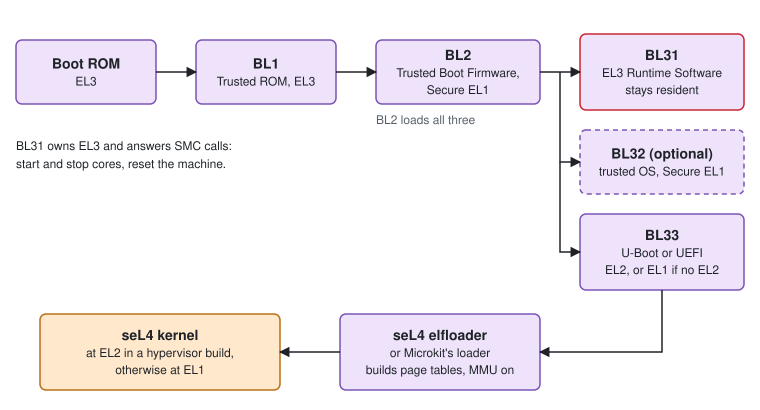

# Arm boot flow

> The chain from reset to a kernel on a 64-bit Arm machine: boot ROM, Trusted Firmware-A (BL1, BL2, BL31), then U-Boot or UEFI, which starts the seL4 elfloader at EL2 or EL1 with the MMU off; the entry conditions each stage leaves decide what the loader and kernel may assume.

[Index](../INDEX.md) › [Part 2: Processor fundamentals](../INDEX.md#part-2-processor-fundamentals) › [AArch64](../INDEX.md#aarch64) · ← [AArch64 paging](aarch64-paging.md) · [PSCI and SMCCC](psci-smccc.md) →

Read first: [AArch64 basics](aarch64-basics.md), [AArch64 exceptions](aarch64-exceptions.md).

| At a glance | |
|---|---|
| Kind | Boot sequence (firmware stages and kernel entry conditions) |
| Architecture | Arm (64-bit) |
| Found through | Machine described by a [device tree](device-tree.md) or [ACPI tables](acpi-tables.md) handed over by the bootloader |
| Key numbers | Entry at EL2 or EL1, MMU off, DTB address in `x0`; Linux `Image` header of 64 bytes, magic `0x644d5241` |
| seL4 code | [`sys_boot.c`](https://github.com/seL4/seL4_tools/blob/master/elfloader-tool/src/arch-arm/sys_boot.c) (elfloader), [`src/arch/arm/64/head.S`](https://github.com/seL4/seL4/blob/master/src/arch/arm/64/head.S) |
| seL4 config | `ElfloaderImage` (`elf`, `binary`, `uimage`, `efi`), `KernelArmHypervisorSupport` |
| seL4 use | Kernel is started by the [elfloader](../sel4/elfloader.md) or Microkit's loader, not by the bootloader |
| On the clouds | Needs the `efi` elfloader image and a built-in device tree; the kernel has no Arm ACPI code |

## What it is

An x86 PC hides its early boot behind the BIOS or UEFI. On Arm the same
work is split into named stages, each handing over to the next at a
defined **exception level** (EL3 firmware, EL2 hypervisor, EL1 kernel,
EL0 user: see [AArch64 basics](aarch64-basics.md)). A kernel developer
needs to know three things about the chain: which firmware stays resident
after boot, what state the processor is in when the kernel's first
instruction runs, and how the description of the machine is passed.

### The stages

Arm's reference firmware is **Trusted Firmware-A** (TF-A), and its stage
names are used even for firmware that is not TF-A.

| Stage | Name | Runs at | Job | Resident? |
|---|---|---|---|---|
| | Boot ROM | EL3 | Mask ROM in the system-on-chip; loads the first stage from flash, SD card or USB | No |
| BL1 | Trusted ROM | EL3 | First TF-A code after reset; sets up exception vectors, loads BL2 (often merged with the boot ROM) | No |
| BL2 | Trusted Boot Firmware | Secure EL1 | Initialises the platform (often including DRAM), loads BL31, BL32 and BL33 | No |
| BL31 | EL3 Runtime Software | EL3 | Initialises the interrupt controller and power controller, then stays to serve `SMC` calls | **Yes** |
| BL32 | Secure-EL1 Payload | Secure EL1 | Optional trusted OS such as OP-TEE | Yes, if present |
| BL33 | Non-trusted Firmware | EL2, or EL1 if there is no EL2 | The ordinary bootloader: U-Boot or UEFI | Usually not (UEFI keeps runtime services) |



*Only BL31 (red outline) is still there once the kernel runs. The last
two boxes are seL4's part of the chain, described under "In seL4" below.*

Two points matter later:

- **BL31 never goes away.** It owns EL3, and an operating system reaches it with
  the `SMC` instruction to start and stop cores and reset the machine
  ([PSCI and SMCCC](psci-smccc.md)). A kernel cannot do these things
  itself on such a platform, because the registers involved belong to
  the secure world.
- **BL33 is entered at the highest non-secure level**, which is EL2 on
  any core that implements it. So a kernel normally starts at EL2 and has
  to decide whether to stay there (as a hypervisor) or drop to EL1.

Not every board follows this exactly. Some vendors use their own
first-stage loaders; U-Boot's SPL (secondary program loader) can take the
place of BL2; the Raspberry Pi boots from its GPU firmware. The shape is
the same: something at EL3 stays, something at EL2 loads the kernel.

### BL33: U-Boot or UEFI

**U-Boot** is the usual bootloader on development boards. It has drivers
for storage and network, a command shell, and commands that load an
image into RAM and jump to it: `bootm` for its own **uImage** format (a
64-byte header giving load address, entry point and checksum, made by
`mkimage`), `booti` for a Linux arm64 `Image`, `bootelf` for an ELF file,
`go` for a raw jump, and `bootefi` for a UEFI application.

**UEFI** ([UEFI](uefi.md)) is the standard on Arm servers and cloud
instances; the implementation is usually EDK2. It loads a PE/COFF
executable (`BOOTAA64.EFI` on a FAT partition), calls its entry point
with a handle and a pointer to the system table, and offers boot services
until the application calls `ExitBootServices`. U-Boot can also act as a
small UEFI implementation.

### How the machine is described

Almost nothing on Arm is discoverable by probing, so the bootloader hands
over a description:

- a **device tree** blob (DTB, see [Device trees](device-tree.md)), on
  boards and under U-Boot; or
- **ACPI tables** ([ACPI tables](acpi-tables.md)), on servers. UEFI
  publishes either or both as entries in its configuration table; the
  device tree entry has GUID `b1b621d5-f19c-41a5-830b-d9152c69aae0`.

Arm cloud instances (EC2 Graviton, Compute Engine's Arm types, Azure) boot
through UEFI and describe themselves with ACPI, not a device tree
([Cloud virtual machines](cloud-vms.md) has what each cloud presents).

### The Linux arm64 boot protocol

There is no Arm equivalent of Multiboot, so the de facto contract between
bootloader and kernel is the one Linux documents, and other kernels and
loaders follow it. On entry to the image:

| Item | Requirement |
|---|---|
| `x0` | Physical address of the DTB (8-byte aligned, at most 2 MiB) |
| `x1` to `x3` | Zero, reserved |
| MMU | Off |
| Data cache | The image's memory cleaned, so that it reads correctly with caches off |
| Interrupts | All of `PSTATE.DAIF` masked |
| Exception level | Non-secure EL2 (recommended) or EL1, the same on every core |
| Timer | `CNTFRQ_EL0` programmed with the counter frequency; `CNTVOFF_EL2` the same on all cores ([Arm generic timer](arm-generic-timer.md)) |
| Secondary cores | Held by firmware, started with PSCI `CPU_ON`, or spinning on a `cpu-release-addr` (the "spin-table" method) |

A Linux `Image` begins with a 64-byte header:

```
u32 code0, code1   executable: a branch to the real start
u64 text_offset    where to load, relative to a 2 MiB boundary
u64 image_size
u64 flags          endianness, page size, placement
u64 res2, res3, res4
u32 magic          0x644d5241, "ARM\x64"
u32 res5           offset of the PE header (for booting as an EFI application)
```

Because the first field is code, a loader that knows nothing of the
header can still jump to offset 0. Because `res5` points to a PE header,
the same file is also a UEFI application. Bootloaders such as U-Boot's
`booti` and hypervisors' direct kernel boot check the magic and refuse
other files, which is the practical reason this header matters to a
non-Linux kernel.

With MMU off, every address is physical and every data access is treated
as uncached device-like memory; the first job of whatever is loaded is
to build page tables and turn translation on
([AArch64 paging](aarch64-paging.md)).

## In seL4

The seL4 kernel is not started by the bootloader directly. Its entry
point (`_start` in
[`src/arch/arm/64/head.S`](https://github.com/seL4/seL4/blob/master/src/arch/arm/64/head.S))
expects to be running at its high virtual link address with translation
already on, at the right exception level, with six arguments in `x0` to
`x5` describing the root task image and the DTB. It contains no code to
change exception level. A separate loader is BL33's payload and prepares
all of this.

### The elfloader

For CMake-based projects (sel4test, CAmkES) the loader is the
**elfloader** from `seL4_tools`, covered in
[Elfloader](../sel4/elfloader.md). In brief it carries the kernel, the
root task and optionally a DTB in an embedded CPIO archive, unpacks them
to their physical addresses, builds boot page tables, starts secondary
cores, turns the MMU on and jumps to the kernel
(`main` and `continue_boot` in
[`sys_boot.c`](https://github.com/seL4/seL4_tools/blob/master/elfloader-tool/src/arch-arm/sys_boot.c)).

The option `ElfloaderImage` picks the outer format to suit the
bootloader:

| `ElfloaderImage` | Output | Started by | DTB from bootloader |
|---|---|---|---|
| `elf` | ELF file | U-Boot `bootelf` | Not used |
| `binary` | Raw `objcopy -O binary` | A raw jump; the entry code moves the image to `IMAGE_START_ADDR` if it was loaded elsewhere (`fixup_image_base`) | Not used |
| `uimage` | Binary wrapped by `mkimage` ([`make-uimage`](https://github.com/seL4/seL4_tools/blob/master/cmake-tool/helpers/make-uimage)) | U-Boot `bootm` | `x0`, accepted if it starts with the DTB magic |
| `efi` | PE/COFF application, position independent, using gnu-efi's start-up code and linker script | UEFI, or U-Boot `bootefi` | Looked up by GUID in the UEFI configuration table (`efi_get_fdt`) |

The `efi` build calls `ExitBootServices`
(`efi_exit_boot_services` in
[`efi_init.c`](https://github.com/seL4/seL4_tools/blob/master/elfloader-tool/src/binaries/efi/efi_init.c))
and then, since UEFI chose the load address, moves itself to just below
the kernel's physical region (`relocate_below_kernel`).

A DTB in the CPIO archive (`kernel.dtb`, from `KernelDTBPath`) takes
precedence; the bootloader's DTB is the fallback (`load_images` in
[`common.c`](https://github.com/seL4/seL4_tools/blob/master/elfloader-tool/src/common.c)).
Either way the kernel only passes the blob on to the root task: its own
knowledge of the platform's devices was compiled in from the device tree
at build time.

### Exception level

`continue_boot` reads `CurrentEL` (`is_hyp_mode`). The outcomes:

| Entered at | Kernel built with `KernelArmHypervisorSupport` | Elfloader does |
|---|---|---|
| EL2 | Yes | Stays at EL2, builds EL2 page tables (`init_hyp_boot_vspace`, `arm_enable_hyp_mmu`) |
| EL2 | No | `leave_hyp`: drops to EL1, then builds EL1 page tables |
| EL1 | No | Builds EL1 page tables (`init_boot_vspace`, `arm_enable_mmu`) |
| EL1 | Yes | Nothing special: it builds EL1 page tables. The kernel cannot run: its entry code (`_start` in `head.S`) begins by reading `sctlr_el2`, and an EL2 register is undefined at EL1 |

`leave_hyp`
([`mmu-hyp.S`](https://github.com/seL4/seL4_tools/blob/master/elfloader-tool/src/arch-arm/armv/armv8-a/64/mmu-hyp.S))
shows the standard way to descend a level: disable the EL2 MMU, set
`HCR_EL2` to just bit 31 (`RW`: EL1 is AArch64) so nothing traps and
stage 2 translation is off, clear `VTTBR_EL2`, write `SPSR_EL2` with "EL1
using `SP_EL1`, interrupts masked", put the return address in `ELR_EL2`
and execute `ERET`. [Arm virtualisation](arm-virtualisation.md) explains
those registers.

Secondary cores are started through PSCI or a spin table before the
kernel runs; see [PSCI and SMCCC](psci-smccc.md) and
[Multiprocessor bring-up](smp-bringup.md).

### Microkit's loader

Microkit does not use the elfloader. Its tool emits one image containing
its own small loader
([`loader/`](https://github.com/seL4/microkit/tree/main/loader)), covered
in [Microkit internals](../sel4/microkit-internals.md). On AArch64,
`ensure_correct_el` in
[`el.c`](https://github.com/seL4/microkit/blob/main/loader/src/aarch64/el.c)
makes the same decision with one more case: entered at EL3 it first
drops to non-secure EL2; a hypervisor kernel must then be at EL2 (else
it stops with an error), and a non-hypervisor kernel is dropped to EL1.
It also zeroes `CNTVOFF_EL2` on the way.

### Cloud instances

The kernel has no ACPI code for Arm (ACPI parsing exists only under
`src/plat/pc99`). An Arm cloud instance therefore needs the `efi`
elfloader image and a device tree written for that instance type and
built into the image, because UEFI there offers no DTB to fall back on.

## Gotchas

- **Entered at EL1 with a hypervisor kernel.** Under a cloud hypervisor a
  guest starts at EL1 unless nested virtualisation is offered, so a
  kernel built with `KernelArmHypervisorSupport` cannot run there. The
  elfloader does not check this combination; Microkit's loader does.
- **`efi_get_fdt` returning nothing is silent.** On an ACPI-only machine
  the `efi` elfloader prints "No DTB passed in from boot loader" and
  carries on with the built-in DTB, or none.
- **The built-in DTB wins.** A bootloader may have patched its DTB (memory
  size, MAC addresses, a `/chosen` node); if the image also carries
  `kernel.dtb`, the root task sees the built-in one.
- **`binary` and `elf` images are linked for one address.** They rely on
  `IMAGE_START_ADDR` being free RAM on that board. Only the `efi` image
  is position independent.
- **Caches.** The protocol says MMU off but lets the bootloader leave
  stale cache contents for memory outside the image. Loaders flush before
  switching translation regimes (`flush_dcache` before `disable_mmu` in
  `leave_hyp`); skipping that gives corruption that depends on the
  bootloader.
- **`CNTVOFF_EL2` is left by whoever ran at EL2.** A kernel at EL1 cannot
  write it, and reads of the virtual counter are offset by it. This is
  why Microkit's loader zeroes it before leaving EL2.
- **A uImage has its load and entry addresses baked into the header.**
  Loading it at another address with `bootm` makes U-Boot copy it to
  the header's load address.

## See also

- [AArch64 basics](aarch64-basics.md): exception levels and registers
- [AArch64 exceptions](aarch64-exceptions.md): `ERET`, `SPSR` and `ELR`, used to change level
- [PSCI and SMCCC](psci-smccc.md): calling the resident EL3 firmware
- [Arm virtualisation](arm-virtualisation.md): what staying at EL2 means
- [Elfloader](../sel4/elfloader.md): the loader in detail
- [Microkit internals](../sel4/microkit-internals.md): Microkit's own loader
- [UEFI](uefi.md): the firmware interface on servers and clouds
- [Device trees](device-tree.md) and [ACPI tables](acpi-tables.md): the two machine descriptions
- [Cloud virtual machines](cloud-vms.md): what cloud Arm instances present
- [x86 boot flow](x86-boot.md): the PC equivalent
- [Multiprocessor bring-up](smp-bringup.md): starting the other cores
- [ELF and linking](elf.md): ELF is the file format of every kernel, loader and user program in an seL4 system
- [QEMU](qemu.md): QEMU emulates whole machines
- [Kernel boot sequence](../sel4/kernel-boot.md): the path from the kernel's entry point to the first user thread

## References

- [Booting AArch64 Linux](https://docs.kernel.org/arch/arm64/booting.html):
  the image header, register and MMU state on entry, exception level,
  timer and secondary core requirements. *Checked 2026-11-14.*
- [TF-A Firmware Design](https://trustedfirmware-a.readthedocs.io/en/latest/design/firmware-design.html):
  BL1, BL2, BL31, BL32, BL33, the level each runs at and that BL33 is
  entered at the highest available non-secure level. *Checked 2026-11-14.*
- [seL4_tools `elfloader-tool/CMakeLists.txt`](https://github.com/seL4/seL4_tools/blob/master/elfloader-tool/CMakeLists.txt):
  `ElfloaderImage` choices and the EFI build flags. *Checked 2026-11-14.*
- [seL4_tools `elfloader-tool/src/arch-arm/sys_boot.c`](https://github.com/seL4/seL4_tools/blob/master/elfloader-tool/src/arch-arm/sys_boot.c):
  `main`, `relocate_below_kernel`, `continue_boot` and the kernel's
  six arguments. *Checked 2026-11-14.*
- [seL4_tools `elfloader-tool/src/arch-arm/64/crt0.S`](https://github.com/seL4/seL4_tools/blob/master/elfloader-tool/src/arch-arm/64/crt0.S):
  AArch64 entry and `fixup_image_base` for binary images.
  *Checked 2026-11-14.*
- [seL4_tools `elfloader-tool/src/arch-arm/armv/armv8-a/64/mmu-hyp.S`](https://github.com/seL4/seL4_tools/blob/master/elfloader-tool/src/arch-arm/armv/armv8-a/64/mmu-hyp.S):
  `leave_hyp` and `arm_enable_hyp_mmu`. *Checked 2026-11-14.*
- [seL4_tools `elfloader-tool/src/binaries/efi/efi_init.c`](https://github.com/seL4/seL4_tools/blob/master/elfloader-tool/src/binaries/efi/efi_init.c):
  `efi_main`, `efi_get_fdt` (the GUID) and `efi_exit_boot_services`.
  *Checked 2026-11-14.*
- [seL4 `src/arch/arm/64/head.S`](https://github.com/seL4/seL4/blob/master/src/arch/arm/64/head.S):
  the kernel's entry point and what it assumes. *Checked 2026-11-14.*
- [Microkit `loader/src/aarch64/el.c`](https://github.com/seL4/microkit/blob/main/loader/src/aarch64/el.c):
  `ensure_correct_el`. *Checked 2026-11-14.*
- U-Boot documentation, the [`bootm`](https://docs.u-boot.org/en/latest/usage/cmd/bootm.html),
  [`booti`](https://docs.u-boot.org/en/latest/usage/cmd/booti.html),
  [`bootelf`](https://docs.u-boot.org/en/latest/usage/cmd/bootelf.html) and
  [`bootefi`](https://docs.u-boot.org/en/latest/usage/cmd/bootefi.html)
  command pages; `bootm`'s "Legacy boot" section for the uImage format.
  *Checked 2026-11-14.*
- U-Boot source: [`include/image.h`](https://github.com/u-boot/u-boot/blob/master/include/image.h)
  (`struct legacy_img_hdr`, the 64-byte uImage header),
  [`boot/image.c`](https://github.com/u-boot/u-boot/blob/master/boot/image.c)
  (`image_decomp` moves an uncompressed image to its load address) and
  [`cmd/boot.c`](https://github.com/u-boot/u-boot/blob/master/cmd/boot.c)
  (the `go` command); [`doc/mkimage.1`](https://github.com/u-boot/u-boot/blob/master/doc/mkimage.1)
  for `mkimage` and the legacy image. *Checked 2026-11-14.*
- [Arm Architecture Reference Manual for A-profile, DDI 0487](https://developer.arm.com/documentation/ddi0487/latest),
  the accessibility pseudocode in the description of `SCTLR_EL2`: a read
  at EL1 is undefined unless nested virtualisation traps it to EL2.
  *Checked 2026-11-14, issue M.d, read from a
  [mirror copy](https://kib.kiev.ua/x86docs/ARM/ARMARMv8/DDI0487M_d_a-profile_architecture_reference_manual.pdf)
  because developer.arm.com refuses scripted fetches.*

## My notes

<!-- Tim writes here. Sessions leave this section as it is. -->
