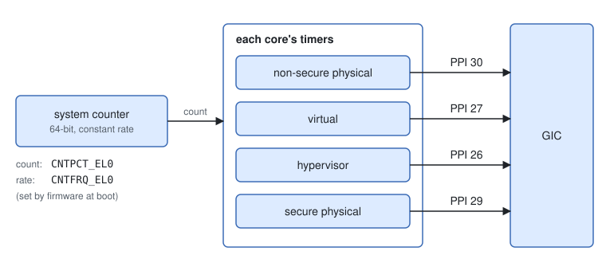

# Arm generic timer

> The architectural timer of every Armv8 core: a system counter whose rate is in `CNTFRQ_EL0`, and per-core comparators that raise PPIs; its rate varies by machine, which seL4 platforms have fixed at build time.

[Index](../INDEX.md) › [Part 3: Platform and devices](../INDEX.md#part-3-platform-and-devices) › [Timers](../INDEX.md#timers) · ← [HPET](hpet.md) · [ISA](isa.md) →

| At a glance | |
|---|---|
| Kind | Architectural timer: one system counter and per-core timers |
| Architecture | Armv8 |
| Reached through | `CNTPCT_EL0` or `CNTVCT_EL0` for the count, `CNTFRQ_EL0` for the rate |
| Interrupt | PPIs at the [GIC](gicv3-its.md), usually 30 (non-secure physical), 27 (virtual), 26 (hypervisor) and 29 (secure physical) |
| Key numbers | 64-bit count at a constant rate shared by all cores |
| seL4 config | `TIMER_FREQUENCY`, set in each platform's `config.cmake` |
| seL4 use | The kernel's Arm timer driver; the rate is fixed at build time |
| On the clouds | Compute Engine's C4A and N4A run at 1000 MHz, T2A at 25 MHz |

## What it is

Armv8 defines one **system counter**, a 64-bit count rising at a constant
rate shared by all cores, and per-core **timers** that compare against it
and raise an interrupt. Software reads the count from `CNTPCT_EL0` (or
`CNTVCT_EL0`, minus a hypervisor's offset) and the rate from
`CNTFRQ_EL0`, which firmware sets at boot.

Each core has several timers (physical, virtual, hypervisor, secure),
each a private peripheral interrupt (PPI) at the [GIC](gicv3-its.md). The
usual PPIs are 30 (non-secure physical), 27 (virtual), 26 (hypervisor) and
29 (secure physical).

*One counter for the whole machine, a set of timers per core, and one PPI
per timer.*

Unlike x86, no calibration is needed: `CNTFRQ_EL0` gives the rate. From
Armv8.6 the rate is fixed at 1 GHz; older cores use whatever
the system designer chose.

## In seL4

The kernel's Arm timer driver uses the generic timer. Each platform's
`config.cmake` sets `TIMER_FREQUENCY` at build time, and a debug build of
the kernel warns at boot if a non-zero `CNTFRQ_EL0` disagrees
(`Warning:  gpt_cntfrq ... expected ...`, printed by `initGenericTimer` in
[`src/drivers/timer/generic_timer.c`](https://github.com/seL4/seL4/blob/master/src/drivers/timer/generic_timer.c)).
User-level code
generally reads `CNTFRQ_EL0` itself.

## Gotchas

- **The rate varies between machines of one cloud.** Compute Engine's
  C4A and N4A (Axion) run at 1000 MHz, T2A (Ampere Altra) at 25 MHz.
  `qemu-arm-virt` assumes 62.5 MHz, so a kernel built for it ticks 16
  times too fast on C4A and 2.5 times too slow on T2A.
- **Only some tests notice.** User level reads `CNTFRQ_EL0` and is right,
  so only tests comparing the kernel's idea of time with user level's
  fail (sel4test's SCHED0021).
- Linux's reported rate is rounded; read `CNTFRQ_EL0` for the exact
  value.

## See also

- [Timers: a map](timers.md): every timer on each architecture in one diagram, and how this one fits in
- [GICv3 and the ITS](gicv3-its.md): where the timer's PPIs go
- [Timer calibration](timer-calibration.md): what x86 has to do instead
- [AArch64 basics](aarch64-basics.md): the 64-bit Arm execution state
- [Arm virtualisation (EL2)](arm-virtualisation.md): what exception level 2 adds to an Arm core so that a hypervisor can run guests
- [GICv2](gicv2.md): arm's older standard interrupt controller, with at most eight cores and every register memory-mapped

## References

- [Arm, "Learn the architecture: Generic Timer"](https://developer.arm.com/documentation/102379/latest/):
  the counter, the timers and their registers; chapter 3 for the 1 GHz
  rate from Armv8.6, section 4.5 for the PPI numbers.
  *Checked 2026-11-14, version 1.3, read as the
  [PDF](https://documentation-service.arm.com/static/65fac6957bcc0c1c661b36c0)
  because developer.arm.com refuses scripted fetches.*
- [Arm Architecture Reference Manual for A-profile (DDI 0487)](https://developer.arm.com/documentation/ddi0487/latest),
  chapter D12 "The Generic Timer in AArch64 state"; D12.1.2 "The system
  counter" for the fixed 1 GHz rate. *Checked 2026-11-14, issue M.d,
  read from a [mirror copy](https://kib.kiev.ua/x86docs/ARM/ARMARMv8/DDI0487M_d_a-profile_architecture_reference_manual.pdf)
  for the same reason.*
- [seL4 `src/drivers/timer/generic_timer.c`](https://github.com/seL4/seL4/blob/master/src/drivers/timer/generic_timer.c):
  `initGenericTimer` and its `CNTFRQ` warning, under
  `CONFIG_DEBUG_BUILD`. *Checked 2026-11-14.*
- [seL4 `src/plat/qemu-arm-virt/config.cmake`](https://github.com/seL4/seL4/blob/master/src/plat/qemu-arm-virt/config.cmake):
  `TIMER_FREQUENCY 62500000`. *Checked 2026-11-14.*
