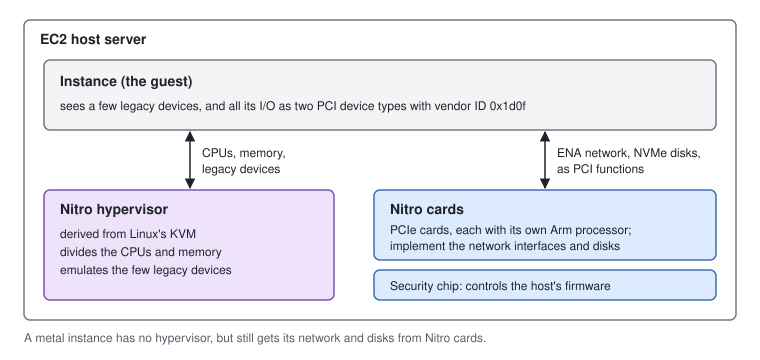

# Amazon EC2 and the Nitro system

> How EC2 runs a guest: the Nitro hypervisor and cards, AMIs and boot modes, EBS, the serial console and other ways to see a kernel boot, and the hardware (PCI devices, interrupt controllers, timers) a guest kernel finds.

[Index](../INDEX.md) › [Part 3: Platform and devices](../INDEX.md#part-3-platform-and-devices) › [Cloud platforms](../INDEX.md#cloud-platforms) · ← [Cloud virtual machines](cloud-vms.md) · [EC2 instance types](ec2-instance-types.md) →

Read first: [Cloud virtual machines](cloud-vms.md), [PCI](pci.md), [ACPI tables](acpi-tables.md).

| At a glance | |
|---|---|
| Kind | Cloud platform: virtual machines, and whole servers on `metal` types |
| Architecture | `x86_64` and `arm64` (Graviton) |
| Hypervisor | Nitro (derived from KVM) since about 2017; Xen on older types; none on `metal` |
| Firmware | BIOS or [UEFI](uefi.md) on x86, by boot mode; UEFI only on Graviton; ACPI on both |
| Devices | [ENA](ena.md) and [NVMe](nvme.md), PCI vendor `0x1d0f`; no [virtio](virtio.md) |
| Console | Serial port only: 16550A at I/O port `0x3f8` on virtual x86, a memory-mapped PCI 16550 on Graviton and metal |
| seL4 use | `pc99` runs on virtual x86 Nitro types; no upstream Arm platform or ENA driver |

## What it is

Amazon EC2 (Elastic Compute Cloud) rents machines by the second. An
**instance** is one running machine; its **instance type**
(`t3.micro`, `m7g.large`: see [EC2 instance types](ec2-instance-types.md))
fixes the CPU, memory and devices. Almost all are virtual machines; types
whose size is `metal` hand over the whole server.

### Nitro and Xen

Instance types from before about 2017 (`t2`, `m4`, `c4`) run on the
**Xen** hypervisor, with Xen's paravirtual disk and network devices.
Everything since runs on the **Nitro system**, which has three parts
(unchecked: this paragraph summarises AWS's description, the first
reference):

- **Nitro cards**: PCIe cards in the host, each with its own Arm
  processor, that implement the instance's network interfaces and disks
  in hardware and present them to the guest as PCI functions.
- The **Nitro hypervisor**: a small hypervisor derived from Linux's KVM.
  It divides the CPUs and memory and emulates the few legacy devices a PC
  needs, and little else, because the I/O is on the cards.
- A security chip that controls the host's firmware.

Linux identifies it as KVM, and it offers KVM's paravirtual interfaces
(observed on t3, c5, c7i, m6a, 2026). A `metal` instance has no hypervisor
at all, but still gets its network and disks from Nitro cards, so the
same two device drivers serve both.

*The hypervisor is small because the I/O is on the cards; a `metal`
instance loses the hypervisor and keeps the cards.*

### What a Nitro guest sees

All Nitro I/O is through two PCI device types, both with vendor ID
`0x1d0f` (Amazon):

| Device | PCI ID | Class | Page |
|---|---|---|---|
| Network: Elastic Network Adapter | `1d0f:ec20` (others exist) | `02/00/00` | [ENA](ena.md) |
| Disks: EBS volumes and instance store | `1d0f:8061` for EBS | `01/08/02` | [NVMe](nvme.md) |

There is no [virtio](virtio.md) device anywhere. Each EBS volume
(Elastic Block Store: a network disk that outlives the instance) is its
own NVMe controller; so is each **instance store** disk (a local SSD on
the `d` types, erased when the instance stops).

The rest of the machine, as booted instances showed it (observed 2026,
on the types named):

| | x86 virtual (t3, t3a, c5, c7i, m6a, m7a, m8i) | Graviton virtual (t4g, c7g, c8g) |
|---|---|---|
| Shape | i440FX-style PC: host bridge `8086:1237`, PIIX ISA bridge; 7th generation and later add PCIe bridges and an `MCFG` table | Arm "virt"-like board; PCI through ECAM at `0x20000000` |
| Firmware | SeaBIOS-style BIOS or EDK II UEFI 2.7, by boot mode | EDK II UEFI 2.7 only |
| Description | ACPI: `APIC` (MADT), `FACP`, `DSDT`, `HPET`, `SRAT`, `SLIT`, `WAET` | ACPI only, no device tree: `APIC`, `GTDT`, `IORT`, `MCFG`, `PPTT`, `SPCR` |
| Interrupts | one [I/O APIC](apic.md) with 24 pins at `0xfec00000`; local APICs left in xAPIC mode, x2APIC available | [GICv3 with one ITS](gicv3-its.md), 96 SPIs |
| Serial console | 16550A [UART](uart.md) at I/O port `0x3f8` (COM1), IRQ 4 | 16550 with memory-mapped registers, a PCI device `1d0f:8250`; address in `SPCR` (`0x090a0000` on Graviton2 and 3) |
| Timers | [PIT](pit.md), 32-bit [HPET](hpet.md), [local APIC timer](lapic-timer.md), invariant [TSC](tsc.md), ACPI PM timer, kvm-clock | [Arm generic timer](arm-generic-timer.md) only |
| CPU start | [Multiboot](x86-boot.md) or UEFI hands over in protected or long mode | EL1; no EL2; [PSCI](psci-smccc.md) by `hvc` |
| IOMMU | none | none usable (`IORT` maps PCI to the ITS) |

The hypervisor signature in CPUID leaf `0x40000000` is KVM's, and leaf
`0x40000010` gives the TSC and APIC timer frequencies (see
[Hypervisor CPUID leaves](hypervisor-cpuid-leaves.md)). The Intel types
have TSC-deadline mode in the local APIC timer; the AMD types do not
(observed on t3a, m6a, m7a, 2026).

`metal` types are different machines: real server firmware, far more
ACPI tables, several I/O APICs, an IOMMU, and the serial port moved (see
Gotchas and [EC2 instance types](ec2-instance-types.md)).

### Images, disks and boot modes

An instance boots from an **AMI** (Amazon Machine Image): a registration
record that points at one or more EBS **snapshots** (stored disk images)
and carries attributes, of which a porter needs three: the architecture
(`x86_64` or `arm64`), ENA support (must be declared for Nitro types;
unchecked), and the **boot mode**. At launch each snapshot becomes a new
EBS **volume** attached to the instance. Building one is covered in
[Cloud boot images](cloud-boot-images.md).

The boot mode chooses the firmware. An AMI says `legacy-bios`, `uefi` or
`uefi-preferred` (UEFI where the instance type has it, otherwise BIOS);
with none, the instance type's default applies: BIOS for Intel and AMD,
[UEFI](uefi.md) for Graviton, which has nothing else. Each instance type
lists the modes it supports. The virtual x86 Nitro types tried offer
both; Xen types and the x86 metal types tried offer `legacy-bios` only
(observed on t2.micro, c5n.metal, c7i.metal-24xl, 2026).

AMIs, snapshots and volumes belong to one **region** (`eu-west-2`); an
instance and its volumes live in one **availability zone** within it
(`eu-west-2a`). Instance types are not all offered in every region or
zone, and prices differ.

### Seeing a kernel boot

There is no screen. Everything a kernel prints must go to the serial
port, and there are three ways to read it:

- **Console output** (`aws ec2 get-console-output`): a buffer of what
  the serial port printed, posted shortly after state changes (start,
  stop, reboot), not continuously. On Nitro types `--latest` asks for
  the current contents. It keeps only the most recent 64 KiB, which a
  debug kernel running a test suite exceeds (observed 2026).
- **EC2 Serial Console**: an interactive connection to the same port,
  from the web console or by SSH through EC2 Instance Connect. It works
  on every virtual Nitro type and most metal types (not `a1.metal`,
  `g5g.metal`, the Mac and `u-*tb1` types), and not on Xen according to
  the documentation. It must be enabled once per account and region,
  and it can only be attached once the instance is `running`, so the
  first seconds of output are missed (observed: the loader and kernel
  banner are gone by the time it attaches).
- **Screenshot** (`get-console-screenshot`): a JPEG of the VGA display.
  Useful only for a kernel that writes to VGA text mode; not available
  on Graviton or metal.

A reliable capture uses both of the first two: attach the serial console
as early as possible for the live stream, and fetch the console output
afterwards for the start.

### Instance metadata

The instance metadata service (IMDS) is an HTTP server at the link-local
address `169.254.169.254`, reachable only from the instance, that
returns its ID, addresses, user data and credentials. Version 2 requires
a session token obtained with a `PUT` first (unchecked: from memory). A
kernel port does not need it: the MAC address is in the ENA device and
the IP address comes from DHCP. It matters only once a system wants its
user data or AWS credentials.

## In seL4

Upstream has no EC2 platform. What exists, and what each side lacks:

- **x86**: the kernel's `pc99` platform already runs on virtual Nitro
  types. It boots by Multiboot only (no UEFI entry point), so a UEFI
  instance needs GRUB in between. It parses the MADT for the I/O APIC
  ([`src/plat/pc99/machine/acpi.c`](https://github.com/seL4/seL4/blob/master/src/plat/pc99/machine/acpi.c)),
  prints through an I/O-port UART only, and measures the TSC and APIC
  timer against the PIT ([Timer calibration](timer-calibration.md)).
  `KernelLAPICMode` and `KernelMaxNumIOAPIC` in
  [`src/arch/x86/config.cmake`](https://github.com/seL4/seL4/blob/master/src/arch/x86/config.cmake)
  matter on metal.
- **Arm**: the kernel takes its memory map and device addresses from a
  [device tree](device-tree.md) at build time, and Graviton firmware
  offers only ACPI, so a platform needs a hand-written device tree and
  cannot adapt at boot. See [Porting to a platform](../sel4/platform-port.md).
  The kernel drives the GICv3 but not the ITS, so there are no MSIs on
  Arm upstream.
- **Drivers**: [sDDF](../sel4/sddf.md) upstream has no ENA driver
  (`drivers/network/` holds virtio and four SoC Ethernet drivers). It
  does have an NVMe driver, `drivers/blk/nvme/`, developed against QEMU.
  Without a network driver an seL4 system on EC2 has a serial port and a
  disk.
- **Console**: on x86 under BIOS the kernel finds COM1 through the BIOS
  data area; under UEFI that area is empty and the port must be given on
  the kernel command line (`console_port=0x3f8 debug_port=0x3f8`).

## Gotchas

- **The PIT is on I/O APIC pin 0.** The MADT of the virtual x86 types
  has interrupt source overrides for IRQs 5, 9, 10 and 11 and none for
  IRQ 0, where most PCs and QEMU redirect IRQ 0 to pin 2 (observed on
  all seven Nitro types tried, 2026). Code that assumes pin 2 gets no
  timer interrupts. `c5n.metal` does have the override to pin 2.
- **The HPET is 32 bits wide**, at 62.5 MHz: see [HPET](hpet.md).
- **BARs move with the boot mode.** The ENA's BAR 0 was at `0xfebf4000`
  under BIOS and `0x80400000` once Linux had booted under UEFI (observed
  on t3.micro, 2026). A system description with fixed device addresses
  must match the firmware actually used, or the driver must read the BAR.
- **Graviton's UART is a 16550, not a PL011**, and it is a PCI device
  whose BAR the firmware has programmed. If it goes quiet, check that
  memory decoding is still enabled in its PCI command register.
- **Graviton layouts differ by generation.** Two layouts covered the
  four virtual generations tried (Graviton2 and 3 share one, 4 and 5 the
  other), and no two metal generations matched (observed 2026). The
  timer frequency differs too: 121.87 MHz on Graviton2, 1050 MHz on 3,
  1000 MHz on 4; read `CNTFRQ_EL0`.
- **Metal has no COM1.** On x86 metal the console is a 16550 behind
  BAR 0 of PCI device `1d0f:8250`, memory-mapped at an address that
  differs by type (`0xe0c00000` on c5n.metal, `0xa1f00000` on
  c7i.metal-24xl) and named in the `SPCR` table. The serial console
  attaches only minutes into a metal boot and `get-console-output`
  returned nothing (observed 2026).
- **Xen types** returned nothing from `get-console-output` while
  running, though the serial console did connect to a t2.micro
  (observed 2026, contrary to the documented support list).
- **CPUID leaves `0x15` and `0x16` are zero** on the virtual types
  tried, so the TSC frequency comes from leaf `0x40000010` or from
  measurement.

## See also

- [Cloud virtual machines](cloud-vms.md): what the clouds have in common
- [EC2 instance types](ec2-instance-types.md): which machine a name means
- [Compute Engine](gce.md): the same questions answered for Google
- [Cloud boot images](cloud-boot-images.md): making an AMI that boots
- [ENA](ena.md) and [NVMe](nvme.md): the two devices
- [UART](uart.md): the 16550 behind every console here

## References

- [AWS Nitro System](https://aws.amazon.com/ec2/nitro/): AWS's overview
  of the cards, hypervisor and security chip. *Unchecked: not opened
  today.*
- [EC2 User Guide, "Instance launch behavior with Amazon EC2 boot modes"](https://docs.aws.amazon.com/AWSEC2/latest/UserGuide/ami-boot.html):
  the three AMI boot mode values and the defaults per processor.
  *Checked 2026-11-14.*
- [EC2 User Guide, "Prerequisites for the EC2 Serial Console"](https://docs.aws.amazon.com/AWSEC2/latest/UserGuide/ec2-serial-console-prerequisites.html),
  "Instance types" and "Instance state": which types support it.
  *Checked 2026-11-14.*
- [EC2 User Guide, "Troubleshoot an unreachable Amazon EC2 instance"](https://docs.aws.amazon.com/AWSEC2/latest/UserGuide/troubleshoot-unreachable-instance.html),
  "Instance console output" and "Capture a screenshot": when the output
  is posted, and the screenshot's limits. *Checked 2026-11-14.*
- [EBS User Guide, "Amazon EBS volumes and NVMe"](https://docs.aws.amazon.com/ebs/latest/userguide/nvme-ebs-volumes.html):
  EBS volumes are NVMe devices on Nitro. *Checked 2026-11-14.*
- [Linux `ena_pci_id_tbl.h`](https://github.com/torvalds/linux/blob/master/drivers/net/ethernet/amazon/ena/ena_pci_id_tbl.h):
  the ENA's PCI IDs. *Checked 2026-11-14.*
- [sDDF `drivers/`](https://github.com/au-ts/sddf/tree/main/drivers):
  which drivers exist upstream. *Checked 2026-11-14.*
- [seL4 `src/plat/pc99/machine/acpi.c`](https://github.com/seL4/seL4/blob/master/src/plat/pc99/machine/acpi.c):
  the kernel's ACPI parsing on x86. *Checked 2026-11-14.*
- [AWS CLI reference, `get-console-output`](https://docs.aws.amazon.com/cli/latest/reference/ec2/get-console-output.html):
  the `--latest` option and the size limit. *Unchecked: not opened
  today; the 64 KiB limit is as observed.*

## My notes

<!-- Tim writes here. Sessions leave this section as it is. -->
