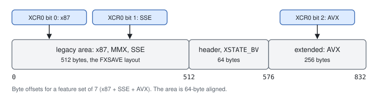

# FPU and SIMD state

> The floating-point and vector registers are extra per-thread state, hundreds to thousands of bytes, that a kernel must save and restore; how and when it does so (lazily by trap, or eagerly) is a performance and security choice, and on x86 the save format and size are build options seL4 checks at boot.

[Index](../INDEX.md) › [Part 2: Processor fundamentals](../INDEX.md#part-2-processor-fundamentals) › [Common ideas](../INDEX.md#common-ideas) · ← [Virtual memory](virtual-memory.md) · [Multiprocessor bring-up and IPIs](smp-bringup.md) →

Read first: [x86-64 basics](x86-64-basics.md), [CPUID and MSRs](cpuid-and-msrs.md).

| At a glance | |
|---|---|
| Kind | Per-thread register state: floating-point and vector registers |
| Architecture | x86, AArch64, RISC-V |
| Reached through | x86: `FXSAVE` or the `XSAVE` family, with `XCR0` set by `XSETBV` |
| Found through | [CPUID](cpuid-and-msrs.md) leaf `0x0D`; leaf 1 `ECX` bit 26 |
| Key numbers | x86: 512 bytes for x87 and SSE, 832 with AVX |
| seL4 code | [`include/machine/fpu.h`](https://github.com/seL4/seL4/blob/master/include/machine/fpu.h), [`src/machine/fpu.c`](https://github.com/seL4/seL4/blob/master/src/machine/fpu.c), [`src/arch/x86/machine/fpu.c`](https://github.com/seL4/seL4/blob/master/src/arch/x86/machine/fpu.c) |
| seL4 config | `KernelFPU`, `KernelXSave`, `KernelXSaveFeatureSet`, `KernelXSaveSize` |
| seL4 use | Eager switch at kernel exit; `seL4_TCBFlag_fpuDisabled` opts a thread out |

## What it is

A thread's general-purpose registers are a couple of hundred bytes and a
kernel saves them on every entry. The floating-point unit (FPU) and SIMD
(single instruction, multiple data: vector) registers are much bigger,
the kernel itself normally never uses them, and many threads never touch
them. So they are handled separately.

| Architecture | Registers | Bytes |
|---|---|---|
| x86, x87 + SSE | 8 × 80-bit x87 (aliased as MMX), 16 × 128-bit `XMM`, `MXCSR` control | 512 (FXSAVE area) |
| x86, + AVX | upper halves making 16 × 256-bit `YMM` | 512 + 64 header + 256 = 832 |
| x86, + AVX-512 | 32 × 512-bit `ZMM`, 8 mask registers `k0`–`k7` | 64 + 512 + 1024 = 1600 more, at offsets CPUID reports |
| AArch64 | 32 × 128-bit `V0`–`V31`, `FPSR`, `FPCR` | 520 |
| AArch64 SVE | vectors up to 2048 bits | up to 8 KiB for 32 vectors |
| RISC-V F/D | 32 × 64-bit `f0`–`f31`, `fcsr` | 264 |

(The x86 sizes follow from the XSAVE layout below, and seL4's x86
defaults agree with the first two rows. The AArch64 and RISC-V figures
are the sizes of seL4's `user_fpu_state_t`, the RISC-V one with four
bytes of padding.)

### Lazy and eager switching

**Lazy**: on a context switch the kernel leaves the old thread's FPU
contents in the registers and *disables* the FPU. If the new thread
executes an FPU instruction it traps; the kernel then saves the
registers to their owner's save area, loads the new thread's, enables
the FPU and resumes. Threads that never use the FPU never pay.

**Eager**: on every switch to a different thread the kernel saves and
restores at once, with no trap.

Each architecture has the disable switch lazy switching needs:

| Architecture | Disable control | Trap on use |
|---|---|---|
| x86 | `CR0.TS` ("task switched") set | `#NM`, device not available, vector 7 |
| AArch64 | `CPACR_EL1.FPEN` = 0 (and `CPTR_EL2.TFP` from a hypervisor) | synchronous exception, class `0x07` |
| RISC-V | `sstatus.FS` = 0 (Off) | illegal instruction exception |

RISC-V's `FS` field also tracks state: Initial, Clean and Dirty, so a
kernel can skip saving registers that were not written.

### x86 save formats

x86 has accumulated several instructions for the job:

| Instruction | Saves | Notes |
|---|---|---|
| `FXSAVE` / `FXRSTOR` | x87, MMX, SSE | fixed 512-byte area, 16-byte aligned; without `CR4.OSFXSR` it may not save the SSE registers |
| `XSAVE` / `XRSTOR` | any components named in a mask | 512-byte legacy area, 64-byte header with the `XSTATE_BV` bitmap, then extended components; 64-byte aligned; needs `CR4.OSXSAVE` |
| `XSAVEOPT` | as `XSAVE` | skips components unchanged since the last restore |
| `XSAVEC` | as `XSAVE` | compacted layout: only enabled components, packed |
| `XSAVES` / `XRSTORS` | also supervisor components | compacted, ring 0 only |

Which components exist and are enabled is the 64-bit register **XCR0**
(extended control register 0), written with `XSETBV`: bit 0 x87, bit 1
SSE, bit 2 AVX, bits 5 to 7 AVX-512. A component from AVX up that is
not enabled in XCR0 cannot be used by any code: AVX instructions fault with `#UD`. So the
kernel's choice of XCR0 decides what user programs may use.
[CPUID](cpuid-and-msrs.md) leaf `0x0D` describes all this: sub-leaf 0
gives the supported XCR0 bits in `EDX:EAX` and the area size for the
currently enabled set in `EBX`; sub-leaf 1 `EAX` has bits for `XSAVEOPT`
(0), `XSAVEC` (1) and `XSAVES` (3). Leaf 1 `ECX` bit 26 says XSAVE
exists.

*The standard (not compacted) layout for x87, SSE and AVX. Each XCR0 bit enables one component, and the total is the size `KernelXSaveSize` must cover.*

### LazyFP

In 2018 lazy switching on Intel CPUs turned out to leak
(CVE-2018-3665, "LazyFP"): with `CR0.TS` set, an FPU instruction still
executes *speculatively* on the previous thread's register contents
before the `#NM` is taken, and a cache side channel recovers them.
Those registers hold AES keys among other things. The fix is eager
switching. Linux already switched eagerly by default, because almost
every process touches these registers sooner or later (SIMD is used
even to copy memory), so laziness only bought an `#NM` trap.

## In seL4

`KernelHaveFPU` (`CONFIG_HAVE_FPU`) is set by the architecture and
platform, not chosen by hand: it is on for x86 and for Arm and RISC-V
builds whose CPU and options include floating point.

**Where the state lives.** In the TCB (thread control block), inside the
register context: `user_context_t` has a `user_fpu_state_t fpuState`
member (x86:
[`include/arch/x86/arch/machine/registerset.h`](https://github.com/seL4/seL4/blob/master/include/arch/x86/arch/machine/registerset.h);
AArch64: `include/arch/arm/arch/64/mode/machine/registerset.h`). Its
size is therefore part of the TCB object's size.

**Switching: eager, at kernel exit.** Current upstream has no FPU trap
handler. The generic code is small:

- [`include/machine/fpu.h`](https://github.com/seL4/seL4/blob/master/include/machine/fpu.h)
  `lazyFPURestore(thread)` runs on the way out of the kernel to
  `thread`. Despite the historical name it is eager: if the thread has
  the flag `seL4_TCBFlag_fpuDisabled`, call `disableFpu()`; else if it
  already owns this core's FPU (`nativeThreadUsingFPU`, comparing with
  the per-core `ksCurFPUOwner`), `enableFpu()`; else
  `switchLocalFpuOwner(thread)`.
- [`src/machine/fpu.c`](https://github.com/seL4/seL4/blob/master/src/machine/fpu.c)
  `switchLocalFpuOwner(new_owner)` enables the FPU, `saveFpuState`s the
  current owner if any, `loadFpuState`s the new one (or disables the FPU
  if `new_owner` is NULL), and updates `ksCurFPUOwner`.
  `switchFpuOwner(new_owner, cpu)` does that on another core through the
  `IpiRemoteCall_switchFpuOwner` remote call (see
  [SMP bring-up](smp-bringup.md)); `fpuRelease(thread)` uses it so that a
  deleted or migrating thread stops owning a core's FPU.

The "ownership" that survives from the lazy design is thus only an
optimisation: a thread that owns the FPU and is switched back to after
threads that have the FPU disabled does not need a reload.

**Threads without FPU.** `seL4_TCB_SetFlags(tcb, clear, set)` with
`seL4_TCBFlag_fpuDisabled`
([`libsel4/include/sel4/constants.h`](https://github.com/seL4/seL4/blob/master/libsel4/include/sel4/constants.h))
marks a thread as not using the FPU. The kernel then never saves or
loads FPU state for it and runs it with the FPU disabled, so an FPU
instruction in it traps and is reported as a fault to its fault handler
(see [faults](../sel4/faults.md)): each architecture's trap code passes
it to `handleUserLevelFault`, which raises a user exception fault,
numbered 7 on x86, the `#NM` vector. This is the way to keep switches
between, say, small driver threads cheap.

**x86 options**
([`src/arch/x86/config.cmake`](https://github.com/seL4/seL4/blob/master/src/arch/x86/config.cmake)):

| Option | Values | Meaning |
|---|---|---|
| `KernelFPU` | `XSAVE`, `FXSAVE` | save format (`CONFIG_XSAVE` or `CONFIG_FXSAVE`) |
| `KernelXSave` | `XSAVE`, `XSAVES`, `XSAVEOPT`, `XSAVEC` | which instruction to use with the XSAVE format |
| `KernelXSaveFeatureSet` | number, default 3 | the value written to XCR0: 3 = x87 + SSE, 7 adds AVX |
| `KernelXSaveSize` | bytes | size of the save area in the TCB; must be at least what CPUID reports for the feature set |

**x86 boot check.** `Arch_initFpu` in
[`src/arch/x86/machine/fpu.c`](https://github.com/seL4/seL4/blob/master/src/arch/x86/machine/fpu.c)
runs on each core. It sets `CR4.OSFXSR`, clears `CR0.EM`, sets `CR0.MP`
and `CR0.NE`, and runs `finit`. With `CONFIG_XSAVE` it then refuses to
boot, returning false with a message, if:

- CPUID leaf 1 `ECX` bit 26 is clear ("XSAVE not supported");
- the CPU's supported XCR0 bits (leaf `0x0D` sub-leaf 0) do not include
  all of `CONFIG_XSAVE_FEATURE_SET` ("Requested feature mask is …");
- after `write_xcr0`, leaf `0x0D` `EBX` exceeds `CONFIG_XSAVE_SIZE`
  ("XSAVE buffer set set to …, but needs to be at least …"); a buffer
  that is larger than needed only warns;
- the chosen `XSAVEOPT`, `XSAVEC` or `XSAVES` instruction is not
  advertised in sub-leaf 1.

`Arch_initFpuContext` gives a new thread a copy of `x86KSnullFpuState`,
a clean state captured at boot. With [VT-x](x86-virtualisation.md),
`vcpu_fpu_to_guest` and `vcpu_fpu_to_host` treat a guest as another FPU
owner.

## Gotchas

- The kernel is built for one feature set. A binary configured for AVX
  (`KernelXSaveFeatureSet` 7) will not boot on a CPU or VM without AVX,
  and one configured for the default 3 boots anywhere but user code
  using AVX takes `#UD`, since XCR0 does not enable it. Cloud instance
  families differ in AVX-512 support; choose per target.
- Raising the feature set without raising `KernelXSaveSize` fails at
  boot, not at build. The required size is CPUID leaf `0x0D` `EBX` on
  the target with that XCR0.
- `KernelXSaveSize` changes the TCB size, hence
  `seL4_TCBBits` and any user-level code that hard-codes object sizes.
- Older seL4 releases switched lazily, with a `#NM` handler
  (`handleFPUFault`) and a count of switches before the FPU was taken
  away; documentation and papers describing that are out of date for
  current upstream. The name `lazyFPURestore` is a leftover.
- A thread with `seL4_TCBFlag_fpuDisabled` must really not use the FPU,
  and on x86-64 compilers emit SSE for plain `memcpy` and struct copies
  unless told `-mgeneral-regs-only` or similar.
- The verified configurations' treatment of FPU state is its own topic:
  check the dossier and [proof impact](../sel4/proof-impact.md) before
  touching this code.

## See also

- [Threads](../sel4/threads.md): the TCB that holds the state
- [x86 exceptions and system calls](x86-exceptions-syscalls.md): `#NM` and `#UD`
- [CPUID and MSRs](cpuid-and-msrs.md): leaf `0x0D`
- [x86 virtualisation](x86-virtualisation.md): guest FPU state
- [SMP bring-up](smp-bringup.md): the remote call that moves FPU ownership
- [AArch64 basics](aarch64-basics.md), [RISC-V basics](riscv-basics.md): the other register sets

## References

- seL4 [`include/machine/fpu.h`](https://github.com/seL4/seL4/blob/master/include/machine/fpu.h)
  and [`src/machine/fpu.c`](https://github.com/seL4/seL4/blob/master/src/machine/fpu.c):
  `lazyFPURestore`, `switchLocalFpuOwner`, `fpuRelease`.
  *Checked 2026-11-14.*
- seL4 [`src/arch/x86/machine/fpu.c`](https://github.com/seL4/seL4/blob/master/src/arch/x86/machine/fpu.c)
  (`Arch_initFpu`) and
  [`src/arch/x86/config.cmake`](https://github.com/seL4/seL4/blob/master/src/arch/x86/config.cmake)
  (`KernelFPU`, `KernelXSave`, `KernelXSaveFeatureSet`,
  `KernelXSaveSize`). *Checked 2026-11-14.*
- seL4 [`libsel4/include/sel4/constants.h`](https://github.com/seL4/seL4/blob/master/libsel4/include/sel4/constants.h)
  (`seL4_TCBFlag_fpuDisabled`) and
  [`libsel4/include/interfaces/object-api.xml`](https://github.com/seL4/seL4/blob/master/libsel4/include/interfaces/object-api.xml)
  (`seL4_TCB_SetFlags`). *Checked 2026-11-14.*
- seL4 [`src/api/syscall.c`](https://github.com/seL4/seL4/blob/master/src/api/syscall.c)
  (`handleUserLevelFault`), [`src/arch/x86/c_traps.c`](https://github.com/seL4/seL4/blob/master/src/arch/x86/c_traps.c),
  [`src/arch/arm/c_traps.c`](https://github.com/seL4/seL4/blob/master/src/arch/arm/c_traps.c)
  and [`src/arch/riscv/c_traps.c`](https://github.com/seL4/seL4/blob/master/src/arch/riscv/c_traps.c):
  the fault a trapped FPU instruction becomes. *Checked 2026-11-14.*
- seL4 [`include/arch/arm/arch/64/mode/machine/registerset.h`](https://github.com/seL4/seL4/blob/master/include/arch/arm/arch/64/mode/machine/registerset.h)
  and [`include/arch/riscv/arch/machine/registerset.h`](https://github.com/seL4/seL4/blob/master/include/arch/riscv/arch/machine/registerset.h):
  `user_fpu_state_t`. *Checked 2026-11-14.*
- [Intel 64 and IA-32 Architectures Software Developer's Manual, combined volumes](https://www.intel.com/content/www/us/en/developer/articles/technical/intel-sdm.html)
  ([PDF](https://cdrdv2.intel.com/v1/dl/getContent/671200), September 2026 edition): volume 1, chapter 13 "Managing
  State Using the XSAVE Feature Set" (13.1 to 13.4: components, CPUID
  leaf `0x0D`, XCR0, the area's layout); volume 2, `FXSAVE`; volume 3,
  section 2.5 (`CR0.TS`, `CR4.OSFXSR`, `CR4.OSXSAVE`).
  *Checked 2026-11-14.*
- [QEMU `target/i386/cpu.h`](https://github.com/qemu/qemu/blob/master/target/i386/cpu.h):
  the sizes of the AVX (256 bytes), opmask (64), `ZMM_Hi256` (512) and
  `Hi16_ZMM` (1024) components. *Checked 2026-11-14.*
- Stecklina and Prescher, "LazyFP: Leaking FPU Register State using
  Microarchitectural Side-Channels", 2018
  ([arXiv:1806.07480](https://arxiv.org/abs/1806.07480)); CVE-2018-3665.
  *Checked 2026-11-14.*
- [Linux `arch/arm64/include/asm/esr.h`](https://github.com/torvalds/linux/blob/master/arch/arm64/include/asm/esr.h)
  (`ESR_ELx_EC_FP_ASIMD`, `0x07`), [`sysreg.h`](https://github.com/torvalds/linux/blob/master/arch/arm64/include/asm/sysreg.h)
  (`CPACR_EL1_FPEN`) and [`kvm_arm.h`](https://github.com/torvalds/linux/blob/master/arch/arm64/include/asm/kvm_arm.h)
  (`CPTR_EL2_TFP`). *Checked 2026-11-14.*
- Stephens et al., "The ARM Scalable Vector Extension", 2017
  ([arXiv:1803.06185](https://arxiv.org/abs/1803.06185)): vector lengths
  from 128 to 2048 bits. *Checked 2026-11-14.*
- [The RISC-V Instruction Set Manual, Volume II, machine chapter](https://github.com/riscv/riscv-isa-manual/blob/main/src/priv/machine.adoc),
  the `FS` field of `mstatus` (`sstatus.FS` is the same field): Off,
  Initial, Clean, Dirty, and an illegal-instruction exception when Off.
  *Checked 2026-11-14.*
- [Arm Architecture Reference Manual for A-profile (DDI 0487)](https://developer.arm.com/documentation/ddi0487/latest),
  `CPACR_EL1`. *Unchecked (developer.arm.com refuses scripted fetches).*
