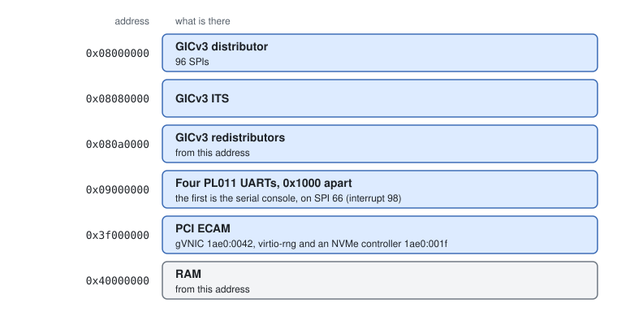

# Google Compute Engine

> Google Cloud's virtual machine service: a KVM-based hypervisor with Google's own device model, UEFI firmware with ACPI on both x86 and Arm, virtio or Google-specific PCI devices, and a logged serial port as the only console.

[Index](../INDEX.md) › [Part 3: Platform and devices](../INDEX.md#part-3-platform-and-devices) › [Cloud platforms](../INDEX.md#cloud-platforms) · ← [EC2 instance types](ec2-instance-types.md) · [Compute Engine machine types](gce-machine-types.md) →

Read first: [Cloud virtual machines](cloud-vms.md), [PCI](pci.md), [ACPI tables](acpi-tables.md).

| At a glance | |
|---|---|
| Kind | Cloud platform: virtual machines |
| Architecture | x86 and Arm |
| Hypervisor | Linux KVM |
| Firmware | UEFI 2.7 (EDK II) with ACPI; no device tree on Arm |
| Devices | [virtio](virtio.md) or [gVNIC](gvnic.md), virtio-scsi or NVMe, by series |
| Console | Serial port 1 only (COM1 at `0x3f8` on x86, PL011 at `0x09000000` on Arm), logged, latest 1 MiB kept |
| Key numbers | No [HPET](hpet.md); [PIT](pit.md) IRQ 0 on I/O APIC pin 0; `CNTFRQ_EL0` 1 GHz on C4A and N4A, 25 MHz on T2A |
| seL4 use | x86 `pc99` boots through GRUB and Multiboot2; no Arm platform; no gVNIC driver in sDDF |

## What it is

Compute Engine (GCE) runs guests ("instances" or "VMs") on Google's
servers. The hypervisor is Linux KVM, but the user-space half, the part
that emulates devices and that would be [QEMU](qemu.md) on a developer's
machine, is Google's own program: Google says it does not use QEMU and
wrote its own virtual machine monitor. So a guest sees KVM's CPU
behaviour (the `KVMKVMKVM` signature in the
[hypervisor CPUID leaves](hypervisor-cpuid-leaves.md), the `kvm-clock`
paravirtual clock) and a device set that only resembles QEMU's.

The words a porter needs:

- **Project**: the billing and permission container; every command names
  one. **Zone** (`europe-west4-a`): one data centre location; a machine
  type is offered only in some zones.
- **Machine type** (`n1-standard-1`, `c4a-standard-2`): the virtual
  hardware model and size. See
  [Compute Engine machine types](gce-machine-types.md); the device set
  depends on the series.
- **Disk**: a network block device (Persistent Disk or Hyperdisk).
  **Snapshot**: a point-in-time copy of a disk. **Image**: a bootable
  disk template plus metadata, from which boot disks are created. A
  custom kernel reaches an instance as a custom image; see
  [Booting a custom kernel on a cloud](cloud-boot-images.md).
- **Guest OS features**: flags stored on the image that tell Compute
  Engine what the software in it can cope with. The ones that matter:

| Flag | Meaning |
|---|---|
| `UEFI_COMPATIBLE` | Boot with UEFI firmware; Shielded VM features become available |
| `GVNIC` | The image has a [gVNIC](gvnic.md) driver, so that NIC type may be chosen |
| `IDPF` | The image has a driver for Intel's IDPF NIC (bare-metal types) |
| `VIRTIO_SCSI_MULTIQUEUE` | Multi-queue virtio-scsi on local SSDs |
| `SEV_CAPABLE`, `SEV_SNP_CAPABLE`, `TDX_CAPABLE` | May be used for Confidential VMs |

- **Metadata server**: an HTTP service at `169.254.169.254`
  (`metadata.google.internal`) from which a guest reads its
  configuration, SSH keys and start-up script, sending the header
  `Metadata-Flavor: Google`. A kernel port does
  not need it; the same key-value metadata is how the operator turns on
  the interactive serial console.

### What an x86 guest sees

Observed on `n1-standard-1`, `e2-medium`, `n2d-standard-2` and
`c4-standard-2` in 2026; the four present the same PC apart from the
PCI devices.

- **Firmware**: UEFI 2.7 built from EDK II, vendor string "Google". The
  guest kernel is entered from a boot loader, not directly; see
  [UEFI](uefi.md) and [x86 boot](x86-boot.md).
- **ACPI tables**: FACP, DSDT, two SSDTs, APIC (the MADT), SRAT, WAET,
  TPM2, and MCFG on C4 only. There is no HPET table and no SPCR.
- **Interrupts**: local [APICs](apic.md) with x2APIC support and one I/O
  APIC of 24 pins at `0xfec00000`. Interrupt source overrides for IRQs
  5, 9, 10 and 11 only, so the PIT's IRQ 0 is on pin 0, not pin 2.
- **Timers**: a [PIT](pit.md), the [TSC](tsc.md) (flagged constant,
  non-stop and of known frequency by Linux), `kvm-clock`, and the ACPI
  PM timer. No [HPET](hpet.md). The [local APIC timer](lapic-timer.md)
  works; N1 has no TSC-deadline mode.
- **Legacy devices**: four 16550A [UARTs](uart.md), a PS/2 keyboard
  controller, and an i440FX-style chipset (host bridge `8086:1237`, PIIX
  ISA bridge `8086:7110`). No VGA card.
- **PCI devices**:

| Device | ID | Where |
|---|---|---|
| virtio-scsi (boot disk) | `1af4:1004` | N1, N2D, E2 |
| virtio-net | `1af4:1000` | N1, N2D, E2 by default |
| gVNIC | `1ae0:0042` | C4 always; N1 when asked for |
| NVMe (boot disk) | `1ae0:001f` | C4, behind PCI bridges |
| virtio-rng | `1af4:1005` | all |
| virtio-balloon | `1af4:1002` | N1, N2D, E2 |

The virtio devices carry the *transitional* IDs (`0x1000` to `0x103f`)
and on the first- and second-generation types are legacy-only: their
registers are I/O ports behind BAR 0. See [virtio](virtio.md).

### What an Arm guest sees

Observed on `t2a-standard-1`, `c4a-standard-1` and `n4a-standard-1` in
2026. The three are one machine, laid out like QEMU's `virt` board:

- UEFI 2.7 (EDK II) with ACPI and no device tree; entry at EL1; PSCI
  1.0 called with `hvc` to start other cores.
- [GICv3](gicv3-its.md): distributor at `0x08000000`, an ITS at
  `0x08080000`, redistributors from `0x080a0000`, 96 SPIs.
- [Generic timer](arm-generic-timer.md) on the usual PPIs (30 physical,
  27 virtual); `CNTFRQ_EL0` is 1 GHz on C4A and N4A, 25 MHz on T2A.
- Four PL011 UARTs from `0x09000000`, `0x1000` apart, the first on SPI
  66 (interrupt 98), where QEMU has SPI 1. The SPCR table names it.
- RAM from `0x40000000`; PCI ECAM at `0x3f000000` with gVNIC
  (`1ae0:0042`), virtio-rng and an NVMe controller (`1ae0:001f`).

*The layout is that of QEMU's `virt` board; the UART interrupt is
not.*

### Serial ports

Every VM has four serial ports. Port 1 (COM1, I/O port `0x3f8`, IRQ 4 on
x86; the PL011 at `0x09000000` on Arm) is the *serial console*: its
output is logged, and the most recent 1 MiB per port can be fetched with
`gcloud compute instances get-serial-port-output` or the
`getSerialPortOutput` API. Setting the metadata key `serial-port-enable`
to `TRUE` allows interactive, two-way access with
`gcloud compute connect-to-serial-port`. There is no screen and no
debugger, so this is the whole debug channel.

### Shielded VM

On a `UEFI_COMPATIBLE` image an instance gets Shielded VM features: a
virtual TPM 2.0 (the `TPM2` table), measured boot with integrity
monitoring, and optionally Secure Boot. vTPM and integrity monitoring
are on by default and are harmless to a kernel that ignores them.
**Secure Boot is off by default.** If it is turned on, the firmware
refuses any boot loader not signed by a key it trusts and the serial
log shows "UEFI: Failed to load image" with "Status: Security
Violation". An unsigned GRUB with an seL4 image therefore needs Secure
Boot left off.

## In seL4

Nothing in upstream seL4 names Compute Engine. What works with upstream
code, and what does not:

- **x86 kernel**: boots through GRUB and Multiboot2 as on any PC; the
  kernel's `pc99` platform, COM1 console, I/O APIC and PIT-based
  [timer calibration](timer-calibration.md) apply unchanged. sel4test
  passed on E2, N2D and C4 with fixes only in user-level timer code
  (observed, 2026).
- **Arm kernel**: there is no platform for it. The `qemu-arm-virt`
  platform with a hand-written device tree matching the list above
  boots (observed on T2A and C4A, 2026), but that platform fixes the
  timer frequency at 62.5 MHz, which is wrong on every Compute Engine
  type. The kernel takes hardware addresses from a build-time device
  tree, not from ACPI; see [platform port](../sel4/platform-port.md)
  and [elfloader](../sel4/elfloader.md).
- **sDDF** ([sDDF](../sel4/sddf.md), [sddf-net](../sel4/sddf-net.md)):
  upstream has
  [`drivers/network/virtio`](https://github.com/au-ts/sddf/tree/main/drivers/network/virtio),
  `drivers/blk/virtio` and `drivers/blk/nvme`, and no gVNIC driver. Its
  virtio PCI transport handles modern devices only, so it does not
  drive the legacy virtio-net of N1, N2D or E2. Its only x86 timer
  driver, `drivers/timer/tsc_hpet`, needs the HPET that Compute Engine
  lacks.

## Gotchas

- **No HPET, anywhere on x86.** Code that assumes one (util_libs'
  ltimer prefers it, sDDF requires it) must fall back to the PIT.
- **The N1 PIT misbehaves**: its count can rise briefly just after a
  reload, which breaks calibration loops that wait for a wrap; see
  [PIT](pit.md) and [timer calibration](timer-calibration.md).
- **Looks like QEMU `virt`, but is not**: on Arm the UART interrupt and
  the timer frequency differ, and there is no device tree to read them
  from.
- **Boot disk type follows the series**: C4, C4A, N4 and N4A boot only
  from Hyperdisk, older series only from Persistent Disk (observed,
  2026). The image is the same either way.
- **Serial output is lost with the instance.** Fetch it before deleting
  the VM.
- **BIOS boot**: `UEFI_COMPATIBLE` is what selects UEFI firmware, and
  Google's own Linux images carry an MBR boot block "to support BIOS"
  beside their EFI partition. Booting an image without the flag was
  not tried, on any series.

## See also

- [Compute Engine machine types](gce-machine-types.md): which series has which devices
- [gVNIC](gvnic.md): the network card of every current series
- [Booting a custom kernel on a cloud](cloud-boot-images.md): building and importing an image
- [Amazon EC2 and the Nitro system](ec2.md): the other cloud, for comparison
- [NVMe](nvme.md): the disk interface of third-generation and later series

## References

- [Create custom images](https://docs.cloud.google.com/compute/docs/images/create-custom),
  "Guest OS features": the flag list, and that `UEFI_COMPATIBLE` leaves
  Secure Boot off with vTPM and integrity monitoring on. *Checked 2026-11-14.*
- [Troubleshooting using the serial console](https://docs.cloud.google.com/compute/docs/troubleshooting/troubleshooting-using-serial-console):
  four ports, port 1 logged, 1 MiB kept, `serial-port-enable`. *Checked 2026-11-14.*
- [Shielded VM](https://docs.cloud.google.com/compute/shielded-vm/docs/shielded-vm):
  Secure Boot, vTPM, integrity monitoring, the "Security Violation"
  message. *Checked 2026-11-14.*
- [Machine families resource and comparison guide](https://docs.cloud.google.com/compute/docs/machine-resource):
  NIC and disk interface per series. *Checked 2026-11-14.*
- [sDDF `drivers/`](https://github.com/au-ts/sddf/tree/main/drivers):
  the network, block and timer drivers that exist upstream. *Checked 2026-11-14.*
- [About VM metadata](https://docs.cloud.google.com/compute/docs/metadata/overview)
  and [View and query VM metadata](https://docs.cloud.google.com/compute/docs/metadata/querying-metadata):
  the metadata server's name and address; the `Metadata-Flavor: Google`
  request header. *Checked 2026-11-14.*
- [Google Cloud Blog, "7 ways we harden our KVM hypervisor at Google Cloud: security in plaintext"](https://cloud.google.com/blog/products/gcp/7-ways-we-harden-our-kvm-hypervisor-at-google-cloud-security-in-plaintext):
  KVM with Google's own user-space virtual machine monitor in place of
  QEMU. *Checked 2026-11-14.*
- [Operating system details](https://docs.cloud.google.com/compute/docs/images/os-details):
  Google's images have a GPT, an EFI partition and an MBR boot block
  for BIOS. *Checked 2026-11-14.*

## My notes

<!-- Tim writes here. Sessions leave this section as it is. -->
