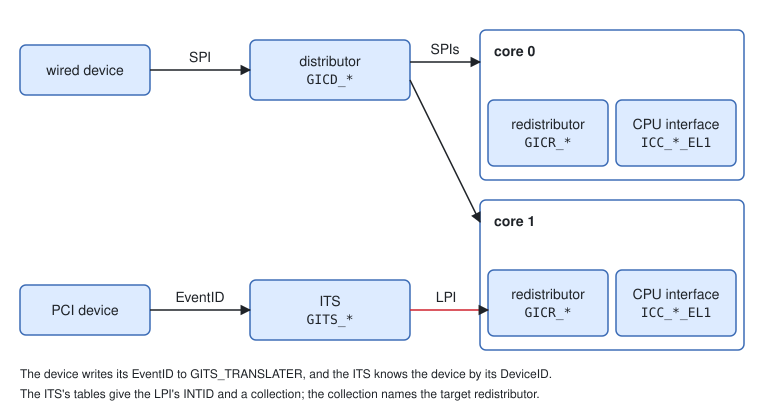

# GICv3 and the ITS (interrupt translation service)

> Arm's interrupt controller (distributor, per-core redistributors, CPU interface) and its ITS, which turns devices' MSI writes into LPIs using tables in memory.

[Index](../INDEX.md) › [Part 3: Platform and devices](../INDEX.md#part-3-platform-and-devices) › [Interrupts](../INDEX.md#interrupts) · ← [Local APIC and I/O APIC](apic.md) · [Timers: a map](timers.md) →

| At a glance | |
|---|---|
| Kind | Interrupt controller, with an optional translation service (ITS) for message signalled interrupts |
| Architecture | Arm |
| Reached through | `GICD_*` and `GICR_*` registers; system registers `ICC_*_EL1` for the CPU interface; the ITS's command queue in memory |
| Key numbers | INTIDs: SGIs 0 to 15, PPIs 16 to 31, SPIs 32 to 1019, LPIs 8192 and up |
| seL4 config | `KernelArmGicV3ITS` (a prototype, not upstream) |
| seL4 use | Upstream handles SPIs, PPIs and SGIs; no LPIs or ITS |
| On the clouds | Every Arm VM seen has a GICv3; bare-metal types from Graviton3 on have a GICv4.1. EC2: 128 LPIs on t4g, 256 on m9g. Compute Engine's bare-metal types have six ITSes |

## What it is

The Generic Interrupt Controller, version 3, has these parts:

- the **distributor** (`GICD_*`), which routes shared peripheral
  interrupts (SPIs) to cores;
- one **redistributor** per core (`GICR_*`), which handles that core's
  private interrupts and LPIs;
- the **CPU interface**, reached through system registers (`ICC_*_EL1`),
  where a core acknowledges and ends interrupts;
- optionally one or more **ITS**es.

*The parts of a GICv3 and the two routes an interrupt takes. The lower
route, through the ITS, is explained under "LPIs and the ITS" below.*

Interrupt IDs (INTIDs) come in ranges:

| INTIDs | Kind | Example |
|---|---|---|
| 0 to 15 | SGIs, software generated | inter-processor interrupts |
| 16 to 31 | PPIs, private per core | the [generic timer](arm-generic-timer.md) |
| 32 to 1019 | SPIs, shared | a UART, a wired device interrupt |
| 8192 and up | LPIs, locality-specific | message signalled interrupts |

**LPIs and the ITS.** LPIs are configured in tables in normal memory
rather than registers: a configuration table (priority, enable) shared by
all cores and a pending table per core. A device does not raise an LPI
directly. It writes an **EventID** to the ITS's `GITS_TRANSLATER`
register, and the ITS identifies the device by its **DeviceID** (for [PCI](pci.md),
derived from the requester ID). The ITS then looks up:

    DeviceID ── device table ──▶ that device's interrupt translation table
    EventID  ── ITT ───────────▶ LPI INTID + collection
    collection ─ collection table ─▶ target redistributor (core)

Software fills these tables by writing commands (`MAPD`, `MAPTI`,
`MAPC`, `INV`, `SYNC`, ...) to the ITS's command queue in memory.

LPIs are edge-triggered and have no active state.

### Later revisions: GICv4 and GICv5

GICv3 is not the newest GIC, but it is the one a guest kernel meets.

**GICv3.1 and GICv3.2** are small additions: longer SPI and PPI ranges,
memory partitioning and monitoring, Secure EL2, and Armv8-R.

**GICv4** adds one thing for hypervisors: direct injection. On a GICv3
a hypervisor takes every device interrupt itself and then hands the
guest a virtual one through a list register (see
[Arm virtualisation](arm-virtualisation.md)). On a GICv4 the ITS can
deliver a **virtual LPI** (vLPI) straight to a running guest, with no
trap to the hypervisor. It needs an ITS, because only LPIs are injected
this way. **GICv4.1** does the same for virtual SGIs, the guest's
inter-processor interrupts, and changes some of GICv4's tables. Both
are described in the GICv3 specification and extend GICv3: everything
on this page holds on a GICv4, and a driver that ignores the additions
works unchanged.

So GICv4 changes what a host can do, not what a guest sees. A machine
whose hardware is a GICv4.1 still presents a GICv3 to its guests. What
the clouds present (from Linux boot logs, November 2026):

| Machine | GIC seen | ITS |
|---|---|---|
| EC2 VMs: t4g (Graviton2), c7g (Graviton3), c8g (Graviton4), m9g (Graviton5) | GICv3 | one, with a restricted LPI range |
| EC2 m6g.metal (Graviton2) | GICv3 | four |
| EC2 m7g.metal (Graviton3), m8g.metal-24xl (Graviton4) | GICv4.1 | one |
| EC2 m9g.metal-48xl (Graviton5) | GICv4.1 | six |
| Compute Engine VMs: t2a, c4a, n4a | GICv3 | one |
| Compute Engine c4a-highmem-96-metal | GICv4.1 | six |
| Azure D2ps v5 (Ampere Altra) | GICv3 | none |

Azure's Cobalt types have not been looked at.

Linux reports a GICv4 with the line `GICv4 features:` and an ITS with
`Using GICv4.1 mode`. Its KVM leaves direct injection off unless booted
with `kvm-arm.vgic_v4_enable=1`, and logs `GICv4 support disabled`.

**GICv5**, announced in April 2025, is a new design and not an
extension. An **Interrupt Routing Service** (IRS) replaces the
distributor and the redistributors, the ITS is simplified, and an
**Interrupt Wire Bridge** (IWB) turns wired signals into interrupts. Its
interrupts are PPIs, SPIs and LPIs. Its programming model is not
backward compatible with GICv3, so it needs its own driver; Linux has
one. None of the cloud machines in the table has a GICv5.

## In seL4

Upstream seL4 supports GICv3 SPIs, PPIs and SGIs but not LPIs or the
ITS, so there are no message signalled interrupts on Arm. A prototype
(behind `KernelArmGicV3ITS`) keeps all the tables in static kernel memory
and adds `seL4_IRQControl_GetMSI(irq, device_id, event_id, ...)`; an
upstream API would need an RFC. One question it must answer is where the
kernel gets memory for the tables; the x86 pull request for VT-d
interrupt remapping ([#1098](https://github.com/seL4/seL4/issues/1098))
needs kernel table memory too.

Upstream has no GICv4 or GICv5 code (a search of `src`, `include` and
`libsel4` at commit `c98d70adf`, November 2026, finds neither name). On
a GICv4 machine the GICv3 driver runs as on a GICv3. Direct injection
would matter only to seL4 as a hypervisor on a bare-metal instance,
where guests' interrupts go through list registers today.

## Gotchas

- **EC2 limits LPIs.** Its hypervisor reports a "restricted LPI range":
  128 LPIs on t4g, 256 on m9g. Take the limit from `GICD_TYPER`.
- **Both clouds** use 64 KiB ITS pages and 8-byte table entries, and
  firmware leaves LPIs disabled.
- **Several ITSes.** Compute Engine's bare-metal types have six; a driver
  handling one sees only the devices behind it.
- Compute Engine's Arm VMs put the ITS at `0x08080000`, QEMU's address.
- **Azure has no ITS.** A D2ps v5 VM has a GICv3 with 960 SPIs and no
  ITS, so no LPIs; Linux logs "No ITS available, not enabling LPIs".
- **Bare metal is not uniform.** EC2's Graviton2 metal type is a plain
  GICv3 with four ITSes; from Graviton3 on, and on Compute Engine's
  bare-metal type, the hardware is a GICv4.1. See the table under
  "Later revisions".

## See also

- [IRQ](irq.md): interrupts in general, and seL4's IRQ handler capabilities
- [Local APIC and I/O APIC](apic.md): the x86 counterpart
- [MSI and MSI-X](msi-msix.md): what the device writes
- [PCI and PCI Express](pci.md): the requester ID that becomes a DeviceID
- [Arm generic timer](arm-generic-timer.md): the PPIs
- [Arm virtualisation (EL2)](arm-virtualisation.md): what exception level 2 adds to an Arm core so that a hypervisor can run guests
- [EC2 instance types](ec2-instance-types.md): how to read an EC2 instance type name
- [GICv2](gicv2.md): arm's older standard interrupt controller, with at most eight cores and every register memory-mapped
- [gVNIC](gvnic.md): compute Engine's own paravirtual network card, the only NIC on third-generation and later machine series...
- [IOMMUs: VT-d and SMMU](iommu.md): an IOMMU translates and restricts the memory addresses devices use for DMA, which is what keeps a...
- [Interrupt delivery](../sel4/irq-handling.md): seL4 turns each device interrupt into a signal on a notification
- [SMP](../sel4/smp.md): seL4 built for more than one core runs a single kernel image under one big lock, with per-core scheduler...
- [Interrupts: a map](interrupts.md): every interrupt controller on x86, Arm and RISC-V side by side, and how this one fits in

## References

- [Arm GICv3 and GICv4 Architecture Specification (IHI 0069)](https://developer.arm.com/documentation/ihi0069/latest/):
  chapter 5, "Locality-specific Peripheral Interrupts and the ITS", and
  the INTID ranges in chapter 2. *Checked 2026-11-14, issue G, read as
  the [PDF](https://documentation-service.arm.com/static/601412d54ccc190e5e681269)
  because developer.arm.com refuses scripted fetches.*
- [Arm, "Learn the architecture: Generic Interrupt Controller v3 and v4, Overview"](https://developer.arm.com/documentation/198123/latest/):
  a readable overview of the parts and the INTID ranges.
  *Checked 2026-11-14, version 3.2, read as the
  [PDF](https://documentation-service.arm.com/static/678108763f2a9a07789e1d9e).*
- [Arm, "Learn the architecture: Generic Interrupt Controller v3 and v4, LPIs"](https://documentation-service.arm.com/static/65ba2901c2052a35156cc629)
  (document 102923): the LPI configuration and pending tables, the
  ITS's tables, `GITS_TRANSLATER` and the commands. *Checked 2026-11-14.*
- The same specification, section 1.1 "About the Generic Interrupt
  Controller (GIC)", "Changes specific to" GICv3.1, GICv3.2, GICv4 and
  GICv4.1: what each revision adds. *Checked 2026-11-15, issue G, same
  PDF.*
- [Arm, "Introducing GICv5"](https://developer.arm.com/community/arm-community-blogs/b/architectures-and-processors-blog/posts/introducing-gicv5),
  28 April 2025: the IRS, the simplified ITS, the IWB, and that the
  programming model is not backward compatible. *Checked 2026-11-15.*
- [Linux, `Documentation/devicetree/bindings/interrupt-controller/arm,gic-v5.yaml`](https://github.com/torvalds/linux/blob/master/Documentation/devicetree/bindings/interrupt-controller/arm,gic-v5.yaml):
  GICv5's components and its three kinds of interrupt; its presence
  shows Linux has a driver. *Checked 2026-11-15.*
- [Linux, `drivers/irqchip/irq-gic-v3.c`](https://github.com/torvalds/linux/blob/master/drivers/irqchip/irq-gic-v3.c),
  `gic_update_rdist_properties()`: prints `GICv4 features:` when the
  redistributors support vLPIs. *Checked 2026-11-15.*
- [Linux, `arch/arm64/kvm/vgic/vgic-v3.c`](https://github.com/torvalds/linux/blob/master/arch/arm64/kvm/vgic/vgic-v3.c),
  `vgic_v3_probe()` and the `kvm-arm.vgic_v4_enable` parameter: direct
  injection is off by default. *Checked 2026-11-15.*
- [seL4 pull request #1098](https://github.com/seL4/seL4/issues/1098),
  "VT-d: add remappable MSI and IOAPIC support": interrupt remapping on
  x86, open. *Checked 2026-11-14 (description only, not the discussion).*

## My notes

<!-- Tim writes here. Sessions leave this section as it is. -->
