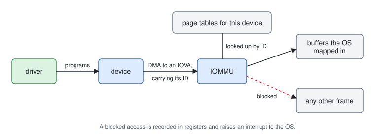

# IOMMUs: VT-d and SMMU

> An IOMMU translates and restricts the memory addresses devices use for DMA, which is what keeps a user-level driver from reading or writing all of memory through its device; seL4 has unverified support for Intel VT-d and Arm SMMUv2.

[Index](../INDEX.md) › [Part 3: Platform and devices](../INDEX.md#part-3-platform-and-devices) › [Buses and devices](../INDEX.md#buses-and-devices) · ← [virtio](virtio.md) · [QEMU](qemu.md) →

Read first: [Virtual memory](virtual-memory.md), [PCI and PCI Express](pci.md).

| At a glance | |
|---|---|
| Kind | Hardware that translates and restricts device DMA addresses |
| Architecture | x86 (Intel VT-d), Arm (SMMU) |
| Found through | [ACPI](acpi-tables.md) DMAR (VT-d), IVRS (AMD-Vi), IORT (SMMU); the device tree's `iommus` property (unchecked) |
| Interrupt | A fault interrupt for blocked accesses |
| seL4 code | [`intel-vtd.c`](https://github.com/seL4/seL4/blob/master/src/plat/pc99/machine/intel-vtd.c), [`iospace.c`](https://github.com/seL4/seL4/blob/master/src/arch/x86/object/iospace.c), [`smmuv2.c`](https://github.com/seL4/seL4/blob/master/src/drivers/smmu/smmuv2.c) |
| seL4 config | `KernelIOMMU` (default on for `pc99`); `KernelArmSMMU` (Tegra X2 only) |
| seL4 use | VT-d and SMMUv2 only, in no verified configuration; no AMD-Vi or SMMUv3 driver |
| On the clouds | None on ordinary EC2 and Compute Engine instances; EC2 bare-metal instances are the exception |

## What it is

### The DMA problem

**DMA** (direct memory access) means a device reads and writes main
memory itself: a network card is given the physical address of a buffer
and copies the packet there with no CPU involvement. Every fast device
works this way ([NVMe](nvme.md), [ENA](ena.md), [virtio](virtio.md)).

The CPU's page tables do not apply to it. They constrain instructions
executed by the CPU; a device on the bus presents a *physical* address
and the memory answers. So whoever programs the device chooses which
physical memory it touches. In a monolithic kernel that is unremarkable:
the driver is already trusted. In a microkernel it undoes the design:

```
 driver (user level, holds only its own frames)
    | writes "receive into physical address X" to a device register
    v
 device ---- DMA write to X ----> any frame: the kernel's, another
                                  component's, a page table
```

A user-level driver with a DMA-capable device and no further protection
is therefore inside the **trusted computing base** (the code that must
be correct for the system's guarantees to hold), however few
capabilities it has.

### What an IOMMU does

An **IOMMU** (I/O memory management unit) sits between devices and
memory and does for devices what the MMU does for the CPU:

- **Translation and protection.** Each device, identified by the ID its
  bus transactions carry, is assigned a set of page tables. Addresses the
  device uses (**I/O virtual addresses**, IOVAs) are looked up there;
  unmapped or write-protected addresses are blocked. The OS maps in only
  the buffers the driver is meant to use.
- **Fault reporting.** A blocked access is recorded in registers and
  raises an interrupt to the OS. The device itself is usually not told.
- **Interrupt remapping.** A [message signalled
  interrupt](msi-msix.md) is a DMA write to a special address, so a
  device that can do DMA can forge any interrupt. With remapping the
  message carries only an index into a table the OS controls.

It is also what lets a hypervisor give a real device to a guest
(passthrough): the IOMMU translates the guest's idea of physical
addresses.



*With an IOMMU in the path, what the device can reach is decided by
page tables the OS controls, whatever address the driver programs.*

The descriptions of the hardware below are from memory of the
specifications, none of which could be opened today (unchecked).

### Intel VT-d

VT-d ("Virtualization Technology for Directed I/O") is found through the
**DMAR** [ACPI table](acpi-tables.md), which lists:

- **DRHD** entries (DMA remapping hardware unit definition): one per
  IOMMU, with the physical address of its register page and the devices
  it covers. A machine often has several.
- **RMRR** entries (reserved memory region reporting): memory ranges
  that named devices must keep access to because firmware uses them (USB
  legacy keyboard emulation, integrated graphics). The OS must map these
  one-to-one for those devices.

A device is identified by its 16-bit PCI **requester ID**: bus (8 bits),
device (5), function (3). Translation walks:

```
root table (register RTADDR)        256 entries, indexed by bus
  -> context table                  256 entries, indexed by device:function
       context entry: domain ID, address width, pointer to
  -> second-level page tables       3 or 4 levels of 512 entries,
       -> 4 KiB page                same shape as x86-64 paging
```

The **domain ID** in the context entry tags IOTLB (translation cache)
entries, as a [PCID or ASID](x86-paging.md) does for the CPU: devices
sharing page tables share a domain ID. After changing tables software
must invalidate the context cache and the IOTLB through registers.
"Second-level" distinguishes these tables from the first-level ones
used when a device shares a process's address space (scalable mode),
which seL4 does not use.

**AMD-Vi** is AMD's equivalent, described by the ACPI **IVRS** table and
using a device table indexed by requester ID; seL4 has no driver for it.

### Arm SMMU

Arm's **System MMU** comes in two incompatible architectures:

| | SMMUv2 | SMMUv3 |
|---|---|---|
| Device identity | **Stream ID** (SID), assigned by the system-on-chip's wiring | Stream ID, for PCI derived from the requester ID |
| Per-device lookup | *Stream match registers* compare the SID and select a **context bank** | **Stream table** in memory, indexed by SID; each entry (STE) points to tables |
| Translation state | A fixed number of context banks (CBs), each a register set like a CPU's: TTBR, TCR, fault status | **Context descriptors** in memory (stage 1) and fields in the STE (stage 2) |
| Programming | Registers only | Command queue and event queue in memory |
| Found on | Older SoCs: Tegra X2, ZynqMP | Servers and newer SoCs |

Both support **stage 1** (the format an OS uses for its own processes'
tables), **stage 2** (the format a hypervisor uses for guests; see [Arm
virtualisation](arm-virtualisation.md)), or both nested. The page table
formats are the CPU's own ([AArch64 paging](aarch64-paging.md)), so an
SMMU can share a set of tables with a CPU address space. On an ACPI
system the **IORT** table describes SMMUs and how requester IDs map to
stream IDs and to [ITS](gicv3-its.md) device IDs; on others the device
tree's `iommus` property does.

The **RISC-V IOMMU** specification (ratified 2023) follows the SMMUv3
pattern: a device directory table indexed by device ID, pointing at
first- and second-stage tables.

### In virtual machines

A guest sees an IOMMU only if the hypervisor emulates one (a **virtual
IOMMU**: QEMU's `-device intel-iommu`, virtio-iommu, an emulated SMMUv3
with `-machine virt,iommu=smmuv3`). Clouds generally do not offer one:
ordinary [EC2](ec2.md) and [Compute Engine](gce.md) instances have no
DMAR table and no usable SMMU, and the cloud's own hardware IOMMU,
confining the instance, is invisible to it. EC2 bare-metal instances
are the exception. Inside a VM without one, a user-level driver for a
passed-through or paravirtual device is trusted with all of the guest's
memory, though never with more than the guest's.

## In seL4

Neither implementation is part of any verified configuration.

### x86: VT-d

`KernelIOMMU` (`CONFIG_IOMMU`) defaults on for `pc99` and is forced off
by `KernelVerificationBuild`. The boot option `disable_iommu` on the
kernel command line turns it off at run time
([`boot_sys.c`](https://github.com/seL4/seL4/blob/master/src/arch/x86/kernel/boot_sys.c)
then sets `num_drhu` to 0).

- **Boot**: `acpi_dmar_scan()` collects up to `MAX_NUM_DRHU` units and
  the RMRR list (up to `KernelMaxRMRREntries`, default 32).
  [`src/plat/pc99/machine/intel-vtd.c`](https://github.com/seL4/seL4/blob/master/src/plat/pc99/machine/intel-vtd.c)
  allocates the root table (`x86KSvtdRootTable`) and context tables,
  maps the RMRR regions one-to-one for their devices, and enables
  translation. From then on **every device is blocked from all memory**
  until user level maps something.
- **Faults**: `vtd_handle_fault()` runs on the IOMMU's fault interrupt
  and, in a printing build, prints the device and address ("IOMMU: DMA
  write page fault from ..."). User level is not told.
- **Capabilities**: the root task gets one master **IOSpace** cap in
  slot `seL4_CapIOSpace` (a null cap when there is no IOMMU). Minting it
  with a badge that encodes a domain ID and a PCI bus, device and
  function (`seL4_X86_IOSpace_CapData`) yields an IOSpace cap for that
  one device; see [Capabilities](../sel4/capabilities.md) for minting.
- **Objects and invocations**
  ([`src/arch/x86/object/iospace.c`](https://github.com/seL4/seL4/blob/master/src/arch/x86/object/iospace.c)):
  the page tables are kernel objects of type `seL4_X86_IOPageTableObject`
  retyped from untyped memory like any page table.
  `seL4_X86_IOPageTable_Map(pt, iospace, ioaddr)` installs one at the
  next missing level (the first becomes the device's context entry);
  `seL4_X86_Page_MapIO(frame, iospace, rights, ioaddr)` maps a 4 KiB
  frame at an I/O address; `seL4_X86_IOPageTable_Unmap` and
  `seL4_X86_Page_Unmap` undo them. `lookup_vtd_context_slot()` is the
  root-table and context-table walk drawn above.
- A frame cap can be mapped either in a [VSpace](../sel4/vspace.md) or
  in an IOSpace, not both: a driver copies the cap and maps one copy
  each way.
- No interrupt remapping (unchecked: no remapping-table code found in
  `intel-vtd.c` by a quick search).

### Arm: SMMUv2

`KernelArmSMMU` (`CONFIG_ARM_SMMU`) exists only for the Tegra X2
(`KernelPlatformTx2`); the driver is
[`src/drivers/smmu/smmuv2.c`](https://github.com/seL4/seL4/blob/master/src/drivers/smmu/smmuv2.c).
(`KernelTk1SMMU` is an older, separate driver for the Tegra K1's
non-standard IOMMU.) There is no SMMUv3 driver. The API exposes the
hardware's two resources as capabilities:

| Cap | From | Invocations |
|---|---|---|
| SID control | the root task | `seL4_ARM_SIDControl_GetSID`: make a cap for one stream ID |
| SID | | `seL4_ARM_SID_BindCB`, `UnbindCB`, `GetFault`, `ClearFault` |
| CB control | the root task | `seL4_ARM_CBControl_GetCB`: make a cap for one context bank; `TLBInvalidateAll` |
| CB | | `seL4_ARM_CB_AssignVspace`, `UnassignVspace`, `TLBInvalidate`, `CBGetFault`, `CBClearFault` |

A context bank is pointed at an ordinary VSpace: the device shares the
page tables of an address space, so "what the device can reach" is
"what is mapped in that VSpace". This differs from x86, where I/O page
tables are separate objects.


*The two capability models side by side. Arrows on the x86 row point
from the thing mapped to what it is mapped into; on the Arm row each
arrow is the invocation named above it.*

### Above the kernel

Microkit's system description has an `io_address_space` element: it
names a device (`peripheral_id`, on x86 a PCI device) and a `domain_id`,
and its `iomap` children map memory regions at chosen I/O virtual
addresses, so the tool builds the device's I/O page tables statically
alongside the protection domains' ([manual, "IO Address
Spaces"](https://github.com/seL4/microkit/blob/main/docs/manual.md)).
The tool's source says only x86 is handled so far
(`tool/microkit/src/sdf/iommu.rs`). Without it a protection domain
given a DMA-capable device is trusted; sDDF drivers take the physical
(or I/O) addresses of their DMA regions as configuration.

### What the proofs assume

The proofs model memory as changed only by the kernel and by user
threads through their mappings. A device writing memory by DMA is
outside the model, so the guarantees hold only if DMA-capable devices
are absent, or are confined by an IOMMU whose (unverified) driver is
trusted, or are driven by components the system trusts completely. See
[The seL4 proofs](../sel4/verification.md).

## Gotchas

- **Enabling VT-d blocks everything at once.** A device still doing DMA
  set up by firmware or the boot loader (a USB controller, a frame
  buffer) faults the moment translation turns on; that is what RMRRs are
  for, and firmware tables are often incomplete.
- **`disable_iommu` trades protection for function**: drivers then use
  physical addresses directly and are fully trusted. Much seL4 x86
  user-level code assumes this mode.
- **With VT-d on, a driver must program the device with I/O addresses**,
  not physical ones, and must have mapped each buffer with
  `seL4_X86_Page_MapIO` first. A driver tested with the IOMMU off fails
  silently with it on: the kernel prints a fault only in debug builds.
- **A cloud guest has no IOMMU to enable.** On ordinary EC2 and Compute
  Engine instances `seL4_CapIOSpace` is a null cap and DMA isolation
  between user-level components is not available at all; the design has
  to treat each driver as trusted with the whole instance's memory, or
  bounce through copying components that at least limit what a
  *client* can do.
- **Without interrupt remapping DMA protection is incomplete**: a
  confined device can still write to the MSI address range and forge
  interrupts.
- **Requester IDs are not always what they seem.** Devices behind a
  PCIe-to-PCI bridge all appear with the bridge's ID; some devices use a
  different function number for DMA than for configuration.
- **SMMUv2 context banks are few** (a hardware-fixed number, often 8 to
  64), so they limit the number of isolated devices.

## See also

- [Virtual memory](virtual-memory.md): the CPU-side idea this copies
- [PCI and PCI Express](pci.md): bus, device, function and bus mastering
- [ACPI tables](acpi-tables.md): where DMAR, IVRS and IORT are found
- [MSI and MSI-X](msi-msix.md): why interrupts need remapping too
- [x86 paging](x86-paging.md) and [AArch64 paging](aarch64-paging.md): the table formats reused
- [x86 virtualisation](x86-virtualisation.md) and [Arm virtualisation](arm-virtualisation.md): second-stage translation for CPUs
- [GICv3 and the ITS](gicv3-its.md): IORT also maps devices to ITS device IDs
- [virtio](virtio.md): `VIRTIO_F_ACCESS_PLATFORM`
- [Cloud virtual machines](cloud-vms.md): what guests are and are not given
- [The seL4 proofs](../sel4/verification.md): the DMA assumption
- [Address spaces (VSpace)](../sel4/vspace.md): the CPU-side mapping API that IOSpaces mirror
- [sDDF](../sel4/sddf.md): how drivers handle DMA regions
- [Index](../INDEX.md): the reading order
- [Virtualisation support](../sel4/hypervisor.md): seL4 can host virtual machines

## References

- [seL4 `src/arch/x86/object/iospace.c`](https://github.com/seL4/seL4/blob/master/src/arch/x86/object/iospace.c):
  context-slot lookup, IOPageTable and MapIO decoding.
  *Checked 2026-11-14.*
- [seL4 `src/plat/pc99/machine/intel-vtd.c`](https://github.com/seL4/seL4/blob/master/src/plat/pc99/machine/intel-vtd.c):
  initialisation, invalidation, fault printing, RMRR handling.
  *Checked 2026-11-14 (function list and fault path; the initialisation
  order described above was not read line by line).*
- [seL4 `src/arch/x86/config.cmake`](https://github.com/seL4/seL4/blob/master/src/arch/x86/config.cmake)
  and [`src/arch/arm/config.cmake`](https://github.com/seL4/seL4/blob/master/src/arch/arm/config.cmake):
  `KernelIOMMU`, `KernelMaxRMRREntries`, `KernelArmSMMU`,
  `KernelTk1SMMU`. *Checked 2026-11-14.*
- [seL4 `libsel4/arch_include/arm/interfaces/object-api-arch.xml`](https://github.com/seL4/seL4/blob/master/libsel4/arch_include/arm/interfaces/object-api-arch.xml)
  and the [x86 one](https://github.com/seL4/seL4/blob/master/libsel4/arch_include/x86/interfaces/object-api-arch.xml):
  the SID, CB and IOPageTable invocations. *Checked 2026-11-14.*
- [seL4 `libsel4/include/sel4/bootinfo_types.h`](https://github.com/seL4/seL4/blob/master/libsel4/include/sel4/bootinfo_types.h):
  `seL4_CapIOSpace`. *Checked 2026-11-14.*
- Intel, "Virtualization Technology for Directed I/O Architecture
  Specification", chapters 3 (DMA remapping), 5 (interrupt remapping)
  and 8 (DMAR table). *Unchecked (intel.com refuses scripted fetches).*
- Arm, "System Memory Management Unit Architecture Specification"
  versions 2 (IHI 0062) and 3 (IHI 0070). *Unchecked
  (developer.arm.com).*
- [Microkit `docs/manual.md`](https://github.com/seL4/microkit/blob/main/docs/manual.md),
  "IO Address Spaces" and the `io_address_space` element.
  *Checked 2026-11-14.*
- [RISC-V IOMMU Architecture Specification](https://github.com/riscv-non-isa/riscv-iommu).
  *Unchecked (not opened).*

## My notes

<!-- Tim writes here. Sessions leave this section as it is. -->
