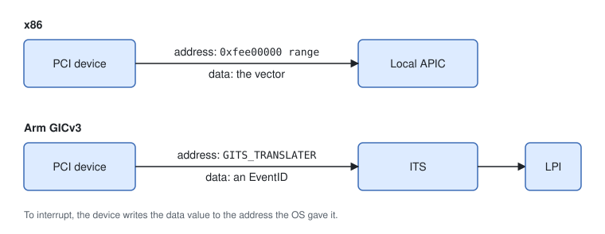

# MSI and MSI-X (message signalled interrupts)

> A PCI device interrupts by writing a value to an address instead of asserting a wire; MSI allows up to 32 vectors set in configuration space, MSI-X up to 2048 from a table in a BAR.

[Index](../INDEX.md) › [Part 3: Platform and devices](../INDEX.md#part-3-platform-and-devices) › [Buses and devices](../INDEX.md#buses-and-devices) · ← [PCI and PCI Express](pci.md) · [UARTs: 16550 and PL011](uart.md) →

| At a glance | |
|---|---|
| Kind | Interrupt mechanism for [PCI](pci.md) devices: a memory write in place of a wire |
| Architecture | x86 and Arm GICv3 |
| Reached through | MSI: a capability in configuration space; MSI-X: a table in a BAR |
| Key numbers | MSI 1 to 32 vectors, a power of two; MSI-X 1 to 2048 |
| seL4 use | x86: an IRQ handler capability for an MSI vector, device programmed by user level; Arm: none |
| On the clouds | NVMe, ENA and gVNIC are designed around MSI-X, one vector per queue |

## What it is

Legacy [PCI](pci.md) interrupts are four shared wires (INTA to INTD) routed through
an interrupt controller. Message signalled interrupts replace the wire
with a memory write: the OS gives the device an **address** and a
**data** value, and to interrupt, the device writes the data to the
address. The interrupt controller recognises writes to that address.

| | MSI | MSI-X |
|---|---|---|
| Vectors per device | 1 to 32, a power of two | 1 to 2048 |
| Where configured | The MSI capability in configuration space | A table in one of the device's BARs, located by the MSI-X capability |
| Address per vector | One shared address, data values consecutive | Each entry has its own address and data |
| Per-vector masking | Optional | Always |

What the address and data mean depends on the architecture:

- **x86:** the address is in the `0xfee00000` range and names a target
  [local APIC](apic.md); the data holds the vector.
- **Arm GICv3:** the address is the ITS's `GITS_TRANSLATER` register and
  the data is an EventID, which the ITS translates to an LPI (see
  [GICv3 and the ITS](gicv3-its.md)).

*The same write means different things on the two architectures: the
address picks the receiver and the data says which interrupt.*

Modern devices such as NVMe and cloud network cards (ENA, gVNIC) are
designed around MSI-X, one vector per queue.

## In seL4

- **x86:** seL4 gives user level an [IRQ](irq.md) handler capability for an MSI
  vector with `seL4_IRQControl_GetMSI` (see [PCI](pci.md)), and the
  user-level driver programs the device.
- **Arm:** seL4 has no ITS support, so no MSI on Arm: there is no Arm
  version of `seL4_IRQControl_GetMSI` to map an event of a device to an
  LPI.

## Gotchas

- **Some devices need MSI-X.** A device that polls fine can still need
  MSI-X for interrupt-driven operation; with one gVNIC driver on Compute
  Engine, round trips fell from about 1 ms polled to 0.07 ms with MSI-X
  (observed 2026).
- The MSI-X table lives in a BAR, so the driver needs that BAR mapped as
  well as configuration space.

## See also

- [IRQ](irq.md): what an interrupt is, and how seL4 hands one to user level
- [Local APIC and I/O APIC](apic.md): where an x86 MSI is delivered
- [GICv3 and the ITS](gicv3-its.md): how Arm turns the write into an interrupt
- [PCI and PCI Express](pci.md): configuration space, capabilities and BARs
- [ACPI tables](acpi-tables.md): MCFG says where PCI configuration space is
- [ENA](ena.md): amazon's network card, the only NIC on EC2 Nitro instances
- [gVNIC](gvnic.md): compute Engine's own paravirtual network card, the only NIC on third-generation and later machine series...
- [IOMMUs: VT-d and SMMU](iommu.md): an IOMMU translates and restricts the memory addresses devices use for DMA, which is what keeps a...
- [ISA](isa.md): the IBM PC's original expansion bus
- [NVMe](nvme.md): the standard PCI storage controller interface, and the one EC2 uses for every disk and Compute Engine for...
- [RISC-V interrupts and timers](riscv-interrupts.md): how interrupts reach an S-mode kernel on RISC-V
- [virtio](virtio.md): virtio is the standard family of paravirtual devices
- [Interrupt delivery](../sel4/irq-handling.md): seL4 turns each device interrupt into a signal on a notification
- [sDDF networking](../sel4/sddf-net.md): the network class of sDDF in detail
- [Interrupts: a map](interrupts.md): every interrupt controller on x86, Arm and RISC-V side by side, and how this one fits in

## References

- [Linux kernel documentation, "The MSI Driver Guide HOWTO"](https://docs.kernel.org/PCI/msi-howto.html):
  what MSI and MSI-X are and their limits (32 against 2048 vectors).
  *Checked 2026-11-14.*
- [PCI Local Bus Specification 3.0](https://lekensteyn.nl/files/docs/PCI_SPEV_V3_0.pdf),
  section 6.8 "Message Signaled Interrupts" (a public copy; PCI-SIG's
  own needs a membership). *Checked 2026-11-14.*
- [OSDev wiki, "PCI"](https://wiki.osdev.org/PCI), the section "Message
  Signaled Interrupts". *Checked 2026-11-14 (through the Internet
  Archive's copy; the site itself refuses scripted fetches).*
