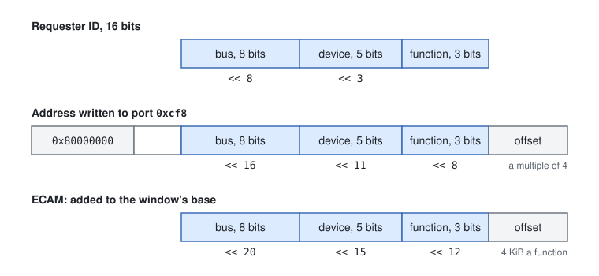

# PCI and PCI Express (Peripheral Component Interconnect)

> The bus by which almost every device in a PC, server or cloud virtual machine is found and reached: each function at a bus:device.function address has a configuration space that names it and holds its BARs, the windows through which its registers appear; PCI Express keeps that software model on point-to-point serial links and reaches the larger configuration space through ECAM.

[Index](../INDEX.md) › [Part 3: Platform and devices](../INDEX.md#part-3-platform-and-devices) › [Buses and devices](../INDEX.md#buses-and-devices) · ← [ISA](isa.md) · [MSI and MSI-X](msi-msix.md) →

| At a glance | |
|---|---|
| Kind | Device bus, with self-describing devices |
| Introduced | PCI in 1992; PCI Express in 2003 |
| Reached through | Configuration space: [I/O ports](io-ports.md) `0xcf8` and `0xcfc` (x86 only) or ECAM in memory; device registers through BARs |
| Found through | ECAM window in the [ACPI](acpi-tables.md) MCFG table |
| Interrupt | INTA to INTD wires, or [MSI and MSI-X](msi-msix.md) |
| Key numbers | 256 buses, 32 devices, 8 functions; configuration space 256 bytes (PCI) or 4096 (PCIe); up to six BARs |
| seL4 code | [`interrupt.c`](https://github.com/seL4/seL4/blob/master/src/arch/x86/object/interrupt.c), [`iospace.c`](https://github.com/seL4/seL4/blob/master/src/arch/x86/object/iospace.c) |
| seL4 use | Kernel never touches configuration space; it takes bus, device and function numbers for MSI and the IOMMU on x86 |

## What it is

PCI (first specified in 1992) replaced [ISA](isa.md) in the 1990s and fixed
its main weakness: ISA devices sat at fixed addresses that software had
to know in advance. A PCI device **describes itself**. Software can walk
every possible address, ask "is anything here, and what?", and then tell
each device where in the address space to put its registers.

**PCI Express** (PCIe, 2003) replaced the shared parallel bus with
point-to-point serial links, one per device, of 1 to 16 lanes. A
**root complex** at the CPU end connects to devices (**endpoints**)
directly or through **switches**, and everything travels as packets.
None of that is visible to a driver: PCIe kept PCI's software model, so
software written for PCI finds and configures PCIe devices. What PCIe
adds that software sees is a larger configuration space and ECAM, below.
In what follows "PCI" means both unless it says otherwise.

### Addresses: bus, device, function

Each device is addressed by three numbers, written `BB:DD.F` in hex
(`00:04.0`):

| Field | Bits | Range | Meaning |
|---|---|---|---|
| Bus | 8 | 0–255 | Which bus; bus 0 hangs off the host bridge |
| Device | 5 | 0–31 | Which slot on that bus |
| Function | 3 | 0–7 | Which of a multi-function device's functions |

The **function** is the unit software deals with: one function, one
configuration space, one driver. Most devices have only function 0. A
**bridge** is itself a function that leads to another bus; its
configuration space says which bus numbers lie behind it, and firmware
numbers the buses as it walks the tree. On PCIe every link is a bus, so a
machine with a PCIe hierarchy has many bridges and bus numbers.

Packed as `bus << 8 | device << 3 | function`, the address is the
16-bit **requester ID** a device puts on its DMA and its MSI writes. An
IOMMU uses it to tell devices apart.

### Configuration space

Each function has a **configuration space**: 256 bytes on PCI, 4096 on
PCIe. The first 64 bytes are a standard header:

| Offset | Field | What for |
|---|---|---|
| `0x00` | Vendor ID (16 bits) | Who made it; all ones means no function here |
| `0x02` | Device ID (16 bits) | Which device, by the vendor's numbering |
| `0x04` | Command (16 bits) | Bit 0 decode I/O BARs; bit 1 decode memory BARs; bit 2 bus master (may do DMA); bit 10 disable INTx |
| `0x08` | Revision and class | What kind of device (network, storage, bridge, ...) |
| `0x0e` | Header type (8 bits) | Layout of the rest: 0 a device, 1 a PCI-to-PCI bridge; bit 7 set if the device has more functions |
| `0x10`–`0x24` | BAR 0 to BAR 5 | Where the device's registers are (below) |
| `0x34` | Capabilities pointer | Start of a linked list of optional features |
| `0x3c`, `0x3d` | Interrupt line and pin | Legacy INTx: which of INTA to INTD, and what firmware routed it to |

A bridge's header (type 1) has only two BARs and puts the primary,
secondary and subordinate bus numbers at `0x18`–`0x1a`.

The **capabilities list** is how optional features are found: each
entry has an ID and a pointer to the next. The ones seL4 work meets are
MSI (ID `0x05`), PCI Express (`0x10`) and MSI-X (`0x11`); see
[MSI and MSI-X](msi-msix.md). PCIe's extra space from offset `0x100`
holds a second list, of **extended capabilities** such as SR-IOV.

### Reaching configuration space

Configuration space is not in the ordinary address space; it needs an
access mechanism.

- **Port I/O, `0xcf8` and `0xcfc` (x86 only).** Write a 32-bit address to
  port `0xcf8`, then read or write the data at port `0xcfc`. The address
  is `0x80000000 | bus << 16 | device << 11 | function << 8 | offset`, with
  the offset a multiple of 4. It reaches only the first 256 bytes, and the
  two-step sequence needs a lock if more than one thread uses it.
- **ECAM (Enhanced Configuration Access Mechanism), PCIe.** All of
  configuration space is mapped into memory: 4 KiB per function, at
  `base + (bus << 20 | device << 15 | function << 12) + offset`. 256 buses
  need 256 MiB. Firmware says where the window is: on ACPI machines in the
  MCFG table (see [ACPI tables](acpi-tables.md)), on device-tree machines
  in the host bridge's node (its `reg` property). Arm has no I/O ports, so on Arm
  ECAM is the only way.

*The same three numbers in each address, with the shift applied to
each below it; only the room left for the offset differs.*

### BARs (base address registers)

A device's registers, and sometimes its on-board memory, appear in the
CPU's address space through up to six **BARs**. Each says what kind of
window it is and where it is:

- Bit 0: 1 for an I/O port window, 0 for memory (MMIO).
- For memory, bits 2:1 are the type: `10` means a 64-bit BAR, which also
  uses the next BAR slot for the upper half. Bit 3 means prefetchable.
- The remaining high bits hold the base address.

The size is not stored anywhere. Software writes all ones to the BAR and
reads it back: the device leaves the low address bits zero, and the
lowest set bit gives the size. Then it writes the address it wants and
restores the decode bits in the command register, which are best
cleared while sizing so the device does not decode the all-ones address.

**Firmware assigns the BARs** at boot, from a window of addresses it
reserves for PCI, and sets the command register's decode bits. An OS can
keep those addresses or move them. Either way, a driver must find its
BARs at run time: they are a property of this boot, not of the device.

### Interrupts

Classic PCI gives each function one of four shared, level-triggered wires,
INTA to INTD, routed by the board (and by firmware tables) to interrupt
controller pins; see [IRQ](irq.md). PCIe has no wires and carries INTx as
`Assert_INTx` and `Deassert_INTx` messages. Modern devices use
[MSI and MSI-X](msi-msix.md) instead: the interrupt is a memory write.

### DMA

A function with the bus master bit set can read and write memory on its
own. Without an IOMMU it can reach all of physical memory, which is why a
user-level driver on seL4 is only as isolated as the IOMMU makes it.

## In seL4

The kernel never touches configuration space: it has no `0xcf8` access and
no ECAM mapping. Finding devices, sizing and moving BARs and setting the
command register are all user level's job. Where the kernel does meet PCI
is in the bus:device.function numbers, on x86:

- **MSI.** `seL4_IRQControl_GetMSI` takes `pci_bus`, `pci_dev`,
  `pci_func`, a `handle` and a CPU vector, range-checks the three numbers
  against `PCI_BUS_MAX`, `PCI_DEV_MAX` and `PCI_FUNC_MAX` (255, 31, 7) and
  records them in the IRQ state
  ([`interrupt.c`](https://github.com/seL4/seL4/blob/master/src/arch/x86/object/interrupt.c),
  [`pci.h`](https://github.com/seL4/seL4/blob/master/include/plat/pc99/plat/machine/pci.h),
  [`object-api-arch.xml`](https://github.com/seL4/seL4/blob/master/libsel4/arch_include/x86/interfaces/object-api-arch.xml)).
  User level still programs the device's MSI capability itself.
- **IOMMU (`KernelIOMMU`, Intel VT-d).** An IOSpace capability carries a
  device's requester ID (`capPCIDevice`). The kernel splits it with
  `get_pci_bus()`, `get_pci_dev()` and `get_pci_fun()` to index the VT-d
  root table by bus and the context table by device and function
  ([`iospace.c`](https://github.com/seL4/seL4/blob/master/src/arch/x86/object/iospace.c)).
- **Port I/O.** Configuration access through `0xcf8` needs an I/O port
  capability for those ports, like any other port I/O.

**Microkit** (x86-64) gives a protection domain I/O port ranges with the
`ioport` element, which is how a driver reaches `0xcf8` and `0xcfc`, and
registers an MSI with `<irq pcidev="BB:DD.F" handle=... vector=...>`
([manual](https://github.com/seL4/microkit/blob/main/docs/manual.md),
[`sdf/pci.rs`](https://github.com/seL4/microkit/blob/main/tool/microkit/src/sdf/pci.rs)).
On Arm, ECAM is a memory region like any other device memory.

**sDDF** describes the configuration header in
[`include/sddf/pci/conf_space.h`](https://github.com/au-ts/sddf/blob/main/include/sddf/pci/conf_space.h)
and has a virtio PCI transport
([`virtio/transport/pci.c`](https://github.com/au-ts/sddf/blob/main/virtio/transport/pci.c)).
Its NVMe driver shows both access mechanisms: `0xcf8`/`0xcfc` through
Microkit I/O ports on x86-64, ECAM elsewhere, where it also programs BAR 0
and BAR 1 itself and sets memory decode and bus master
([`nvme.h`](https://github.com/au-ts/sddf/blob/main/drivers/blk/nvme/nvme.h),
[`nvme.c`](https://github.com/au-ts/sddf/blob/main/drivers/blk/nvme/nvme.c)).
sDDF fixes each device's bus:device.function and BAR addresses
at build time.

**util_libs** has [`libpci`](https://github.com/seL4/util_libs/tree/master/libpci),
a user-level PCI library; the virtual machine monitor library
`libsel4vmmplatsupport` in seL4_projects_libs links against it.

## Gotchas

- **BAR addresses change with the firmware.** On an EC2 t3.micro the ENA
  card's BAR 0 was at `0x80400000` booted by UEFI and `0xfebf4000` booted
  by BIOS. EC2's metal types put the serial console's BAR (PCI device
  `1d0f:8250`) at `0xe0c00000` on a c5n.metal and `0xa1f00000` on a
  c7i.metal-24xl. A driver that hard-codes a BAR works on one machine.
- **Bus numbers change too.** The ENA card is at `00:05.0` on a t3.micro
  but on bus `0x27` on newer EC2 types, behind a PCIe hierarchy of bridges.
- **Decode can be off.** On an EC2 t4g (Graviton), the PCI serial console
  can go quiet after UEFI's `ExitBootServices`; check that the memory
  decode bit in its command register is still set.
- **Moving a BAR does not always work under a hypervisor.** On a Compute
  Engine N1, the gVNIC card accepts new BAR values in configuration space
  but then answers nothing at the new address, while the emulated
  virtio-scsi adapter's moved MSI-X BAR works. Keeping firmware's
  assignments is safer than reassigning.
- **A BAR behind a bridge must stay inside the bridge's window.** A
  bridge passes a memory access down only if the address falls in the
  memory window set in the bridge's own header (base and limit at offset
  `0x20`, prefetchable at `0x24`) (unchecked). Seen in QEMU (q35 with
  SeaBIOS): a virtio-scsi adapter behind two bridges, its MSI-X BAR moved
  out of their window `0xfe600000`–`0xfe7fffff` to `0xfe800000`, kept the
  new value in configuration space and then raised no interrupts; moved
  to `0xfe600000` it worked.
- **A bridge has decode and bus master bits of its own.** They govern
  what the bridge forwards down and up, DMA and MSI writes included
  (unchecked). SeaBIOS leaves bus master clear on the bridges it sets up;
  QEMU forwards regardless, so a system that works there may still fail
  on hardware that enforces the bit.
- **Absent functions read as all ones**, so a vendor ID of `0xffff`
  means "nothing here". Probe functions 1 to 7 only if function 0's
  header type has bit 7 set.
- **A 64-bit BAR takes two slots.** BAR 1 may be the top half of BAR 0,
  not a BAR of its own.
- **Port `0xcf8` reaches only 256 bytes.** Extended capabilities need
  ECAM even on x86.
- Compute Engine's Arm types put the ECAM at `0x3f000000`; EC2's t4g at
  `0x20000000`. Compute Engine's N1 is an i440FX-style PC with no PCIe
  hierarchy, its virtio devices on bus 0.

## See also

- [MSI and MSI-X](msi-msix.md): how PCI devices interrupt, configured through capabilities and BARs
- [ACPI tables](acpi-tables.md): MCFG says where ECAM is
- [IRQ](irq.md): legacy INTx wires and their routing
- [ISA](isa.md): what PCI replaced, and the legacy devices behind PCI's ISA bridge
- [GICv3 and the ITS](gicv3-its.md): the requester ID becomes the ITS's DeviceID
- [Local APIC and I/O APIC](apic.md): where x86 INTx and MSI interrupts arrive
- [I/O ports and MMIO](io-ports.md): x86's separate 16-bit address space for device registers, reached with the `in` and `out` instructions
- [IOMMUs: VT-d and SMMU](iommu.md): an IOMMU translates and restricts the memory addresses devices use for DMA, which is what keeps a...
- [NVMe](nvme.md): the standard PCI storage controller interface, and the one EC2 uses for every disk and Compute Engine for...
- [virtio](virtio.md): virtio is the standard family of paravirtual devices
- [sDDF networking](../sel4/sddf-net.md): the network class of sDDF in detail

## References

- [Linux `include/uapi/linux/pci_regs.h`](https://github.com/torvalds/linux/blob/master/include/uapi/linux/pci_regs.h):
  the header layout, offsets and bits used above (configuration space
  sizes 256 and 4096, command bits, header type and multi-function bit,
  BAR flag bits, capability IDs, bridge bus numbers). *Checked 2026-11-14.*
- [Linux kernel documentation, "How To Write Linux PCI Drivers"](https://docs.kernel.org/PCI/pci.html),
  sections 1.4.1 "Enable the PCI device" and 1.4.2 "Request MMIO/IOP
  resources": firmware may leave BARs unassigned, and the bus master bit
  enables DMA. *Checked 2026-11-14.*
- [Wikipedia, "PCI configuration space"](https://en.wikipedia.org/wiki/PCI_configuration_space):
  the `0xcf8` address format, ECAM's 4 KiB per function and 256 MiB
  window, BAR sizing by writing all ones, absent devices reading all
  ones. *Checked 2026-11-14.*
- [Wikipedia, "PCI Express"](https://en.wikipedia.org/wiki/PCI_Express):
  point-to-point links of x1 to x16, root complex and switches, PCI
  software compatibility, 2003. *Checked 2026-11-14.*
- [sDDF `drivers/blk/nvme/nvme.h`](https://github.com/au-ts/sddf/blob/main/drivers/blk/nvme/nvme.h):
  working code for both mechanisms, the ECAM layout
  `bus << 20 | dev << 15 | func << 12`, and the specification sections it
  follows. *Checked 2026-11-14.*
- [seL4 source](https://github.com/seL4/seL4), upstream `master` of 2026-11-09: `interrupt.c`, `pci.h`,
  `iospace.c`, `object-api-arch.xml` as linked above; no `0xcf8` access
  anywhere in `src/` or `include/`. *Checked 2026-11-14.*
- [Microkit manual](https://github.com/seL4/microkit/blob/main/docs/manual.md), sections "I/O Ports" and the `irq` element's MSI
  attributes, upstream `main` of 2026-11-02. *Checked 2026-11-14.*
- [PCI Local Bus Specification 3.0](https://lekensteyn.nl/files/docs/PCI_SPEV_V3_0.pdf)
  (the copy sDDF's NVMe driver cites; PCI-SIG's own needs a membership):
  revision history (1.0 issued 22 June 1992), section 3.2.2.3.2
  (configuration mechanism #1), chapter 6 (configuration space) and the
  implementation note in section 6.2.5.1 (disable decode before sizing a
  BAR). *Checked 2026-11-14.*
- [PCI Express Base Specification](https://pcisig.com/specifications),
  section 7.2.2 (ECAM). *Unchecked (PCI-SIG documents need a membership
  and the site refuses scripted fetches; section as cited in sDDF's NVMe
  driver).*
- [Wikipedia, "Peripheral Component Interconnect"](https://en.wikipedia.org/wiki/Peripheral_Component_Interconnect):
  created 1992; each PCI Express slot appears as a separate bus behind a
  PCI-to-PCI bridge. *Checked 2026-11-14.*
- [Linux `drivers/pci/probe.c`](https://github.com/torvalds/linux/blob/master/drivers/pci/probe.c)
  (`__pci_read_base()` callers clear the command register's decode bits
  while sizing) and [`drivers/pci/pci.h`](https://github.com/torvalds/linux/blob/master/drivers/pci/pci.h)
  (the INTx message codes, `PCIE_MSG_CODE_ASSERT_INTA` to
  `PCIE_MSG_CODE_DEASSERT_INTD`). *Checked 2026-11-14.*
- [Linux device tree binding `pci/host-generic-pci.yaml`](https://github.com/torvalds/linux/blob/master/Documentation/devicetree/bindings/pci/host-generic-pci.yaml):
  the host bridge node's `reg` gives the ECAM base
  (`pci-host-ecam-generic`). *Checked 2026-11-14.*
- [seL4_projects_libs `libsel4vmmplatsupport/CMakeLists.txt`](https://github.com/seL4/seL4_projects_libs/blob/master/libsel4vmmplatsupport/CMakeLists.txt):
  links `pci`. *Checked 2026-11-14.*
- [OSDev wiki, "PCI"](https://wiki.osdev.org/PCI): a walkthrough of
  enumeration and BARs, and sDDF's source for `conf_space.h`.
  *Checked 2026-11-14 (through the Internet Archive's copy; the site
  itself refuses scripted fetches).*
