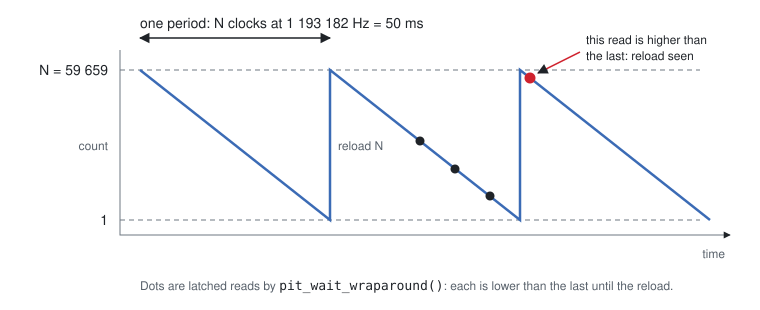

# PIT (8253/8254 programmable interval timer)

> The original PC's timer chip, a 16-bit down-counter at 1 193 182 Hz behind I/O ports 0x40 to 0x43; every x86 hypervisor still emulates it, and seL4 times its other clocks against it at boot.

[Index](../INDEX.md) › [Part 3: Platform and devices](../INDEX.md#part-3-platform-and-devices) › [Timers](../INDEX.md#timers) · ← [Timers: a map](timers.md) · [TSC](tsc.md) →

| At a glance | |
|---|---|
| Kind | Timer device (Intel 8253/8254 chip, now always emulated or in the chipset) |
| Architecture | x86 |
| Reached through | [I/O ports](io-ports.md) `0x40` to `0x43` |
| Interrupt | [ISA](isa.md) IRQ 0 |
| Key numbers | 1 193 182 Hz clock; three 16-bit counters; longest period about 54.9 ms |
| seL4 code | [`src/plat/pc99/machine/pit.c`](https://github.com/seL4/seL4/blob/master/src/plat/pc99/machine/pit.c) |
| seL4 use | [Timer calibration](timer-calibration.md) at boot only; `BOOT_CODE`, outside the proofs |
| On the clouds | Emulated on EC2 Nitro and Compute Engine x86 types, with IRQ 0 on I/O APIC pin 0 |

## What it is

The Intel 8253, and its superset the 8254, has three independent 16-bit
counters fed by one clock. On a PC that clock is 1 193 182 Hz (a twelfth
of the original PC's 14.318 18 MHz crystal), and that rate is
fixed by convention, which is the PIT's whole value today: it is the one
x86 timer whose frequency software can assume.

| Channel | Wired to | Use today |
|---|---|---|
| 0 | [IRQ](irq.md) 0 | System tick, or a reference clock |
| 1 | DRAM refresh on the original PC | Nothing |
| 2 | PC speaker; its gate is bit 0 of port `0x61` | Occasionally calibration |

Ports: `0x40` to `0x42` are the channels' data ports, `0x43` the mode and
command register. A command byte selects a channel, how the 16-bit value
is transferred through the 8-bit port (low byte, high byte, or low then
high), a mode (0 to 5) and binary or BCD counting.

**Mode 2, rate generator**, is the one seL4 uses. Load a count N; the
counter decrements once per clock from N to 1, then reloads N and carries
on. The period is N clocks, repeating for ever. A count of 1 is illegal
in this mode. With N up to 65 536 the longest period is about 54.9 ms.

*The count in mode 2 with seL4's N of 59 659, and how
`pit_wait_wraparound()` (see below) finds the reload.*

**Reading the count.** The count is 16 bits but the port is 8, so two
reads could straddle a decrement. Writing a **counter latch command**
(the channel's number with access bits `00`, so `0x00` for channel 0) to
`0x43` freezes a copy of the count; the next two reads return its low and
high bytes and the latch is released.

## In seL4

The kernel uses the PIT only at boot, to measure how fast the
[TSC](tsc.md) and the [local APIC timer](lapic-timer.md) run (see
[timer calibration](timer-calibration.md)):

- [`src/plat/pc99/machine/pit.c`](https://github.com/seL4/seL4/blob/master/src/plat/pc99/machine/pit.c):
  `pit_init()` writes `0x34` (channel 0, low then high byte, mode 2) and a
  divisor of 1 193 182 × 50 / 1000 = 59 659, so one period is 50 ms
  (`PIT_WRAPAROUND_MS`). `pit_wait_wraparound()` latches and reads the
  count in a loop until it goes up, which it does only at the reload.
- Callers: `measure_tsc_khz()` and `tsc_init()` in
  [`src/plat/pc99/machine/hardware.c`](https://github.com/seL4/seL4/blob/master/src/plat/pc99/machine/hardware.c),
  and `apic_measure_freq()` in
  [`src/arch/x86/kernel/apic.c`](https://github.com/seL4/seL4/blob/master/src/arch/x86/kernel/apic.c).
- All of it is `BOOT_CODE`: run once before any user thread, then
  discarded, and outside the verified proofs (see
  [boot code](../sel4/boot-code.md)).

At user level, util_libs' `libplatsupport` has a PIT driver for the pc99
ltimer, used when there is no usable [HPET](hpet.md). It needs the
kernel to grant I/O port access through an IOPort capability for ports
`0x40` to `0x43`, made with `seL4_X86_IOPortControl_Issue` (see
[I/O ports](io-ports.md)). sDDF has no PIT driver: its x86 timer driver,
`drivers/timer/tsc_hpet`, uses the TSC and the HPET.

## Gotchas

- **IRQ 0 is not always [I/O APIC](apic.md) pin 2.** On most PCs, and in QEMU, the
  [ACPI](acpi-tables.md) MADT has an interrupt source override sending [ISA](isa.md)
  IRQ 0 to pin 2. EC2's Nitro types and Compute Engine's x86 types have
  no override for IRQ 0, so the PIT is on pin 0. Read the MADT; never
  assume pin 2.
- **Emulated PITs are not 8254s.** On Compute Engine's `n1-standard-1`
  the count sometimes rose by 20 to 90 just after a reload, which a real
  8254 cannot do. A wait that stops at the first rise then returns almost
  at once and the calibration comes out wildly low.
- **Each access is slow under a hypervisor.** An emulated PIT's port
  accesses trap to the hypervisor, and a vCPU can be descheduled between
  two reads, so short PIT measurements are noisy in VMs.
- **Count once per period.** util_libs' TSC calibration once counted one
  PIT period twice and came out 2.5% low.

## See also

- [Timers: a map](timers.md): every timer on each architecture in one diagram, and how this one fits in
- [ISA](isa.md): the legacy device family the PIT belongs to
- [Local APIC and I/O APIC](apic.md): the I/O APIC pin its interrupt arrives on
- [Timer calibration](timer-calibration.md): what the PIT is used for in seL4
- [HPET](hpet.md): the timer meant to replace it
- [TSC](tsc.md) and [local APIC timer](lapic-timer.md): the clocks it calibrates
- [Hypervisor CPUID leaves](hypervisor-cpuid-leaves.md): how a VM can skip the PIT
- [ACPI tables](acpi-tables.md): the MADT says which pin IRQ 0 arrives on
- [I/O ports and MMIO](io-ports.md): x86's separate 16-bit address space for device registers, reached with the `in` and `out` instructions
- [8259 PIC](pic-8259.md): the PC's original interrupt controller, a pair of 8259A chips giving 15 IRQ lines through I/O ports
- [seL4_libs and util_libs](../sel4/sel4-libs.md): the classic C libraries for building dynamic systems on seL4

## References

- [Intel 8254 Programmable Interval Timer datasheet](https://www.scs.stanford.edu/10wi-cs140/pintos/specs/8254.pdf)
  (a copy kept for Stanford's Pintos course), "Mode 2: Rate Generator" and
  "Counter Latch Command": the two sections seL4's code relies on.
  *Checked 2026-11-14.*
- [Linux KVM documentation, "Timekeeping Virtualization for X86-Based Architectures"](https://docs.kernel.org/virt/kvm/x86/timekeeping.html),
  section 2.1 "i8254 - PIT": the channels, ports and wiring, with a
  diagram. *Checked 2026-11-14.*
- [seL4 `pit.c`](https://github.com/seL4/seL4/blob/master/src/plat/pc99/machine/pit.c):
  the kernel's whole PIT driver, 40 lines. *Checked 2026-11-14.*
- [Wikipedia, "Intel 8253"](https://en.wikipedia.org/wiki/Intel_8253),
  section "IBM PC programming": 1.193 18 MHz as the
  14.318 18 MHz system clock divided by 12. *Checked 2026-11-14.*
- [util_libs `libplatsupport/src/plat/pc99/pit.c`](https://github.com/seL4/util_libs/blob/master/libplatsupport/src/plat/pc99/pit.c)
  and [`ltimer.c`](https://github.com/seL4/util_libs/blob/master/libplatsupport/src/plat/pc99/ltimer.c):
  the user-level PIT driver and the HPET-then-PIT choice.
  *Checked 2026-11-14.*
- [sDDF `drivers/timer/tsc_hpet/timer.c`](https://github.com/au-ts/sddf/blob/main/drivers/timer/tsc_hpet/timer.c):
  sDDF's x86 timer driver. *Checked 2026-11-14.*
- [seL4 `libsel4/arch_include/x86/interfaces/object-api-arch.xml`](https://github.com/seL4/seL4/blob/master/libsel4/arch_include/x86/interfaces/object-api-arch.xml):
  `seL4_X86_IOPortControl_Issue`. *Checked 2026-11-14.*
- [OSDev wiki, "Programmable Interval Timer"](https://wiki.osdev.org/Programmable_Interval_Timer):
  a practical guide with the command byte laid out. *Unchecked (the site
  refuses scripted fetches).*
