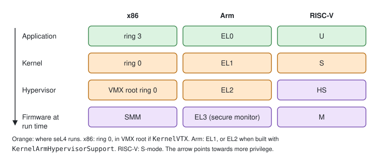

# Privilege levels

> The CPU modes that separate user code, kernel, hypervisor and firmware on x86 (rings, VMX root, SMM), Arm (EL0 to EL3) and RISC-V (U, S, M): seL4 runs in ring 0, EL1 or EL2, or S-mode, and something more privileged usually sits beneath it.

[Index](../INDEX.md) › [Part 2: Processor fundamentals](../INDEX.md#part-2-processor-fundamentals) › [Common ideas](../INDEX.md#common-ideas) · ← [History and key papers](../sel4/history-and-papers.md) · [Exceptions, interrupts and traps](exceptions-and-traps.md) →

| At a glance | |
|---|---|
| Kind | CPU mechanism: modes that separate user code, kernel, hypervisor and firmware |
| Architecture | x86, Arm, RISC-V |
| Reached through | An [exception, interrupt or system call](exceptions-and-traps.md) |
| Key numbers | x86: four rings; AArch64: four exception levels; RISC-V: three modes (unchecked) |
| seL4 code | `init_gdt()` in [`src/arch/x86/64/kernel/vspace.c`](https://github.com/seL4/seL4/blob/master/src/arch/x86/64/kernel/vspace.c); [`include/arch/riscv/arch/sbi.h`](https://github.com/seL4/seL4/blob/master/include/arch/riscv/arch/sbi.h) |
| seL4 config | `KernelVTX`, `KernelArmHypervisorSupport` |
| seL4 use | Runs in ring 0, EL1 or EL2, or S-mode |
| On the clouds | The provider's hypervisor sits beneath the kernel ([cloud VMs](cloud-vms.md)) |

## What it is

A CPU that ran every instruction for everyone could not protect a
kernel from its programs: any program could rewrite the page tables or
turn interrupts off. So every architecture seL4 supports keeps a
**current privilege level** in the processor state and checks it on
each sensitive operation. Less privileged code can do arithmetic and
touch the memory mapped for it; anything else (control registers,
interrupt masking, I/O, halting) either faults or is silently ignored.
The only way up is a controlled entry: an
[exception, interrupt or system call](exceptions-and-traps.md), which
jumps to an address the more privileged level chose earlier.

The architecture facts on this page come from the vendor manuals, which
were not opened today (unchecked); the seL4 facts are checked against
the source.

### x86

x86 has four **rings**, 0 (most privileged) to 3. The current ring
(CPL, current privilege level) is the low two bits of the `CS` segment
register (see [x86-64 basics](x86-64-basics.md)). Every mainstream
system uses only ring 0 for the kernel and ring 3 for users; rings 1
and 2 are legacy, and paging only distinguishes "supervisor" (rings 0
to 2) from "user" (ring 3) anyway.

Two more modes were bolted on beside the rings:

- **VMX** (Intel VT-x; AMD's equivalent is SVM) adds an orthogonal
  axis: **root** operation for a hypervisor and **non-root** for its
  guests, each with its own rings 0 to 3. A guest kernel runs in
  non-root ring 0 and believes it owns the machine; operations the
  hypervisor chose to intercept cause a **VM exit** to root mode. See
  [x86 virtualisation](x86-virtualisation.md).
- **SMM** (system management mode) belongs to the firmware. A system
  management interrupt (SMI) suspends everything, kernel and hypervisor
  included, and runs firmware code from memory the OS cannot see, then
  resumes. The OS cannot mask or observe it, only notice lost time.

### Arm

AArch64 has four **exception levels**:

| Level | Meant for |
|---|---|
| EL0 | applications |
| EL1 | OS kernel |
| EL2 | hypervisor |
| EL3 | secure monitor (firmware) |

In addition, TrustZone splits the machine into a **secure** and a
**non-secure** world, each with its own EL0 and EL1; EL3 switches
between them. Firmware (Trusted Firmware-A) keeps EL3 and answers
calls from below made with the `SMC` instruction, such as
[PSCI](psci-smccc.md) to start a core. `SVC` enters EL1 from EL0 and
`HVC` enters EL2 from EL1. EL2 and EL3 are optional in the
architecture, and a guest in a virtual machine sees only EL0 and EL1.
See [AArch64 basics](aarch64-basics.md) and
[Arm virtualisation](arm-virtualisation.md).

### RISC-V

RISC-V has three modes: **U** (user), **S** (supervisor) and **M**
(machine). M-mode is mandatory, sees physical memory without
translation and runs firmware, normally OpenSBI. A kernel in S-mode
asks it for services through the **SBI** (supervisor binary interface)
using the `ecall` instruction, the same instruction U-mode uses to make
a system call into S-mode. The hypervisor (H) extension turns S into
**HS** (hypervisor-extended supervisor) and adds virtualised **VS** and
**VU** modes for guests. See [RISC-V basics](riscv-basics.md).

### Side by side

| Role | x86 | Arm | RISC-V |
|---|---|---|---|
| Application | ring 3 | EL0 | U |
| Kernel | ring 0 | EL1 | S |
| Hypervisor | VMX root ring 0 | EL2 | HS |
| Guest kernel | VMX non-root ring 0 | EL1 | VS |
| Firmware at run time | SMM | EL3 (secure monitor) | M |
| Call down to firmware | none (SMI, or ACPI) | `SMC` | `ecall` (SBI) |

The designs differ in one way that matters for seL4. On Arm and RISC-V
the hypervisor level is a distinct, more privileged level with its own
registers, so a kernel must be built for it. On x86, root mode is the
ordinary ring 0 with extra instructions enabled, so the same kernel
can run with or without guests.

## In seL4

| Architecture | seL4 runs in | Beneath it |
|---|---|---|
| x86 | ring 0 (VMX root if `KernelVTX`) | SMM firmware; a hypervisor on a cloud VM |
| Arm | EL1, or EL2 with `KernelArmHypervisorSupport` | EL3 firmware; a hypervisor on a cloud VM |
| RISC-V | S-mode | M-mode firmware (OpenSBI) |

*Read down for more privilege. On x86 the hypervisor row is not a separate level: VMX root is the ordinary ring 0 with extra instructions, and SMM stands beside the rings.*

- **x86.** The kernel's code segment has descriptor privilege level 0
  and user threads get one with level 3; no other ring is used
  (`init_gdt()` in
  [`src/arch/x86/64/kernel/vspace.c`](https://github.com/seL4/seL4/blob/master/src/arch/x86/64/kernel/vspace.c)).
  With `KernelVTX` the kernel executes `VMXON` and offers VCPU objects
  so that a user-level monitor can run guests
  ([`src/arch/x86/object/vcpu.c`](https://github.com/seL4/seL4/blob/master/src/arch/x86/object/vcpu.c)).
  seL4 has no support for AMD's SVM (unchecked beyond finding no SVM
  code in `src/arch/x86`).
- **Arm.** The level is a build-time choice. With
  `KernelArmHypervisorSupport` (CMake, in
  [`src/arch/arm/config.cmake`](https://github.com/seL4/seL4/blob/master/src/arch/arm/config.cmake))
  the kernel is built to run in EL2, uses the EL2 system registers
  (`head.S` selects `sctlr_el2` in place of `sctlr_el1`) and offers
  VCPU objects; user threads still run in EL0 and guests' kernels in
  EL1. Without it the kernel runs in EL1. The kernel does not move
  itself between levels: the [elfloader](../sel4/elfloader.md) must
  deliver it at the level it was built for.
- **RISC-V.** The kernel runs in S-mode and uses the `s*` control
  registers (`sstatus`, `stvec`, ...). It calls M-mode for the timer,
  console and IPIs through `sbi_call()`, an `ecall`, in
  [`include/arch/riscv/arch/sbi.h`](https://github.com/seL4/seL4/blob/master/include/arch/riscv/arch/sbi.h).
  Upstream seL4 has no H-extension support (unchecked).

The verified configurations say which level was proved; see
[verification](../sel4/verification.md).

## Gotchas

- **The kernel is rarely the most privileged software.** The proofs
  assume that whatever is beneath (SMM, EL3, M-mode, a cloud
  hypervisor) behaves like the hardware model. On a
  [cloud VM](cloud-vms.md) the "hardware" is the provider's
  hypervisor, which can trap instructions, hide
  [CPUID features](cpuid-and-msrs.md) and take time away.
- **An Arm kernel image is tied to its level.** An EL1 build started
  in EL2, or the reverse, fails early and without a message, because
  its first system register accesses are for the wrong level. Whether
  EL2 is available depends on the firmware and, in a VM, on whether the
  hypervisor offers nested virtualisation.
- **x86 rings are not VMX modes.** "Ring -1" for a hypervisor and
  "ring -2" for SMM are slang; neither is a ring, and a guest's ring 0
  is a real ring 0 as far as the guest can tell.
- **SMIs steal time invisibly**, which matters when
  [calibrating a timer](timer-calibration.md) or reasoning about worst
  case execution time.

## See also

- [Exceptions and traps](exceptions-and-traps.md): how control moves to a more privileged level
- [x86-64 basics](x86-64-basics.md): where the ring lives in the segment registers
- [x86 exceptions and system calls](x86-exceptions-syscalls.md): the ring 3 to ring 0 transition in detail
- [AArch64 basics](aarch64-basics.md): exception levels and their registers
- [RISC-V basics](riscv-basics.md): modes and control registers
- [seL4 as a hypervisor](../sel4/hypervisor.md): what the kernel adds when it runs at the hypervisor level
- [Cloud VMs](cloud-vms.md): what the layer beneath does on EC2, Compute Engine and Azure

## References

- [seL4 `src/arch/x86/64/kernel/vspace.c`](https://github.com/seL4/seL4/blob/master/src/arch/x86/64/kernel/vspace.c):
  `init_gdt()` builds descriptors with privilege level 0 and 3 only.
  *Checked 2026-11-14.*
- [seL4 `src/arch/x86/config.cmake`](https://github.com/seL4/seL4/blob/master/src/arch/x86/config.cmake)
  and [`src/arch/x86/object/vcpu.c`](https://github.com/seL4/seL4/blob/master/src/arch/x86/object/vcpu.c):
  `KernelVTX` and `vmxon()`. *Checked 2026-11-14.*
- [seL4 `src/arch/arm/config.cmake`](https://github.com/seL4/seL4/blob/master/src/arch/arm/config.cmake)
  and [`src/arch/arm/64/head.S`](https://github.com/seL4/seL4/blob/master/src/arch/arm/64/head.S):
  `KernelArmHypervisorSupport` ("Build as Hypervisor") and the choice
  of `sctlr_el2`. *Checked 2026-11-14.*
- [seL4 `include/arch/riscv/arch/sbi.h`](https://github.com/seL4/seL4/blob/master/include/arch/riscv/arch/sbi.h):
  the SBI calls and the `ecall` that makes them. *Checked 2026-11-14.*
- [Intel 64 and IA-32 Architectures Software Developer's Manual](https://www.intel.com/content/www/us/en/developer/articles/technical/intel-sdm.html),
  volume 3: chapter 5 "Protection" (rings), the VMX chapters, and the
  "System Management Mode" chapter. *Unchecked (intel.com refuses
  scripted fetches).*
- [Arm Architecture Reference Manual for A-profile (DDI 0487)](https://developer.arm.com/documentation/ddi0487/latest),
  section D1 "The AArch64 System Level Programmers' Model": exception
  levels and security states. *Unchecked (developer.arm.com refuses
  scripted fetches).*
- [The RISC-V Instruction Set Manual, Volume II: Privileged Architecture](https://github.com/riscv/riscv-isa-manual/releases):
  privilege modes, and the hypervisor extension chapter. *Unchecked
  (not opened today).*

## My notes

<!-- Tim writes here. Sessions leave this section as it is. -->
