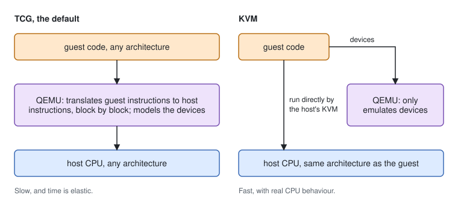
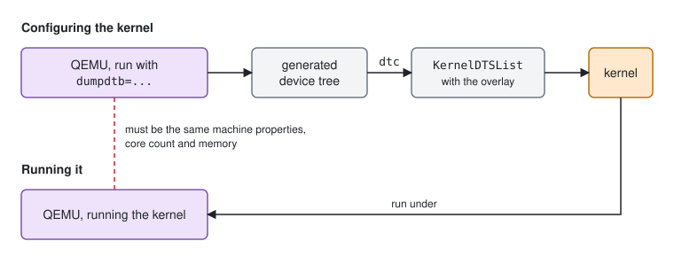

# QEMU

> QEMU emulates whole machines (x86 PCs, Arm and RISC-V `virt` boards) in software or with KVM, and is where most seL4 development and testing first runs; its machines resemble clouds only loosely.

[Index](../INDEX.md) › [Part 3: Platform and devices](../INDEX.md#part-3-platform-and-devices) › [Virtual and cloud machines](../INDEX.md#virtual-and-cloud-machines) · ← [IOMMUs: VT-d and SMMU](iommu.md) · [Cloud virtual machines](cloud-vms.md) →

Read first: [x86 boot](x86-boot.md), [Arm boot](arm-boot.md), [Device trees](device-tree.md).

| At a glance | |
|---|---|
| Kind | Full-system emulator |
| Architectures | x86, Arm and RISC-V guests, one program each (`qemu-system-x86_64`, `qemu-system-aarch64`, `qemu-system-riscv64`) |
| Accelerators | TCG (translation, the default) or KVM |
| seL4 platforms | `pc99`, `qemu-arm-virt`, `qemu-riscv-virt`, `spike`; Microkit boards `qemu_virt_aarch64`, `qemu_virt_riscv64`, `x86_64_generic` |
| seL4 code | [`simulate.py`](https://github.com/seL4/seL4_tools/blob/master/cmake-tool/simulate_scripts/simulate.py), [`simulation.cmake`](https://github.com/seL4/seL4_tools/blob/master/cmake-tool/helpers/simulation.cmake), [`qemu-arm-virt/config.cmake`](https://github.com/seL4/seL4/blob/master/src/plat/qemu-arm-virt/config.cmake) |
| seL4 config | `ARM_CPU`, `QEMU_MEMORY` (MiB, default 1024), `QEMU_GIC_VERSION` |
| seL4 use | Where most development and testing first runs, through the `simulate` script |
| On the clouds | Its machines resemble clouds only loosely |

## What it is

QEMU is a **full-system emulator**: one program per guest architecture
(`qemu-system-x86_64`, `qemu-system-aarch64`, `qemu-system-riscv64`,
`qemu-system-arm`, `qemu-system-i386`) that models a CPU, memory and a
board's worth of devices, and runs an unmodified kernel on them. It
executes guest code in one of two ways:

| Accelerator | How | Use |
|---|---|---|
| **TCG** (tiny code generator), the default | Translates guest instructions to host instructions, block by block. Any guest on any host. Slow, and time is elastic | Cross-architecture work; exact control of CPU features |
| **KVM** (`-accel kvm` or `-enable-kvm`) | The Linux host's hardware virtualisation runs guest code directly; QEMU only emulates devices. Guest and host architecture must match | Speed; real CPU behaviour. The same split clouds use, with their own device models in QEMU's place |



*Where guest code runs under each accelerator. Under KVM, QEMU is left
with the devices alone.*

### Machines

`-machine` (or `-M`) picks the board, which fixes the memory map and the
built-in devices. The ones seL4 work uses:

| Machine | What it is |
|---|---|
| x86 `pc` (the default, "i440FX") | A 1996 PC: PCI host bridge with configuration through I/O ports only, [ISA](isa.md) devices, [PIC](pic-8259.md), [PIT](pit.md), [I/O APIC](apic.md), [HPET](hpet.md), COM1 [UART](uart.md) |
| x86 `q35` | A 2009 PC: PCI Express with memory-mapped configuration (an MCFG [ACPI table](acpi-tables.md)), AHCI; otherwise the same legacy devices. Can emulate an Intel [IOMMU](iommu.md) |
| x86 `microvm` | A minimal machine with virtio-mmio and no PCI |
| AArch64/Arm `virt` | No real board: RAM from `0x40000000`, a PL011 at `0x09000000`, a [GIC](gicv2.md), [generic timers](arm-generic-timer.md), [PSCI](psci-smccc.md), 32 [virtio](virtio.md)-mmio slots, a generic PCIe host; all described in a device tree QEMU generates |
| RISC-V `virt` | The same idea: RAM from `0x80000000`, a 16550 UART at `0x10000000`, PLIC and CLINT ([RISC-V interrupts](riscv-interrupts.md)), virtio-mmio, PCIe |
| RISC-V `spike` | Mimics the Spike reference simulator: almost no devices |
| Real boards (`raspi3b`, `sabrelite`, `xlnx-zcu102`, ...) | Partial models of actual hardware |

Machine properties follow the name after commas. For Arm `virt`:

| Property | Effect |
|---|---|
| `virtualization=on` | Emulate EL2, so the guest starts in EL2 and a hypervisor-mode seL4 can run ([Arm virtualisation](arm-virtualisation.md)). Under KVM it needs a host kernel that supports nested virtualisation |
| `secure=on/off` | Emulate EL3 and the secure world |
| `gic-version=2`, `3`, `max` | Which GIC; version 2 limits the machine to 8 cores |
| `highmem=off` | Keep RAM and devices below 4 GiB (no high PCIe window or high redistributor region) |
| `its=on/off` | With GICv3, provide an [ITS](gicv3-its.md); deprecated in current QEMU in favour of `msi=` |
| `dumpdtb=file` | Write the generated device tree to `file` and exit without running |

### CPU, memory, cores

- **`-cpu`** picks a CPU model. On x86: a named microarchitecture
  (`Nehalem`, `Haswell`, ...), `qemu64` (a lowest common denominator),
  `max` (everything the accelerator can do) or, under KVM, `host`.
  Feature flags are added and removed with `,+name` and `,-name`
  (`+fsgsbase`, `+pdpe1gb`, `+xsave`, `+invpcid`, `+x2apic`), and
  `,enforce` makes QEMU refuse to start if it cannot provide one, where
  by default it only warns. On Arm: `cortex-a53`, `cortex-a57`,
  `cortex-a72`, `max`, or `host` with KVM. On RISC-V: `rv64`, `rv32`,
  with extensions as properties. See [CPUID and MSRs](cpuid-and-msrs.md)
  for what the flags mean to the guest.
- **`-m`** sets RAM (`-m 2G`, `-m size=2G`; a bare number is MiB).
- **`-smp N`** sets the number of cores.

### Loading the guest

| Option | Behaviour |
|---|---|
| `-kernel f` on x86 | If `f` has a Multiboot (version 1) header QEMU acts as a Multiboot loader: loads the 32-bit ELF and enters at its entry point in 32-bit protected mode. `-initrd g` becomes the first Multiboot *module*; `-append` the command line. A Linux bzImage is handled differently. No firmware boot path is exercised beyond SeaBIOS starting |
| `-kernel f` on Arm | An ELF is loaded by its program headers and entered at its entry point, in the highest exception level emulated, with nothing else set up. A flat "Image" is loaded Linux-style with the device tree's address in `x0` |
| `-kernel f` on RISC-V | Loaded after the firmware named by `-bios` (OpenSBI by default, which enters it in S-mode with the hart ID in `a0` and the device tree in `a1`); `-bios none` starts the image in M-mode with no firmware |
| `-device loader,file=f,addr=A,cpu-num=0` | The "generic loader": place raw bytes at an address and set a core's program counter. Works for images that are not ELF |
| `-bios f` | Replace the firmware |
| `-drive if=pflash,format=raw,readonly=on,file=OVMF_CODE.fd` (and a second, writable, for the variable store) | Boot through [UEFI](uefi.md) firmware (OVMF on x86, AAVMF/`QEMU_EFI.fd` on Arm) from a disk image, as a cloud does. See [Cloud boot images](cloud-boot-images.md) |
| `-drive file=disk.img,format=raw` | Attach a disk; the interface depends on the machine unless a `-device` says |

### Console and devices

- **`-nographic`** removes the display window and connects the first
  serial port *and* the QEMU monitor to the terminal. **`-serial
  mon:stdio`** says the same for the serial port explicitly; with
  `-display none` it is the form scripts use. Each `-serial` option
  fills the next UART, so `-serial null -serial mon:stdio` puts the
  terminal on the *second* UART.
- In that mode `Ctrl-a x` quits, `Ctrl-a c` switches to the monitor
  (`info registers`, `info mtree` for the memory map, `info qtree` for
  devices, `info pic`, `info lapic`, `xp /8x 0x...` to read physical
  memory), `Ctrl-a h` lists the rest.
- **`-device`** adds a device and **`-netdev`** / `-drive id=` the host
  side it connects to:

  ```
  -device virtio-net-pci,netdev=n0 -netdev user,id=n0,hostfwd=tcp::5555-:22
  -device e1000,netdev=n0          (Intel 82540EM gigabit NIC)
  -device virtio-blk-pci,drive=d0 -drive id=d0,if=none,format=raw,file=disk.img
  -device virtio-net-device,netdev=n0    (the virtio-mmio form, for virt)
  -device nvme,drive=d0,serial=x
  ```

  `-device help` lists them all; `-device NAME,help` its properties.

### Debugging

- **`-s`** opens a GDB server on TCP port 1234; **`-S`** starts with the
  CPU halted. Then `gdb kernel.elf -ex 'target remote :1234'` gives
  breakpoints and single-stepping in the kernel from the first
  instruction. See [Debugging](../sel4/debugging.md).
- **`-d int`** logs every interrupt and exception taken, with the
  register state: the way to see a triple fault or an exception loop
  that prints nothing. **`-d guest_errors`** logs accesses to
  nonexistent device registers and other guest mistakes; `-d unimp`
  unimplemented features; `-d cpu_reset` the state at each reset;
  **`-D file`** sends the log to a file. `-d help` lists the categories.
- **`-no-reboot`** (with `-no-shutdown`) stops at a triple fault instead
  of resetting in a loop.

## In seL4

### The `simulate` script

Projects built with the `seL4_tools` CMake framework (sel4test, the
tutorials) get an executable `simulate` in the build directory, and a
`launch_gdb` beside it. It is
[`cmake-tool/simulate_scripts/simulate.py`](https://github.com/seL4/seL4_tools/blob/master/cmake-tool/simulate_scripts/simulate.py)
with defaults filled in by `GenerateSimulateScript()` in
[`cmake-tool/helpers/simulation.cmake`](https://github.com/seL4/seL4_tools/blob/master/cmake-tool/helpers/simulation.cmake),
which chooses per platform:

| Platform | QEMU command, in outline |
|---|---|
| `pc99` | `qemu-system-x86_64` (or `-i386`) `-cpu <model>,<flags>,enforce -nographic -serial mon:stdio -m size=... -kernel <kernel> -initrd <root task>`. The model comes from `KernelX86MicroArch*` (`Nehalem` by default) and flags are added or removed from the kernel configuration: `KernelHugePage` → `pdpe1gb`, `KernelFSGSBaseInst` → `fsgsbase`, `KernelFPUXSave` → `xsave`, `KernelSupportPCID` → `invpcid`, `KernelVTX` → `vme`, and so on |
| `qemu-arm-virt` | `qemu-system-aarch64` (or `-arm`) `-machine virt[,gic-version=N]`, or `virt,virtualization=on,highmem=off,secure=off[,gic-version=N]` when `KernelArmHypervisorSupport` is set; `-cpu ${KernelArmCPU} -nographic -m size=${QEMU_MEMORY} -kernel <elfloader image>` |
| `qemu-riscv-virt` | `qemu-system-riscv64 -machine virt -cpu rv64 -nographic -bios none -m size=${QEMU_MEMORY} -kernel <image>` |
| `spike` | `-machine spike` (64-bit) or `virt` (32-bit), `-bios none` |
| some Arm boards | `sabrelite`, `xilinx-zynq-a9`, `xlnx-zcu102`, `mcimx7d-sabre`, `raspi3b`, several with `-serial null -serial mon:stdio` |

On x86 the kernel and root task are two files, loaded as Multiboot
kernel and module; elsewhere there is one image with the
[elfloader](../sel4/elfloader.md) in front. Useful arguments to the
script: `-d` (`--gdbserver`) adds `-s -S`; `-n` (`--dry-run`) prints the
command without running it, the quickest way to learn the options;
`-m`, `-c`, `-M` override memory, CPU and machine; `--extra-qemu-args`
and `--extra-cpu-opts` append.

### Kernel platforms made for QEMU

`qemu-arm-virt` and `qemu-riscv-virt` are kernel platforms
(`KernelPlatform`) for the `virt` machines. Because the machine's
hardware depends on the command line, **their device tree is generated
by running QEMU during the kernel's configuration**:
[`src/plat/qemu-arm-virt/config.cmake`](https://github.com/seL4/seL4/blob/master/src/plat/qemu-arm-virt/config.cmake)
runs `qemu-system-... -machine virt,secure=off[,virtualization=on,highmem=off],gic-version=N,dumpdtb=... -cpu ${ARM_CPU} -smp ${KernelMaxNumNodes} -m ${QEMU_MEMORY} -nographic`,
decompiles the result with `dtc`, and appends it and
`overlay-qemu-arm-virt.dts` to `KernelDTSList` (see
[Device trees](device-tree.md)). `ARM_CPU` (`cortex-a7`, `a15`, `a53`,
`a57`, `a72`), `QEMU_MEMORY` (MiB, default 1024) and `QEMU_GIC_VERSION`
are CMake variables. The RISC-V platform does the same. A consequence:
the kernel must be run with the same machine properties, core count and
memory it was built with, and `qemu-system-*` must be installed on the
build machine.



*QEMU appears twice: once to describe the machine to the kernel's
build, once to be that machine. The two command lines must agree.*

x86 needs none of this: the `pc99` kernel discovers memory and devices
at boot, so one kernel runs under any `-m`, `-smp` and machine.

### Microkit

Microkit's SDK has QEMU boards, with run commands in its
[manual](https://github.com/seL4/microkit/blob/main/docs/manual.md):

| Board | Command, in outline |
|---|---|
| `qemu_virt_aarch64` | `qemu-system-aarch64 -machine virt,virtualization=on -cpu cortex-a53 -nographic -serial mon:stdio -device loader,file=loader.img,addr=0x70000000,cpu-num=0 -m size=2G` |
| `qemu_virt_aarch64_el1` | the same with plain `-machine virt` |
| `qemu_virt_riscv64` | `qemu-system-riscv64 -machine virt -nographic -serial mon:stdio -kernel loader.img -m size=2G`, started by QEMU's bundled OpenSBI |
| `x86_64_generic` | `qemu-system-x86_64 -cpu qemu64,+fsgsbase,+pdpe1gb,+xsaveopt,+xsave -m 1G -display none -serial mon:stdio -kernel sel4_32.elf -initrd loader.img` |

The Arm image is a flat binary, hence the generic loader and a fixed
address. `-smp 4` is added for the SMP configurations. On Arm and RISC-V
the memory size is fixed when the SDK's kernel is built, so use the
manual's `2G`; on x86 it can be chosen at run time with `-m`.

## Gotchas

- **TCG time is not real time.** Guest instructions take varying host
  time and virtual clocks can run ahead or behind, so anything that
  measures one clock against another ([Timer calibration](timer-calibration.md))
  gets plausible but unstable numbers, and timing-dependent tests that
  pass under TCG prove little about hardware. `-icount` makes time
  deterministic at a cost in speed.
- **TCG lacks CPU features.** No VT-x, so `KernelVTX` cannot be tested
  on TCG (the `simulate` script's `vme` mapping notwithstanding); some
  newer instruction sets are missing or recent; `,enforce` turns "QEMU
  silently dropped a flag the kernel requires" into an error at start.
  Without it the kernel fails its own feature check at boot, or faults
  on an undefined instruction.
- **KVM gives the host's CPU, not a chosen one.** `-cpu host` exposes
  whatever the build machine has; a named model fails or is trimmed if
  the host lacks a feature. Results differ between developers' machines
  and CI. Nested virtualisation (seL4 with VT-x under KVM) needs it
  enabled in the host's KVM module. Arm's `virtualization=on` works
  with KVM only if the host kernel supports nested virtualisation;
  otherwise QEMU refuses to start.
- **The default x86 CPU is too old for seL4's defaults.** `qemu64`
  lacks features a default x86-64 seL4 build requires (which is why
  both the `simulate` script and Microkit's command add flags); a
  hand-written command line that omits them stops at the kernel's CPU
  feature check.
- **`-kernel` skips the firmware path.** A kernel that boots with
  `-kernel` has not shown it can be loaded by GRUB or by UEFI: no ACPI
  RSDP handed over by a boot loader, no EFI memory map, no boot-loader
  frame buffer. Clouds boot from a disk through UEFI
  ([Cloud boot images](cloud-boot-images.md)); test that path with OVMF
  and a disk image before spending money on instances.
- **QEMU's devices are not a cloud's.** `q35` has a PIT, an HPET, a PIC
  and COM1; [EC2](ec2.md) and [Compute Engine](gce.md) each lack some of
  these and add devices QEMU has no model of (ENA, gVNIC). Code that
  works on `q35` has been tested against QEMU's idea of a PC. See
  [Cloud virtual machines](cloud-vms.md).
- **Emulated devices are forgiving.** Memory starts zeroed and TCG does
  not model CPU caches, so missing cache flushes and
  uninitialised-memory bugs pass unnoticed (unchecked).
- **`virt` changes between QEMU versions.** Addresses of newer devices
  and details of the generated device tree move; a `qemu-arm-virt`
  kernel built against one QEMU's tree can misbehave on another. The
  kernel's `config.cmake` only insists on QEMU 3.1.0 or later.
- **A large `-m` on x86 splits RAM** around the 32-bit PCI hole: from
  3.5 GiB on `pc`, 3 GiB stays below 4 GiB and the rest starts at 4 GiB;
  from 2.75 GiB on `q35`, 2 GiB stays below. On Arm `virt` with
  `highmem=off` RAM, which starts at 1 GiB, is capped at 3 GiB.

## See also

- [x86 boot](x86-boot.md): Multiboot, which `-kernel` implements
- [Arm boot](arm-boot.md): what an Arm image expects at entry
- [UEFI](uefi.md) and [Cloud boot images](cloud-boot-images.md): booting QEMU the way a cloud boots
- [Device trees](device-tree.md): `dumpdtb` and build-time trees
- [virtio](virtio.md): the devices `-device virtio-*` adds
- [UARTs: 16550 and PL011](uart.md): what `-serial` connects
- [Timer calibration](timer-calibration.md): why TCG timing misleads
- [x86 virtualisation (VT-x)](x86-virtualisation.md) and [Arm virtualisation (EL2)](arm-virtualisation.md): what the accelerators and `virtualization=on` rest on
- [Cloud virtual machines](cloud-vms.md): how real clouds differ
- [Debugging](../sel4/debugging.md): GDB against `-s -S`
- [Elfloader](../sel4/elfloader.md): the image `-kernel` loads on Arm and RISC-V
- [Build system](../sel4/build-system.md): where `simulate` comes from
- [sel4test and sel4bench](../sel4/sel4test.md): the test suite usually run this way
- [Microkit](../sel4/microkit.md): its QEMU boards
- [Index](../INDEX.md): the reading order

## References

- [seL4_tools `cmake-tool/helpers/simulation.cmake`](https://github.com/seL4/seL4_tools/blob/master/cmake-tool/helpers/simulation.cmake):
  the per-platform QEMU binary, machine, CPU and flags.
  *Checked 2026-11-14.*
- [seL4_tools `cmake-tool/simulate_scripts/simulate.py`](https://github.com/seL4/seL4_tools/blob/master/cmake-tool/simulate_scripts/simulate.py):
  the script's arguments, `-s -S`, `-kernel`/`-initrd`.
  *Checked 2026-11-14.*
- [seL4 `src/plat/qemu-arm-virt/config.cmake`](https://github.com/seL4/seL4/blob/master/src/plat/qemu-arm-virt/config.cmake)
  and [`src/plat/qemu-riscv-virt/config.cmake`](https://github.com/seL4/seL4/blob/master/src/plat/qemu-riscv-virt/config.cmake):
  the `dumpdtb` step and its variables. *Checked 2026-11-14.*
- [Microkit `docs/manual.md`](https://github.com/seL4/microkit/blob/main/docs/manual.md),
  the board sections "QEMU virt (AArch64)", "QEMU virt (RISC-V 64-bit)"
  and "x86-64 generic": run commands. *Checked 2026-11-14.*
- [QEMU documentation, "Invocation"](https://www.qemu.org/docs/master/system/invocation.html):
  the options, including `-accel` ("By default, tcg is used"), `-m`,
  `-nographic`, `-serial`, `-s`, `-S`, `-d`, `-D`, `-no-reboot` and
  `-device intel-iommu`. *Checked 2026-11-14.*
- [QEMU documentation, "'virt' generic virtual platform"](https://www.qemu.org/docs/master/system/arm/virt.html):
  devices, CPU models and machine properties, including the deprecation
  of `its`. *Checked 2026-11-14.*
- [QEMU documentation, "GDB usage"](https://www.qemu.org/docs/master/system/gdb.html).
  *Checked 2026-11-14.*
- QEMU documentation,
  ["'virt' Generic Virtual Platform" (RISC-V)](https://www.qemu.org/docs/master/system/riscv/virt.html),
  ["microvm"](https://www.qemu.org/docs/master/system/i386/microvm.html),
  ["Generic Loader"](https://www.qemu.org/docs/master/system/generic-loader.html),
  ["Keys in the character backend multiplexer"](https://www.qemu.org/docs/master/system/mux-chardev.html)
  and ["QEMU Monitor"](https://www.qemu.org/docs/master/system/monitor.html):
  the RISC-V machine and its default OpenSBI, the loader's `addr` and
  `cpu-num`, the `Ctrl-a` keys and the `info` commands.
  *Checked 2026-11-14.*
- [Linux KVM documentation, "Running nested guests with KVM"](https://docs.kernel.org/virt/kvm/x86/running-nested-guests.html):
  the `nested` parameter of the host's `kvm_intel` module.
  *Checked 2026-11-14.*
- QEMU source:
  [`hw/arm/virt.c`](https://github.com/qemu/qemu/blob/master/hw/arm/virt.c)
  (memory map; `virtualization` under KVM; the 32-bit limit with
  `highmem=off`),
  [`hw/riscv/virt.c`](https://github.com/qemu/qemu/blob/master/hw/riscv/virt.c)
  (memory map),
  [`hw/arm/boot.c`](https://github.com/qemu/qemu/blob/master/hw/arm/boot.c)
  (ELF against Linux image; the exception level entered),
  [`hw/i386/pc_piix.c`](https://github.com/qemu/qemu/blob/master/hw/i386/pc_piix.c)
  and [`hw/i386/pc_q35.c`](https://github.com/qemu/qemu/blob/master/hw/i386/pc_q35.c)
  (machine descriptions with their years; the RAM split),
  [`hw/core/machine.c`](https://github.com/qemu/qemu/blob/master/hw/core/machine.c)
  (`dumpdtb`), [`util/log.c`](https://github.com/qemu/qemu/blob/master/util/log.c)
  (the `-d` items) and
  [`target/i386/cpu.c`](https://github.com/qemu/qemu/blob/master/target/i386/cpu.c)
  (`enforce`; VMX missing from TCG's features). *Checked 2026-11-14.*

## My notes

<!-- Tim writes here. Sessions leave this section as it is. -->
