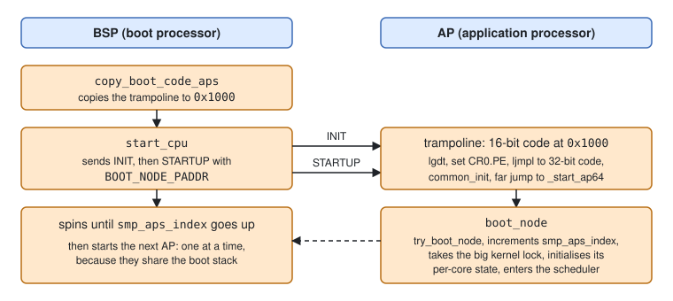

# SMP bring-up: starting the other cores

> How a multicore machine goes from one running core to all of them: INIT and STARTUP IPIs on x86, PSCI `CPU_ON` on Arm, SBI HSM on RISC-V; on x86 the seL4 kernel does it itself, on Arm and RISC-V the elfloader does it first.

[Index](../INDEX.md) › [Part 2: Processor fundamentals](../INDEX.md#part-2-processor-fundamentals) › [Common ideas](../INDEX.md#common-ideas) · ← [FPU and SIMD state](fpu-state.md) · [ELF and linking](elf.md) →

Read first: [Local APIC and I/O APIC](apic.md), [x86 boot](x86-boot.md).

| At a glance | |
|---|---|
| Kind | Boot mechanism: starting the cores other than the boot processor |
| Architecture | x86, Arm, RISC-V |
| Reached through | x86: INIT and STARTUP IPIs from the [local APIC](apic.md) ICR; Arm: [PSCI](psci-smccc.md) `CPU_ON` or a spin table; RISC-V: SBI `sbi_hart_start` |
| Found through | [ACPI](acpi-tables.md) MADT; [device tree](device-tree.md) `/cpus` node |
| Key numbers | x86 trampoline at `0x1000`, entry below 1 MiB |
| seL4 code | [`src/arch/x86/kernel/smp_sys.c`](https://github.com/seL4/seL4/blob/master/src/arch/x86/kernel/smp_sys.c), elfloader [`smp_boot.c`](https://github.com/seL4/seL4_tools/blob/master/elfloader-tool/src/arch-arm/smp_boot.c), [`src/smp/ipi.c`](https://github.com/seL4/seL4/blob/master/src/smp/ipi.c) |
| seL4 config | `KernelMaxNumNodes` (`CONFIG_MAX_NUM_NODES`) |
| seL4 use | x86: the kernel starts its APs; Arm and RISC-V: the [elfloader](../sel4/elfloader.md) does |

## What it is

Firmware starts a machine on one core, the **boot processor** (BSP on
x86, "primary" or "boot hart" elsewhere). The others, **application
processors** (APs, "secondaries"), sit halted or parked in firmware until
the operating system asks for them. SMP (symmetric multiprocessing)
bring-up is that asking: find out which cores exist, give each an entry
address and a stack, and wait for it to report in. The mechanism differs
completely per architecture.

### x86: INIT, STARTUP and a real-mode trampoline

**Discovery.** The ACPI MADT lists one entry per logical processor with
its local APIC ID (type 0 entries hold 8-bit IDs, type 9 "x2APIC"
entries hold 32-bit ones) and an enabled flag: see
[ACPI tables](acpi-tables.md). IDs need not be contiguous; with
hyperthreading four logical cores can be 0, 2, 1, 3.

**Starting.** The BSP writes its local APIC's interrupt command register
(ICR) to send two inter-processor interrupts (IPIs) addressed by APIC ID:

1. **INIT** (delivery mode 5) resets the target core to its power-on
   state, but it then waits instead of running the reset vector.
2. **STARTUP**, or SIPI (delivery mode 6), carries an 8-bit vector `VV`.
   The target begins executing in 16-bit **real mode** at physical
   address `0xVV000`, with `CS` = `0xVV00` and `IP` = 0.

So the entry point must be page-aligned and below 1 MiB, and the code
there must be 16-bit. Kernels copy a small **trampoline** to low memory
that repeats, for this core, the climb the BSP made at boot: load a GDT,
set `CR0.PE`, far-jump to 32-bit code, enable paging and long mode, jump
to the kernel proper. The classic recipe (the SDM's example) waits 10 ms
after INIT and sends STARTUP twice 200 µs apart; Linux drops the delays
on modern CPUs but still sends STARTUP twice.

In x2APIC mode the ICR is one 64-bit MSR with a 32-bit destination, and
is needed to address APIC IDs of 255 and above.

### Arm: PSCI CPU_ON, or a spin table

On Arm the secondaries are held by firmware at a higher exception level.
[PSCI](psci-smccc.md) (Power State Coordination Interface) is the
standard call interface: `CPU_ON(target_mpidr, entry_point, context_id)`
starts the core whose `MPIDR_EL1` affinity value is `target_mpidr` at
`entry_point`, at the same exception level the caller runs at, MMU off,
with `context_id` in `x0`. Cores are listed in the
[device tree](device-tree.md) `/cpus` node with
`enable-method = "psci"`, or in the MADT's GICC entries.

The older **spin-table** method (`enable-method = "spin-table"`) has
firmware park each secondary in a loop polling a memory word named by the
`cpu-release-addr` property; writing an entry address there (and, in
practice, kicking the core awake) releases it. Some 32-bit SoCs have
their own register for the same job.

### RISC-V: SBI HSM

RISC-V cores are **harts** (hardware threads). The supervisor binary
interface's hart state management extension gives
`sbi_hart_start(hartid, start_addr, opaque)`: the hart starts in S-mode
at `start_addr` with `a0` = its hart ID and `a1` = `opaque`, with
`satp` = 0 (no paging) and interrupts off (`sstatus.SIE` = 0). Before HSM, firmware released
all harts into the payload at once and they raced for a lottery to
choose the boot hart.

### IPIs after boot

The same cross-core interrupt that starts cores on x86 is, on every
architecture, how running cores ask things of each other: the local APIC
ICR on x86, software-generated interrupts (SGIs) on the Arm
[GIC](gicv2.md), SBI IPI calls or the software-interrupt controller on
RISC-V. A kernel needs it for two jobs above all: **TLB shootdown**
(after changing a page table, telling other cores using it to flush
their cached translations) and **reschedule** (telling a core that a
thread it should now run has become runnable).

## In seL4

SMP is a build-time choice: `KernelMaxNumNodes` (`CONFIG_MAX_NUM_NODES`,
default 1, in
[`config.cmake`](https://github.com/seL4/seL4/blob/master/config.cmake))
above 1 defines `ENABLE_SMP_SUPPORT`. It requires a single scheduling
domain. See [seL4 SMP](../sel4/smp.md) for the big kernel lock and what
user level sees; this section covers only getting the cores running.

### x86: the kernel starts its own APs

- `acpi_madt_scan`, called from `try_boot_sys` in
  [`boot_sys.c`](https://github.com/seL4/seL4/blob/master/src/arch/x86/kernel/boot_sys.c),
  fills `boot_state.cpus[]` with APIC IDs; `cpus[0]` is taken to be the
  BSP.
- `copy_boot_code_aps` in
  [`src/arch/x86/kernel/smp_sys.c`](https://github.com/seL4/seL4/blob/master/src/arch/x86/kernel/smp_sys.c)
  copies the trampoline, the bytes between `boot_cpu_start` and
  `boot_cpu_end`, to `BOOT_NODE_PADDR` = `0x1000`. It checks that the
  code fits and that Multiboot's `mem_lower` says that much low memory
  exists.
- The trampoline is in
  [`src/arch/x86/64/head.S`](https://github.com/seL4/seL4/blob/master/src/arch/x86/64/head.S)
  (and `32/head.S`): `.code16`, `lgdt` with an address computed relative
  to `boot_cpu_start`, set `CR0.PE`, `ljmpl` to 32-bit code, load the
  shared `boot_stack_top`, then the same `common_init` the BSP used and
  a far jump to `_start_ap64`, which calls `boot_node`.
- `start_boot_aps` loops over the remaining CPUs. For each, `start_cpu`
  does `apic_send_init_ipi(cpu_id)` then
  `apic_send_startup_ipi(cpu_id, BOOT_NODE_PADDR)`, and the BSP spins
  until the AP increments `smp_aps_index`. APs start **one at a time**
  because they share the boot stack.
- `boot_node` on the AP sets up its thread-local pointer, calls
  `try_boot_node` (switch to the kernel address space, `init_cpu`),
  increments `smp_aps_index`, takes the big kernel lock, initialises its
  per-core state and enters the scheduler.

*One AP at a time, because they share the boot stack; the BSP waits on `smp_aps_index` with no timeout (see Gotchas).*

### Arm and RISC-V: the elfloader starts them

The kernel on these architectures never calls PSCI or SBI to start a
core. The [elfloader](../sel4/elfloader.md) starts every secondary
*before* jumping to the kernel, and the secondaries enter the kernel
image themselves and wait.

- Arm:
  [`elfloader-tool/src/arch-arm/smp_boot.c`](https://github.com/seL4/seL4_tools/blob/master/elfloader-tool/src/arch-arm/smp_boot.c)
  `smp_boot` (called from `main` in `sys_boot.c`) walks the CPUs and
  calls a driver chosen by the device tree's enable method:
  [`drivers/smp-psci.c`](https://github.com/seL4/seL4_tools/blob/master/elfloader-tool/src/arch-arm/drivers/smp-psci.c)
  calls `psci_cpu_on(cpu_id, secondary_startup, 0)`;
  `drivers/smp-spin-table.c` writes `secondary_startup` to the release
  address; `smp-imx6.c` and `smp-zynq7000.c` poke SoC registers.
  `secondary_startup` (in `crt0.S`) gives the core a stack and calls
  `non_boot_main`, which enables the MMU with the boot page tables and
  jumps to the kernel entry.
- RISC-V:
  [`elfloader-tool/src/arch-riscv/boot.c`](https://github.com/seL4/seL4_tools/blob/master/elfloader-tool/src/arch-riscv/boot.c)
  probes for HSM (`hsm_exists`) and calls
  `sbi_hart_start(h, secondary_harts, h)` for each hart up to
  `CONFIG_MAX_NUM_NODES`.
- In the kernel
  ([`src/arch/arm/kernel/boot.c`](https://github.com/seL4/seL4/blob/master/src/arch/arm/kernel/boot.c),
  [`src/arch/riscv/kernel/boot.c`](https://github.com/seL4/seL4/blob/master/src/arch/riscv/kernel/boot.c))
  a secondary runs `try_init_kernel_secondary_core`, which spins on
  `node_boot_lock`. The primary finishes `try_init_kernel`, then
  `release_secondary_cpus` sets the lock and waits until `ksNumCPUs`
  equals `CONFIG_MAX_NUM_NODES`.

*Purple is the elfloader, orange the kernel. The kernel never asks firmware for a core; it only waits for the number it was built for.*

### IPIs

[`src/smp/ipi.c`](https://github.com/seL4/seL4/blob/master/src/smp/ipi.c)
is the generic layer. `doRemoteMaskOp(func, data1, data2, data3, mask)`
stores a request in the big kernel lock structure, sends the
`irq_remote_call_ipi` interrupt to the cores in `mask`, and `ipi_wait`s
for them; `handleIPI` on each target runs the function. The requests are
the `IpiRemoteCall_t` enum in each architecture's
`include/arch/*/arch/smp/ipi.h`: `IpiRemoteCall_Stall`, the
`InvalidateTranslation*` family (TLB shootdown), `switchFpuOwner` (see
[FPU state](fpu-state.md)) and, on Arm, masking of private interrupts.
`doMaskReschedule` sends the separate `irq_reschedule_ipi`.

## Gotchas

- The x86 trampoline needs real RAM at physical `0x1000`. The kernel
  trusts `mem_lower` for that and does not consult the full memory map.
- `start_boot_aps` waits forever for each AP. A core that the MADT lists
  as enabled but that never starts (or a hypervisor that drops the
  STARTUP IPI) hangs boot after "Starting node #N", with no timeout.
- seL4 sends one INIT (assert, then level de-assert) and one STARTUP
  with no delays in between: `start_cpu` makes two calls, and the
  `apic_send_*` functions they reach only write the ICR. Hardware that
  needs the classic timing is old; hypervisors do not.
- On Arm and RISC-V the kernel waits for exactly `CONFIG_MAX_NUM_NODES`
  cores. Build with a number higher than the machine has, or lose one
  `CPU_ON`, and the primary spins forever in `release_secondary_cpus`.
  On x86 the count comes from the MADT, capped by the option.
- With the elfloader built as a [UEFI](uefi.md) application, PSCI is
  still the way to start cores, and the conduit (`smc` or `hvc`) and CPU
  IDs still come from the device tree compiled into the image, not from
  the firmware's MADT.
- x86 APIC IDs at or above 255 need x2APIC; cloud instances with very
  many vCPUs have them.

## See also

- [seL4 SMP](../sel4/smp.md): the big kernel lock, per-core state, affinity
- [Local APIC and I/O APIC](apic.md): the ICR and x2APIC
- [PSCI and SMCCC](psci-smccc.md): the Arm firmware call interface
- [ACPI tables](acpi-tables.md): the MADT
- [Elfloader](../sel4/elfloader.md): where Arm and RISC-V secondaries start
- [x86 boot](x86-boot.md): the mode climb the trampoline repeats
- [RISC-V basics](riscv-basics.md): harts and SBI
- [Arm boot flow](arm-boot.md): the chain from reset to a kernel on a 64-bit Arm machine
- [RISC-V interrupts and timers](riscv-interrupts.md): how interrupts reach an S-mode kernel on RISC-V
- [Kernel boot sequence](../sel4/kernel-boot.md): the path from the kernel's entry point to the first user thread
- [Interrupts: a map](interrupts.md): every interrupt controller on x86, Arm and RISC-V side by side, and how this one fits in

## References

- seL4 [`src/arch/x86/kernel/smp_sys.c`](https://github.com/seL4/seL4/blob/master/src/arch/x86/kernel/smp_sys.c),
  [`src/arch/x86/64/head.S`](https://github.com/seL4/seL4/blob/master/src/arch/x86/64/head.S)
  (`boot_cpu_start`),
  [`include/arch/x86/arch/kernel/smp_sys.h`](https://github.com/seL4/seL4/blob/master/include/arch/x86/arch/kernel/smp_sys.h)
  (`BOOT_NODE_PADDR`). *Checked 2026-11-14.*
- seL4 [`src/smp/ipi.c`](https://github.com/seL4/seL4/blob/master/src/smp/ipi.c),
  [`include/arch/x86/arch/smp/ipi.h`](https://github.com/seL4/seL4/blob/master/include/arch/x86/arch/smp/ipi.h),
  [`src/arch/arm/kernel/boot.c`](https://github.com/seL4/seL4/blob/master/src/arch/arm/kernel/boot.c),
  [`config.cmake`](https://github.com/seL4/seL4/blob/master/config.cmake).
  *Checked 2026-11-14.*
- seL4_tools [`elfloader-tool/src/arch-arm/smp_boot.c`](https://github.com/seL4/seL4_tools/blob/master/elfloader-tool/src/arch-arm/smp_boot.c),
  [`drivers/smp-psci.c`](https://github.com/seL4/seL4_tools/blob/master/elfloader-tool/src/arch-arm/drivers/smp-psci.c),
  [`drivers/smp-spin-table.c`](https://github.com/seL4/seL4_tools/blob/master/elfloader-tool/src/arch-arm/drivers/smp-spin-table.c),
  [`arch-riscv/boot.c`](https://github.com/seL4/seL4_tools/blob/master/elfloader-tool/src/arch-riscv/boot.c).
  *Checked 2026-11-14.*
- seL4 [`src/arch/x86/kernel/xapic.c`](https://github.com/seL4/seL4/blob/master/src/arch/x86/kernel/xapic.c)
  and [`x2apic.c`](https://github.com/seL4/seL4/blob/master/src/arch/x86/kernel/x2apic.c):
  `apic_send_init_ipi()` and `apic_send_startup_ipi()`, delivery modes
  5 and 6, no delays. *Checked 2026-11-14.*
- [Intel 64 and IA-32 Architectures Software Developer's Manual, combined volumes](https://cdrdv2.intel.com/v1/dl/getContent/671200)
  (order number 325462-093US, September 2026), volume 3, section 11.4
  "Multiple-Processor (MP) Initialization" (the `000VV000H` start
  address; the 10 ms and 200 µs delays in the example of 11.4.4),
  section 13.6 "Issuing Interprocessor Interrupts" (delivery modes) and
  13.12.9 "ICR Operation in x2APIC Mode". *Checked 2026-11-14.*
- Linux [`arch/x86/kernel/smpboot.c`](https://github.com/torvalds/linux/blob/master/arch/x86/kernel/smpboot.c):
  `smp_set_init_udelay()` uses no delay on modern processors;
  `num_starts` is 2. *Checked 2026-11-14.*
- [Arm Power State Coordination Interface (DEN0022)](https://developer.arm.com/documentation/den0022/latest),
  section 5.6 "CPU_ON". *Unchecked: developer.arm.com refuses scripted
  fetches.*
- [RISC-V SBI specification](https://github.com/riscv-non-isa/riscv-sbi-doc),
  ["Hart State Management Extension (EID #0x48534D "HSM")"](https://github.com/riscv-non-isa/riscv-sbi-doc/blob/master/src/ext-hsm.adoc),
  "Hart start": the register state a started hart sees.
  *Checked 2026-11-14.*

## My notes

<!-- Tim writes here. Sessions leave this section as it is. -->
