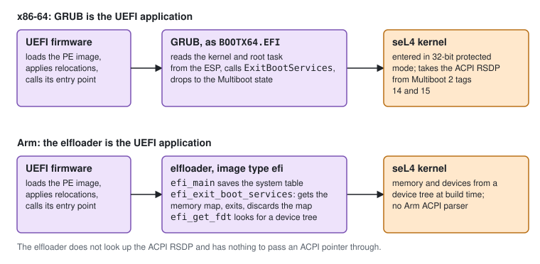

# UEFI (Unified Extensible Firmware Interface)

> The firmware interface that replaced the PC BIOS and is standard on Arm servers and cloud instances: it loads a PE executable from a FAT partition and offers it services and tables; x86 seL4 hides it behind GRUB, and the Arm elfloader can be built as a UEFI application.

[Index](../INDEX.md) › [Part 2: Processor fundamentals](../INDEX.md#part-2-processor-fundamentals) › [x86-64](../INDEX.md#x86-64) · ← [x86 boot: BIOS, GRUB and Multiboot](x86-boot.md) · [8259 PIC](pic-8259.md) →

Read first: [x86 boot](x86-boot.md), [ACPI tables](acpi-tables.md).

| At a glance | |
|---|---|
| Kind | Firmware interface specification |
| Architecture | x86-64 and AArch64 |
| Introduced | Began as Intel's EFI for Itanium |
| Key numbers | Fallback loader paths `\EFI\BOOT\BOOTX64.EFI` and `\EFI\BOOT\BOOTAA64.EFI` |
| seL4 code | Arm elfloader: [`efi_init.c`](https://github.com/seL4/seL4_tools/blob/master/elfloader-tool/src/binaries/efi/efi_init.c); x86 kernel: none |
| seL4 config | `ElfloaderImageEFI` (Arm only) |
| seL4 use | x86: hidden behind GRUB, with [Multiboot 2](x86-boot.md) carrying the ACPI RSDP; Arm: the [elfloader](../sel4/elfloader.md) built as a UEFI application |
| On the clouds | Arm instances boot `BOOTAA64.EFI` and use ACPI; x86 clouds offer UEFI on current instance types |

## What it is

UEFI is a specification for what firmware offers a boot loader or
operating system: how to find and start a loader, what the CPU state is
when it starts, which functions it may call, and which tables describe
the machine. It began as Intel's EFI for Itanium, and is now the normal
firmware on PCs and on Arm servers; EDK II (TianoCore) is the open-source
reference implementation.

### How it differs from BIOS

| | BIOS | UEFI |
|---|---|---|
| Interface | software interrupts, 16-bit real mode | C function pointers in tables, native mode (64-bit long mode on x86-64, AArch64 EL2 or EL1 on Arm) |
| Loader | 512-byte boot sector | a **PE/COFF** file (the Windows executable format), relocatable, with subsystem 10 "EFI application" |
| Disk layout | MBR partition table | GPT (GUID partition table) with an **EFI system partition** (ESP), a FAT file system |
| Machine description | scattered: E820 memory map, scan for ACPI | system table and configuration tables |
| Boot choice | boot order of devices | `Boot####` variables in non-volatile storage naming a file; fallback path on removable media |

The fallback path is what disk images for clouds rely on, since a fresh
instance has no boot variables: `\EFI\BOOT\BOOTX64.EFI` on x86-64 and
`\EFI\BOOT\BOOTAA64.EFI` on AArch64.

### Entry and the system table

Firmware loads the PE image anywhere it likes, applies relocations and
calls its entry point as `efi_main(ImageHandle, SystemTable)`, on x86-64
with the Microsoft calling convention, in long mode with identity-mapped
page tables and interrupts enabled. The **system table** points at:

- **boot services**: memory allocation (`AllocatePages`, `AllocatePool`),
  `GetMemoryMap`, protocol lookup (`LocateProtocol`), image loading,
  timers, `ExitBootServices`;
- **runtime services**: the few calls that stay usable after the OS takes
  over: variables (`GetVariable`, `SetVariable`), time, `ResetSystem`;
- console input and output protocols;
- **configuration tables**: an array of (GUID, pointer) pairs. The ones
  that matter here are the ACPI 2.0 RSDP, the SMBIOS entry point
  (vendor and model strings) and, on Arm, the flattened
  [device tree](device-tree.md).

Devices are reached through **protocols**, interfaces identified by GUID.
The Graphics Output Protocol (GOP) gives a linear framebuffer: address,
resolution, pixel format. There is no text-mode VGA under pure UEFI.

### ExitBootServices and the memory map

Until the loader calls `ExitBootServices(ImageHandle, MapKey)`, firmware
owns the machine: its timer interrupt runs, its drivers hold the devices,
its allocator owns free memory. The call hands everything over. It takes
the `MapKey` that the latest `GetMemoryMap` returned and fails if the map
changed since, so loaders fetch the map and exit in a loop.

`GetMemoryMap` returns descriptors of type, physical start, page count
and attributes. The descriptor size is returned separately and must be
used to step through the array.

| Type | After ExitBootServices |
|---|---|
| `EfiConventionalMemory` | free RAM |
| `EfiLoaderCode`, `EfiLoaderData` | the loader's own image and allocations; free once it is done |
| `EfiBootServicesCode`, `EfiBootServicesData` | free |
| `EfiRuntimeServicesCode`, `EfiRuntimeServicesData` | keep: runtime services live here |
| `EfiACPIReclaimMemory` | ACPI tables; free once parsed |
| `EfiACPIMemoryNVS`, `EfiReservedMemoryType`, `EfiUnusableMemory` | never use |
| `EfiMemoryMappedIO` | device registers runtime services need |

GRUB translates this map into Multiboot memory types for its kernels.

### Secure Boot, CSM

**Secure Boot** makes firmware verify a signature on each PE image
against keys held in authenticated variables (`PK`, `KEK`, `db`, `dbx`)
before running it. Linux distributions boot through `shim`, a small
loader signed by Microsoft that verifies GRUB against the distribution's
key. An unsigned loader runs only with Secure Boot off.

The **CSM** (compatibility support module) lets UEFI firmware emulate a
BIOS and boot an MBR. It is a feature of PC firmware only, and is
disappearing there.

### Arm servers and clouds

Arm's server base boot requirements make UEFI with ACPI the standard
interface, so Arm cloud instances (AWS Graviton, Compute Engine's Arm
types, Azure's Arm types) boot `BOOTAA64.EFI` and describe hardware with
ACPI, often with no device tree at all. Arm firmware enters the loader at
EL2 if the CPU implements it and firmware allows, otherwise EL1 (see
[Arm boot](arm-boot.md)). On x86, clouds offer UEFI on current instance
types, some with legacy BIOS as an option (see
[cloud boot images](cloud-boot-images.md)).

## In seL4

**x86: not at all, directly.** The kernel has no PE header and no EFI
entry point; it is a [Multiboot](x86-boot.md) kernel entered in 32-bit
protected mode. On a UEFI machine GRUB (the `x86_64-efi` build, as
`BOOTX64.EFI`) is the UEFI application: it reads the kernel and root task
from the ESP, calls `ExitBootServices`, and drops to the Multiboot state.
The one thing seL4 needs from UEFI that it cannot find alone is the ACPI
RSDP: `acpi_init` in
[`src/plat/pc99/machine/acpi.c`](https://github.com/seL4/seL4/blob/master/src/plat/pc99/machine/acpi.c)
scans the legacy BIOS area, which UEFI firmware does not fill, so boot on
UEFI needs Multiboot 2, whose tags 14 and 15 carry a copy of the RSDP
that `try_boot_sys_mbi2` in
[`boot_sys.c`](https://github.com/seL4/seL4/blob/master/src/arch/x86/kernel/boot_sys.c)
picks up. The kernel ignores the EFI system-table and EFI memory-map
tags, never calls runtime services, and exports the Multiboot 2
framebuffer tag (which GRUB fills from GOP) to the root task.

**Arm: the elfloader as a UEFI application.** The
[elfloader](../sel4/elfloader.md) has an image type `efi`
(`ElfloaderImageEFI`, Arm only, in
[`elfloader-tool/CMakeLists.txt`](https://github.com/seL4/seL4_tools/blob/master/elfloader-tool/CMakeLists.txt)).
It links against start-up code and a linker script taken from the gnu-efi
project (`src/binaries/efi/gnuefi/`), which wrap the ELF in a PE header,
with `EFI_SUBSYSTEM=0xa`, and relocate the image at run time since
firmware chooses the load address. Then, in
[`src/binaries/efi/efi_init.c`](https://github.com/seL4/seL4_tools/blob/master/elfloader-tool/src/binaries/efi/efi_init.c):

- `efi_main` clears BSS, saves the image handle and system table pointer,
  and calls the ordinary `_start`;
- `efi_exit_boot_services` allocates a buffer, calls `get_memory_map`
  (growing the buffer while it returns `EFI_BUFFER_TOO_SMALL`), then
  `exit_boot_services` with the key. The map itself is discarded;
- `efi_get_fdt` searches the configuration tables for the device tree
  GUID `b1b621d5-f19c-41a5-830b-d9152c69aae0`.

`main` in
[`src/arch-arm/sys_boot.c`](https://github.com/seL4/seL4_tools/blob/master/elfloader-tool/src/arch-arm/sys_boot.c)
calls both; `load_images` in `src/common.c` uses a `kernel.dtb` from the
elfloader's own archive if `ElfloaderIncludeDtb` put one there, otherwise
the firmware's. Because firmware may have loaded the image where the
kernel will go, the EFI path ends with `relocate_below_kernel`.

*On both architectures something else is the UEFI application; the kernel
itself never is.*

**What this leaves undone on ACPI-only Arm machines.** The Arm kernel
takes its memory regions and device addresses from a device tree at build
time, not from firmware at boot. The elfloader throws the UEFI memory map
away, does not look up the ACPI RSDP, and has nothing to pass an ACPI
pointer through to the kernel, which has no Arm ACPI parser. So on a
machine whose firmware offers only ACPI, someone must write a device
tree by hand that matches what firmware set up, and memory that UEFI
marked as runtime or reserved is avoided only if that device tree says
so.

## Gotchas

- `ExitBootServices` stops the firmware console. The elfloader's later
  output goes through its own UART driver, at the address compiled in
  from the device tree; if that is wrong, the EFI build goes silent right
  after "exit boot services".
- The elfloader's `efi_exit_boot_services` retries only the buffer-size
  case, not a stale map key.
- With Secure Boot on, an unsigned GRUB or elfloader is refused before
  it prints anything. Clouds call this "Shielded VM" (Compute Engine) or
  UEFI Secure Boot (EC2); it is off by default on both.
- UEFI x86 firmware leaves the BIOS data area and the VGA text buffer
  meaningless: see the `console_port` gotcha in [x86 boot](x86-boot.md).
- Firmware leaves interrupt controllers, timers and sometimes
  [x2APIC mode](apic.md) in whatever state it used. A kernel cannot
  assume reset values.

## See also

- [x86 boot](x86-boot.md): Multiboot, which is what seL4 sees instead
- [Arm boot](arm-boot.md): the other Arm boot paths (U-Boot, device tree)
- [ACPI tables](acpi-tables.md): what the RSDP configuration table leads to
- [Device tree](device-tree.md): the alternative hardware description
- [Elfloader](../sel4/elfloader.md): the Arm and RISC-V loader
- [Cloud boot images](cloud-boot-images.md): ESP layout for EC2 and Compute Engine
- [ELF and linking](elf.md): ELF is the file format of every kernel, loader and user program in an seL4 system
- [QEMU](qemu.md): QEMU emulates whole machines

## References

- [UEFI Specification 2.10](https://uefi.org/specs/UEFI/2.10/), sections
  4 "EFI System Table", 7 "Services: Boot Services" (7.2 memory
  allocation and map, 7.4.6 `ExitBootServices`), 8 "Runtime Services",
  12.9 Graphics Output Protocol, 13.3 file system format and ESP, 32
  "Secure Boot and Driver Signing"; also sections 2.1.1 (PE images and
  subsystem 10), 2.3.4 and 2.3.6 (x64 and AArch64 hand-off state), 3.5.1.1
  (removable media boot and the `BOOTX64.EFI`, `BOOTAA64.EFI` names) and
  4.6 (configuration table GUIDs). *Checked 2026-11-14 (through the
  Internet Archive's copy; uefi.org itself refuses scripted fetches).*
- seL4_tools [`elfloader-tool/src/binaries/efi/efi_init.c`](https://github.com/seL4/seL4_tools/blob/master/elfloader-tool/src/binaries/efi/efi_init.c),
  [`elfloader-tool/src/arch-arm/sys_boot.c`](https://github.com/seL4/seL4_tools/blob/master/elfloader-tool/src/arch-arm/sys_boot.c),
  [`elfloader-tool/src/common.c`](https://github.com/seL4/seL4_tools/blob/master/elfloader-tool/src/common.c),
  [`elfloader-tool/README.md`](https://github.com/seL4/seL4_tools/blob/master/elfloader-tool/README.md)
  section "EFI". *Checked 2026-11-14.*
- seL4 [`src/arch/x86/kernel/boot_sys.c`](https://github.com/seL4/seL4/blob/master/src/arch/x86/kernel/boot_sys.c)
  (`try_boot_sys_mbi2`) and
  [`src/plat/pc99/machine/acpi.c`](https://github.com/seL4/seL4/blob/master/src/plat/pc99/machine/acpi.c)
  (`acpi_init`). *Checked 2026-11-14.*
- [Multiboot2 Specification](https://www.gnu.org/software/grub/manual/multiboot2/multiboot.html),
  section 3.6: ACPI RSDP, EFI system table and EFI memory map tags.
  *Checked 2026-11-14.*
- [Arm Base Boot Requirements (BBR), DEN0044](https://developer.arm.com/documentation/den0044/latest):
  UEFI and ACPI requirements for Arm servers. *Unchecked:
  developer.arm.com refuses scripted fetches.*
- [Linux kernel documentation, "ACPI on Arm systems"](https://docs.kernel.org/arch/arm64/arm-acpi.html):
  Arm servers follow the BSA and BBR, and ACPI is supported only on
  platforms that boot through UEFI. *Checked 2026-11-14.*
- [Wikipedia, "UEFI"](https://en.wikipedia.org/wiki/UEFI): EFI's origin
  on Itanium, TianoCore EDK II as the reference implementation, the CSM
  and its removal. *Checked 2026-11-14.*
- [GRUB `grub-core/mmap/efi/mmap.c`](https://github.com/rhboot/grub2/blob/master/grub-core/mmap/efi/mmap.c):
  the translation of EFI memory types to GRUB's. *Checked 2026-11-14.*
- [shim-review `README.md`](https://github.com/rhboot/shim-review/blob/main/README.md):
  shims are submitted for signing by Microsoft's UEFI CA.
  *Checked 2026-11-14.*
- [EC2 User Guide, "Instance launch behavior with Amazon EC2 boot modes"](https://docs.aws.amazon.com/AWSEC2/latest/UserGuide/ami-boot.html)
  and ["How UEFI Secure Boot works with Amazon EC2 instances"](https://docs.aws.amazon.com/AWSEC2/latest/UserGuide/how-uefi-secure-boot-works.html):
  UEFI and legacy BIOS boot modes; Secure Boot disabled by default.
  *Checked 2026-11-14.*
- [Compute Engine documentation, "Modifying Shielded VM options on a VM instance"](https://docs.cloud.google.com/compute/shielded-vm/docs/modifying-shielded-vm):
  Secure Boot is not enabled by default. *Checked 2026-11-14.*
