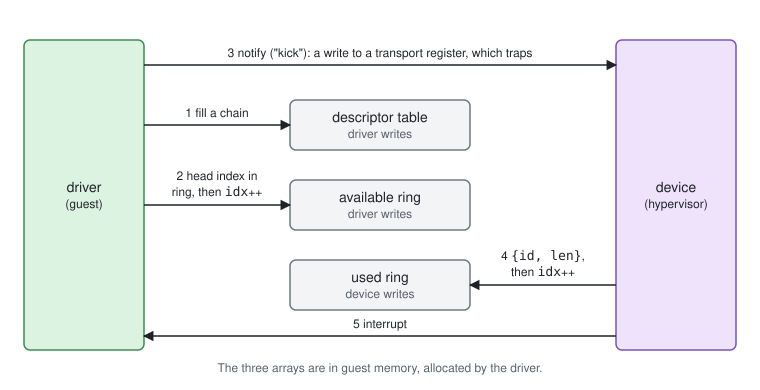

# virtio

> virtio is the standard family of paravirtual devices (network, block, console and more) that hypervisors offer in place of emulated hardware: one queue mechanism, three transports, and the easiest real I/O for an seL4 system on QEMU or Compute Engine.

[Index](../INDEX.md) › [Part 3: Platform and devices](../INDEX.md#part-3-platform-and-devices) › [Buses and devices](../INDEX.md#buses-and-devices) · ← [UARTs: 16550 and PL011](uart.md) · [IOMMUs: VT-d and SMMU](iommu.md) →

Read first: [PCI and PCI Express](pci.md), [MSI and MSI-X](msi-msix.md).

| At a glance | |
|---|---|
| Kind | Standard family of paravirtual devices (OASIS) |
| Reached through | Three transports: [PCI](pci.md) (capabilities and BARs, or legacy [I/O ports](io-ports.md)), MMIO, channel I/O (s390) |
| Found through | PCI vendor ID `0x1AF4`; a [device tree](device-tree.md) node with `compatible = "virtio,mmio"` |
| Interrupt | PCI: [MSI-X](msi-msix.md) per queue, or one shared INTx line; MMIO: one interrupt |
| Key numbers | Queue size a power of two, at most 32768; modern PCI device ID `0x1040` + type, transitional `0x1000` to `0x103F` |
| seL4 code | None in the kernel; [sDDF](../sel4/sddf.md) drivers for net, blk and console over [`include/sddf/virtio/`](https://github.com/au-ts/sddf/tree/main/include/sddf/virtio) |
| seL4 use | User level only; sDDF's drivers are modern only, with split rings |
| On the clouds | [Compute Engine](gce.md): PCI with transitional IDs on older machine families; [EC2](ec2.md): none |

## What it is

Emulating a real network card means trapping every register access a
driver makes. A **paravirtual** device is instead designed for a guest
that knows it is virtualised: the guest and the hypervisor share memory,
the guest queues requests in it, and a single trapped write says "look
now". **virtio** is the OASIS standard for such devices. The
specification calls the hypervisor's side the **device** and the guest's
the **driver**, and separates three layers:

```
 device types    net | blk | console | scsi | rng | ...   (section 5)
 virtqueues      split or packed rings in guest memory    (section 2)
 transport       PCI | MMIO | channel I/O (s390)          (section 4)
```

A driver for one device type works over any transport, given a small
transport layer underneath. All structures are little-endian in virtio
1.x.

### Starting a device

The driver writes bits into the one-byte **device status** register, in
this order (specification section 3.1.1):

| Step | Status bit | Value |
|---|---|---|
| Write 0 to reset | | 0 |
| Guest has noticed the device | ACKNOWLEDGE | 1 |
| Guest has a driver for it | DRIVER | 2 |
| Read the device's feature bits, write back the subset wanted | | |
| Features are final; read status back to see the device kept the bit | FEATURES_OK | 8 |
| Set up the virtqueues and read device configuration | | |
| Driver is live | DRIVER_OK | 4 |

FAILED (128) says the driver gave up; DEVICE_NEEDS_RESET (64) is set by
the device after an error. **Feature bits** are a 64-bit set: bits 0 to
23 belong to the device type (`VIRTIO_NET_F_MAC`), the rest to the queue
and transport: `VIRTIO_F_INDIRECT_DESC` (28), `VIRTIO_F_EVENT_IDX` (29),
`VIRTIO_F_VERSION_1` (32, which a modern driver must accept),
`VIRTIO_F_ACCESS_PLATFORM` (33, device addresses go through an
[IOMMU](iommu.md)), `VIRTIO_F_RING_PACKED` (34).

### Split virtqueues

A **virtqueue** carries buffers from driver to device and back. A device
has one or more (a simple network device has two: receive and transmit).
The classic **split** layout is three arrays in guest memory, allocated
by the driver, whose guest-physical addresses the driver gives the
device. The queue size *N* is a power of two, at most 32768.

```
descriptor table            available ring          used ring
(driver writes)             (driver writes)         (device writes)
struct virtq_desc {         le16 flags;             le16 flags;
  le64 addr;  /* guest      le16 idx;               le16 idx;
               physical */  le16 ring[N];           struct { le32 id;
  le32 len;                 le16 used_event;                 le32 len;
  le16 flags;                                       } ring[N];
  le16 next;                                        le16 avail_event;
} desc[N];
```

- A **descriptor** names one buffer. Flags: `VIRTQ_DESC_F_NEXT` (1)
  chains it to descriptor `next`, so one request can span several
  buffers; `VIRTQ_DESC_F_WRITE` (2) marks a buffer the *device* writes
  (receive data, a status byte), otherwise the device only reads it;
  `VIRTQ_DESC_F_INDIRECT` (4) means the buffer is itself a table of
  descriptors.
- To submit, the driver fills a chain, puts the head's index in
  `avail.ring[avail.idx % N]`, then increments `avail.idx` (a free-running
  16-bit counter), then **notifies** the device ("kicks"): a write to a
  transport register, which traps to the hypervisor.
- When done the device writes `{id = head index, len = bytes it wrote}`
  to `used.ring[used.idx % N]`, increments `used.idx` and **interrupts**
  the driver. The driver remembers the last `used.idx` it saw and
  processes the entries between.



*One request through a split virtqueue, in order. Each array has one
writer, and the two expensive steps are the trap (3) and the
interrupt (5).*

The driver owns descriptor allocation: it keeps its own free list. Both
directions of signalling are expensive, so each side can ask the other
to hold off: the driver sets `VIRTQ_AVAIL_F_NO_INTERRUPT` (1) in
`avail.flags`, the device sets `VIRTQ_USED_F_NO_NOTIFY` (1) in
`used.flags`. These are hints. With `VIRTIO_F_EVENT_IDX` negotiated the
flags are replaced by thresholds: `used_event` ("interrupt me when
`used.idx` passes this") and `avail_event`.

**Packed virtqueues** (`VIRTIO_F_RING_PACKED`, virtio 1.1) fold the three
arrays into one ring of descriptors that both sides write in turn, with
wrap counters instead of indices; it is kinder to caches and to hardware
implementations. Neither sDDF nor the clouds' legacy devices use it.

### Transports

**virtio-pci, modern (1.0 onwards).** Vendor ID `0x1AF4` (Red Hat),
device ID `0x1040` + device type. The registers are not at fixed
offsets: the device's PCI capability list holds vendor-specific
capabilities (`struct virtio_pci_cap`), each giving a type, a BAR number,
an offset and a length:

| `cfg_type` | Structure | Holds |
|---|---|---|
| 1 | common configuration | feature selectors and words, `device_status`, `queue_select`, per-queue size, enable, MSI-X vector and the three ring addresses (64-bit) |
| 2 | notification | where to write to kick queue *n*: offset = `queue_notify_off` × `notify_off_multiplier` |
| 3 | ISR status | one byte: bit 0 queue interrupt, bit 1 configuration change; reading clears it and deasserts INTx |
| 4 | device configuration | device-type fields (MAC address, disk capacity) |
| 5 | PCI configuration access | a window for reaching the others without mapping a BAR |

Interrupts: with MSI-X enabled the driver assigns a table entry to
configuration changes (`config_msix_vector`) and to each queue
(`queue_msix_vector`), reading each back because the device answers
`0xFFFF` (no vector) on failure; the ISR byte is then unused. Without
MSI-X there is one shared INTx line and the driver reads the ISR byte to
find out why.

**virtio-pci, legacy and transitional.** Before 1.0 ("0.9.5") the layout
was fixed registers in BAR 0, normally an [I/O port](io-ports.md) BAR:

| Offset | Size | Register |
|---|---|---|
| 0 | 32 | device features (bits 0 to 31 only) |
| 4 | 32 | driver features |
| 8 | 32 | queue address, as a **page frame number**: physical address / 4096 |
| 12 | 16 | queue size (read-only: the device dictates it) |
| 14 | 16 | queue select |
| 16 | 16 | queue notify |
| 18 | 8 | device status |
| 19 | 8 | ISR status |
| 20 | | device configuration (at 24 if MSI-X is enabled, after two vector registers) |

The three ring parts must then be contiguous in one allocation at an
address below 16 TiB, laid out by a fixed formula; structures are in
guest-native byte order; there is no FEATURES_OK step and no feature
bit above 31. A **transitional** device offers both interfaces and
carries a device ID in `0x1000` to `0x103F` (`0x1000` net, `0x1001`
block, `0x1002` balloon, `0x1003` console, `0x1004` SCSI, `0x1005`
entropy); the PCI subsystem ID tells the type. A **legacy-only** device
uses the same IDs but has no capabilities. So a transitional ID does not
say which interface exists: look for the capabilities.

**virtio-mmio.** For machines without PCI: a 4 KiB (or smaller) register
block at an address the [device tree](device-tree.md) gives
(`compatible = "virtio,mmio"`), one interrupt, one device per block.

| Offset | Register |
|---|---|
| `0x000` | MagicValue: `0x74726976`, "virt" |
| `0x004` | Version: 2 for virtio 1.x, 1 for legacy |
| `0x008` | DeviceID: the device type; 0 means the slot is empty |
| `0x050` | QueueNotify |
| `0x060`, `0x064` | InterruptStatus (bit 0 queue, bit 1 configuration), InterruptACK |
| `0x070` | Status |

Version 1 uses a queue page frame number (QueuePFN at `0x040`, with
GuestPageSize and QueueAlign) like legacy PCI; version 2 has separate
64-bit address registers for the three ring parts.

### Device types

| Type ID | Device | Queues and essentials |
|---|---|---|
| 1 | net | receive queue, transmit queue, optionally a control queue. Every packet is preceded by a `struct virtio_net_hdr` (12 bytes in 1.x: flags, GSO type, header length, GSO size, checksum start and offset, number of buffers). Features: `VIRTIO_NET_F_MAC` (MAC address in device configuration), `MRG_RXBUF` (a packet may span several receive buffers), checksum and segmentation offload (`CSUM`, `GUEST_TSO4`, `HOST_TSO4`...), `MQ` (several queue pairs) |
| 2 | blk | one request queue; a request is a chain of a 16-byte header (type, sector), data buffers, and one status byte the device writes |
| 3 | console | a receive and a transmit queue per port carrying raw bytes |
| 4 | rng (entropy) | one queue; the device fills buffers with random bytes |
| 8 | scsi host | control, event and request queues carrying SCSI commands |

### Who offers what

| Platform | virtio |
|---|---|
| [QEMU](qemu.md) `virt` (Arm, RISC-V) | 32 virtio-mmio slots (Arm) in the generated device tree, version 1 unless `-global virtio-mmio.force-legacy=false`; PCI devices too if asked (`-device virtio-net-pci`) |
| QEMU `q35`, `pc` | PCI: `-device virtio-net-pci`; transitional by default on a conventional PCI bus, tunable with `disable-legacy=on` |
| [Compute Engine](gce.md) | PCI with transitional IDs on older machine families: net, SCSI, rng, balloon; newer families use gVNIC and NVMe |
| [EC2](ec2.md) | none: ENA and NVMe |

## In seL4

The kernel knows nothing of virtio. Everything is at user level.

**[sDDF](../sel4/sddf.md)** has three virtio drivers, each a small
device-type core over a shared transport layer
([`include/sddf/virtio/`](https://github.com/au-ts/sddf/tree/main/include/sddf/virtio):
`queue.h` for the split ring structures, `feature.h`,
`transport/common.h`, `transport/mmio.h`, `transport/pci.h`):

| Driver | Path | Transports |
|---|---|---|
| net | [`drivers/network/virtio`](https://github.com/au-ts/sddf/tree/main/drivers/network/virtio) (`common/ethernet.c`) | `mmio/`, `pci/` |
| blk | [`drivers/blk/virtio`](https://github.com/au-ts/sddf/tree/main/drivers/blk/virtio) (`block.c`) | `mmio/`, `pci/` |
| console | [`drivers/serial/virtio`](https://github.com/au-ts/sddf/tree/main/drivers/serial/virtio) (`console.c`) | MMIO (`virtio,mmio` in its `config.json`) |

They are **modern only**: `VIRTIO_VERSION` is 2, the net driver accepts
exactly `VIRTIO_NET_F_MAC` and `VIRTIO_F_VERSION_1` and so uses split
rings with no mergeable buffers, no offloads, no indirect descriptors and
no event index. The PCI transport finds the common, notify, ISR and
device structures through the capabilities above; it does not implement
the legacy I/O-port interface. The drivers translate between the
virtqueue and sDDF's own shared-memory queues (see
[sDDF networking](../sel4/sddf-net.md)); buffers must be at known
physical addresses since descriptors carry guest-physical addresses,
which is why the driver's ring memory (`hw_ring_buffer` in `config.json`)
and the data regions need physical addresses known to the driver.

**libvmm**, the virtual machine monitor used with Microkit, is on the
other side: it *emulates* virtio devices (console, net, blk, sound; MMIO
and PCI transports) for a Linux guest, backing them with sDDF clients,
so a guest's virtio driver ends up talking to a native sDDF driver. See [Virtualisation support](../sel4/hypervisor.md).

**Interrupts** reach a driver as notifications on an IRQ handler
capability ([Interrupt delivery](../sel4/irq-handling.md)). For MMIO it
is the device tree's interrupt. For PCI on x86 it is either the INTx
line's I/O APIC pin or an [MSI-X](msi-msix.md) vector, which the system
designer must allocate and the driver must program into the device.

## Gotchas

- **Compute Engine's virtio is not what sDDF's PCI transport expects.**
  The devices carry transitional IDs and are driven through the legacy
  I/O-port interface; a modern-only driver finds no usable common
  configuration capability. Check the capability list of the actual
  device before assuming.
- **QEMU's virtio-mmio defaults to legacy** (version 1) on `virt`
  machines, and a version 2 driver must refuse it. sDDF's documented
  QEMU commands add `-global virtio-mmio.force-legacy=false`.
- **Empty MMIO slots exist.** QEMU's `virt` device tree lists every
  slot; those without a device read DeviceID 0. Which slot a `-device`
  lands in is not obvious (QEMU fills from the highest address down).
- **Memory ordering matters.** The ring is shared with another thread of
  execution (the hypervisor): write the ring entry before `idx`, with a
  barrier between, and re-check for new used entries after re-enabling
  interrupts, or lose a wake-up.
- **Suppression flags are hints**: a driver must tolerate interrupts it
  asked not to get.
- **`len` in the used ring is what the device wrote**, not the request
  size, and on the net receive path it includes the 12-byte header.
- **A legacy device dictates the queue size**; the driver must allocate
  whatever the device says (often 256 or more entries), contiguously.
- **Without an IOMMU the device (hypervisor) can already see all guest
  memory**, so virtio adds no DMA risk on a VM that a hypervisor did not
  already pose; on seL4 the concern is the *driver* putting arbitrary
  physical addresses in descriptors. See [IOMMUs](iommu.md).

## See also

- [PCI and PCI Express](pci.md): capabilities and BARs, where the modern transport lives
- [MSI and MSI-X](msi-msix.md): per-queue interrupts
- [I/O ports](io-ports.md): the legacy transport's registers
- [Device trees](device-tree.md): how virtio-mmio devices are found
- [Google Compute Engine](gce.md): its virtio devices and IDs
- [gVNIC](gvnic.md), [ENA](ena.md), [NVMe](nvme.md): what clouds use instead
- [QEMU](qemu.md): `-device virtio-*`
- [IOMMUs: VT-d and SMMU](iommu.md): `VIRTIO_F_ACCESS_PLATFORM`
- [sDDF](../sel4/sddf.md) and [sDDF networking](../sel4/sddf-net.md): the drivers' other side
- [Interrupt delivery](../sel4/irq-handling.md): how the driver gets its interrupt
- [Index](../INDEX.md): the reading order
- [Compute Engine machine types](gce-machine-types.md): how to read a Compute Engine machine type name such as `c4a-standard-2`, and what the series behind it...
- [UARTs: 16550 and PL011](uart.md): A UART is the serial port

## References

- [Virtual I/O Device (VIRTIO) Version 1.2, OASIS](https://docs.oasis-open.org/virtio/virtio/v1.2/virtio-v1.2.html):
  sections 2.1 (status), 2.7 (split virtqueues), 3.1.1 (initialisation),
  4.1.2 and 4.1.4 (PCI IDs, capabilities, ISR, MSI-X, legacy header),
  4.2.2 and 4.2.4 (MMIO registers), the legacy-interface notes 2.7.2,
  4.1.4.10 and 4.1.5.1.3.1, and in section 5 the device IDs, virtqueues,
  `struct virtio_net_hdr` and `struct virtio_blk_req`.
  *Checked 2026-11-14.* Section 2.8 (packed virtqueues) was not read
  today.
- [sDDF `include/sddf/virtio/transport/pci.h`](https://github.com/au-ts/sddf/blob/main/include/sddf/virtio/transport/pci.h),
  [`transport/mmio.h`](https://github.com/au-ts/sddf/blob/main/include/sddf/virtio/transport/mmio.h),
  [`transport/common.h`](https://github.com/au-ts/sddf/blob/main/include/sddf/virtio/transport/common.h)
  and [`feature.h`](https://github.com/au-ts/sddf/blob/main/include/sddf/virtio/feature.h):
  capability types, magic, status and feature bit numbers.
  *Checked 2026-11-14.*
- [sDDF `drivers/network/virtio/common/ethernet.c`](https://github.com/au-ts/sddf/blob/main/drivers/network/virtio/common/ethernet.c):
  the features the net driver negotiates. *Checked 2026-11-14.*
- [libvmm](https://github.com/au-ts/libvmm), `README.md` and
  [`src/virtio/`](https://github.com/au-ts/libvmm/tree/main/src/virtio)
  (`block.c`, `console.c`, `net.c`, `sound.c`, `mmio.c`, `pci.c`; the
  device files include sDDF's queue headers): device emulation for
  guests. *Checked 2026-11-14.*
- [QEMU documentation, "virt generic virtual platform"](https://www.qemu.org/docs/master/system/arm/virt.html):
  the 32 virtio-mmio transports. *Checked 2026-11-14.*
- QEMU source: [`hw/virtio/virtio-mmio.c`](https://github.com/qemu/qemu/blob/master/hw/virtio/virtio-mmio.c)
  (`force-legacy` defaults to true),
  [`hw/arm/virt.c`](https://github.com/qemu/qemu/blob/master/hw/arm/virt.c)
  (`create_virtio_devices()`: later `-device` options get lower
  addresses), [`hw/virtio/virtio-pci.c`](https://github.com/qemu/qemu/blob/master/hw/virtio/virtio-pci.c)
  and [`docs/pcie.txt`](https://github.com/qemu/qemu/blob/master/docs/pcie.txt)
  (`disable-legacy` is on by default only in a PCI Express port).
  *Checked 2026-11-14.*
- sDDF [`examples/echo_server/echo.mk`](https://github.com/au-ts/sddf/blob/main/examples/echo_server/echo.mk):
  the QEMU command with `-global virtio-mmio.force-legacy=false`.
  *Checked 2026-11-14.*
