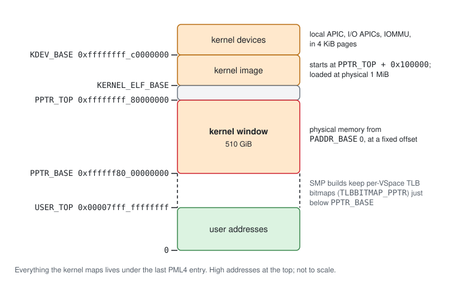

# x86-64 paging

> How x86-64 translates 48-bit virtual addresses through four levels of 512-entry tables rooted at `CR3`, with the entry flags, large pages, PCIDs and TLB rules a kernel must respect; seL4 exposes each level as an object type and keeps its own window in the top 512 GiB.

[Index](../INDEX.md) › [Part 2: Processor fundamentals](../INDEX.md#part-2-processor-fundamentals) › [x86-64](../INDEX.md#x86-64) · ← [CPUID and MSRs](cpuid-and-msrs.md) · [x86-64 exceptions and system calls](x86-exceptions-syscalls.md) →

Read first: [Virtual memory](virtual-memory.md), [x86-64 basics](x86-64-basics.md).

| At a glance | |
|---|---|
| Kind | Address translation mechanism: four levels of page tables |
| Architecture | x86-64 |
| Reached through | `CR3` holds the top table; `invlpg` and `invpcid` invalidate |
| Key numbers | 48-bit virtual addresses; 512 eight-byte entries a table; pages of 4 KiB, 2 MiB and 1 GiB |
| seL4 code | [`src/arch/x86/64/kernel/vspace.c`](https://github.com/seL4/seL4/blob/master/src/arch/x86/64/kernel/vspace.c), [`hardware.h`](https://github.com/seL4/seL4/blob/master/include/plat/pc99/plat/64/plat_mode/machine/hardware.h) |
| seL4 config | `KernelHugePage`, `KernelSupportPCID`, `KernelSkimWindow` |
| seL4 use | One object type per level ([VSpace](../sel4/vspace.md)); 510 GiB kernel window under the last PML4 entry |
| On the clouds | `PCID` is missing on some instance types |

## What it is

Paging is mandatory in long mode: every address a program or the
kernel uses is virtual. The architecture facts here are from the Intel
manual; seL4 constants and names are from the source.

### The walk

`CR3` holds the physical address of the top table. Each table is one
4 KiB page of 512 eight-byte entries, so each level consumes 9 bits of
the address:

```
 63      48 47     39 38     30 29     21 20     12 11        0
+----------+---------+---------+---------+---------+-----------+
| sign ext | PML4 ix | PDPT ix |  PD ix  |  PT ix  |  offset   |
+----------+---------+---------+---------+---------+-----------+
     CR3 ──▶ PML4 ───▶ PDPT ───▶ PD ─────▶ PT ─────▶ 4 KiB page
                         │        └─ PS=1 ─────────▶ 2 MiB page
                         └─ PS=1 ──────────────────▶ 1 GiB page
```

| Level | Name | One entry covers |
|---|---|---|
| 4 | PML4 (page map level 4) | 512 GiB |
| 3 | PDPT (page directory pointer table) | 1 GiB |
| 2 | PD (page directory) | 2 MiB |
| 1 | PT (page table) | 4 KiB |

4 × 9 + 12 = 48 bits, hence the [canonical address](x86-64-basics.md)
rule. Newer CPUs offer a fifth level (PML5, 57 bits, `CR4.LA57`); seL4
does not use it. A PDPT or PD entry with the **PS** (page size) bit
set maps a 1 GiB or 2 MiB page directly and ends the walk. 2 MiB pages
exist on every x86-64 CPU; 1 GiB pages need a CPUID feature
([CPUID](cpuid-and-msrs.md)).

### Entry format

| Bit | Name | Meaning |
|---|---|---|
| 0 | P | present; if 0 the rest is free for software and access faults |
| 1 | R/W | writable |
| 2 | U/S | accessible from ring 3 |
| 3, 4 | PWT, PCD | cache control, index into the PAT |
| 5 | A | accessed, set by the CPU |
| 6 | D | dirty, set by the CPU on write (leaf entries) |
| 7 | PS | this entry maps a large page (PDPT, PD); PAT bit in a PT entry |
| 8 | G | global: survives a `CR3` switch (leaf entries, needs `CR4.PGE`) |
| 12 to 51 | | physical address of the next table or the page |
| 63 | NX | no execute (needs `EFER.NXE`) |

Permissions combine down the walk: an access needs R/W and U/S set at
every level, and NX at any level forbids execution. Kernels therefore
set the upper levels permissively and restrict at the leaf.

Modifiers a kernel turns on:

- **`CR0.WP`**: ring 0 also faults on writes to read-only pages.
- **SMEP** (`CR4` bit 20): ring 0 may not execute user pages.
- **SMAP** (`CR4` bit 21): ring 0 may not read or write user pages
  unless `RFLAGS.AC` is set.
- **PAT** (page attribute table, MSR `0x277`): eight cache-mode slots
  chosen per page by the PAT, PCD and PWT bits. Modes include
  write-back (normal RAM), uncacheable (device registers) and write
  combining (frame buffers).

A failed walk or permission check raises a page fault (#PF, vector 14)
with the address in `CR2` and an error code saying present or not,
read or write, user or supervisor, instruction fetch; see
[x86 exceptions and system calls](x86-exceptions-syscalls.md).

### TLB, global pages and PCID

The **TLB** (translation lookaside buffer) caches completed walks. The
CPU never removes a stale entry on its own when software edits a
table. Software must:

- `invlpg addr`: drop one page's translation on this core;
- write `CR3`: drop every non-global translation on this core;
- on SMP, ask other cores to do the same with an IPI (a "TLB
  shootdown").

Flushing everything at each address-space switch is costly, so:

- **Global pages** (G bit) stay across `CR3` writes; used for kernel
  mappings that are the same in every address space.
- **PCID** (process-context identifier, `CR4.PCIDE`): the low 12 bits
  of `CR3` tag TLB entries with an address-space number, so entries of
  several spaces coexist. Writing `CR3` with bit 63 set switches
  without flushing the new PCID's entries. `invpcid` invalidates by
  address and PCID, by PCID, or everything.

## In seL4

**Object types.** User level builds address spaces from kernel objects,
one type per level (see [VSpace](../sel4/vspace.md)), all 4 KiB
(`seL4_PML4Bits`, `seL4_PDPTBits`, `seL4_PageDirBits`,
`seL4_PageTableBits` are 12 in
[`libsel4/sel4_arch_include/x86_64/sel4/sel4_arch/constants.h`](https://github.com/seL4/seL4/blob/master/libsel4/sel4_arch_include/x86_64/sel4/sel4_arch/constants.h)):
`seL4_X64_PML4Object` (the VSpace root), `seL4_X86_PDPTObject`,
`seL4_X86_PageDirectoryObject`, `seL4_X86_PageTableObject`. Frames come in three sizes: `seL4_PageBits` 12 (4 KiB),
`seL4_LargePageBits` 21 (2 MiB), `seL4_HugePageBits` 30 (1 GiB, only
with `KernelHugePage`).

**Kernel layout**
([`include/plat/pc99/plat/64/plat_mode/machine/hardware.h`](https://github.com/seL4/seL4/blob/master/include/plat/pc99/plat/64/plat_mode/machine/hardware.h),
which `include/arch/x86/arch/64/mode/hardware.h` includes). Everything
the kernel maps lives under the last PML4 entry:

| Symbol | Value | Region above it |
|---|---|---|
| `USER_TOP` | `0x00007fff_ffffffff` | end of user addresses |
| `PPTR_BASE` | `0xffffff80_00000000` | **kernel window**: physical memory from `PADDR_BASE` 0, at a fixed offset |
| `PPTR_TOP` | `0xffffffff_80000000` | end of the window (so `PADDR_TOP` is 510 GiB) |
| `KERNEL_ELF_BASE` | `PPTR_TOP + 0x100000` | kernel image, loaded at physical 1 MiB (`KERNEL_ELF_PADDR_BASE`) |
| `KDEV_BASE` | `0xffffffff_c0000000` | kernel devices: local APIC, I/O APICs, IOMMU, 4 KiB pages |

The kernel reaches any physical address `p` below `PADDR_TOP` as
`p + PPTR_BASE_OFFSET`; a "pptr" in the source is such an address. Just
below `PPTR_BASE` an SMP build keeps per-VSpace TLB bitmaps
(`TLBBITMAP_PPTR`) recording which cores may hold entries.



*The symbols of the table above as a map, high addresses at the top and not
to scale. The 510 GiB kernel window is where physical memory appears.*

**Boot tables.**
[`src/arch/x86/64/head.S`](https://github.com/seL4/seL4/blob/master/src/arch/x86/64/head.S)
`setup_pml4` fills `boot_pml4` and `boot_pdpt` with large-page
mappings, enough to enable long mode and run C at both the low
(identity) and high addresses. Then `map_kernel_window()` in
[`src/arch/x86/64/kernel/vspace.c`](https://github.com/seL4/seL4/blob/master/src/arch/x86/64/kernel/vspace.c)
builds the real tables in static arrays (`x64KSKernelPML4`,
`x64KSKernelPDPT`, `x64KSKernelPD`, `x64KSKernelPT`): the window with
1 GiB pages if `KernelHugePage`, otherwise 2 MiB pages through
`x64KSKernelPDs`; the image; and the device page table. It asserts
that `PPTR_BASE` and `KERNEL_ELF_BASE` fall in the last PML4 slot.
Every user PML4 gets a copy of that kernel entry when it is created.

**Run-time code.** The same file holds the user-facing side: decoding
`Map`/`Unmap` invocations for each level, `lookupPDPTSlot()` and its
siblings that walk tables in software, and fault decoding. Code shared
with ia32 is in
[`src/arch/x86/kernel/vspace.c`](https://github.com/seL4/seL4/blob/master/src/arch/x86/kernel/vspace.c),
including `init_pat_msr()` and `map_kernel_window_devices()`.
`init_cpu()` in `src/arch/x86/kernel/boot.c` sets `CR0.WP` and enables
SMEP and SMAP when CPUID offers them.

**PCID.** With `KernelSupportPCID` (x86_64 only) the kernel uses a
VSpace's ASID (address space identifier, assigned from an
[ASID pool](../sel4/vspace.md)) as its PCID; the comment in
`mode/object/structures.h` notes 2^12 hardware PCIDs. `makeCR3(addr,
pcid)` and `setCurrentCR3()` in
[`include/arch/x86/arch/64/mode/machine.h`](https://github.com/seL4/seL4/blob/master/include/arch/x86/arch/64/mode/machine.h)
build the `CR3` value and set bit 63 to keep TLB entries;
`invalidateLocalPCID()`-style helpers there wrap `invpcid` with the
`INVPCID_TYPE_*` modes. Without the option every switch flushes.

**Meltdown: the SKIM window.** Meltdown let user code read anything
mapped in its page tables, kernel-only or not. With `KernelSkimWindow`
(x86_64, default on) a user thread runs on tables that map only a
"Static Kernel Image and Micro-state" window: kernel code and the few
per-core data it needs to enter and leave, built by
`map_skim_window()`; the full window is switched in on kernel entry
(`CR3` write in `traps.S`). `KERNEL_IS_GLOBAL()` turns the G bit off
for kernel mappings in that configuration, since they must not survive
the switch. At boot the kernel compares the option
with `IA32_ARCH_CAPABILITIES.RDCL_NO` and refuses to run unprotected
on a vulnerable CPU.

## Gotchas

- **The kernel window is 510 GiB, not all of memory.** Physical
  addresses at or above `PADDR_TOP` cannot be kernel objects; RAM
  above it is left out of the kernel's memory at boot
  (`add_mem_p_regs`) and, like devices above it, reaches user level
  only as device untypeds, usable as user-mapped frames.
- **Editing an entry is not enough.** Any patch that clears or
  narrows a mapping needs the matching invalidation, on every core
  that may have it cached; look for the `invalidate*` call beside each
  table write.
- **`PCID`/`INVPCID` are missing on some cloud instance types** (EC2's
  `t3a` has no PCID: see [EC2 instance types](ec2-instance-types.md)), and `head.S` hangs
  with a one-line message if `KernelSupportPCID` is set and they are
  missing. Build with it off for a virtual CPU you have not checked.
- **The PS bit position means PAT in a PT entry.** Bit 7 is PS at the
  PDPT and PD levels and the PAT selector at the PT level; for large
  pages the PAT selector moves to bit 12.
- **The layout comment's exponents are approximate.** The diagram in
  `hardware.h` labels `PPTR_TOP` as 2^64 − 2^29; the constant is
  `0xffffffff80000000`, which is 2^64 − 2^31. Trust the `#define`s.
- **Constants are duplicated in `linker.lds`**, as the header warns;
  change both.

## See also

- [Virtual memory](virtual-memory.md): the general idea, across architectures
- [VSpace](../sel4/vspace.md): the seL4 API over these tables, ASID pools included
- [x86-64 basics](x86-64-basics.md): `CR0`, `CR3`, `CR4`, canonical addresses
- [x86 exceptions and system calls](x86-exceptions-syscalls.md): the page fault, and the `CR3` switch on entry
- [CPUID and MSRs](cpuid-and-msrs.md): detecting 1 GiB pages, PCID, SMEP, SMAP
- [AArch64 paging](aarch64-paging.md) and [RISC-V paging and traps](riscv-paging-and-traps.md): the same job elsewhere
- [IOMMU](iommu.md) and [x86 virtualisation](x86-virtualisation.md): the other page tables (VT-d, EPT) with a similar shape

## References

- [seL4 `include/plat/pc99/plat/64/plat_mode/machine/hardware.h`](https://github.com/seL4/seL4/blob/master/include/plat/pc99/plat/64/plat_mode/machine/hardware.h):
  the layout diagram and `USER_TOP`, `PPTR_BASE`, `PPTR_TOP`,
  `KERNEL_ELF_BASE`, `KDEV_BASE`. *Checked 2026-11-14.*
- [seL4 `src/arch/x86/64/kernel/vspace.c`](https://github.com/seL4/seL4/blob/master/src/arch/x86/64/kernel/vspace.c):
  `map_kernel_window()` (both variants), `map_skim_window()`.
  *Checked 2026-11-14.*
- [seL4 `src/arch/x86/64/head.S`](https://github.com/seL4/seL4/blob/master/src/arch/x86/64/head.S):
  `setup_pml4`, `pcid_check`, `invpcid_check`, `huge_page_check`.
  *Checked 2026-11-14.*
- [seL4 `include/arch/x86/arch/64/mode/machine.h`](https://github.com/seL4/seL4/blob/master/include/arch/x86/arch/64/mode/machine.h):
  `makeCR3()`, `CR3` bit 63, `INVPCID_TYPE_*`. *Checked 2026-11-14.*
- [seL4 `libsel4/sel4_arch_include/x86_64/sel4/sel4_arch/constants.h`](https://github.com/seL4/seL4/blob/master/libsel4/sel4_arch_include/x86_64/sel4/sel4_arch/constants.h):
  object and frame sizes. *Checked 2026-11-14.*
- [seL4 `include/arch/x86/arch/machine/pat.h`](https://github.com/seL4/seL4/blob/master/include/arch/x86/arch/machine/pat.h)
  and [`cpu_registers.h`](https://github.com/seL4/seL4/blob/master/include/arch/x86/arch/machine/cpu_registers.h):
  PAT MSR and memory types; `CR0_WRITE_PROTECT`, `CR4_SMEP`,
  `CR4_SMAP`. *Checked 2026-11-14.*
- [seL4 `src/arch/x86/config.cmake`](https://github.com/seL4/seL4/blob/master/src/arch/x86/config.cmake):
  `KernelHugePage`, `KernelSupportPCID`, `KernelSkimWindow` (help text
  and default). *Checked 2026-11-14.*
- [seL4 `src/arch/x86/kernel/boot_sys.c`](https://github.com/seL4/seL4/blob/master/src/arch/x86/kernel/boot_sys.c)
  (`add_mem_p_regs`) and [`src/kernel/boot.c`](https://github.com/seL4/seL4/blob/master/src/kernel/boot.c)
  (`create_untypeds`): memory above `PADDR_TOP` is ignored as kernel
  memory and given out as device untypeds. *Checked 2026-11-14.*
- [Intel 64 and IA-32 Architectures Software Developer's Manual, combined volumes](https://www.intel.com/content/www/us/en/developer/articles/technical/intel-sdm.html)
  ([PDF](https://cdrdv2.intel.com/v1/dl/getContent/671200), September 2026 edition; chapter numbers move between
  editions: paging was chapter 4 in older ones),
  volume 3 chapter 5 "Paging": 5.1 (control bits, CPUID enumeration), 5.5
  (4-level and 5-level paging, entry formats), 5.6 (access rights, SMEP,
  SMAP), 5.7 (page faults), 5.10 (TLBs, PCIDs, invalidation); 14.12
  (PAT). *Checked 2026-11-14.*
- [AMD64 Architecture Programmer's Manual, volume 2](https://www.amd.com/en/search/documentation/hub.html),
  chapter 5 "Page Translation and Protection". *Unchecked (amd.com's
  document pages need a browser).*
- [Meltdown: Reading Kernel Memory from User Space](https://meltdownattack.com/meltdown.pdf)
  (Lipp et al., 2018): the attack the SKIM window answers.
  *Checked 2026-11-14.*
