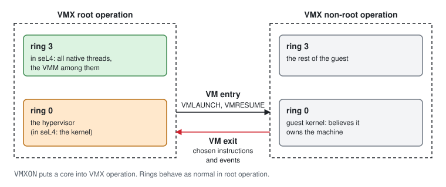

# x86 virtualisation: VT-x, the VMCS and EPT

> Intel's hardware support for running guest operating systems (VMX root and non-root operation, the VMCS, EPT) and AMD's equivalent: it is what seL4's x86 hypervisor mode drives, and what every x86 virtual machine, cloud instances included, runs under.

[Index](../INDEX.md) › [Part 2: Processor fundamentals](../INDEX.md#part-2-processor-fundamentals) › [x86-64](../INDEX.md#x86-64) · ← [8259 PIC](pic-8259.md) · [AArch64 basics](aarch64-basics.md) →

Read first: [Privilege levels](privilege-levels.md), [x86 paging](x86-paging.md), [CPUID and MSRs](cpuid-and-msrs.md).

| At a glance | |
|---|---|
| Kind | Processor extension for running guests: Intel VT-x (VMX), AMD SVM |
| Architecture | x86 |
| Found through | [CPUID](cpuid-and-msrs.md) leaf 1 `ECX` bit 5; `IA32_FEATURE_CONTROL` MSR |
| Key numbers | A 4 KiB VMCS for each virtual CPU; four-level EPT; 16-bit VPID |
| seL4 code | [`src/arch/x86/object/vcpu.c`](https://github.com/seL4/seL4/blob/master/src/arch/x86/object/vcpu.c) |
| seL4 config | `KernelVTX` (default off) |
| seL4 use | Hypervisor on Intel only, with a user-level VMM handling exits; not in any verified configuration |
| On the clouds | An ordinary EC2 or Compute Engine instance does not advertise VMX |

## What it is

Classic x86 could not be virtualised cleanly: some instructions that
reveal or change privileged state do not trap in ring 3. Intel's **VT-x**
(the instruction set extension is **VMX**, virtual machine extensions)
and AMD's **SVM** fixed that in 2005 and 2006 by adding a second
dimension of privilege instead of another ring. The Intel description
here follows the Intel SDM, volume 3, chapters 26 to 32; "In seL4" is
checked against the source.

### Root and non-root operation

After `VMXON` a core is in **VMX operation**, in one of two modes:

| | VMX root | VMX non-root |
|---|---|---|
| Who runs there | the hypervisor (and, in seL4, all native threads) | the guest |
| Rings | 0 to 3, behaving as normal | 0 to 3, but chosen instructions and events cause a **VM exit** |
| Enter by | VM exit | **VM entry**: `VMLAUNCH` (first time) or `VMRESUME` |

A guest kernel runs in ring 0 of non-root mode and believes it owns the
machine. The hypervisor decides which of its actions exit.

*Root or non-root is a second axis beside the rings, not a ring below
ring 0.*

Enabling it: [CPUID](cpuid-and-msrs.md) leaf 1 `ECX` bit 5 says VMX
exists; the `IA32_FEATURE_CONTROL` MSR (`0x3A`) must have "VMX outside
SMX" set and is usually locked by firmware; then set `CR4.VMXE` and
execute `VMXON` with the physical address of a 4 KiB region holding the
revision identifier from `IA32_VMX_BASIC`.

### The VMCS

The **virtual machine control structure** is a 4 KiB region per virtual
CPU, opaque to software: fields are read and written by encoding with
`VMREAD` and `VMWRITE`, after `VMPTRLD` makes that VMCS current on the
core (`VMCLEAR` detaches it, and must be done before it moves to another
core). It holds:

| Area | Contents |
|---|---|
| Guest state | loaded on VM entry, saved on VM exit: `CR0`, `CR3`, `CR4`, `RSP`, `RIP`, `RFLAGS`, segment registers with their hidden bases and limits, GDTR, IDTR, some MSRs, interruptibility |
| Host state | loaded on VM exit: the hypervisor's `CR3`, `RSP`, `RIP` (the exit handler), segment selectors |
| Control fields | pin-based controls (do external interrupts and NMIs exit?), primary and secondary processor-based controls (does `HLT`, `RDTSC`, `MOV CR3`, I/O exit? use EPT, VPID?), exception bitmap, I/O and MSR bitmaps, entry and exit controls, event injection |
| Exit information | read-only: exit reason, exit qualification, guest linear and physical address, instruction length |

General-purpose registers are not in the VMCS; the hypervisor saves and
restores them itself. Which control bits may be 0 or 1 on a given CPU is
published in the `IA32_VMX_*` capability MSRs ("fixed" bits), and a VM
entry fails if the VMCS violates them.

### VM exits

A VM exit stores a **basic exit reason** in the low 16 bits of the exit
reason field. The ones a reader meets first:

| Reason | Number | Cause |
|---|---|---|
| Exception or NMI | 0 | a guest exception selected by the exception bitmap |
| External interrupt | 1 | a host device interrupt arrived while the guest ran |
| `CPUID` | 10 | always exits |
| `HLT` | 12 | guest idle |
| Control register access | 28 | `MOV` to or from `CR0`, `CR3`, `CR4` |
| I/O instruction | 30 | `IN` or `OUT` to a [port](io-ports.md) the bitmap traps |
| `RDMSR`, `WRMSR` | 31, 32 | MSR access the bitmap traps |
| EPT violation | 48 | guest touched guest-physical memory with no or insufficient mapping |

### EPT and VPID

Without help, a hypervisor must shadow the guest's page tables. **EPT**
(extended page tables) adds a second translation stage in hardware: the
guest's own tables translate guest-virtual to **guest-physical**
addresses, and a four-level EPT (PML4, PDPT, PD, PT, like
[ordinary paging](x86-paging.md) but with read, write and execute bits)
owned by the hypervisor translates guest-physical to host-physical. A
missing translation is an EPT violation exit, the guest's equivalent of
a page fault to user level. The cost is a longer TLB miss: every step
of the guest's walk is itself translated.

*The guest controls only the first stage; the hypervisor owns the second.*

**VPID** (virtual processor identifier) is a 16-bit tag on TLB entries,
like a PCID, so that VM entries and exits need not flush the TLB.
`INVEPT` and `INVVPID` flush by EPT root or by VPID.

### Interrupts

Basic VT-x exits on every guest access to its
[local APIC](apic.md), and the hypervisor emulates it and **injects**
interrupts through the VM-entry event field. **APIC virtualisation**
(APICv) keeps a virtual APIC page the CPU updates without exits, and
**posted interrupts** let another core or an [IOMMU](iommu.md) deliver an
interrupt to a running guest with no exit at all.

### AMD SVM

AMD's equivalent has the same shape under other names: `EFER.SVME`
enables it, the control block is the **VMCB** (a plain memory structure,
not accessed by special instructions), `VMRUN` enters, `#VMEXIT` leaves
with an exit code, and nested paging (NPT, or RVI) is its EPT. Code for
one does not run on the other.

### Nested virtualisation and clouds

A guest that wants to be a hypervisor itself needs the outer hypervisor
to emulate VMX: **nested virtualisation**. It costs performance, and
clouds leave it off unless asked: an ordinary EC2 or Compute Engine
instance's CPUID does not advertise VMX, and VT-x for the tenant is
available only on bare-metal instance types or where the provider
offers nesting for a machine family and it is enabled for the instance (see
[EC2 instance types](ec2-instance-types.md) and
[Compute Engine machine types](gce-machine-types.md)).

### What a guest kernel sees

Even a kernel with no interest in being a hypervisor notices that it is
a guest:

- CPUID leaf 1 `ECX` bit 31, the hypervisor bit, is set, and leaves from
  `0x40000000` identify the hypervisor and may give timer frequencies:
  see [hypervisor CPUID leaves](hypervisor-cpuid-leaves.md).
- Devices are emulated legacy parts ([PIT](pit.md), [8259](pic-8259.md),
  16550 [UART](uart.md)) or paravirtual ones ([virtio](virtio.md),
  [ENA](ena.md), [gVNIC](gvnic.md)); some legacy parts are simply
  absent.
- Every port access, many MSR accesses and `CPUID` cost a VM exit,
  far slower than the instruction itself, so calibration loops that poll a
  port behave differently.
- The [TSC](tsc.md) may be offset or scaled by the VMCS, and a vCPU can
  be descheduled at any instruction.

## In seL4

seL4 can be the hypervisor on Intel CPUs only; there is no SVM support.
`KernelVTX` (`CONFIG_VTX`, default off, in
[`src/arch/x86/config.cmake`](https://github.com/seL4/seL4/blob/master/src/arch/x86/config.cmake))
enables it. It is not part of any verified configuration. The kernel
provides mechanism only; a user-level virtual machine monitor (VMM)
emulates devices and handles exits. See
[seL4 hypervisor mode](../sel4/hypervisor.md) for the model across
architectures.

The code is
[`src/arch/x86/object/vcpu.c`](https://github.com/seL4/seL4/blob/master/src/arch/x86/object/vcpu.c):

- **Boot.** `vtx_init`, per core: `is_vtx_supported`; read
  `IA32_FEATURE_CONTROL` and set and lock "VMX outside SMX" if firmware
  left it unlocked (fail with "vt-x: feature locked" otherwise);
  `init_vtx_fixed_values` reads the capability MSRs on core 0 and
  `check_vtx_fixed_values` requires other cores to match; set
  `CR4_VMXE`; `vmxon` on a per-core region `x86KSVMXOnRegion`.
- **Objects.** `seL4_X86_VCPUObject` holds the VMCS and saved guest
  state (`vcpu_init` fills the host-state and control fields). The EPT
  levels are `seL4_X86_EPTPML4Object`, `seL4_X86_EPTPDPTObject`,
  `seL4_X86_EPTPDObject` and `seL4_X86_EPTPTObject`, mapped with
  `seL4_X86_EPTPDPT_Map`, `seL4_X86_EPTPD_Map` and `seL4_X86_EPTPT_Map`;
  ordinary frames are mapped into them as guest-physical memory. An EPT
  PML4 serves as the guest thread's address space root (`setEPTRoot`).
- **Invocations** on a VCPU capability, decoded by
  `decodeX86VCPUInvocation`:

  | Invocation | Purpose |
  |---|---|
  | `seL4_X86_VCPU_SetTCB` | bind the VCPU to a thread, one to one |
  | `seL4_X86_VCPU_ReadVMCS`, `WriteVMCS` | access VMCS fields; `decodeWriteVMCS` allows a fixed list and forces the fixed control bits |
  | `seL4_X86_VCPU_ReadMSR`, `WriteMSR` | guest MSR state the kernel switches |
  | `seL4_X86_VCPU_WriteRegisters` | the guest's general-purpose registers |
  | `seL4_X86_VCPU_EnableIOPort`, `DisableIOPort` | let the guest use ports directly, given an I/O port capability |

- **Running a guest.** The bound thread calls the system call
  `seL4_VMEnter` (`SysVMEnter`, dispatched in
  [`src/arch/x86/c_traps.c`](https://github.com/seL4/seL4/blob/master/src/arch/x86/c_traps.c)).
  The thread is then "in the guest" until something returns it:
  `handleVmexit` reads the basic exit reason; an `EXTERNAL_INTERRUPT`
  exit is handled as a normal kernel interrupt and the guest resumed;
  other exits go through `handleVmxFault`, which makes `seL4_VMEnter`
  return to the VMM with the reason, qualification and guest state in
  message registers (`setMRs_vmexit`). A notification arriving for the
  thread also returns it (`VMCheckBoundNotification`).
- **TLB tags.** VPIDs are allocated in `findFreeVPID` and flushed with
  `invvpid_context`; EPT changes use `invept`.
- **FPU.** `vcpu_fpu_to_guest` and `vcpu_fpu_to_host` switch
  [FPU state](fpu-state.md) between the VMM thread and its guest.

## Gotchas

- On a cloud VM without nested virtualisation, a `KernelVTX` kernel
  prints "vt-x: not supported" at boot and stops: `vtx_init` returns
  false, so `init_cpu` in `src/arch/x86/kernel/boot.c` does, and boot
  fails.
- Firmware can lock `IA32_FEATURE_CONTROL` with VMX disabled; only a
  firmware setting fixes that.
- The VMM, not the kernel, must emulate `CPUID`, the APIC, the PIT and
  everything else that exits; seL4 uses neither APICv nor posted
  interrupts: `init_vtx_fixed_values` asks for no such control bits, and
  the virtual-APIC and posted-interrupt VMCS fields are not among those
  `decodeWriteVMCS` lets a VMM write.
- A VMCS is cached per core. Migrating a VCPU's thread between cores
  needs a `VMCLEAR` on the old core first, which is what the
  `IpiRemoteCall_ClearCurrentVCPU` remote call is for (see
  [SMP bring-up](smp-bringup.md)).
- The Arm design is different in kind (a hypervisor exception level, not
  a second mode): see [Arm virtualisation](arm-virtualisation.md). Do
  not carry intuitions across.

## See also

- [seL4 hypervisor mode](../sel4/hypervisor.md): VCPUs and VMMs across architectures
- [Arm virtualisation](arm-virtualisation.md): EL2 and stage-2 translation
- [Hypervisor CPUID leaves](hypervisor-cpuid-leaves.md): how a guest identifies its host
- [Cloud VMs](cloud-vms.md): what the clouds' hypervisors present
- [x86 paging](x86-paging.md): the tables EPT mirrors
- [Privilege levels](privilege-levels.md): rings, and where VMX root sits
- [QEMU](qemu.md): QEMU emulates whole machines

## References

- seL4 [`src/arch/x86/object/vcpu.c`](https://github.com/seL4/seL4/blob/master/src/arch/x86/object/vcpu.c):
  `vtx_init`, `init_vtx_fixed_values`, `handleVmexit`, the invocation
  decoders (`decodeWriteVMCS`'s list of writable fields).
  *Checked 2026-11-14.*
- seL4 [`src/arch/x86/kernel/boot.c`](https://github.com/seL4/seL4/blob/master/src/arch/x86/kernel/boot.c):
  `init_cpu` fails when `vtx_init` does. *Checked 2026-11-14.*
- seL4 [`libsel4/sel4_arch_include/x86_64/interfaces/object-api-sel4-arch.xml`](https://github.com/seL4/seL4/blob/master/libsel4/sel4_arch_include/x86_64/interfaces/object-api-sel4-arch.xml)
  and the `arch_include/x86` interface file: `seL4_X86_VCPU` and
  `seL4_X86_EPT*` methods. *Checked 2026-11-14.*
- seL4 [`src/arch/x86/config.cmake`](https://github.com/seL4/seL4/blob/master/src/arch/x86/config.cmake)
  (`KernelVTX`). *Checked 2026-11-14.*
- [Intel 64 and IA-32 Architectures Software Developer's Manual, combined volumes](https://www.intel.com/content/www/us/en/developer/articles/technical/intel-sdm.html)
  ([PDF](https://cdrdv2.intel.com/v1/dl/getContent/671200), September 2026 edition; chapter numbers move between
  editions), volume 3: chapters 26 "Introduction to Virtual Machine
  Extensions" (root and non-root operation, `IA32_FEATURE_CONTROL`,
  `VMXON`), 27 "Virtual Machine Control Structures" (the areas, the
  16-bit VPID in 27.6.12), 28 "VMX Non-Root Operation" (28.1.2: `CPUID`
  exits unconditionally), 31 "VMX Support for Address Translation" (VPID,
  EPT) and 32 "APIC Virtualization and Virtual Interrupts"; appendix C
  "VMX Basic Exit Reasons" (the numbers in the table).
  *Checked 2026-11-14.*
- [Linux `arch/x86/include/asm/svm.h`](https://github.com/torvalds/linux/blob/master/arch/x86/include/asm/svm.h)
  and [`msr-index.h`](https://github.com/torvalds/linux/blob/master/arch/x86/include/asm/msr-index.h):
  AMD's `struct vmcb` with its exit code, and `EFER_SVME`.
  *Checked 2026-11-14.*
- [Wikipedia, "x86 virtualization"](https://en.wikipedia.org/wiki/X86_virtualization):
  why classic x86 could not be trapped and emulated; VT-x in 2005, AMD's
  extension in 2006; RVI as AMD's name for nested paging.
  *Checked 2026-11-14.*
- [Google Cloud, "About nested virtualization"](https://docs.cloud.google.com/compute/docs/instances/nested-virtualization/overview)
  and [Amazon EC2, "Use nested virtualization"](https://docs.aws.amazon.com/AWSEC2/latest/UserGuide/amazon-ec2-nested-virtualization.html):
  nesting is enabled per instance, on some machine families only; AWS
  points performance-sensitive users at bare metal. *Checked 2026-11-14.*
- [AMD64 Architecture Programmer's Manual, volume 2](https://www.amd.com/en/search/documentation/hub.html),
  chapter 15 "Secure Virtual Machine". *Unchecked (amd.com's document
  pages need a browser; chapter number from memory).*
