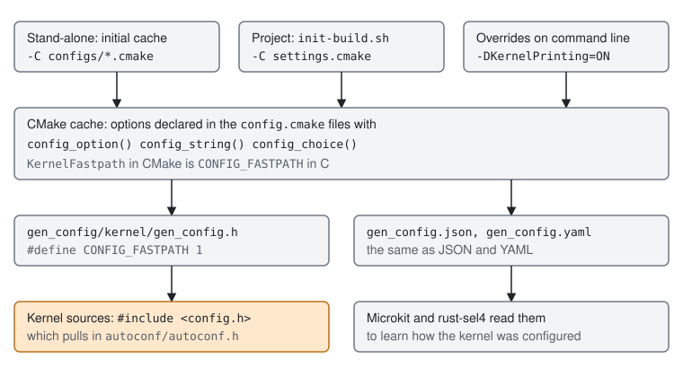

# Build system

> seL4 builds with CMake and Ninja: options declared in `config.cmake` files become `CONFIG_*` macros in a generated `gen_config.h`, a platform name selects architecture and sources, and the kernel builds either alone from a `configs/*.cmake` file or inside a project through `init-build.sh`.

[Index](../INDEX.md) › [Part 4: The seL4 kernel](../INDEX.md#part-4-the-sel4-kernel) › [Inside the kernel](../INDEX.md#inside-the-kernel) · ← [Source layout](source-layout.md) · [Generated code](generated-code.md) →

Read first: [Source layout](source-layout.md).

| At a glance | |
|---|---|
| Kind | Tool (the CMake and Ninja build) |
| Repository | `seL4` (kernel build), `seL4_tools` (`cmake-tool/` for project builds) |
| Key source | [`config.cmake`](https://github.com/seL4/seL4/blob/master/config.cmake), [`configs/seL4Config.cmake`](https://github.com/seL4/seL4/blob/master/configs/seL4Config.cmake), [`tools/helpers.cmake`](https://github.com/seL4/seL4/blob/master/tools/helpers.cmake) |
| Config options | `KernelPlatform`, `KernelSel4Arch`, `KernelVerificationBuild`, `KernelDebugBuild`, `KernelIsMCS` |
| Built on | CMake 3.16 or later, Ninja, a GNU cross toolchain or `clang` |
| Used by | Project builds such as [sel4test](sel4test.md) (`init-build.sh`); [Microkit](microkit.md)'s `build_sdk.py` |
| Verified | `configs/*_verified.cmake`: one file per configuration that has a proof |

## What it is

Everything in the seL4 world except Microkit systems and Rust crates is
built with **CMake**, which generates **Ninja** build files; `ninja` then
does the compiling. A kernel is never built "for all platforms": one
build directory holds one configuration (one platform, one word size,
MCS or not, debug or not), and the configuration decides which source
files are compiled at all.

There are two ways to build a kernel.

### Stand-alone

The kernel repository builds by itself, from an initial-cache file:

```
mkdir build && cd build
cmake -DCROSS_COMPILER_PREFIX= -DCMAKE_TOOLCHAIN_FILE=../seL4/gcc.cmake \
      -G Ninja -C ../seL4/configs/X64_verified.cmake ../seL4/
ninja kernel.elf
```

- `-C file` is CMake's "pre-load a script to populate the cache". The
  files in `configs/` are short lists of `set(KernelPlatform "pc99" CACHE
  STRING "")` lines, one file per configuration that has a proof
  (`X64_verified.cmake`, `AARCH64_verified.cmake`, `RISCV64_MCS_verified.cmake`,
  ...). You can write your own, or add `-DKernelPrinting=ON` style
  overrides to the command line.
- `CMAKE_TOOLCHAIN_FILE` is `gcc.cmake` or `llvm.cmake` from the kernel
  repository. `CROSS_COMPILER_PREFIX` is the prefix of the cross tools
  (`aarch64-linux-gnu-`); left empty or unset, `gcc.cmake` searches for a
  known prefix for the target architecture (`aarch64-linux-gnu-`,
  `riscv64-unknown-elf-`, ...) or uses the native compiler on a matching
  host.
- `ninja kernel.elf` leaves `kernel.elf` in the build directory. With
  `-DCMAKE_INSTALL_PREFIX=<dir>`, `cmake --install <build>` copies
  `kernel.elf` to `bin/` and the libsel4 sources and generated headers to
  `libsel4/` under it: this is the form other build systems (Microkit,
  rust-sel4) consume.
- `ccmake .` in the build directory browses and edits the options.

This builds a kernel and nothing else: no root task, so nothing to boot.
It is the fast way to check that a kernel change compiles in a given
configuration.

### Inside a project

A bootable image needs a kernel, a root task and, on Arm and RISC-V, the
[elfloader](elfloader.md). Projects such as [sel4test](sel4test.md) are
assembled from several repositories by Google's `repo` tool and a
manifest (`sel4test-manifest`), into a fixed layout:

```
project/
├── kernel/                  seL4
├── tools/seL4/              seL4_tools: cmake-tool/, elfloader-tool/
├── projects/                sel4test, seL4_libs, util_libs, musllibc, ...
├── init-build.sh  ──▶ tools/seL4/cmake-tool/init-build.sh
├── griddle        ──▶ tools/seL4/cmake-tool/griddle
├── CMakeLists.txt ──▶ tools/seL4/cmake-tool/default-CMakeLists.txt
└── settings.cmake / easy-settings.cmake ──▶ the project's own
```

(the exact set of symlinks is from memory of the manifests: unchecked).
Then:

```
mkdir build && cd build
../init-build.sh -DPLATFORM=x86_64 -DSIMULATION=TRUE
ninja
./simulate
```

`init-build.sh` is a thin wrapper: it runs `cmake
-DCMAKE_TOOLCHAIN_FILE=kernel/gcc.cmake -G Ninja "$@" -C settings.cmake
<project>`. The project's `settings.cmake` is where friendly variables
are turned into kernel options, using helpers from
`cmake-tool/helpers/application_settings.cmake`:

| Project variable | Effect (sel4test's `settings.cmake`) |
|---|---|
| `PLATFORM` | A platform or board name, or `x86_64`/`ia32`; `correct_platform_strings()` maps it to `KernelPlatform`, `KernelSel4Arch` and board sub-options |
| `AARCH32`, `AARCH64`, `RISCV64`, `ARM_HYP` | Pick the mode where a platform supports several (unchecked beyond the sel4test documentation) |
| `RELEASE` | `ON`: `CMAKE_BUILD_TYPE=Release`, `KernelPrinting` off, `KernelDebugBuild` off |
| `VERIFICATION` | `ON`: `KernelVerificationBuild` on, `KernelDebugBuild` off |
| neither | `KernelDebugBuild` and `KernelPrinting` on |
| `SIMULATION` | Applies settings QEMU needs (on x86: no IOMMU, no PCID, `FXSAVE` for FPU state, FS/GS base through MSRs) and generates the `simulate` script |
| `SMP`, `NUM_NODES` | `KernelMaxNumNodes` |
| `MCS` | `KernelIsMCS` |

`simulate` is a generated Python script in the build directory that runs
[QEMU](../concepts/qemu.md) with the right machine, CPU and image
arguments. `griddle` is an older shell wrapper around the same `cmake`
call that knows a project's "easy settings"; `init-build.sh` is what the
documentation uses.

### Kernel options that matter most

| CMake variable | C macro | Meaning |
|---|---|---|
| `KernelPlatform` | `CONFIG_PLAT_<NAME>` | The platform: `pc99`, `qemu-arm-virt`, ... |
| `KernelSel4Arch` | `CONFIG_ARCH_X86_64` etc. | `x86_64`, `ia32`, `aarch64`, `aarch32`, `arm_hyp`, `riscv64`, `riscv32` |
| `KernelArch` | `CONFIG_ARCH_X86` etc. | Derived from `KernelSel4Arch`: `x86`, `arm`, `riscv` |
| `KernelWordSize` | `CONFIG_WORD_SIZE` | Derived: 32 or 64 |
| `KernelVerificationBuild` | `CONFIG_VERIFICATION_BUILD` | Default `ON`. Forbids options that are outside the proofs' assumptions (debug build, printing, benchmarks). It does not by itself make the kernel a verified one |
| `KernelDebugBuild` | `CONFIG_DEBUG_BUILD` | Assertions, symbols and the debug system calls (`seL4_DebugPutChar`, ...). Needs `KernelVerificationBuild` off |
| `KernelPrinting` | `CONFIG_PRINTING` | Kernel `printf` to the serial console. Defaults to `KernelDebugBuild`'s value |
| `KernelIsMCS` | `CONFIG_KERNEL_MCS` | The [MCS](mcs.md) kernel: a different API |
| `KernelMaxNumNodes` | `CONFIG_MAX_NUM_NODES` | Cores; above 1 also sets `CONFIG_ENABLE_SMP_SUPPORT` ([SMP](smp.md)) |
| `KernelOptimisation` | `CONFIG_KERNEL_OPT_LEVEL_O2` etc. | `-O2` (default), `-Os`, `-O0`, `-O1`, `-O3` |
| `KernelFastpath` | `CONFIG_FASTPATH` | The IPC fast path, default on |
| `KernelNumDomains`, `KernelRootCNodeSizeBits`, `KernelMaxNumBootinfoUntypedCaps` | `CONFIG_NUM_DOMAINS`, ... | Sizes fixed at build time |

### Compilers

`gcc.cmake` drives a GNU cross toolchain; `llvm.cmake` drives `clang`
with a target triple (`-DTRIPLE=aarch64-linux-gnu`) and still uses the
GNU binutils of that prefix. The host-dependencies page names the Debian
and Ubuntu packages (`gcc-aarch64-linux-gnu`, `ninja-build`,
`device-tree-compiler`, `libxml2-utils`, the `sel4-deps` Python package)
without minimum versions. `configs/seL4Config.cmake` requires CMake 3.16
or later. The proofs are about the C semantics and, for some
configurations, the binary produced by particular GCC versions
([verification](verification.md)); the compiler is otherwise trusted.

## In seL4

### How an option is declared

Options are declared with helper functions from the kernel's
[`tools/helpers.cmake`](https://github.com/seL4/seL4/blob/master/tools/helpers.cmake):

```cmake
config_option(KernelFastpath FASTPATH "Enable IPC fastpath" DEFAULT ON)

config_string(KernelMaxNumNodes MAX_NUM_NODES "Max number of CPU cores to boot"
              DEFAULT 1 UNQUOTE ...)

config_choice(KernelOptimisation KERNEL_OPT_LEVEL "Select the kernel optimisation level"
              "-O2;KernelOptimisationO2;KERNEL_OPT_LEVEL_O2"
              "-Os;KernelOptimisationOS;KERNEL_OPT_LEVEL_OS" ...)
```

| Helper | Declares | Arguments |
|---|---|---|
| `config_option` | A boolean | CMake cache name, C name without `CONFIG_`, help text, `DEFAULT`, optional `DEPENDS "A;NOT B"` and `DEFAULT_DISABLED` (the value when the dependencies fail) |
| `config_string` | A number or string | The same; `UNQUOTE` emits the value bare, without it as a C string |
| `config_choice` | One of several | Each alternative is `"value;CacheBool;C_NAME[;condition]"`; exactly one of the booleans ends up on |
| `config_set` | A derived value, not user-settable | Name, C name, value |

The first argument is what you pass as `-DKernelFastpath=OFF`; the second
is what C code tests as `CONFIG_FASTPATH`. Each helper appends to a
string that the build finally writes out, per "configuration library", as:

```
<build>/gen_config/kernel/gen_config.h      #define CONFIG_FASTPATH 1 ...
<build>/gen_config/kernel/gen_config.json   the same as JSON
<build>/gen_config/kernel/gen_config.yaml   the same as YAML
<build>/autoconf/autoconf.h                 #include <kernel/gen_config.h>
```

Kernel sources `#include <config.h>`, which pulls in `autoconf.h`. A
disabled boolean is left undefined (a comment in the header), so code
tests with `#ifdef CONFIG_X` or the `config_set(CONFIG_X)` /
`config_ternary()` macros from `include/util.h`. `libsel4` has its own `gen_config/sel4/gen_config.h` in the same
style, and user-level libraries add theirs. The JSON and YAML are for
tools: Microkit and rust-sel4 read them to learn how the kernel was
configured. In a project build the kernel's files are under
`<build>/kernel/` (see [generated code](generated-code.md)).



*An option has a CMake name going in and a C name coming out; the JSON and
YAML copies are how other build systems learn the configuration.*

### Where options live

| File | Options |
|---|---|
| [`config.cmake`](https://github.com/seL4/seL4/blob/master/config.cmake) | Generic: `KernelIsMCS`, `KernelNumDomains`, `KernelDebugBuild`, ... |
| `src/arch/<arch>/config.cmake` | Per architecture: `KernelArmHypervisorSupport`, `KernelIRQController`, `KernelFSGSBase`, ... and the architecture's `add_sources()` |
| `src/plat/<plat>/config.cmake` | The platform's declaration |
| `src/drivers/*/config.cmake` | Which shared drivers a build includes |
| [`configs/seL4Config.cmake`](https://github.com/seL4/seL4/blob/master/configs/seL4Config.cmake) | The driver of it all: includes every `src/plat/*/config.cmake`, then the architecture and generic files |

### How a platform is selected

Every `src/plat/*/config.cmake` is included in every build, and each
begins by declaring itself:

```cmake
declare_platform(pc99 KernelPlatPC99 PLAT_PC99 KernelArchX86)

if(KernelPlatPC99)
    declare_seL4_arch(x86_64 ia32)
endif()

add_sources(DEP "KernelPlatPC99" PREFIX src/plat/pc99/machine CFILES acpi.c hardware.c ...)
```

`declare_platform()` sets its boolean (`KernelPlatPC99`) only if
`KernelPlatform` equals its name. Inside the guarded block,
`declare_seL4_arch()` lists the modes the platform supports: the first is
the default if `KernelSel4Arch` is unset, and any other value is a fatal
error. It then derives `KernelArch` and `KernelWordSize`. Arm and RISC-V
platforms go on to name their device tree (`list(APPEND KernelDTSList
...)`), their CPU (`KernelArmCortexA53`) and, with
`declare_default_headers()`, their timer frequency, `MAX_IRQ`, interrupt
controller and timer driver. `add_sources(DEP ...)` adds files to the
kernel's source list only when the dependency holds.

So adding a platform is mostly one new `config.cmake` and a device tree
([porting to a platform](platform-port.md)).

### The kernel's `CMakeLists.txt`

After configuration, [`CMakeLists.txt`](https://github.com/seL4/seL4/blob/master/CMakeLists.txt)
sets compiler flags (`-m64`, `-D__KERNEL_64__`, the optimisation level;
more in `tools/flags.cmake`), sets the include path, runs the generators
(bitfields, system call and invocation headers, hardware headers),
concatenates the sources into `kernel_all.c`, preprocesses the linker
script, and links `kernel.elf` ([source layout](source-layout.md),
[generated code](generated-code.md)).

### Microkit is different

[Microkit](microkit.md) does not use `cmake-tool` or `repo`. Its
`build_sdk.py` runs the kernel's stand-alone CMake build once per board
and per configuration (`debug`, `release`, `benchmark`...), passing a
Python dictionary of `Kernel*` options as `-D` arguments (always
`KernelIsMCS`; `KernelDebugBuild` and `KernelPrinting` on for `debug`),
then `cmake --install`s each into the SDK as
`board/<board>/<config>/elf/sel4.elf` with its libsel4 headers and
`gen_config.json`. A Microkit user never builds the kernel: the
`microkit` tool picks a prebuilt one from the SDK
([Microkit internals](microkit-internals.md)).

## Gotchas

- `KernelVerificationBuild` defaults to `ON`, and options that depend on
  `NOT KernelVerificationBuild` are silently forced to their
  `DEFAULT_DISABLED` value. A stand-alone build with only
  `-DKernelPrinting=ON` prints nothing; pass
  `-DKernelVerificationBuild=OFF` too.
- The CMake cache is sticky. `-C` files and `settings.cmake` set initial
  values; changing `PLATFORM` or `KernelSel4Arch` in an existing build
  directory usually leaves stale derived values behind. Use a fresh
  directory per configuration.
- The CMake name and the C name of an option differ and neither is
  derivable from the other (`KernelIsMCS` is `CONFIG_KERNEL_MCS`,
  `KernelMaxNumNodes` is `CONFIG_MAX_NUM_NODES`): grep the `config.cmake`
  files for either to find the pair.
- A `*_verified.cmake` file is a contract with the proofs: changing one
  changes what is verified, and the proof repository pins them
  ([proof impact](proof-impact.md)).
- `PLATFORM`, `RELEASE`, `SIMULATION` and friends are conventions of a
  project's `settings.cmake`, not of the kernel. The kernel's stand-alone
  build ignores them.
- A new C file compiles into nothing until an `add_sources()` lists it,
  and a new option does nothing until a `config.cmake` that is actually
  included declares it.
- The same kernel source built by `sel4test` and by Microkit can behave
  differently only because the option sets differ: compare the two
  `gen_config.json` files before suspecting the code.

## See also

- [Source layout](source-layout.md): the directories the options select
- [Generated code](generated-code.md): what else lands in the build directory
- [sel4test](sel4test.md): the project most kernel changes are built and tested in
- [Elfloader](elfloader.md): built by the same project build for Arm and RISC-V
- [Microkit internals](microkit-internals.md): the SDK build
- [CI](ci.md): which configurations upstream builds for every pull request
- [Debugging](debugging.md): debug builds and the `simulate` script in use
- [Device trees](../concepts/device-tree.md): A device tree is a data structure describing hardware that cannot be discovered by probing
- [ELF and linking](../concepts/elf.md): ELF is the file format of every kernel, loader and user program in an seL4 system
- [Ecosystem and repositories](ecosystem.md): seL4 is some thirty repositories in two GitHub organisations
- [libsel4 and the runtime](libsel4.md): libsel4 is the kernel's ABI written down as C

## References

- [seL4 docs, "Stand-alone seL4 builds"](https://docs.sel4.systems/projects/buildsystem/standalone.html):
  the `cmake ... -C ../seL4/configs/X64_verified.cmake` command, `ninja
  kernel.elf`, `gen_config/`, `cmake --install`. *Checked 2026-11-14.*
- [seL4 docs, "Host dependencies"](https://docs.sel4.systems/projects/buildsystem/host-dependencies.html):
  packages; gives no version numbers. *Checked 2026-11-14.*
- [seL4 `config.cmake`](https://github.com/seL4/seL4/blob/master/config.cmake):
  the generic options and their dependencies on `KernelVerificationBuild`.
  *Checked 2026-11-14.*
- [seL4 `configs/seL4Config.cmake`](https://github.com/seL4/seL4/blob/master/configs/seL4Config.cmake):
  `declare_platform()`, `declare_seL4_arch()`, the derived `KernelArch`
  and `KernelWordSize`, CMake 3.16. *Checked 2026-11-14.*
- [seL4 `tools/helpers.cmake`](https://github.com/seL4/seL4/blob/master/tools/helpers.cmake):
  `config_option`, `config_choice`, the `gen_config.{h,json,yaml}` paths,
  `generate_autoconf`. *Checked 2026-11-14.*
- [seL4 `src/plat/pc99/config.cmake`](https://github.com/seL4/seL4/blob/master/src/plat/pc99/config.cmake)
  and [`src/plat/qemu-arm-virt/config.cmake`](https://github.com/seL4/seL4/blob/master/src/plat/qemu-arm-virt/config.cmake):
  two platform declarations. *Checked 2026-11-14.*
- [seL4 `configs/X64_verified.cmake`](https://github.com/seL4/seL4/blob/master/configs/X64_verified.cmake):
  the shape of an initial-cache file. *Checked 2026-11-14.*
- [seL4 `gcc.cmake`](https://github.com/seL4/seL4/blob/master/gcc.cmake)
  and [`llvm.cmake`](https://github.com/seL4/seL4/blob/master/llvm.cmake):
  cross-prefix search, `TRIPLE`. *Checked 2026-11-14.*
- [seL4_tools `cmake-tool/init-build.sh`](https://github.com/seL4/seL4_tools/blob/master/cmake-tool/init-build.sh)
  and [`helpers/application_settings.cmake`](https://github.com/seL4/seL4_tools/blob/master/cmake-tool/helpers/application_settings.cmake):
  the wrapped `cmake` call; `ApplyCommonReleaseVerificationSettings`,
  `correct_platform_strings`. *Checked 2026-11-14.*
- [sel4test `settings.cmake`](https://github.com/seL4/sel4test/blob/master/settings.cmake):
  `PLATFORM`, `SIMULATION`, `SMP`, `MCS`. *Checked 2026-11-14.*
- [Microkit `build_sdk.py`](https://github.com/seL4/microkit/blob/main/build_sdk.py):
  the per-board option dictionaries and the `cmake`, `cmake --build`,
  `cmake --install` sequence. *Checked 2026-11-14.*

## My notes

<!-- Tim writes here. Sessions leave this section as it is. -->
