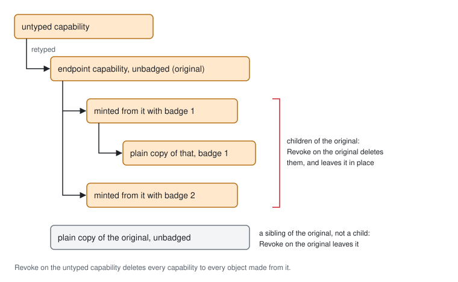

# Capabilities

> A capability is an unforgeable, kernel-held token naming one kernel object plus the rights its holder has; every seL4 operation is authorised by one, and the kernel tracks how capabilities were derived so that access can be revoked.

[Index](../INDEX.md) › [Part 4: The seL4 kernel](../INDEX.md#part-4-the-sel4-kernel) › [Model and API](../INDEX.md#model-and-api) · ← [NVMe](../concepts/nvme.md) · [CSpaces and capability addressing](cspace.md) →

Read first: [seL4 overview](overview.md).

| At a glance | |
|---|---|
| Kind | Kernel mechanism: kernel-held references to objects, with rights |
| Key source | [`src/object/cnode.c`](https://github.com/seL4/seL4/blob/master/src/object/cnode.c), [`src/object/objecttype.c`](https://github.com/seL4/seL4/blob/master/src/object/objecttype.c), [`include/object/structures_64.bf`](https://github.com/seL4/seL4/blob/master/include/object/structures_64.bf) |
| API | `seL4_CNode_*`: Copy, Mint, Move, Mutate, Rotate, Delete, Revoke |
| Object size | `cap_t` is two words; a slot (`cte_t`) is 32 bytes on 64-bit |
| Built on | CNode slots ([CSpaces](cspace.md)) |
| Used by | Every seL4 operation; [IPC](ipc.md) capability transfer; [untyped retype](untyped-memory.md) |

## What it is

A **capability** (cap) is a reference to a kernel object together with
access rights, stored where user code cannot write: in a slot of a
**CNode**, a kernel object that is an array of capability slots
([CSpaces](cspace.md)). A thread names a capability by a number, a
**CPtr** (capability pointer), which the kernel looks up in the thread's
own CNodes, much as a Unix process names an open file by a file
descriptor that indexes a kernel table. The differences from file
descriptors are what make seL4's model:

- capabilities are the *only* way to name anything. There is no path,
  PID or global ID to fall back on, so a thread with no capability to an
  object cannot affect it;
- they cover every kind of object (threads, page tables, interrupts,
  untyped memory, CNodes themselves), not just I/O;
- the kernel records which capability was derived from which, so a
  holder can revoke everything it handed out.

### Rights

Four rights exist, as bits of a `seL4_CapRights_t`:

| Right | Bit | On an endpoint | On a notification | On a frame |
|---|---|---|---|---|
| Write | 0 | may send | may signal | may be mapped writable |
| Read | 1 | may receive | may wait | may be mapped readable |
| Grant | 2 | may send capabilities in messages (and a reply cap) | - | - |
| GrantReply | 3 | may send a reply cap with a Call, but no other caps | - | - |

Other object types ignore rights: holding a TCB or CNode capability
gives full control of it (the manual's table adds one more row: on an
reply capability, Grant allows capabilities in the reply message).
Rights only shrink: a copy can have fewer rights than its
source, never more.

### Badges

An endpoint or notification capability can carry a **badge**: one word
chosen by whoever mints the capability. When a message arrives through a
badged capability the receiver is given the badge, so a server that
hands each client a differently badged capability to one
[endpoint](ipc.md) knows which client is calling, and the client cannot
alter it. On a [notification](notifications.md) the badges of pending
signals are ORed together, so they are used as bit masks. A badge can be
set only on an unbadged capability; a badged one cannot be re-badged.

### Operations on capabilities

All are invocations of a CNode capability (`seL4_CNode_*`):

| Operation | Effect |
|---|---|
| Copy | New capability to the same object in another slot, rights masked by an argument |
| Mint | Copy, and also set the badge (endpoint, notification) or the guard (CNode) |
| Move | Move to another slot; the source slot becomes empty |
| Mutate | Move, and set the guard of a CNode capability (it cannot set a badge) |
| Rotate | Two moves done atomically: slot 2 to slot 3, slot 1 to slot 2; used to swap |
| Delete | Empty one slot. If it held the last capability to the object, the object is destroyed |
| Revoke | Delete every capability *derived from* this one, leaving this one in place |
| CancelBadgedSends | For a badged endpoint capability: abort pending sends made with that badge |
| SaveCaller | Non-MCS only: save the current reply capability into a slot |

Capabilities also travel in [IPC](ipc.md) messages (if the sender's
endpoint capability has Grant), and new ones appear when
[untyped memory is retyped](untyped-memory.md).

### Derivation and revocation

The kernel keeps a **capability derivation tree** (CDT): when B is
copied or minted from A, or an object is retyped from untyped
capability A, B becomes a child of A. Revoking A deletes all its
descendants. This gives:

- **Revoking access.** A server mints a badged endpoint capability for a
  client; revoking the server's capability removes the client's access,
  wherever the client has copied it since.
- **Reclaiming memory.** Revoking an untyped capability deletes every
  capability to every object made from it, which destroys those objects
  and makes the memory reusable.

Not every copy is a child. A plain copy of a capability is a *sibling*
of it (revoking the original does not delete it) unless the original is
an untyped capability or an unbadged endpoint or notification capability
whose copy gains a badge. The precise rule is `isMDBParentOf`, below.



*Minting a badge makes a child that Revoke on the original removes; a
plain copy of the original is a sibling and survives.*

## In seL4

### Representation

Capability layouts are declared in bitfield specification files and
turned into C accessor functions by a generator
([generated code](generated-code.md)):
[`include/object/structures_64.bf`](https://github.com/seL4/seL4/blob/master/include/object/structures_64.bf)
(and `_32.bf`) for generic capabilities, and
`include/arch/<arch>/arch/<bits>/mode/object/structures.bf` for
architecture ones, which also holds the `tagged_union cap capType` list.
A `cap_t` is two machine words with a 5-bit type tag:

| Tag | Generic capability | | Tag | Generic capability |
|---|---|---|---|---|
| 0 | `null_cap` (empty slot) | | 14 | `irq_control_cap` |
| 2 | `untyped_cap` | | 16 | `irq_handler_cap` |
| 4 | `endpoint_cap` | | 18 | `zombie_cap` |
| 6 | `notification_cap` | | 20 | `domain_cap` |
| 8 | `reply_cap` | | 22 | `sched_context_cap` (MCS) |
| 10 | `cnode_cap` | | 24 | `sched_control_cap` (MCS) |
| 12 | `thread_cap` | | odd | architecture caps: `frame_cap` 1, `page_table_cap` 3, `asid_control_cap` 11, `asid_pool_cap` 13, and more per architecture |

For example, on 64-bit an `endpoint_cap` holds a 64-bit `capEPBadge`,
the object pointer `capEPPtr`, and one bit each for `capCanSend`,
`capCanReceive`, `capCanGrant` and `capCanGrantReply`. There is no
general "rights" field: each type stores what it needs.
[Kernel objects](kernel-objects.md) lists what each type refers to.

A slot is a `cte_t` (capability table entry): the `cap_t` plus an
`mdb_node_t`, 32 bytes on 64-bit. "MDB" is the mapping database, the
name the CDT inherits from earlier L4 kernels.

### The derivation tree as a list

The CDT is not stored as a tree. Every non-empty slot is on one doubly
linked list, through `mdbPrev` and `mdbNext` in its `mdb_node`, kept in
pre-order: a capability's descendants follow it immediately. Two flag
bits, `mdbRevocable` and `mdbFirstBadged`, record enough to recover the
tree shape. `isMDBParentOf(a, b)` in
[`src/object/cnode.c`](https://github.com/seL4/seL4/blob/master/src/object/cnode.c)
decides whether `b`, found after `a` in the list, is a descendant:

1. `a` must be marked `mdbRevocable`;
2. `sameRegionAs(a, b)`: `b`'s object lies within what `a` covers
   (an untyped covers every object inside its memory);
3. for endpoints and notifications: if `a` is unbadged, yes; if badged,
   only if `b` has the same badge and is not `mdbFirstBadged` (that is,
   not itself the root of a newly minted badge).

`cteInsert(newCap, srcSlot, destSlot)` links a derived capability in
directly after its source and sets the two flags from
`isCapRevocable`. `cteMove` and `cteSwap` rewrite the neighbours'
pointers so the list position moves with the capability.

### Revoke and delete

```c
/* cteRevoke, abridged */
for (next = mdbNext(slot); next && isMDBParentOf(slot, next);
     next = mdbNext(slot)) {
    cteDelete(next, true);
    preemptionPoint();
}
```

Revoke repeatedly deletes the next list entry while it is a descendant.
Because the list is in pre-order this visits the whole subtree, and
because each step makes progress and re-reads the list, the loop can be
abandoned at `preemptionPoint()` when an interrupt is pending; the
system call is then restarted and carries on
([kernel design](kernel-design.md)).

`cteDelete` calls `finaliseSlot`, which asks `isFinalCapability` whether
this is the last capability to the object (it compares the list
neighbours with `sameObjectAs`), and `finaliseCap`
([`src/object/objecttype.c`](https://github.com/seL4/seL4/blob/master/src/object/objecttype.c))
to tear the object down if so: cancelling IPC, unbinding, unmapping.
Deleting the last capability to a CNode or TCB means deleting the
capabilities inside it, which could be long, so the slot is first
turned into a `zombie_cap` that records how much is left, and
`reduceZombie` works through it preemptibly.

### Copy, mint, move, mutate

`decodeCNodeInvocation` handles all four together. The steps to know:

- `maskCapRights(rights, cap)` clears right bits (Copy and Mint);
- `updateCapData(preserve, data, cap)` applies a badge or guard. It
  returns a null capability, which the caller reports as
  `seL4_IllegalOperation`, when asked to badge an already badged
  capability. Mutate passes `preserve = true`, so it never sets badges;
- `deriveCap(slot, cap)` decides whether a copy may exist at all. It
  yields a null capability for `irq_control_cap`, `zombie_cap` and the
  non-MCS `reply_cap` (these cannot be copied), and for an untyped
  capability it requires `ensureNoChildren`, failing with
  `seL4_RevokeFirst` otherwise. Architecture capabilities go through
  `Arch_deriveCap`; a copy of a mapped frame capability comes out
  unmapped (see [VSpace](vspace.md)).

The slot lookups these use are in
[`src/kernel/cspace.c`](https://github.com/seL4/seL4/blob/master/src/kernel/cspace.c),
described in [CSpaces](cspace.md).

## Gotchas

- **Deleting a capability does not free memory.** It may destroy the
  object, but the memory stays charged to the untyped it came from until
  that untyped is revoked (or all its children are deleted and it is
  reset on the next retype).
- **A copy is usually a sibling, not a child.** Revoking your endpoint
  capability does not remove plain copies of it. To hand out access you
  can later revoke, mint a badged capability from an unbadged original
  and keep the original.
- **Revoke on a badged capability** removes capabilities with the same
  badge derived from it, not other badges on the same endpoint.
- **Copying an untyped capability with children fails** with
  `seL4_RevokeFirst`; and `cteInsert` marks the source untyped as full
  when an identical untyped child is derived (`setUntypedCapAsFull`), so
  the two cannot both allocate.
- **Revoke can be slow and restarts.** It is preemptible, so the caller
  may see the system call take many kernel entries; and another thread
  with the same CSpace can observe intermediate states.
- **Destination slots must be empty** (`seL4_DeleteFirst`): no
  capability operation overwrites a slot.
- **Zombies are visible in debug dumps** and in the proofs, though never
  to the API. A patch touching finalisation must keep the invariants on
  them.

## See also

- [CSpaces and capability addressing](cspace.md): where capabilities live and how a CPtr finds one
- [Kernel objects](kernel-objects.md): what each capability type refers to
- [Untyped memory and retyping](untyped-memory.md): the root of every derivation tree
- [System calls and invocations](syscalls-and-invocations.md): how a capability is invoked
- [IPC and endpoints](ipc.md): badges and capability transfer in messages
- [Generated code](generated-code.md): the bitfield generator behind `cap_t`
- [I/O ports and MMIO](../concepts/io-ports.md): x86's separate 16-bit address space for device registers, reached with the `in` and `out` instructions

## References

- [seL4 `include/object/structures_64.bf`](https://github.com/seL4/seL4/blob/master/include/object/structures_64.bf):
  generic capability layouts and `mdb_node`. *Checked 2026-11-14.*
- [seL4 `include/arch/x86/arch/64/mode/object/structures.bf`](https://github.com/seL4/seL4/blob/master/include/arch/x86/arch/64/mode/object/structures.bf):
  the tag numbers (the same generic tags appear in the Arm and RISC-V
  files). *Checked 2026-11-14.*
- [seL4 `src/object/cnode.c`](https://github.com/seL4/seL4/blob/master/src/object/cnode.c):
  `decodeCNodeInvocation`, `cteInsert`, `cteRevoke`, `isMDBParentOf`,
  `ensureNoChildren`, `invokeCNodeRotate`. *Checked 2026-11-14.*
- [seL4 `src/object/objecttype.c`](https://github.com/seL4/seL4/blob/master/src/object/objecttype.c):
  `deriveCap`, `updateCapData`. *Checked 2026-11-14.*
- [libsel4 `mode_include/64/sel4/shared_types.bf`](https://github.com/seL4/seL4/blob/master/libsel4/mode_include/64/sel4/shared_types.bf):
  `seL4_CapRights` bit order. *Checked 2026-11-14.*
- [seL4 Reference Manual](https://sel4.systems/Info/Docs/seL4-manual-latest.pdf),
  chapter 3 "Capability Spaces": rights per object type (3.1.4,
  table 3.1), CNode methods (3.1.2), the CDT (3.1.5).
  *Checked 2026-11-14 (version 17.0.0).*
- [seL4 `src/arch/arm/64/object/objecttype.c`](https://github.com/seL4/seL4/blob/master/src/arch/arm/64/object/objecttype.c)
  and [`src/arch/riscv/object/objecttype.c`](https://github.com/seL4/seL4/blob/master/src/arch/riscv/object/objecttype.c),
  `Arch_deriveCap`: a derived frame capability has its mapping
  cleared. *Checked 2026-11-14.*
