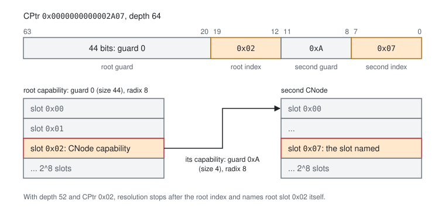

# CSpaces and capability addressing

> A thread's CSpace is the tree of CNodes (tables of capability slots) reachable from its root CNode; a CPtr is resolved through it a few bits at a time using each CNode's guard and radix, and CNode invocations name slots by an explicit root, index and depth.

[Index](../INDEX.md) › [Part 4: The seL4 kernel](../INDEX.md#part-4-the-sel4-kernel) › [Model and API](../INDEX.md#model-and-api) · ← [Capabilities](capabilities.md) · [Kernel objects](kernel-objects.md) →

Read first: [Capabilities](capabilities.md).

| At a glance | |
|---|---|
| Kind | Kernel mechanism: how a CPtr names a capability slot |
| Key source | [`src/kernel/cspace.c`](https://github.com/seL4/seL4/blob/master/src/kernel/cspace.c) |
| Config options | `CONFIG_ROOT_CNODE_SIZE_BITS` (`KernelRootCNodeSizeBits`) |
| API | Guard set by `seL4_CNode_Mint`, `seL4_CNode_Mutate`, `seL4_TCB_SetSpace`, `seL4_TCB_Configure`; slots named by root, index, depth |
| Object size | A CNode has 2^radix slots |
| Built on | [Capabilities](capabilities.md) |
| Used by | Every system call (invocation addressing); `seL4_CNode_*`; `seL4_Untyped_Retype`'s destination; the IPC receive slot |

## What it is

A **CNode** is a kernel object: an array of 2^radix **slots**, each of
which holds one [capability](capabilities.md) or is empty. A thread's
TCB has one slot naming its **CSpace root**, a CNode capability. The
thread's **CSpace** (capability space) is everything reachable from
that root: the root CNode's slots, and, where a slot holds a capability
to another CNode, that CNode's slots, and so on. It is the capability
analogue of an address space, with CNodes as the page tables, and like
page tables it is built by user level, not by the kernel.

A **CPtr** (capability pointer) is a word that addresses a slot in a
CSpace, as a virtual address addresses a byte. The kernel **resolves**
it by consuming bits from the most significant end, one CNode at a
time.

### Guard and radix

Each *capability to* a CNode carries, besides the object pointer:

- the **radix**: the CNode has 2^radix slots, so radix bits of the CPtr
  select a slot;
- a **guard** of **guard size** bits: a fixed bit pattern that must
  match the CPtr's next bits before the radix bits are read.

The guard is a short cut. With 64-bit CPtrs and a CNode of 4096 slots
(radix 12), the other 52 bits must be consumed somehow; a guard of 52
zero bits consumes them in one step without 52 bits' worth of
intermediate tables. The guard belongs to the capability, not the CNode,
so two capabilities to one CNode can have different guards. It is set
when minting or mutating the capability (`seL4_CNode_Mint`,
`seL4_CNode_Mutate`) or when installing a root with
`seL4_TCB_SetSpace` / `seL4_TCB_Configure`, as a `seL4_CNode_CapData`
word: guard in the upper bits, guard size in the low 6.

### Resolution

Starting with the root CNode capability and `n` bits to resolve (the
**depth**):

1. Compare the top `guardSize` of the remaining bits with the guard.
   Mismatch, or fewer than `guardSize` bits left: fail, *guard
   mismatch*.
2. If `guardSize + radix` exceeds the bits left: fail, *depth mismatch*.
3. Take the next `radix` bits as the slot index.
4. If no bits are left, that slot is the answer.
5. Otherwise look in the slot. If it holds a CNode capability, repeat
   from step 1 with it. If not, stop: resolution ends early at this
   slot, with some bits unresolved.

Example: a two-level CSpace on a 64-bit machine. The root capability
has guard size 44 (guard 0) and radix 8; slot `0x02` of the root holds
a capability to a second CNode with guard size 4 (guard `0xA`) and
radix 8.



*Each CNode capability on the way consumes its guard bits and then its
radix bits; the guard and radix of the second CNode come from the
capability in root slot `0x02`, not from the CNode.*

With depth
52 and CPtr `0x02`, resolution stops after the root's index and names
root slot 2 itself: the slot *holding the second-level CNode
capability*, which is how one refers to a CNode slot rather than
descending through it.

### Two ways of naming a slot

**Invocation addressing.** The first argument of every system call is a
CPtr for the capability being invoked. It is always resolved from the
calling thread's CSpace root with depth equal to the word size (64, or
32). The same applies to extra capabilities passed as arguments and to
the fault endpoint on non-MCS kernels. Here early termination (step 5)
is accepted: if resolution reaches a non-CNode capability with bits
left over, that capability is used.

**Root, index, depth.** Operations that *act on slots* take three
values per slot:

```c
seL4_CNode_Copy(dest_root, dest_index, dest_depth,
                src_root,  src_index,  src_depth, rights);
```

- `root`: a CPtr (invocation-addressed) to a CNode capability to start
  from. It need not be the caller's own CSpace root;
- `index`: the CPtr to resolve, relative to that root;
- `depth`: how many bits of `index` to resolve, 1 to the word size.

Here resolution must consume exactly `depth` bits; leftover bits are an
error. This form exists so that a thread can name slots it could not
otherwise reach: a slot containing a CNode capability (stop early, as
above), or slots of a CNode that belongs to another thread's CSpace
that it is constructing. `seL4_Untyped_Retype`'s destination and the
IPC receive slot (`receiveCNode`, `receiveIndex`, `receiveDepth` in the
IPC buffer) use the same triple.

### The initial thread's CSpace

The [root task](bootinfo-and-root-task.md) starts with a single CNode
of 2^`CONFIG_ROOT_CNODE_SIZE_BITS` slots (build option
`KernelRootCNodeSizeBits`), whose capability has guard 0 and guard size
`wordBits - CONFIG_ROOT_CNODE_SIZE_BITS`. So every CPtr is simply a slot
number, resolved at full depth: slot 1 is its own TCB
(`seL4_CapInitThreadTCB`), 2 the root CNode itself
(`seL4_CapInitThreadCNode`), 3 its VSpace, 4 `seL4_CapIRQControl`, and
so on up to `seL4_NumInitialCaps` (16), followed by the ranges that
BootInfo describes (frames, untypeds, empty slots). In this layout
`seL4_CNode_Copy(seL4_CapInitThreadCNode, slot, seL4_WordBits, ...)`
addresses any slot.

## In seL4

All lookup is in
[`src/kernel/cspace.c`](https://github.com/seL4/seL4/blob/master/src/kernel/cspace.c):

| Function | Use |
|---|---|
| `resolveAddressBits(nodeCap, capptr, n_bits)` | The loop above. Returns the slot and `bitsRemaining`; sets `current_lookup_fault` on failure |
| `lookupSlot(thread, cptr)` | Invocation addressing: `resolveAddressBits(root, cptr, wordBits)`; does not check `bitsRemaining` |
| `lookupCap`, `lookupCapAndSlot` | Wrappers returning the capability found |
| `lookupSlotForCNodeOp(isSource, root, cptr, depth)` | The triple form: rejects depth outside 1..`wordBits` with `seL4_RangeError`, and `bitsRemaining != 0` with a depth-mismatch lookup fault |
| `lookupSourceSlot`, `lookupTargetSlot`, `lookupPivotSlot` | Thin wrappers used by `decodeCNodeInvocation` |

Points worth knowing when reading it:

- The fields come from `cnode_cap` in
  [`structures_64.bf`](https://github.com/seL4/seL4/blob/master/include/object/structures_64.bf):
  `capCNodeGuard` (64 bits), `capCNodeGuardSize` and `capCNodeRadix`
  (6 bits each), `capCNodePtr`.
- A failed lookup produces a `lookup_fault_t`, one of `invalid_root`,
  `missing_capability`, `depth_mismatch`, `guard_mismatch`. In
  invocation addressing it becomes a *cap fault* delivered to the
  thread's [fault handler](faults.md); in the triple form it becomes
  the error `seL4_FailedLookup` returned to the caller, with the lookup
  fault details in message registers.
- The guard extraction is
  `(capptr >> ((n_bits - guardBits) & MASK(wordRadix))) & MASK(guardBits)`.
  The inner mask is there because shifting a 64-bit value by 64 is
  undefined in C, and the proof would not go through otherwise.
- `assert(levelBits != 0)`: a CNode capability with radix 0 and guard
  size 0 would loop without progress, so the kernel never creates one
  (`updateCapData` and retype enforce it).
- The loop is bounded by the word size, since each level consumes at
  least one bit, so lookup needs no preemption point.
- `updateCapData` in
  [`src/object/objecttype.c`](https://github.com/seL4/seL4/blob/master/src/object/objecttype.c)
  unpacks `seL4_CNode_CapData` and refuses a guard size that, added to
  the radix, exceeds the word size.
- The initial CNode is made by `create_root_cnode` in
  [`src/kernel/boot.c`](https://github.com/seL4/seL4/blob/master/src/kernel/boot.c);
  the slot numbers are the enum in
  [`libsel4/include/sel4/bootinfo_types.h`](https://github.com/seL4/seL4/blob/master/libsel4/include/sel4/bootinfo_types.h).
- The IPC fastpath (`src/fastpath/`) has its own inlined copy of the
  lookup for speed (unchecked).

## Gotchas

- **Depth is in bits, and for a full CPtr it is the word size**, not
  the CNode's radix. Passing the radix (say 12) as `depth` for a root
  CNode whose capability has a 52-bit guard fails with a guard
  mismatch, because the 12 bits offered cannot cover the guard. Use
  `seL4_WordBits`, and do not hard-code 64 or 32 in portable code.
- **Without a guard the index comes from the top of the CPtr.** If a
  root capability has guard size 0 and radix 12, a full-depth lookup
  takes the slot index from bits 63 to 52, so CPtr `5` names slot 0,
  not slot 5 (and an invocation then stops early there, see below).
  Frameworks avoid this by always giving the root a guard that pads to
  the word size, as the kernel does for the root task.
- **Guard size counts even when the guard is 0.** A guard of zero bits'
  *value* still consumes `guardSize` bits and those bits of the CPtr
  must be zero.
- **CPtrs are relative to a CSpace.** The same number means different
  capabilities in different threads, and capabilities sent over IPC
  arrive at a slot the receiver chose, with a different CPtr.
- **Invocation lookups stop early without complaint.** A stray CPtr
  whose high bits lead into a non-CNode capability invokes *that*
  capability, giving a confusing "illegal operation" instead of a
  lookup failure.
- **A slot that holds a CNode capability can only be named with a
  shorter depth.** At full depth the lookup descends through it.
- **`seL4_FailedLookup` has two sides.** For CNode operations, check
  whether the source or destination failed
  (`failedLookupWasSource`); debug builds print which (`userError`).
- **The root task's CNode is finite and fixed.** Running out of slots
  is a common early failure in hand-written root tasks; it must build
  further CNodes from untyped memory itself.

## See also

- [Capabilities](capabilities.md): what the slots hold and the CNode operations
- [Kernel objects](kernel-objects.md): the CNode object and its size
- [System calls and invocations](syscalls-and-invocations.md): where the invoked CPtr comes from
- [BootInfo and the root task](bootinfo-and-root-task.md): the initial CSpace layout
- [Faults and fault handlers](faults.md): cap faults from failed lookups
- [Threads and TCBs](threads.md): setting a thread's CSpace root
- [Virtual memory](../concepts/virtual-memory.md): the page-table analogy
- [Untyped memory and retyping](untyped-memory.md): untyped capabilities stand for blocks of physical memory that are not yet any kernel object

## References

- [seL4 `src/kernel/cspace.c`](https://github.com/seL4/seL4/blob/master/src/kernel/cspace.c):
  `resolveAddressBits`, `lookupSlot`, `lookupSlotForCNodeOp`.
  *Checked 2026-11-14.*
- [seL4 `include/object/structures_64.bf`](https://github.com/seL4/seL4/blob/master/include/object/structures_64.bf):
  `cnode_cap` and the lookup fault blocks. *Checked 2026-11-14.*
- [seL4 `src/kernel/boot.c`](https://github.com/seL4/seL4/blob/master/src/kernel/boot.c),
  `create_root_cnode`: radix and guard of the initial CNode capability.
  *Checked 2026-11-14.*
- [libsel4 `bootinfo_types.h`](https://github.com/seL4/seL4/blob/master/libsel4/include/sel4/bootinfo_types.h):
  initial capability slot numbers. *Checked 2026-11-14.*
- [libsel4 `mode_include/64/sel4/shared_types.bf`](https://github.com/seL4/seL4/blob/master/libsel4/mode_include/64/sel4/shared_types.bf):
  `seL4_CNode_CapData` (guard 58 bits, guard size 6). *Checked 2026-11-14.*
- [seL4 Reference Manual](https://sel4.systems/Info/Docs/seL4-manual-latest.pdf),
  sections 3.3 "CSpace Addressing" and 3.4 "Lookup Failure Description":
  worked examples of multi-level lookups. *Unchecked: PDF not opened
  today; section numbers from memory.*

## My notes

<!-- Tim writes here. Sessions leave this section as it is. -->
