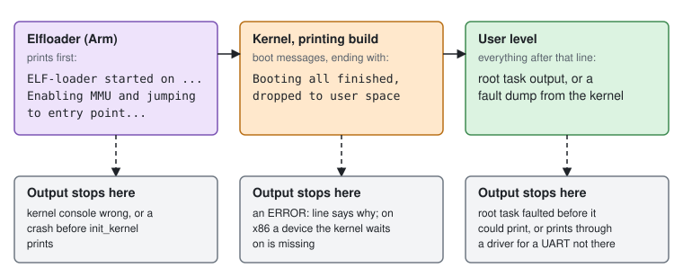

# Debugging

> The tools for finding out why an seL4 system misbehaves: debug-build kernel output and error reasons, the debug system calls, the fault dump, GDB under QEMU, the hardware debug API, tracing, and how to read a first boot that fails.

[Index](../INDEX.md) › [Part 4: The seL4 kernel](../INDEX.md#part-4-the-sel4-kernel) › [Inside the kernel](../INDEX.md#inside-the-kernel) · ← [Platform ports](platform-port.md) · [CHERI-seL4](cheri-sel4.md) →

Read first: [Build system and configuration](build-system.md), [Faults and fault handlers](faults.md), [Kernel boot sequence](kernel-boot.md).

| At a glance | |
|---|---|
| Kind | Process (debugging tools and techniques) |
| Key source | [`src/kernel/faulthandler.c`](https://github.com/seL4/seL4/blob/master/src/kernel/faulthandler.c), [`src/assert.c`](https://github.com/seL4/seL4/blob/master/src/assert.c), [`include/api/types.h`](https://github.com/seL4/seL4/blob/master/include/api/types.h) (`userError`) |
| Config options | `KernelDebugBuild`, `KernelPrinting`, `HardwareDebugAPI`, `KernelBenchmarks` |
| API | `seL4_DebugPutChar`, `seL4_DebugNameThread`, `seL4_DebugDumpScheduler`, `seL4_TCB_SetBreakpoint` |
| Built on | A serial port ([UARTs](../concepts/uart.md)); GDB through [QEMU](../concepts/qemu.md) |
| Used by | [sel4bench](sel4test.md) (the benchmark modes) |
| Verified | None of it: a verified kernel has no console driver, `printf` or debug system calls |

## What it is

seL4 has no kernel debugger and no log daemon. What it has is a serial
port ([UARTs](../concepts/uart.md)), a debug build that explains itself
on that port, a handful of extra system calls, and whatever the machine
or emulator offers from outside (GDB through
[QEMU](../concepts/qemu.md), JTAG on a board). Debugging a port is
mostly the art of getting the first character out and then reading what
the kernel says.

### Build options

Defaults here are those of a project configured through `init-build.sh`
without `-DVERIFICATION=ON` or `-DRELEASE=ON`. The kernel's own default
for `KernelVerificationBuild` is `ON`, which forces the options below
off in a stand-alone kernel build (see
[Build system](build-system.md)).

| Option (C macro) | Default | Effect |
|---|---|---|
| `KernelVerificationBuild` (`CONFIG_VERIFICATION_BUILD`) | off | Restricts the build to what the proofs cover; every option below depends on it being off |
| `KernelDebugBuild` (`CONFIG_DEBUG_BUILD`) | on | Symbols, assertions, thread names, the `Debug*` system calls |
| `KernelPrinting` (`CONFIG_PRINTING`) | follows `KernelDebugBuild` | The kernel's serial driver and `printf`; `seL4_DebugPutChar` |
| `KernelInvocationReportErrorIPC` | off | Also writes the error text into the caller's IPC buffer |
| `KernelColourPrinting` | on | ANSI colour escapes in error messages; turn off when logging to a file |
| `KernelIRQReporting` | on | Messages about spurious and unhandled interrupts |
| `KernelUserStackTraceLength` | 16 | Words of user stack printed in the fault dump |
| `HardwareDebugAPI` (`CONFIG_HARDWARE_DEBUG_API`) | off | Breakpoints, watchpoints and single-step for user threads |
| `KernelBenchmarks` | `none` | `generic`, `track_kernel_entries`, `tracepoints` or `track_utilisation` |
| `KernelDangerousCodeInjection` | off | `seL4_DebugRun`: run a user-supplied function in kernel mode |

Project build scripts usually wrap these: `-DRELEASE=OFF` in sel4test's
`init-build.sh`, `--config debug` in [Microkit](microkit.md).

A **verified or release kernel prints nothing at all**, not even a
boot banner: with `KernelPrinting` off the kernel has no console driver
(the serial device is left to user level), `printf` compiles to
nothing, and `seL4_DebugPutChar` does not exist. The reason is the
proofs: a UART driver and a formatter are code the verified
configurations do not contain ([The seL4 proofs](verification.md)).
On such a kernel, silence is not a symptom.

### What the kernel prints

- **Boot messages.** Memory regions, device discovery on x86
  (ACPI tables, CPUs, I/O APICs), then on every architecture the last
  line `Booting all finished, dropped to user space`. Anything after
  that line comes from user level or from a fault.
- **Invocation errors.** Every place the kernel rejects a system call
  is a `userError("...")` call, which in a printing build writes

  ```
  <<seL4(CPU 0) [decodeUntypedInvocation/68 T0xffffff8001234400 "rootserver" @4012ab]: Untyped Retype: Invalid object type.>>
  ```

  that is: the kernel function and line that refused, the calling
  thread's TCB address and debug name, the user program counter of the
  system call, and the reason. User level gets only an error number
  such as `seL4_InvalidArgument`
  ([System calls and invocations](syscalls-and-invocations.md)); the
  text is how you tell which of the many checks failed. This is the
  single most useful debugging feature and the reason to develop on
  debug kernels.
- **`fail()` and assertions.** `fail("msg")` prints
  `seL4 called fail at FILE:LINE in function F, saying "msg"` and
  halts; a failed `assert()` (debug builds only) prints
  `seL4 failed assertion 'EXPR' at FILE:LINE in function F`. `halt()`
  prints `halting...` and stops the CPU. On Arm and RISC-V a failed
  boot ends in `fail("ERROR: kernel init failed")`, preceded by a more
  specific `ERROR:` line.
- **The fault dump.** When a thread faults and has no usable fault
  handler, the kernel cannot deliver the fault message
  ([Faults](faults.md), "Double faults"), so it suspends the thread
  and prints:

  ```
  Caught cap fault in send phase at address 0
  while trying to handle:
  vm fault on data at address 0x10 with status 0x4
  in thread 0xffffff80bffed400 "child" at address 0x401a3c
  With stack:
  0x413f60: 0x0
  ...
  ```

  Read it bottom-up. "at address 0x401a3c" is the faulting program
  counter: look it up with `objdump -dS` or `addr2line -e` on the
  program's ELF file. "vm fault on data at address 0x10" is the access
  that failed (here a null pointer plus a field offset); "status" is
  the architecture's fault status (the page-fault error code on x86,
  `ESR_EL1` on AArch64). The first line is why delivery failed: a cap
  fault at address 0 means the thread simply has no fault endpoint. The
  stack words (`KernelUserStackTraceLength` of them) can be scanned for
  return addresses. The rest of the system keeps running, so a dump
  followed by a hang usually means the dead thread was one that others
  were waiting on.

### Debug system calls

These are system calls in their own right (negative syscall numbers,
no capability needed), declared in
`libsel4/include/api/syscall.xml` and present only under the
configuration shown.

| Call | Needs | Does |
|---|---|---|
| `seL4_DebugPutChar(c)` | printing | Writes one character to the kernel console; `seL4_DebugPutString` is a libsel4 loop over it |
| `seL4_DebugDumpScheduler()` | printing | Prints a table of every thread: name, state, restart PC and priority, plus core, domain and release-queue columns under SMP, several domains or MCS. The call exists with printing alone but prints only in a debug build |
| `seL4_DebugHalt()` | debug | Halts the kernel |
| `seL4_DebugCapIdentify(cap)` | debug | Returns the capability's type tag, 0 for an empty slot |
| `seL4_DebugSnapshot()` | debug | Prints a capDL description of the system: an `objects { ... }` block and a `caps { ... }` block |
| `seL4_DebugNameThread(tcb, name)` | debug | Sets the name shown in messages and dumps |
| `seL4_DebugSendIPI`, `seL4_DebugGetThreadAffinity` | debug + SMP | Poke another core; ask where a thread runs |
| `seL4_DebugRun(fn, arg)` | code injection | Calls `fn` in kernel mode |
| `seL4_Benchmark*` | benchmarks | Log control and utilisation counters, below |

Name threads early: an error that says `"net_driver"` is worth more
than a TCB address. `seL4_DebugPutChar` works before any user-level
serial driver does, which is why libsel4-based runtimes use it for
early `printf`, and why output can stop when a system is rebuilt in
release mode.

### GDB with QEMU

QEMU's `-s` opens a GDB server on TCP port 1234 and `-S` holds the CPU
at reset until GDB says continue (sel4test:
`./simulate --extra-qemu-args="-S -s"`). Then:

```
$ gdb kernel/kernel.elf            # aarch64-linux-gnu-gdb etc. for other targets
(gdb) target remote :1234
(gdb) break init_kernel            # or boot_sys on x86
(gdb) continue
```

Load the ELF file of whatever you are debugging; `add-symbol-file` adds
a second one (a user program) to the same session. Points that
surprise:

- GDB is debugging the *machine*, not a process. A breakpoint is an
  address; it fires in whichever address space has that address mapped,
  and a kernel symbol is meaningless while the elfloader or a
  bootloader is running.
- `kernel.elf` is linked at its virtual address. Before the MMU is on
  (the elfloader on Arm, the first instructions of `_start` on x86) the
  code runs at physical addresses, so symbolic breakpoints do not
  match; break on the physical address (`break *0x...`) or wait until
  paging is on. Prefer `hbreak` (hardware breakpoints) this early:
  a software breakpoint is a breakpoint instruction written into
  guest memory, which this early may not be mapped or loaded yet.
- On x86-64, QEMU starts the CPU in 16- or 32-bit mode and the kernel
  switches to 64-bit long mode in its first few dozen instructions
  ([x86 boot](../concepts/x86-boot.md)). GDB cannot follow a change of
  register set in mid-session, so `qemu-system-x86_64` always reports
  the 64-bit registers, even before the switch. A GDB whose
  architecture is a 16- or 32-bit one then fails with "Remote 'g'
  packet reply is too long"; `set architecture i386:x86-64` before
  `target remote` (or `disconnect`, set it, and reconnect).
- How many hardware breakpoints there are depends on QEMU's
  accelerator: unlimited under TCG (software emulation), and under
  KVM or another accelerator only what that accelerator supports.
- User-level `printf` and the kernel's are different functions; a
  breakpoint on one does not catch the other.

On real hardware the equivalents are a JTAG probe on Arm and RISC-V
boards; cloud virtual machines offer no such access, only the serial
console ([Cloud virtual machines](../concepts/cloud-vms.md)).

### The hardware debug API

With `HardwareDebugAPI`, user level can debug *other threads* through
their TCB capability: `seL4_TCB_SetBreakpoint`,
`seL4_TCB_GetBreakpoint`, `seL4_TCB_UnsetBreakpoint` program the CPU's
debug registers (instruction breakpoints and data watchpoints) for
that thread, and `seL4_TCB_ConfigureSingleStepping` makes it trap
after N instructions. A hit arrives at the thread's fault handler as
`seL4_Fault_DebugException`. This is what a user-level GDB stub is
built on. It exists on x86 and Arm; platform files that cannot support
it set `KernelHardwareDebugAPIUnsupported`, and all of RISC-V does.

### Before the console works

The kernel's own console comes up early in boot but not first, and on
a new machine it may never come up. Lower-level probes, in rising
order of effort:

- **Arm and RISC-V: the elfloader prints first**
  (`ELF-loader started on ...`, then
  `Enabling MMU and jumping to entry point...` on Arm). If the
  elfloader prints and the kernel does not, the fault is in the
  kernel's device tree or UART choice, not the board
  ([Elfloader](elfloader.md)). RISC-V output goes through SBI, so it
  works wherever OpenSBI does.
- **x86: write to the port directly.** One `outb` to `0x3f8` (or to
  QEMU's debug port `0xe9`, with `-debugcon`) needs no initialisation
  under an emulator and can be put anywhere, including assembly before
  paging ([I/O ports and MMIO](../concepts/io-ports.md)). The kernel
  takes its console from the command line (`console_port=`,
  `debug_port=`) or defaults to `0x3f8`.
- **Arm: poke the UART data register** from assembly or C at its
  physical address (before the MMU is on) with a known-good character.
- **No output device at all:** hang deliberately (`for (;;);`) or
  reset deliberately at successive points, and observe which happens.

### Tracing and benchmarking

`KernelBenchmarks` selects one mode. `track_kernel_entries` logs every
kernel entry (system call, interrupt, fault) with timing;
`tracepoints` times the code between `TRACE_POINT_START(n)` and
`TRACE_POINT_STOP(n)` pairs that you insert in the kernel;
`track_utilisation` accumulates per-thread run time, read with
`seL4_BenchmarkGetThreadUtilisation`. The first two write to a 1 MB
**kernel log buffer** that user level supplies as a large frame with
`seL4_BenchmarkSetLogBuffer` and brackets with `seL4_BenchmarkResetLog`
and `seL4_BenchmarkFinalizeLog`. The option's own help text says the
modes are not fully implemented on x86. [sel4bench](sel4test.md) is the
user of these.

### Reading a first boot that fails

Heuristics, not proofs; each is the usual cause, not the only one.



*Who is printing at each stage of an Arm boot, and three rows of the table
below placed where the output stops.*

| Symptom | Usually means |
|---|---|
| Nothing at all | Not a printing build; wrong console (port, UART, baud); or the image was never entered (wrong load address or entry point, wrong image format for the bootloader) |
| Bootloader or elfloader output, then nothing | Kernel console wrong, or a crash before `init_kernel` prints: bad `physBase`/memory node on Arm, wrong exception level, paging set up for the wrong address |
| Reset loop on x86 | Triple fault: an exception with no working handler, typically a bad page table or descriptor during the mode switch ([x86-64 exceptions](../concepts/x86-exceptions-syscalls.md)); under QEMU, `-d int,cpu_reset -no-reboot` shows the faulting exception |
| An `ERROR:` line, then `kernel init failed` or a halt | The kernel told you: read the line above. Common ones are memory regions that overlap the kernel or the user image, and too many regions or boot modules |
| Boot messages stop part-way on x86 | A device the kernel waits on is missing: PIT-based calibration with no PIT is the classic ([Timer calibration](../concepts/timer-calibration.md)) |
| `Booting all finished...` then nothing | The root task faulted before it could print, or it prints through a driver for a UART the machine lacks; in a debug build expect a fault dump |
| Starts, then hangs or stalls in sleeps and timeouts | No timer interrupts: wrong IRQ number or controller mode, timer frequency wrong, or the interrupt never acknowledged ([Interrupt delivery](irq-handling.md)) |
| Works on one core, hangs with SMP | Secondary CPU start-up or IPIs ([SMP](smp.md)) |

## In seL4

- Options: [`config.cmake`](https://github.com/seL4/seL4/blob/master/config.cmake)
  (search for `KernelDebugBuild`).
- `userError`: [`include/api/types.h`](https://github.com/seL4/seL4/blob/master/include/api/types.h).
  It is a macro that vanishes without `CONFIG_PRINTING`, so adding or
  rewording one never affects a verified build.
- `_fail()`, `_assert_fail()`: [`src/assert.c`](https://github.com/seL4/seL4/blob/master/src/assert.c);
  `halt()` in `src/arch/*/idle.c`.
- The fault dump: `handleDoubleFault()` and `print_fault()` in
  [`src/kernel/faulthandler.c`](https://github.com/seL4/seL4/blob/master/src/kernel/faulthandler.c);
  the stack words are printed by the per-architecture
  `Arch_userStackTrace()`.
- Debug system calls: listed in
  [`libsel4/include/api/syscall.xml`](https://github.com/seL4/seL4/blob/master/libsel4/include/api/syscall.xml)
  under `<debug>`, dispatched by `handleUnknownSyscall()` in
  `src/api/syscall.c`.
- Kernel console: `kernel_putDebugChar()`; on x86 in
  [`src/plat/pc99/machine/io.c`](https://github.com/seL4/seL4/blob/master/src/plat/pc99/machine/io.c),
  with the port chosen in `src/arch/x86/kernel/cmdline.c`; on Arm and
  RISC-V in the driver under `src/drivers/serial/` that the device
  tree selects ([Platform ports](platform-port.md)).
- `debug_printKernelEntryReason()` in `include/api/debug.h` prints why
  the kernel was entered; handy inside a temporary `printf`.
- Tracepoints: `include/benchmark/benchmark.h`.

## Gotchas

- **Debug and release kernels are different kernels.** Timing, memory
  layout and even which system calls exist differ. Code that calls
  `seL4_DebugPutChar` unconditionally fails to link, or faults with an
  unknown-syscall fault, on a release kernel.
- **Kernel `printf` is polled and slow.** It runs with interrupts off
  and waits for the UART; heavy printing changes timing enough to hide
  or create races, and at 115200 baud each line costs milliseconds.
- **Two writers, one UART.** In a debug build the kernel and a
  user-level serial driver can both drive the same device; output
  interleaves, and the driver's interrupt configuration can break the
  kernel's assumptions or the reverse.
- **A thread with no name prints as an address.** `seL4_DebugNameThread`
  costs one call per thread and makes every later message readable.
- **The fault dump's "address" is the restart PC** (`getRestartPC()`,
  the saved `FaultIP`). For a fault raised by a system call (a cap
  fault, an unknown system call) that is the trap instruction itself,
  not the one after it.
- **`KernelBenchmarks` on Arm exports the performance counters (PMU)
  to user level** (`KernelArmExportPMUUser`), per its help text; a
  benchmark kernel is not an isolation kernel.
- **x86 emulators forgive a UART that was never initialised; real and
  cloud hardware may not.** An early `outb` that works under QEMU can
  print nothing on a machine whose port is absent or needs line
  settings first.

## See also

- [Faults and fault handlers](faults.md): the fault types named in the dump
- [Kernel boot sequence](kernel-boot.md): what should happen, in order
- [QEMU](../concepts/qemu.md): the emulator and its debugging switches
- [UARTs](../concepts/uart.md): the console device itself
- [sel4test and sel4bench](sel4test.md): the test suite to run once it boots, and the benchmark user
- [Platform ports](platform-port.md): the assumptions a new machine breaks
- [System calls and invocations](syscalls-and-invocations.md): error codes the messages explain
- [ELF and linking](../concepts/elf.md): ELF is the file format of every kernel, loader and user program in an seL4 system
- [libsel4 and the runtime](libsel4.md): libsel4 is the kernel's ABI written down as C

## References

- [seL4 `config.cmake`](https://github.com/seL4/seL4/blob/master/config.cmake):
  every option in the table, with defaults and dependencies.
  *Checked 2026-11-14.*
- [seL4 `libsel4/include/api/syscall.xml`](https://github.com/seL4/seL4/blob/master/libsel4/include/api/syscall.xml):
  the debug system calls and their conditions. *Checked 2026-11-14.*
- [seL4 `include/api/types.h`](https://github.com/seL4/seL4/blob/master/include/api/types.h):
  the `userError` format. *Checked 2026-11-14.*
- [seL4 `src/kernel/faulthandler.c`](https://github.com/seL4/seL4/blob/master/src/kernel/faulthandler.c)
  and [`src/assert.c`](https://github.com/seL4/seL4/blob/master/src/assert.c):
  the fault dump and `fail`/assert texts. *Checked 2026-11-14.*
- [seL4 debugging guide](https://docs.sel4.systems/projects/sel4-tutorials/debugging-guide.html):
  QEMU `-S -s`, GDB commands, `objdump`, the caveats about page-table
  switches. *Checked 2026-11-14.*
- [seL4 `libsel4/include/interfaces/object-api.xml`](https://github.com/seL4/seL4/blob/master/libsel4/include/interfaces/object-api.xml):
  the breakpoint and single-step TCB invocations. *Checked 2026-11-14.*
- [seL4_tools `elfloader-tool/src/arch-arm/sys_boot.c`](https://github.com/seL4/seL4_tools/blob/master/elfloader-tool/src/arch-arm/sys_boot.c):
  the elfloader's messages. *Checked 2026-11-14.*
- [seL4 `include/api/debug.h`](https://github.com/seL4/seL4/blob/master/include/api/debug.h),
  [`src/api/syscall.c`](https://github.com/seL4/seL4/blob/master/src/api/syscall.c)
  and [`src/arch/arm/64/machine/capdl.c`](https://github.com/seL4/seL4/blob/master/src/arch/arm/64/machine/capdl.c):
  what `seL4_DebugDumpScheduler` and `seL4_DebugSnapshot` print, and
  under which options. *Checked 2026-11-14.*
- [seL4 `src/arch/arm/64/traps.S`](https://github.com/seL4/seL4/blob/master/src/arch/arm/64/traps.S),
  [`src/arch/x86/c_traps.c`](https://github.com/seL4/seL4/blob/master/src/arch/x86/c_traps.c)
  and [`src/arch/riscv/traps.S`](https://github.com/seL4/seL4/blob/master/src/arch/riscv/traps.S):
  `FaultIP` on a system call is the address of the trap instruction.
  *Checked 2026-11-14.*
- [QEMU, "GDB usage"](https://www.qemu.org/docs/master/system/gdb.html):
  `-s` and `-S`, breakpoints inserted into guest memory, hardware
  breakpoints per accelerator. *Checked 2026-11-14.*
- [QEMU `target/i386/gdbstub.c`](https://github.com/qemu/qemu/blob/master/target/i386/gdbstub.c):
  a 64-bit x86 CPU reports 64-bit registers in every mode.
  *Checked 2026-11-14.*
- [QEMU issue 141](https://gitlab.com/qemu-project/qemu/-/issues/141):
  the "Remote 'g' packet reply is too long" error and the
  `set architecture` workaround. *Checked 2026-11-14.*
- [seL4 reference manual](https://sel4.systems/Info/Docs/seL4-manual-latest.pdf),
  version 17.0.0: sections 10.2.3 "Debugging System Calls" and 6.2.4
  to 6.2.5 (the hardware debug API's faults). *Checked 2026-11-14.*
