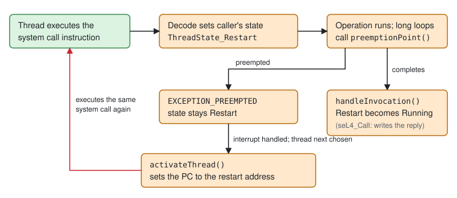

# Kernel design

> The rules every line of seL4 follows: one kernel stack per core and no blocking inside the kernel, interrupts off except at explicit preemption points that abort and restart the system call, no kernel heap, errors as return values, and a small set of global state; knowing them explains why kernel code looks the way it does.

[Index](../INDEX.md) › [Part 4: The seL4 kernel](../INDEX.md#part-4-the-sel4-kernel) › [Inside the kernel](../INDEX.md#inside-the-kernel) · ← [Virtualisation support](hypervisor.md) · [Source layout](source-layout.md) →

Read first: [seL4 overview](overview.md), [Source layout](source-layout.md).

| At a glance | |
|---|---|
| Kind | Kernel mechanism (the design rules and execution model) |
| Key source | `src/api/syscall.c`, [`src/model/preemption.c`](https://github.com/seL4/seL4/blob/master/src/model/preemption.c), `src/model/statedata.c` |
| Config options | `CONFIG_KERNEL_STACK_BITS`, `CONFIG_MAX_NUM_WORK_UNITS_PER_PREEMPTION`, `CONFIG_RESET_CHUNK_BITS` |
| Built on | [Untyped memory](untyped-memory.md) in place of a heap; the [verified C subset](verified-c-subset.md) |
| Verified | The proofs model the kernel as a function from (state, event) to state; debug-only code is outside them |

## What it is

seL4's source reads strangely to someone used to Linux: no locks in the
uniprocessor code, no `kmalloc`, no sleeping, functions that return a
status and leave the real error in a global, and loops that can give up
half way. Each oddity follows from a handful of design decisions, most
made so that the kernel could be [formally verified](verification.md)
and its worst-case execution time bounded.

### An event kernel with one stack per core

Linux gives every thread its own kernel stack, so a thread can block deep
inside a system call and resume there later (a "process model" kernel).
seL4 is an **event** (or "interrupt model") kernel: there is one kernel
stack per core (`kernel_stack_alloc[CONFIG_MAX_NUM_NODES][BIT(CONFIG_KERNEL_STACK_BITS)]`,
4 KiB each by default), every kernel entry starts at the top of it with
an empty stack, and every entry runs to completion and returns to user
level. There are no kernel threads, and nothing in the kernel ever
waits.

A thread that "blocks" in `seL4_Recv` is not suspended inside the
kernel. The kernel records the thread's state in its TCB (`tcbState`:
`BlockedOnReceive`, and which endpoint), queues the TCB on the endpoint,
picks another thread and returns to that one. When a message later
arrives, the sender's system call copies it into the receiver's saved
registers and marks it `Running`. All per-thread kernel state is
therefore the TCB's saved user registers plus a few words; nothing lives
on a stack between entries.

This makes the kernel a function from (state, event) to state, which is
what the proofs model, and keeps memory per thread small. Both the SOSP
2009 paper and the TOCS 2014 paper give this rationale: an event-based
kernel with a single stack sidesteps the verification complexity of
yielding inside the kernel, and earlier L4 kernels chose it to reduce
the kernel's memory footprint.

### Interrupts off, with preemption points

The kernel runs with interrupts disabled from entry to exit. On one core
there is then no concurrency in the kernel at all, so no locks and no
interleavings to reason about. (On several cores a single big lock
restores the same property: [SMP](smp.md).)

The price is interrupt latency: the longest kernel path is the longest
time a device waits. Almost every operation is short and bounded by
construction, but a few are not: revoking a capability with many
descendants, deleting a CNode or a thread with a large structure behind
it, and clearing the memory of a large untyped before reuse. These loops
call `preemptionPoint()`:

```c
exception_t preemptionPoint(void)
{
    ksWorkUnitsCompleted++;
    if (ksWorkUnitsCompleted >= CONFIG_MAX_NUM_WORK_UNITS_PER_PREEMPTION) {
        ksWorkUnitsCompleted = 0;
        if (isIRQPending()) {            /* MCS adds budget and domain checks */
            return EXCEPTION_PREEMPTED;
        }
    }
    return EXCEPTION_NONE;
}
```

It does not enable interrupts. It polls the interrupt controller every
`CONFIG_MAX_NUM_WORK_UNITS_PER_PREEMPTION` iterations, and if something
is pending the operation returns `EXCEPTION_PREEMPTED` up the call chain.
The top level then handles the interrupt as if it had just arrived and
leaves the calling thread ready to **restart** its system call.

### Restartable system calls

Because there is no kernel stack to resume on, a preempted operation
cannot continue from where it was. Instead:

- before doing any work, an invocation sets the caller's state to
  `ThreadState_Restart` (see the `setThreadState(NODE_STATE(ksCurThread),
  ThreadState_Restart)` calls at the end of every decode function);
- if the operation completes, `handleInvocation()` turns `Restart` into
  `Running` and, for a `seL4_Call`, writes the reply;
- if it was preempted, the state stays `Restart`. When the thread is next
  chosen, `activateThread()` sets its program counter to the restart
  address (`getRestartPC()`: the system call instruction itself), so the
  thread simply executes the same system call again.



*The red arrow is the restart: there is no kernel stack to resume on, so a
preempted thread runs the whole system call again.*

Long operations are written so that each step makes durable progress and
leaves kernel state consistent: a preempted revoke has already deleted
some children, so the retry has less to do. This is why revoke and delete
are structured as "remove one thing, check for preemption, repeat", and
why untyped memory is cleared in chunks of `BIT(CONFIG_RESET_CHUNK_BITS)`
bytes with the untyped's free index moved back after each chunk.

The same mechanism serves ordinary blocking: a thread that faults or
blocks during an invocation is just in another state, and its registers
already hold everything needed to continue or retry.

### No dynamic allocation

The kernel has no heap and no allocator. After boot, every byte of
memory the kernel uses for an object (a TCB, a page table, a CNode) comes
from an [untyped](untyped-memory.md) region that user level chose and
passed to `seL4_Untyped_Retype`. So:

- the kernel cannot run out of memory in the middle of an operation, and
  there are no allocation-failure paths to verify;
- memory policy is entirely user level's;
- kernel metadata for an object lives inside the object: queues are
  intrusive linked lists through TCBs, and the capability derivation tree
  is threaded through the capability slots themselves.

The only memory not from untypeds is the kernel image and its static data
(the globals below, per-core stacks, the idle threads, kernel page
tables), sized at build time by options such as `CONFIG_MAX_NUM_NODES`
and `CONFIG_NUM_DOMAINS`.

### Bounded work and no trust in user input

Every loop in the kernel is bounded by something fixed (word size, number
of priorities, `CONFIG_RETYPE_FAN_OUT_LIMIT` objects per retype) or has a
preemption point. That makes a worst-case execution time analysis
possible, and it is why new kernel code that iterates over a
user-controlled quantity is rejected in review.

The kernel never dereferences a pointer supplied by user level. System
call arguments are register values or words in the caller's IPC buffer,
and the IPC buffer itself is reached through the kernel's own mapping of
the frame the thread's buffer capability names (`lookupIPCBuffer()`),
never through the user's virtual address. Objects are named only by
capability addresses, resolved by `lookupCap()` and friends through the
caller's [CSpace](cspace.md). An invocation is **decoded** completely
(all capabilities looked up, all arguments checked) before any state
changes: the `decode*Invocation()` functions check, the `invoke*()`
functions act and are written so they cannot fail. A patch that adds a
check inside an `invoke` function, or a state change inside a `decode`
function, is breaking this rule
([system calls and invocations](syscalls-and-invocations.md)).

### Errors as return values

C has no exceptions and the [verified subset](verified-c-subset.md) has
no `goto` out of nested calls, so failure is a return value plus a
global holding the detail:

| `exception_t` value | Detail in | Meaning |
|---|---|---|
| `EXCEPTION_NONE` | | Success |
| `EXCEPTION_SYSCALL_ERROR` | `current_syscall_error` | The invocation was invalid; becomes the `seL4_Error` the caller sees (`seL4_InvalidCapability`, `seL4_RangeError`, ...) |
| `EXCEPTION_LOOKUP_FAULT` | `current_lookup_fault` | A capability address did not resolve |
| `EXCEPTION_FAULT` | `current_fault` | The thread faulted; a [fault](faults.md) message goes to its handler |
| `EXCEPTION_PREEMPTED` | | A preemption point fired |

Functions that also return a value return a small struct with a `status`
field (`lookupCap_ret_t`, `lookupSlot_ret_t`). The pattern at every call
site is: call, test `status != EXCEPTION_NONE`, return it upward.

### Global state

Kernel state outside objects is a short list of globals, by convention
prefixed `ks` (kernel state), in `src/model/statedata.c`:

| Global | Holds |
|---|---|
| `ksCurThread` | The thread whose registers will be restored on exit |
| `ksIdleThread` | The per-core idle thread |
| `ksSchedulerAction` | What `schedule()` should do: `SchedulerAction_ResumeCurrentThread`, `SchedulerAction_ChooseNewThread`, or a pointer to a specific thread to switch to |
| `ksReadyQueues[]`, `ksReadyQueuesL1Bitmap[]`, `ksReadyQueuesL2Bitmap[][]` | The run queues and their two-level bitmap ([scheduling](scheduling.md)) |
| `ksCurDomain`, `ksDomainTime`, `ksDomScheduleIdx` | The domain scheduler |
| `ksWorkUnitsCompleted` | The preemption-point counter |
| `ksCurSC`, `ksConsumed`, `ksCurTime`, `ksReprogram`, `ksReleaseQueue` | MCS only: scheduling context and time accounting |
| `current_fault`, `current_lookup_fault`, `current_syscall_error` | Error detail, above |

Per-core variables are declared with `UP_STATE_DEFINE` and read through
`NODE_STATE(ksCurThread)`. Without SMP that is just the variable; with
SMP it expands to a field of this core's entry in `ksSMP[]`. Always use
the macro in new code. Architecture state (kernel page tables, ASID tables, interrupt state) lives
in `src/arch/<arch>/model/statedata.c` and its `32/` and `64/`
siblings, with names prefixed `x86KS`, `armKS` or `riscvKS` (also
`x64KS`, `ia32KS`, and `armHS` for Arm hypervisor state).

## In seL4

### The shape of every kernel entry

```
user ──trap──▶ assembly entry (traps.S / head.S vectors)
                 save user registers into ksCurThread's TCB, switch to the kernel stack
               c_handle_syscall() / c_handle_interrupt() / c_handle_vm_fault() ...   src/arch/<arch>/c_traps.c
                 take the kernel lock (SMP), try the fast path
               slowpath() ─▶ handleSyscall()                                         src/api/syscall.c
                               handleInvocation() ─▶ lookup ─▶ decodeInvocation() ─▶ invoke...
                               (on error or preemption: handle any pending interrupt)
                               schedule()          pick ksCurThread per ksSchedulerAction
                               activateThread()    fix up a Restart thread's PC
               restore_user_context()              never returns: load registers, return to user
```

All entries share the last three steps. `handleInterruptEntry()`,
`handleVMFaultEvent()`, `handleUserLevelFault()` and
`handleUnknownSyscall()` in `src/api/syscall.c` are the siblings of
`handleSyscall()`, each ending in `schedule(); activateThread();`. The
architecture pages cover the assembly half
([x86](../concepts/x86-exceptions-syscalls.md),
[AArch64](../concepts/aarch64-exceptions.md)).

Since entries never return through the stack, the C entry functions are
`NORETURN` and `restore_user_context()` ends in the architecture's
return-to-user instruction. Nothing on the kernel stack survives.

Scheduling is likewise deferred: code that makes a thread runnable does
not switch to it, it calls `possibleSwitchTo()` or `rescheduleRequired()`
to set `ksSchedulerAction`, and the one `schedule()` call at the end of
the entry acts on it.

### Preemption points in the source

`preemptionPoint()` is in [`src/model/preemption.c`](https://github.com/seL4/seL4/blob/master/src/model/preemption.c).
Upstream has exactly three callers: two in `src/object/cnode.c` (the
revoke loop and the delete/finalise loop) and one in
`src/object/untyped.c` (clearing memory when an untyped is reset). In
`handleSyscall()`, a non-`EXCEPTION_NONE` result from `handleInvocation()`
leads to `checkInterrupt()` (on MCS preceded by `mcsPreemptionPoint()`),
which services the pending interrupt before `schedule()`.

### The Haskell heritage

seL4 was designed by writing an executable prototype in Haskell, which
doubled as the design-level specification; the C was then
re-implemented from it by hand, and the proof relates the two (SOSP
2009, section 2.2). It shows:

- camelCase function names that match the Haskell and the Isabelle
  specifications (`decodeInvocation`, `cteDeleteOne`, `setThreadState`),
  alongside snake_case in the machine-level code that had no Haskell
  counterpart (`init_kernel`, `map_kernel_window`);
- result structs (`lookupCap_ret_t`) and the `exception_t` convention,
  which stand in for Haskell's error monad;
- the decode/invoke split, which was two phases of a monadic function;
- small pure functions over values (`cap_t` passed and returned by
  value, the [generated](generated-code.md) `_new`/`_get_`/`_set_`
  accessors) where C programmers would mutate through pointers;
- `tagged_union` types that are algebraic data types in the original.

Renaming a function or restructuring one "for readability" therefore
breaks the correspondence the proofs rely on: see
[proof impact](proof-impact.md).

## Gotchas

- `preemptionPoint()` returning non-zero is not an error to report or log:
  the caller must return it unchanged all the way up, having left state
  consistent for a retry.
- Because a preempted call restarts from the beginning, user level can
  observe the side effects of a long operation part-done (some
  capabilities already revoked) while the call has not yet returned.
- `current_syscall_error` and friends are only meaningful immediately
  after a function returned the matching `exception_t`. Reading them
  later, or returning `EXCEPTION_SYSCALL_ERROR` without setting
  `current_syscall_error.type`, reports a stale error.
- `ksCurThread` is "the thread to return to", and may change during an
  entry only inside `schedule()`. Code before that which wants "the
  caller" reads `NODE_STATE(ksCurThread)`; code that makes another thread
  runnable must not switch directly.
- The kernel stack is small and has no guard page (the option's help text
  warns of silent corruption): no large locals, no recursion. The
  verified subset forbids recursion anyway; the one naturally recursive
  operation, deleting a CNode that contains capabilities to CNodes, is
  made iterative with "zombie" capabilities.
- Debug-only code (`#ifdef CONFIG_DEBUG_BUILD`, `CONFIG_PRINTING`) is
  outside the proofs and may break these rules a little (unbounded
  printing); do not take it as a model for real paths.
- "No allocation" includes boot: boot code carves the initial objects out
  of free memory with its own simple scheme and hands the rest to user
  level as untypeds ([kernel boot](kernel-boot.md)).

## See also

- [System calls and invocations](syscalls-and-invocations.md): the decode and invoke phases in detail
- [Scheduling](scheduling.md): what `schedule()` does with `ksSchedulerAction`
- [Untyped memory](untyped-memory.md): the consequence of no kernel heap
- [Verified C subset](verified-c-subset.md): the language rules that go with these design rules
- [Proof impact](proof-impact.md): what changing this code costs
- [SMP](smp.md): how the big lock preserves the no-concurrency model
- [Faults](faults.md): what `EXCEPTION_FAULT` turns into
- [History and papers](history-and-papers.md): where the design is argued
- [Exceptions, interrupts and traps](../concepts/exceptions-and-traps.md): the three ways a CPU leaves user code for the kernel
- [Virtual memory](../concepts/virtual-memory.md): how an MMU translates the addresses programs use into physical ones through multi-level page tables, with...

## References

- [seL4 `src/model/preemption.c`](https://github.com/seL4/seL4/blob/master/src/model/preemption.c):
  `preemptionPoint()`, quoted above without its MCS branch; its three
  callers found by search. *Checked 2026-11-14.*
- [seL4 `src/api/syscall.c`](https://github.com/seL4/seL4/blob/master/src/api/syscall.c):
  `handleSyscall()` ending in `schedule(); activateThread();`, and
  `handleInvocation()`'s treatment of each `exception_t` and of
  `ThreadState_Restart`. *Checked 2026-11-14.*
- [seL4 `src/kernel/thread.c`](https://github.com/seL4/seL4/blob/master/src/kernel/thread.c):
  `activateThread()` and the restart PC. *Checked 2026-11-14.*
- [seL4 `include/api/failures.h`](https://github.com/seL4/seL4/blob/master/include/api/failures.h):
  the `exception_t` values and the three `current_*` globals.
  *Checked 2026-11-14.*
- [seL4 `src/model/statedata.c`](https://github.com/seL4/seL4/blob/master/src/model/statedata.c)
  and [`include/model/statedata.h`](https://github.com/seL4/seL4/blob/master/include/model/statedata.h):
  the `ks` globals, `UP_STATE_DEFINE`, `NODE_STATE`. *Checked 2026-11-14.*
- [seL4 `src/arch/arm/c_traps.c`](https://github.com/seL4/seL4/blob/master/src/arch/arm/c_traps.c):
  `c_handle_syscall()`, `slowpath()`, `restore_user_context()` calls.
  *Checked 2026-11-14.*
- [seL4 `config.cmake`](https://github.com/seL4/seL4/blob/master/config.cmake):
  `KernelStackBits` (default 12, "no guard below the stack"),
  `KernelMaxNumWorkUnitsPerPreemption`, `KernelResetChunkBits`,
  `KernelRetypeFanOutLimit`. *Checked 2026-11-14.*
- Klein et al., ["seL4: Formal Verification of an OS Kernel"](https://trustworthy.systems/publications/nicta_full_text/1852.pdf),
  SOSP 2009: the event-based design, preemption points, the Haskell
  prototype. *Checked 2026-11-14.*
- Klein et al., ["Comprehensive Formal Verification of an OS Microkernel"](https://trustworthy.systems/publications/nicta_full_text/7371.pdf),
  ACM TOCS 32(1), 2014: the fuller account of the same design (section
  3.4) and of memory management through untypeds (section 3.3).
  *Checked 2026-11-14.*
- Murray et al., ["seL4: from General Purpose to a Proof of Information
  Flow Enforcement"](https://trustworthy.systems/publications/nicta_full_text/6464.pdf),
  IEEE S&P 2013: why the domain scheduler state exists (the static
  partition scheduler added for the proof). *Checked 2026-11-14.*
- [seL4 `src/arch/x86/model/statedata.c`](https://github.com/seL4/seL4/blob/master/src/arch/x86/model/statedata.c)
  (and the `arm/32`, `arm/64`, `riscv`, `x86/32`, `x86/64` siblings):
  the architecture state and its name prefixes. *Checked 2026-11-14.*
