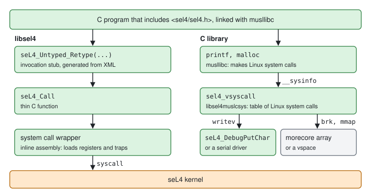

# libsel4 and the runtime

> libsel4 is the kernel's ABI written down as C (types, constants, system call wrappers and generated invocation stubs), shipped in the kernel repository under a BSD licence; `sel4runtime` and a C library sit on top of it, and Microkit and rust-sel4 consume the same definitions by other routes.

[Index](../INDEX.md) › [Part 6: User level](../INDEX.md#part-6-user-level) · ← [Proof impact of a change](proof-impact.md) · [seL4_libs and util_libs](sel4-libs.md) →

Read first: [System calls and invocations](syscalls-and-invocations.md), [Generated code](generated-code.md).

| At a glance | |
|---|---|
| Kind | Library (C, nearly all headers): the kernel's ABI |
| Repository | The kernel repository, `libsel4/` directory |
| Key source | [`libsel4/include/sel4/`](https://github.com/seL4/seL4/tree/master/libsel4/include/sel4), [`libsel4/tools/`](https://github.com/seL4/seL4/tree/master/libsel4/tools) |
| Config options | `LibSel4FunctionAttributes`, `LibSel4StubsUseIPCBufferOnly`, `LibSel4PrintInvocationErrors`, `LibSel4UseThreadLocals` |
| API | `<sel4/sel4.h>`: system call wrappers (`seL4_Call`, ...) and generated invocation stubs |
| Used by | `sel4runtime`, musllibc, [seL4_libs](sel4-libs.md), [Microkit](microkit.md), [rust-sel4](rust-sel4.md) |
| Verified | No; the kernel code that decodes what it sends is |

## What it is

The seL4 kernel has no stable binary interface of its own to document:
what a user program needs to know (system call numbers, which register
carries what, invocation labels, object sizes, the layout of the IPC
buffer and of BootInfo) is all in **libsel4**, a small C library in the
kernel repository's `libsel4/` directory. It is built in the same
CMake build as the kernel, with the same configuration, and nearly all
of it is headers: the one C file defines two variables.

A program includes `<sel4/sel4.h>` and gets:

| Kind | Examples | Where it comes from |
|---|---|---|
| Basic types | `seL4_Word` (machine word), `seL4_CPtr` (a capability address, see [CSpaces](cspace.md)), `seL4_Bool`, `seL4_Uint64` | `sel4/simple_types.h`, `sel4/types.h` |
| Packed types | `seL4_MessageInfo_t`, `seL4_CapRights_t`, `seL4_CNode_CapData_t`, fault messages | generated from `shared_types.bf` and `types.bf` by the [bitfield generator](generated-code.md) |
| Structures | `seL4_IPCBuffer`, `seL4_BootInfo`, `seL4_UntypedDesc`, `seL4_UserContext` (a thread's registers, per architecture) | `sel4/shared_types.h`, `sel4/bootinfo_types.h`, `sel4/sel4_arch/types.h` |
| Constants | object types (`seL4_TCBObject`), size bits (`seL4_PageBits`, `seL4_TCBBits`, `seL4_MinUntypedBits`), `seL4_MsgMaxLength` (120), `seL4_MsgMaxExtraCaps` (3), errors (`seL4_InvalidArgument`) | `sel4/constants.h`, `sel4/objecttype.h`, `sel4/errors.h`, and the `arch`, `sel4_arch` and `plat` variants |
| Initial capability slots | `seL4_CapInitThreadTCB` (1), `seL4_CapInitThreadCNode` (2), `seL4_CapInitThreadVSpace` (3), `seL4_CapIRQControl` (4), ... `seL4_NumInitialCaps` (16) | `sel4/bootinfo_types.h`; see [BootInfo](bootinfo-and-root-task.md) |
| System calls | `seL4_Send`, `seL4_Call`, `seL4_Recv`, `seL4_ReplyRecv`, `seL4_NBSend`, `seL4_Yield`, with different signatures on [MCS](mcs.md) | declared in `sel4/syscalls.h`, implemented per architecture |
| Invocations | `seL4_Untyped_Retype`, `seL4_TCB_Configure`, `seL4_X86_Page_Map`, ... | generated from XML into `interfaces/sel4_client.h` |
| Message access | `seL4_GetMR(i)`, `seL4_SetMR(i, w)`, `seL4_GetCap`, `seL4_SetCap`, `seL4_GetBadge`, `seL4_SetCapReceivePath`, `seL4_GetIPCBuffer` | `sel4/functions.h` |
| Debug and benchmark calls | `seL4_DebugPutChar`, `seL4_DebugDumpScheduler`, `seL4_DebugHalt`, `seL4_DebugSnapshot`, `seL4_DebugCapIdentify`, `seL4_DebugNameThread`, `seL4_BenchmarkResetLog`, ... | `sel4/syscalls.h`; exist only when the kernel configuration has them |

### Two layers of function

A **system call wrapper** is a few lines of inline assembly that load
registers and trap. On x86-64 (`syscalls_syscall.h`) `x64_sys_send`
puts the system call number in `rdx`, the capability address in `rdi`,
the message info word in `rsi` and the first four message registers in
`r10`, `r8`, `r9`, `r15`, keeps `rsp` in `rbx` across the `syscall`
instruction and restores it afterwards (see
[x86 exceptions and system calls](../concepts/x86-exceptions-syscalls.md)
for the instruction).
On MCS the reply capability goes in `r12`. `seL4_Call` and its
siblings are thin C functions around these.

An **invocation stub** is generated C on top of `seL4_Call`: it
marshals its arguments into message registers and the IPC buffer, sets
the extra capabilities, builds the `seL4_MessageInfo_t` with the
method's label, calls, and unmarshals the error code and any results.
The stubs come from the same XML files the kernel's invocation labels
come from, so both sides agree by construction;
[generated code](generated-code.md) covers the generators.

### The IPC buffer pointer

Each thread has an [IPC buffer](ipc.md), a page the kernel reads the
longer part of a message from. The kernel knows where it is from
`seL4_TCB_Configure`; user code has to be told separately, and libsel4
keeps the address in the global `__sel4_ipc_buffer`, declared
`__thread` (thread-local) when `LibSel4UseThreadLocals` is on, which
is the default. `seL4_GetMR` and every stub go through it. Nothing in
libsel4 sets it: the runtime does.

### Licence and compatibility

The kernel is GPLv2; libsel4, like other user-level code in the
repository, is BSD 2-clause, and `LICENSE.md` adds a "GPL syscall
note" modelled on Linux's: programs that use the kernel through its
system calls are not derived works. So proprietary user-level code can
link libsel4.

seL4 does **not** promise a stable ABI between releases. System call
numbers and invocation labels are enumerations generated from XML, so
adding a method renumbers the ones after it; object sizes and
structures change with configuration options. Each release in
`CHANGES.md` is labelled BINARY COMPATIBLE, SOURCE COMPATIBLE or
BREAKING relative to the one before, and the file's header gives the
rules of thumb: a change only under `src/` and `include/` is binary
compatible; adding symbols in `libsel4/` is binary compatible;
altering existing definitions in `libsel4/` is source compatible;
anything else is breaking. In practice user level is always compiled
against the libsel4 of the exact kernel it will run on, with the same
configuration. A patch that changes the kernel API therefore changes
`libsel4/` in the same commit, and needs a `CHANGES.md` entry.

### The runtime and the C library

libsel4 is not enough to run a C program: something must provide
`_start`, a stack, thread-local storage (TLS) and `main`'s arguments.

**sel4runtime** (`seL4/sel4runtime`) is that minimal C runtime. It has
two entry points. An ordinary process enters at `_start` in the
per-architecture `crt0.S`, with a stack laid out as on Linux
(arguments, environment and an auxiliary vector). The
[root task](bootinfo-and-root-task.md) has no stack and only a
BootInfo pointer in a register, so it enters at `_sel4_start`, which
switches to a static 16 KiB stack and builds those vectors itself,
with the BootInfo pointer in an `AT_SEL4_BOOT_INFO` auxiliary entry.
Both paths meet in `__sel4_start_main`, which copies the ELF's TLS
image into a static area, sets the thread pointer
(`seL4_SetTLSBase`, or the architecture's register), sets
`__sel4_ipc_buffer` (for the root task, from `bootinfo->ipcBuffer`),
runs constructors and calls `main`. The root task then gets its
BootInfo from `sel4runtime_bootinfo()`. sel4runtime also has helpers
for creating the TLS area of a new thread
(`sel4runtime_write_tls_image`) and exit callbacks.

**musllibc** (`seL4/musllibc`, branch `sel4`) is a fork of musl 1.1,
a C library written for Linux. It makes Linux system calls; on seL4
those are redirected through musl's `__sysinfo` pointer to
`sel4_vsyscall` in **libsel4muslcsys** (part of
[seL4_libs](sel4-libs.md)), which looks the Linux system call number
up in a table: `writev` to standard output becomes
`seL4_DebugPutChar` or a serial driver, `brk` and `mmap` hand out
pieces of a static "morecore" array
(`CONFIG_LIB_SEL4_MUSLC_SYS_MORECORE_BYTES`) or of a
[vspace](sel4-libs.md), and a system call with no table entry prints
a warning and fails. So `printf` and `malloc` work in a root task;
`fork` or sockets do not.

*The two routes down from a C program: libsel4's two layers of function on the left, and on the right the Linux system calls musllibc makes, answered by `sel4_vsyscall`.*

### Other consumers

- **Microkit** builds libsel4 from the kernel source for each board
  and configuration in its SDK and puts it, with `libmicrokit`, in
  the SDK's board directory. `libmicrokit` is the whole runtime of a
  [protection domain](microkit.md): no sel4runtime, no C library, and
  `LibSel4UseThreadLocals` off, with `__sel4_ipc_buffer` an ordinary
  global initialised to a fixed address.
- **rust-sel4**'s `sel4-sys` crate generates Rust from the same
  headers, bitfield and XML files at build time and reimplements the
  stubs in Rust; see [rust-sel4](rust-sel4.md).

## In seL4

- [`libsel4/include/sel4/`](https://github.com/seL4/seL4/tree/master/libsel4/include/sel4):
  the architecture-independent headers; `sel4.h` includes everything.
- `libsel4/arch_include/{arm,riscv,x86}`,
  `libsel4/sel4_arch_include/{aarch32,aarch64,arm_hyp,ia32,riscv32,riscv64,x86_64}`,
  `libsel4/mode_include/{32,64}`, `libsel4/sel4_plat_include/<plat>`:
  the same layering as the kernel's own `include/`
  ([source layout](source-layout.md)), selected by include paths.
- [`libsel4/sel4_arch_include/x86_64/sel4/sel4_arch/syscalls.h`](https://github.com/seL4/seL4/blob/master/libsel4/sel4_arch_include/x86_64/sel4/sel4_arch/syscalls.h)
  chooses `syscalls_syscall.h` or `syscalls_sysenter.h`; the other
  architectures have one `syscalls.h` each.
- `libsel4/include/api/syscall.xml` (system calls),
  `libsel4/include/interfaces/object-api.xml` and the per-architecture
  `object-api-arch.xml`, `object-api-sel4-arch.xml` (invocations).
- [`libsel4/tools/`](https://github.com/seL4/seL4/tree/master/libsel4/tools):
  `syscall_stub_gen.py` (the stubs), `syscall_header_gen.py`,
  `invocation_header_gen.py`, `bitfield_gen.py`.
- [`libsel4/src/sel4_bootinfo.c`](https://github.com/seL4/seL4/blob/master/libsel4/src/sel4_bootinfo.c):
  the only C file; defines `__sel4_ipc_buffer` and the legacy
  `seL4_InitBootInfo`/`seL4_GetBootInfo`.
- [`libsel4/CMakeLists.txt`](https://github.com/seL4/seL4/blob/master/libsel4/CMakeLists.txt):
  the options. `LibSel4FunctionAttributes` (`default`: system calls
  inline, stubs not; `inline`; `public`: everything a public symbol,
  for language bindings), `LibSel4StubsUseIPCBufferOnly` (stubs pass
  everything in the IPC buffer instead of registers),
  `LibSel4PrintInvocationErrors`, `LibSel4UseThreadLocals`.

The kernel includes some libsel4 headers itself (constants, object
types, `shared_types`), which is how the two sides share definitions.
libsel4 is not covered by the proofs, but the kernel code that decodes
what it sends is ([proof impact](proof-impact.md)).

## Gotchas

- **A stale libsel4 fails quietly.** User code built against another
  kernel version or configuration traps with the wrong numbers: `object-api.xml` includes or leaves out
  methods by configuration (MCS, for one), so the invocation labels
  shift. The kernel then decodes a different method, or rejects a
  label it does not know for that capability with
  `seL4_IllegalOperation` (the `default:` case of
  `decodeTCBInvocation`, for example), from an invocation that looks
  right.
- **MCS changes signatures**, not just adds calls: `seL4_Recv` and
  `seL4_ReplyRecv` take a reply capability, `seL4_Reply` does not
  exist, and `seL4_NBSendRecv` and its relatives appear
  (`syscalls_mcs.h` versus `syscalls_master.h`).
- **Debug calls vanish in release builds.** `seL4_DebugPutChar` is
  declared only under `CONFIG_PRINTING`, `seL4_DebugHalt` and the
  rest under `CONFIG_DEBUG_BUILD`; code that calls them
  unconditionally does not compile for a verified configuration.
- **A new thread needs its own TLS and IPC buffer pointer.** With
  `__sel4_ipc_buffer` thread-local, a thread started without a TLS
  area faults on its first invocation, on the load of the buffer
  pointer rather than in the kernel.
- **Message registers do not survive the next call.** A stub returns
  its error code by value, but anything read afterwards with
  `seL4_GetMR` (a received message, the extra detail of an error) is
  in the IPC buffer, and the next system call, including one inside
  `printf`, overwrites it.
- **musllibc is old and Linux-shaped.** The fork tracks musl 1.1, and
  an unimplemented system call is a run-time warning, not a link
  error.

## See also

- [System calls and invocations](syscalls-and-invocations.md): what the wrappers and stubs do on the kernel side
- [Generated code](generated-code.md): the XML and bitfield generators
- [Build system](build-system.md): how libsel4 is built with the kernel
- [BootInfo and the root task](bootinfo-and-root-task.md): what `sel4runtime_bootinfo()` returns
- [IPC](ipc.md): the IPC buffer and message registers
- [seL4_libs and util_libs](sel4-libs.md): the libraries above libsel4, with libsel4muslcsys
- [Microkit](microkit.md): libmicrokit, the runtime of a protection domain
- [rust-sel4](rust-sel4.md): the Rust equivalent of this layer
- [Debugging](debugging.md): the debug system calls in use
- [Kernel objects](kernel-objects.md): the fixed set of object types the seL4 kernel implements

## References

- [seL4 `libsel4/`](https://github.com/seL4/seL4/tree/master/libsel4):
  the headers, XML and tools named above; `include/sel4/functions.h`,
  `constants.h`, `bootinfo_types.h`, `macros.h`, `syscalls.h`,
  `CMakeLists.txt`, `src/sel4_bootinfo.c`. *Checked 2026-11-14.*
- [`syscalls_syscall.h` for x86-64](https://github.com/seL4/seL4/blob/master/libsel4/sel4_arch_include/x86_64/sel4/sel4_arch/syscalls_syscall.h):
  the register assignment. *Checked 2026-11-14.*
- [seL4 `LICENSE.md`](https://github.com/seL4/seL4/blob/master/LICENSE.md):
  GPLv2 kernel, BSD user level, the GPL syscall note.
  *Checked 2026-11-14.*
- [seL4 `CHANGES.md`](https://github.com/seL4/seL4/blob/master/CHANGES.md),
  header comment: the compatibility levels and rules of thumb.
  *Checked 2026-11-14.*
- [sel4runtime](https://github.com/seL4/sel4runtime): `README.md`
  (entry points, TLS layout), `include/sel4runtime.h`, `src/env.c`.
  *Checked 2026-11-14.*
- [libsel4muslcsys `src/vsyscall.c`](https://github.com/seL4/seL4_libs/blob/master/libsel4muslcsys/src/vsyscall.c)
  and `src/sys_morecore.c`: the system call table, `__sysinfo`, the
  static morecore. *Checked 2026-11-14.*
- [seL4 musllibc](https://github.com/seL4/musllibc/tree/sel4): the
  fork; its README names the musl 1.1 series. *Checked 2026-11-14.*
- [Microkit `build_sdk.py`](https://github.com/seL4/microkit/blob/main/build_sdk.py)
  and [`libmicrokit/src/main.c`](https://github.com/seL4/microkit/blob/main/libmicrokit/src/main.c):
  `LibSel4UseThreadLocals` off, the fixed `__sel4_ipc_buffer`.
  *Checked 2026-11-14.*
- [seL4 Reference Manual](https://sel4.systems/Info/Docs/seL4-manual-latest.pdf),
  chapter 10 "seL4 API Reference": the generated documentation of every
  call. *Checked 2026-11-14 (version 17.0.0; contents and the
  `seL4_DomainSet` and `seL4_TCB_SetTLSBase` entries read, not every
  call).*
- [seL4 `libsel4/include/interfaces/object-api.xml`](https://github.com/seL4/seL4/blob/master/libsel4/include/interfaces/object-api.xml)
  (the `<condition>` elements on methods) and
  [`src/object/tcb.c`](https://github.com/seL4/seL4/blob/master/src/object/tcb.c)
  (`decodeTCBInvocation`'s default case). *Checked 2026-11-14.*

## My notes

<!-- Tim writes here. Sessions leave this section as it is. -->
