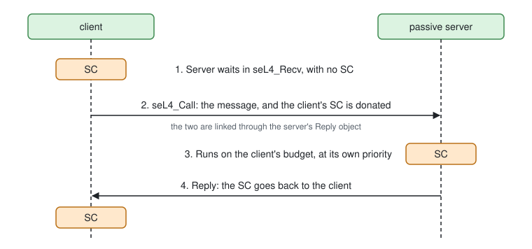

# MCS (mixed-criticality system) kernel

> A seL4 build option that replaces the periodic tick with scheduling contexts (a budget of CPU time per period) and one-shot timer deadlines; Microkit uses it, so its timer must be accurate.

[Index](../INDEX.md) › [Part 4: The seL4 kernel](../INDEX.md#part-4-the-sel4-kernel) › [Model and API](../INDEX.md#model-and-api) · ← [Scheduling](scheduling.md) · [IPC and endpoints](ipc.md) →

| At a glance | |
|---|---|
| Kind | Build option |
| Key source | [`src/kernel/sporadic.c`](https://github.com/seL4/seL4/blob/master/src/kernel/sporadic.c), [`src/object/schedcontext.c`](https://github.com/seL4/seL4/blob/master/src/object/schedcontext.c), [`src/object/schedcontrol.c`](https://github.com/seL4/seL4/blob/master/src/object/schedcontrol.c), [`src/object/reply.c`](https://github.com/seL4/seL4/blob/master/src/object/reply.c) |
| Config options | `KernelIsMCS`, `KernelWcetScale` |
| API | `seL4_SchedControl_ConfigureFlags`, `seL4_SchedContext_Bind`, `seL4_TCB_SetTimeoutEndpoint` |
| Object size | Scheduling context: at least 2^`seL4_MinSchedContextBits` (128) bytes |
| Built on | [Scheduling](scheduling.md)'s priorities and queues |
| Used by | Microkit and sDDF |
| Verified | Proofs are separate from the main tree, on [l4v](l4v.md)'s `rt` branch |

## What it is

The classic seL4 kernel schedules threads by priority with a periodic
tick and fixed time slices. The MCS configuration (`KernelIsMCS`, or
`-DMCS=TRUE` in sel4test builds) adds temporal isolation: a thread can be
given a guaranteed share of CPU time and prevented from taking more.

- A **scheduling context** is a kernel object holding a **budget** and a
  **period**: the thread may run for at most budget microseconds out of
  every period. Budget equal to period is a round-robin thread with 100%
  of a core.
- Scheduling contexts are configured through the `seL4_SchedControl`
  capability, one per core.
- A **passive server** has no scheduling context of its own and runs on
  its caller's when called over IPC.
- **Timeout faults** report a thread that exhausts its budget.

Instead of a periodic tick, the kernel programs a one-shot timer for the
next event (budget exhaustion or a period's replenishment), in timer
ticks. Every budget and period is only as accurate as the kernel's idea
of the timer's rate.

### Scheduling contexts and refills

A scheduling context (SC) is created by retyping untyped memory to
`seL4_SchedContextObject` with a size of at least
`2^seL4_MinSchedContextBits` (128) bytes, and given its parameters by

```
seL4_SchedControl_ConfigureFlags(sched_control, sc, budget, period,
                                 extra_refills, badge, flags)
```

where `budget` and `period` are in microseconds, `badge` is the word
sent in timeout faults, and `sched_control` is the capability for the
core the SC will supply time on. `seL4_SchedControl_Configure` is the
same call with `flags` 0.

Budget is tracked as a list of **refills**, each a pair (time from
which it may be used, amount). The scheme is the **sporadic server**
of real-time scheduling theory: when a thread uses *u* of its budget
starting at time *t*, that amount comes back as a new refill at
*t + period*, no sooner. Over any window of one period the thread
therefore gets at most its budget, however it chops its execution up,
which a naive "reset the budget every period" scheme does not
guarantee.


*Used budget returns exactly one period after the moment its use
began, never sooner.*

A thread that blocks and resumes often splits its budget into many
small refills. The list is a fixed-size circular buffer inside the SC
object: `MIN_REFILLS` (2) always, plus `extra_refills` if the object
was made large enough (`seL4_MaxExtraRefills(size_bits)`). When the
buffer is full, refills are merged, which is safe but delays budget.
More refills cost memory and buy less budget lost to merging.

Two special cases:

- **Round robin**: budget equal to period. No sporadic accounting;
  the SC has two refills and the thread goes to the back of its
  priority's queue when the budget is used, like a timeslice.
- **`seL4_SchedContext_Sporadic`** (the only flag): without it an SC is
  treated as **constant bandwidth**, for threads that should just get
  budget/period of a CPU; with it the SC is constrained only by the
  sporadic server rules. The difference in the code is when
  `refill_unblock_check()` runs, which moves the head refill's time up
  to now and merges the refills that then overlap: for a sporadic SC
  only when its thread becomes runnable (`sc_sporadic()`), for a
  constant-bandwidth SC every time the kernel switches to it
  (`sc_constant_bandwidth()` in `switchSchedContext()`).

The kernel refuses budgets below `MIN_BUDGET`, twice its worst-case
execution time (below), so that a thread always has enough budget to
get into the kernel and out again.

Other invocations on an SC: `seL4_SchedContext_Bind` (to a TCB, or to
a notification), `Unbind` and `UnbindObject`, `Consumed` (returns time
used since last asked) and `YieldTo` (the caller gives up the CPU in
favour of the thread bound to that SC, if it is runnable at a priority
the caller could set, and gets back the time it consumed).

### Passive servers and donation

On MCS a thread without an SC cannot run. That makes possible a server
with no time of its own:

1. the server starts with an SC, initialises, and blocks in
   `seL4_Recv`/`seL4_NBSendRecv` on its endpoint; the initialiser then
   unbinds its SC. It is now **passive**;
2. a client does `seL4_Call`. The kernel **donates** the client's SC
   to the server along with the message, and links the two through the
   server's **Reply object** ([IPC](ipc.md));
3. the server runs on the client's budget, at its own priority;
4. the server replies; the SC goes back to the client with the reply.

Time spent serving a client is charged to that client, and a server
called by many clients needs no budget analysis of its own. Calls
nest: Reply objects form a stack (the *call chain*) recording where
the SC must return. `seL4_Send` and `seL4_NBSend` do not donate; only
`Call`, and the MCS "send then receive" calls where the caller itself
is about to block.



*The scheduling context (SC) travels with the call and comes back with
the reply, so the server's time is charged to the client.*

A passive server can also be woken by a notification that has an SC
bound to it ([Notifications](notifications.md)): it borrows that SC to
handle the signal.

### Timeout faults

What if the client's budget runs out while the server is running on
it? The server is stuck mid-request, possibly holding state other
clients need. If the server's TCB has a **timeout endpoint**
(`seL4_TCB_SetTimeoutEndpoint`), the kernel sends a
[timeout fault](faults.md) there, carrying the SC's badge and the time
consumed. The handler chooses the policy: reply to the fault with
more budget arranged, or reset the server to a known state and send
the client an error. With no timeout endpoint (the common case, and
always for round-robin SCs) the thread is just postponed until its
next refill.

### The release queue

A thread whose SC has no usable budget is not in a ready queue. It
waits in the per-core **release queue**, ordered by when its head
refill becomes usable. At every kernel entry that reschedules, threads
whose time has come are moved back to the ready queues.

## In seL4

- On x86 the kernel sets deadlines in [TSC](../concepts/tsc.md) ticks,
  through TSC deadline mode or the
  [local APIC timer](../concepts/lapic-timer.md) at a measured ratio. On
  Arm, through the [generic timer](../concepts/arm-generic-timer.md).
- Microkit and sDDF use the MCS kernel.
- sel4test's `SCHED*` tests check budgets and periods against user-level
  timers.

### Time inside the kernel

All kernel time is in timer **ticks** (`ticks_t`, 64 bits); user-level
microseconds are converted at the API boundary (`usToTicks()`).

| State (per core) | Meaning |
|---|---|
| `ksCurTime` | Timestamp taken at this kernel entry |
| `ksConsumed` | Ticks used by the current SC since it was last charged |
| `ksCurSC` | The SC being charged (normally `ksCurThread->tcbSchedContext`) |
| `ksReprogram` | The one-shot timer must be reprogrammed before returning |
| `ksReleaseQueue` | The release queue |
| `ksIdleSC` | The idle thread's SC, never charged |

On each kernel entry (`include/kernel/thread.h`):

1. `updateTimestamp()` reads `getCurrentTime()` into `ksCurTime` and
   adds the difference to `ksConsumed` (and takes it off
   `ksDomainTime`).
2. `checkBudget()` asks `refill_sufficient(ksCurSC, ksConsumed)`. If
   not, `chargeBudget()` charges the SC, calls `endTimeslice()` (which
   raises the timeout fault, or appends a round-robin thread to its
   queue, or `postpone()`s the thread to the release queue) and
   requests a reschedule; the system call that was being entered is
   not performed and will be restarted. The `MCS_DO_IF_BUDGET` macro
   in `src/api/syscall.c` wraps this.
3. `schedule()` starts with `awaken()` (release queue to ready
   queues) and ends with `switchSchedContext()`, which on a change of
   SC calls `commitTime()` to charge the outgoing one, and then, if
   `ksReprogram` is set, `setNextInterrupt()`.

`setNextInterrupt()` computes the earliest of: `ksCurTime` plus the
current SC's head refill amount (budget expiry), the end of the
domain's time, and the release time of the head of the release queue;
then calls `setDeadline(that - getTimerPrecision())`.

`getCurrentTime()` and `setDeadline()` are the whole interface to the
timer driver: a 64-bit free-running count and a one-shot compare. On
Arm they are in `include/drivers/timer/*.h` (the generic timer's
counter and compare registers); on x86 they are in
`include/arch/x86/arch/machine/timer.h`, where `getCurrentTime()`
reads the TSC and `setDeadline()` writes the TSC-deadline MSR or,
when the CPU lacks TSC-deadline mode (`x86KSapicRatio` non-zero), the
local APIC timer's count.

### Worst-case execution time constants

The kernel must never let a thread into the kernel with less budget
than the kernel might use, or it would overrun someone else's time.
Each platform therefore declares `KERNEL_WCET` in microseconds (for
example `KERNEL_WCET 10u` in
`src/plat/qemu-arm-virt/config.cmake`); the build option
`KernelWcetScale` multiplies it. From it:

- `MIN_BUDGET` = 2 x WCET x scale (`include/kernel/sporadic.h`): the
  least a refill may hold, and the margin `refill_sufficient()` keeps;
- `getKernelWcetTicks()`, the same in ticks.

`getTimerPrecision()`, how early `setNextInterrupt()` sets the
deadline, is separate: on Arm it is the platform's `TIMER_PRECISION`
plus `TIMER_OVERHEAD_TICKS` (`include/arch/arm/arch/machine/timer.h`).

These numbers are estimates, not measured bounds: `config.cmake`
calls the value "the kernel WCET estimate", and nearly every platform
declares the same 10 microseconds (x86 hard-codes 10 in
`getKernelWcetUs()`; the Jetson TK1 says 100).

### Refill code

[`src/kernel/sporadic.c`](https://github.com/seL4/seL4/blob/master/src/kernel/sporadic.c)
and `include/kernel/sporadic.h`. A `refill_t` is `{ rTime, rAmount }`
(16 bytes); the buffer follows `struct sched_context` in the object,
indexed by `scRefillHead`/`scRefillTail` up to `scRefillMax`.

| Function | Job |
|---|---|
| `refill_new()` | Initialise: one refill of the whole budget, usable now |
| `refill_update()` | Reconfigure a live SC, keeping what it may still use now |
| `refill_ready()` | Is the head refill's `rTime` at or before `ksCurTime`? |
| `refill_sufficient(sc, usage)` | Does the head hold at least `usage + MIN_BUDGET`? |
| `refill_budget_check(usage)` | Charge `usage` to the current SC: shrink the head, schedule the used amount one period later (`schedule_used()`), merge refills too small to use |
| `refill_unblock_check()` | When a thread becomes runnable again: bring a stale head refill up to now and merge refills that now overlap |

`refill_budget_check()` carries comments about what "is used in the
current proofs"; the invariants (refills ordered, non-overlapping,
summing to the budget, head at least `MIN_BUDGET`) are checked by
`REFILL_SANITY_START/END` on debug builds.

### Objects and invocations

- `struct sched_context` in `include/object/structures.h`: `scPeriod`,
  `scConsumed`, `scCore`, `scTcb`, `scReply`, `scNotification`,
  `scBadge`, `scYieldFrom`, the refill indices and `scSporadic`.
- [`src/object/schedcontrol.c`](https://github.com/seL4/seL4/blob/master/src/object/schedcontrol.c):
  `decodeSchedControl_ConfigureFlags()` checks budget and period
  against `MIN_BUDGET_US` and `MAX_PERIOD_US` and the refill count
  against the object size.
- [`src/object/schedcontext.c`](https://github.com/seL4/seL4/blob/master/src/object/schedcontext.c):
  Bind, Unbind, Consumed, YieldTo; `schedContext_donate()`,
  `schedContext_resume()`.
- [`src/object/reply.c`](https://github.com/seL4/seL4/blob/master/src/object/reply.c):
  `struct reply` has `replyTCB`, `replyPrev` and `replyNext`.
  `reply_push()` (on Call) blocks the caller on the Reply object and,
  if allowed and the callee has no SC, donates the caller's SC and
  pushes the Reply on the SC's call chain (`scReply`);
  `reply_remove()`/`reply_pop()` undo it on reply, returning the SC.
- `sendIPC()` and `receiveIPC()` take a `canDonate` argument; a
  timeout fault never donates.
- `src/kernel/thread.c`: `awaken()`, `postpone()`, `endTimeslice()`,
  `chargeBudget()`, `setNextInterrupt()`, `switchSchedContext()`.
  `isSchedulable()` (runnable, has an active SC, not in the release
  queue) replaces `isRunnable()` in scheduling decisions.

### Verification status

The proofs for the MCS kernel are not part of the main proof tree:
[l4v](l4v.md)'s README lists MCS separately, with its own status badge
for the `rt` branch. No MCS configuration is yet among the fully
verified ones:
[the verified configurations page](https://docs.sel4.systems/projects/sel4/verified-configurations.html)
lists `AARCH64_MCS`, `ARM_MCS` and `RISCV64_MCS` as configurations
"for the ongoing MCS verification", their proofs in progress. In practice: a patch to
MCS-only code (`#ifdef CONFIG_KERNEL_MCS`) does not break the proofs
on `master`, but the proof engineers working on `rt` will have to
absorb it, so [proof impact](proof-impact.md) still has to be stated.

## Gotchas

- **Clock errors become scheduling errors.** On x86 without TSC-deadline
  mode the kernel scales deadlines by a whole-number TSC to APIC timer
  ratio (`x86KSapicRatio`); where the true ratio is not whole, budgets
  ran 32.5% too long on EC2's AMD types and twice as long on most boots
  of Compute Engine's N1 (observed 2026). The non-MCS kernel,
  with only a periodic tick, hides such errors.
- **Hangs can look like scheduler bugs.** A timer that never fires stops
  everything at the first deadline, which in Microkit is just after
  "Microkit Monitor started!".
- **Budgets and periods have floors and ceilings.** Below
  `MIN_BUDGET_US` or above `MAX_PERIOD_US`,
  `seL4_SchedControl_ConfigureFlags` fails with a range error; both
  depend on the platform's `KERNEL_WCET` and timer.
- **A system call can be silently restarted.** If the caller's budget
  is insufficient at kernel entry the call is not performed; the
  thread retries it after its refill. Code must not assume a system
  call's entry happens at most once.
- **Passive servers must be at least as high priority as their
  clients' interests require and must never block on anything but
  their endpoint**: while a server holds a client's SC, the client
  cannot run or be timed out except through a timeout handler.
- **A passive server woken by a signal needs an SC bound to the
  notification**, or it becomes `Running` with nothing to run on.
- **`seL4_Yield` gives away the rest of the head refill**, which for a
  non-round-robin thread means sleeping until the next refill, not
  merely letting an equal-priority thread in.
- **Too few refills wastes budget.** A thread that blocks often with
  `extra_refills` 0 has its refills merged and deferred; the symptom
  is a thread getting less CPU than budget/period.

## See also

- [Local APIC timer](../concepts/lapic-timer.md) and [TSC](../concepts/tsc.md): the x86 timer path
- [Timer calibration](../concepts/timer-calibration.md): where the rates come from
- [Scheduling](scheduling.md): the priority scheduler MCS builds on
- [Threads and TCBs](threads.md): `tcbSchedContext`, the timeout handler slot
- [IPC and endpoints](ipc.md): Reply objects and Call
- [Faults](faults.md): the timeout fault message
- [Notifications](notifications.md): scheduling contexts bound to notifications
- [Microkit](microkit.md): budgets and periods per protection domain, passive protection domains
- [History and key papers](history-and-papers.md): seL4 is the third generation of the L4 microkernel family, designed from 2004 to be formally verified
- [Kernel objects](kernel-objects.md): the fixed set of object types the seL4 kernel implements
- [sel4test and sel4bench](sel4test.md): sel4test is the kernel's functional test suite, a root task that runs each test in a fresh process and...
- [SMP](smp.md): seL4 built for more than one core runs a single kernel image under one big lock, with per-core scheduler...
- [System calls and invocations](syscalls-and-invocations.md): seL4 has only about a dozen real system calls, all forms of sending to or receiving from a capability

## References

- [seL4 tutorial, "MCS"](https://docs.sel4.systems/Tutorials/mcs.html):
  scheduling contexts, budgets and periods, passive servers.
  *Checked 2026-11-14.*
- [seL4 Reference Manual](https://sel4.systems/Info/Docs/seL4-manual-latest.pdf),
  version 17.0.0, sections 6.1.7 to 6.1.11: scheduling contexts,
  round-robin and sporadic refills, the `seL4_SchedContext_Sporadic`
  flag, passive threads, donation. *Checked 2026-11-14.*
- [`include/arch/x86/arch/machine/timer.h`](https://github.com/seL4/seL4/blob/master/include/arch/x86/arch/machine/timer.h):
  the x86 `getCurrentTime()`, `setDeadline()`, `getKernelWcetUs()`.
  *Checked 2026-11-14.*
- [seL4 `config.cmake`](https://github.com/seL4/seL4/blob/master/config.cmake)
  (`KernelWcetScale`) and the platforms' `KERNEL_WCET` values, for
  example [`src/plat/tk1/config.cmake`](https://github.com/seL4/seL4/blob/master/src/plat/tk1/config.cmake).
  *Checked 2026-11-14.*
- [Verified configurations](https://docs.sel4.systems/projects/sel4/verified-configurations.html):
  the MCS configurations are listed as verification in progress.
  *Checked 2026-11-14.*
- [`src/kernel/thread.c`](https://github.com/seL4/seL4/blob/master/src/kernel/thread.c)
  and
  [`include/kernel/thread.h`](https://github.com/seL4/seL4/blob/master/include/kernel/thread.h):
  `updateTimestamp()`, `checkBudget()`, `commitTime()`,
  `chargeBudget()`, `endTimeslice()`, `setNextInterrupt()`,
  `postpone()`. *Checked 2026-11-14.*
- [`src/kernel/sporadic.c`](https://github.com/seL4/seL4/blob/master/src/kernel/sporadic.c)
  and
  [`include/kernel/sporadic.h`](https://github.com/seL4/seL4/blob/master/include/kernel/sporadic.h):
  the refill functions, `MIN_BUDGET`, `MAX_PERIOD_US`.
  *Checked 2026-11-14 (`refill_budget_check()`,
  `refill_unblock_check()`, `sc_sporadic()` and
  `sc_constant_bandwidth()` read; the others by name and signature
  only).*
- [`include/object/structures.h`](https://github.com/seL4/seL4/blob/master/include/object/structures.h):
  `struct sched_context`, `struct reply`, `MIN_REFILLS`.
  *Checked 2026-11-14.*
- [`src/object/endpoint.c`](https://github.com/seL4/seL4/blob/master/src/object/endpoint.c):
  where `sendIPC()`/`receiveIPC()` call `reply_push()` and
  `schedContext_donate()`. *Checked 2026-11-14.*
- [l4v README](https://github.com/seL4/l4v/blob/master/README.md): MCS
  proofs tracked on the `rt` branch. *Checked 2026-11-14.*
- [Lyons, McLeod, Almatary, Heiser, "Scheduling-context capabilities: a
  principled, light-weight operating-system mechanism for managing
  time", EuroSys 2018](https://trustworthy.systems/publications/full_text/Lyons_MAH_18.pdf):
  the design and its rationale. *Checked 2026-11-14.*
