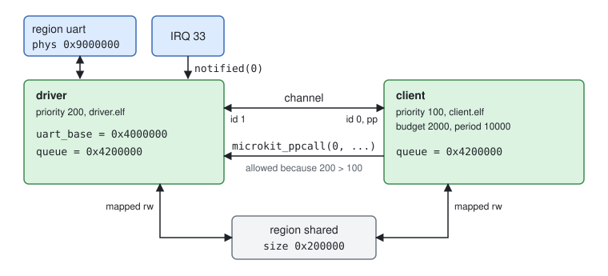

# Microkit

> The seL4 Foundation's small SDK for static systems: you write single-threaded protection domains against `libmicrokit`, describe them, their channels, memory regions and interrupts in an XML system description file, and the `microkit` tool turns that into a bootable image.

[Index](../INDEX.md) › [Part 6: User level](../INDEX.md#part-6-user-level) · ← [sel4test and sel4bench](sel4test.md) · [Microkit internals](microkit-internals.md) →

Read first: [Notifications](notifications.md), [IPC](ipc.md), [MCS](mcs.md).

| At a glance | |
|---|---|
| Kind | Framework: an SDK for static systems |
| Repository | [seL4/microkit](https://github.com/seL4/microkit) |
| Key source | `libmicrokit/include/microkit.h`, `tool/microkit/`, `docs/manual.md` |
| Config options | SDK configurations `debug`, `release`, `benchmark`, each also as `smp-...` |
| API | Entry points `init`, `notified`, `protected`, `fault`; `microkit_notify`, `microkit_ppcall`, `microkit_irq_ack` |
| Built on | The [MCS](mcs.md) kernel, always |
| Used by | [sDDF](sddf.md), [LionsOS](lionsos.md) |
| Verified | No; it uses MCS, whose proofs are not complete |

## What it is

Raw seL4 gives a [root task](bootinfo-and-root-task.md) every capability
and leaves it to build the system. Microkit removes that step for the
common case of a **static** system: one whose set of components,
memory and communication links is fixed at build time. It offers a
handful of abstractions (protection domain, channel, memory region,
interrupt, virtual machine), and everything else (creating objects,
distributing capabilities, loading programs) is computed by a tool on
the build machine. Microkit always uses the [MCS](mcs.md) kernel.

It is an **SDK, not a build system**. A release contains the `microkit`
tool, the manual and, for each board and configuration, a prebuilt
kernel, `libmicrokit.a`, `monitor.elf`, `initialiser.elf` and (Arm and
RISC-V) `loader.elf`. You compile your components however you like.
What follows describes `main` at version `2.4.0-dev`.

### Protection domains

A **protection domain** (PD) is one thread with its own
[VSpace](vspace.md) and [CSpace](cspace.md), running one ELF program
linked against `libmicrokit.a`. It has no `main`; libmicrokit owns the
event loop and calls up to four entry points, never two at once:

| Entry point | Called when |
|---|---|
| `void init(void)` | once, at start. Not synchronised between PDs: a high-priority PD may be notified before a low-priority PD has finished `init` |
| `void notified(microkit_channel ch)` | a notification or interrupt arrived on channel `ch` |
| `microkit_msginfo protected(microkit_channel ch, microkit_msginfo msginfo)` | another PD made a protected procedure call on `ch` (optional) |
| `seL4_Bool fault(microkit_child child, microkit_msginfo msginfo, microkit_msginfo *reply_msginfo)` | a child PD or virtual CPU faulted (needed only by a parent); returning true replies and resumes the child |

Attributes in the description: `priority` (0 to 254, default 0; 255
belongs to the monitor), `budget` and `period` in microseconds (default
budget 1000, period defaults to the budget; together they bound the PD
to budget/period of a CPU, see [MCS](mcs.md)), `passive`, `stack_size`
(4 KiB to 16 MiB, default 8 KiB), `cpu` (the core it is pinned to),
`fpu`, and on Arm `smc`. A **passive** PD gives up its scheduling
context after `init`; from then on it runs only on the context of
whoever notifies or calls it, which is how a server's time is charged
to its clients.

A `protection_domain` element nested inside another makes a **child**:
the parent holds the child's TCB capability, receives its
[faults](faults.md) through `fault`, and can call `microkit_pd_stop`,
`microkit_pd_restart` and `microkit_pd_resume` on it. Faults of PDs
without a parent go to the monitor, which prints them and leaves the PD
stopped.

### Channels

A **channel** joins exactly two PDs. Each end has its own identifier for
it, so A may call it 3 and B call it 7; a PD has no other way to name
another PD. Two things travel over a channel:

- **Notifications.** `microkit_notify(ch)` makes the other end's
  `notified` run. It does not block, works in either direction
  regardless of priority, and carries no data: several notifies before
  the receiver runs collapse into one call
  (see [Notifications](notifications.md)).
- **Protected procedure calls** (PPC), allowed for an end marked
  `pp="true"`. `microkit_ppcall(ch, msginfo)` blocks the caller, runs
  the callee's `protected`, and returns its result. Arguments go in
  message registers (`microkit_mr_set`, `microkit_mr_get`, up to 64
  words; `microkit_msginfo_new(label, count)` makes the header). The
  callee must have **strictly higher priority** than the caller, and
  the call graph must be acyclic: together these mean a call can never
  deadlock and the callee is never preempted by its caller.

`microkit_deferred_notify(ch)` and `microkit_deferred_irq_ack(ch)`
record one notify or acknowledgement and perform it in the same system
call as the PD's next wait, saving a kernel entry on the hot path of a
driver. Only one can be pending at a time.

### Memory regions

A `memory_region` is a named range of physical memory with a `size`, an
optional `page_size` and an optional `phys_addr` (for device registers
and DMA buffers). A `map` element inside a PD maps it at `vaddr` with
`perms` (`r`, `w`, `x`) and `cached` (`false` for device registers).
Mapping one region into two PDs is how they share memory. Regions in
RAM start zeroed, or are filled from a file with `prefill_path`.

Programs learn addresses by **symbol patching**: `setvar_vaddr="name"`
on a `map` makes the tool write the virtual address into the 64-bit
global variable `name` in the PD's ELF file; `setvar_size`, `setvar_id`
on channels and IRQs, and `<setvar symbol=".." region_paddr="mr"/>`
(the region's physical address, for DMA) work the same way.

### Interrupts, I/O ports and virtual machines

An `irq` element in a PD delivers a hardware interrupt as a
notification on channel `id`. The kernel keeps the interrupt masked
until the PD calls `microkit_irq_ack(ch)` ([IRQ handling](irq-handling.md)).
The element's form depends on the architecture:

| Platform | Attributes |
|---|---|
| Arm, RISC-V | `irq` (number), `trigger` (`level` default, or `edge`) |
| x86-64 [I/O APIC](../concepts/apic.md) | `pin`, `vector` (0 to 107), optional `ioapic`, `trigger`, `polarity` |
| x86-64 [MSI](../concepts/msi-msix.md) | `pcidev` (`bus:dev.func`), `handle`, `vector` |

On x86-64, `<ioport id=".." addr=".." size=".."/>` grants a range of
[I/O ports](../concepts/io-ports.md), used through
`microkit_x86_ioport_read_8/16/32` and `..._write_...`, and
`io_address_space` elements program the [IOMMU](../concepts/iommu.md),
which SDK kernels enable.

A `virtual_machine` element inside a PD gives that PD a guest: a second
address space and one or more `vcpu` elements. Guest exits arrive at the
parent's `fault` entry point, and `microkit_vcpu_*` functions drive the
vCPU. A PD manages at most one VM. The virtual machine monitor itself
is user code, normally [libvmm](lionsos.md).

### A complete description

```xml
<?xml version="1.0" encoding="UTF-8"?>
<system>
    <memory_region name="uart" size="0x1000" phys_addr="0x9000000"/>
    <memory_region name="shared" size="0x200000"/>

    <protection_domain name="driver" priority="200">
        <program_image path="driver.elf"/>
        <map mr="uart" vaddr="0x4000000" perms="rw" cached="false"
             setvar_vaddr="uart_base"/>
        <map mr="shared" vaddr="0x4200000" perms="rw"
             setvar_vaddr="queue"/>
        <irq irq="33" id="0"/>
    </protection_domain>

    <protection_domain name="client" priority="100" budget="2000"
                       period="10000">
        <program_image path="client.elf"/>
        <map mr="shared" vaddr="0x4200000" perms="rw"
             setvar_vaddr="queue"/>
    </protection_domain>

    <channel>
        <end pd="driver" id="1"/>
        <end pd="client" id="0" pp="true"/>
    </channel>
</system>
```

The driver sees its interrupt as `notified(0)` and the client as
`notified(1)`; the client may `microkit_ppcall(0, ...)` the driver
because 200 > 100.



*The description above as a picture. Each end of the channel has its own identifier, and the variables shown are the ones the tool patches with `setvar_vaddr`.*

### Workflow, boards and configurations

1. Compile each PD against `$SDK/board/<board>/<config>/include` and
   link it with `libmicrokit.a` and the `microkit.ld` linker script from
   the same directory.
2. Run `microkit system.xml --board <board> --config <config>
   --search-path <dir with ELFs> -o loader.img -r report.txt`.
3. Boot the image: U-Boot `go` (raw binary), `bootelf` (ELF) or `bootm`
   (RISC-V uImage); see below for x86.

Configurations are `debug` (kernel console output,
`microkit_dbg_puts`), `release` (no serial output from kernel, loader,
monitor or initialiser) and `benchmark` (utilisation tracking, PMU
exported), each also as `smp-debug`, `smp-release`, `smp-benchmark` for
the multi-core kernel. The manual lists 29 boards: Arm boards such as
`qemu_virt_aarch64`, `maaxboard`, `odroidc4`, `rpi4b_*`, `zcu102`;
RISC-V boards such as `qemu_virt_riscv64`, `star64`, `hifive_p550`; and
`x86_64_generic` and `x86_64_generic_vtx`.

**x86-64** arrived in release 2.1.0. There is no Microkit loader on
x86: the tool writes the kernel as `sel4.elf` (64-bit ELF) and
`sel4_32.elf` (32-bit ELF) beside an "initial task" image (the `-o`
file), and a Multiboot bootloader loads the kernel with that image as
its one boot module, as in [x86 boot](../concepts/x86-boot.md). With
QEMU: `-kernel sel4_32.elf -initrd loader.img`. The kernel is the
generic `pc99` platform, needs the CPU features `pat`, `xsave`,
`pdpe1gb` and `fsgsbase`, and supports up to 16 cores. The `_vtx` board
adds Intel VT-x guests (one vCPU per VM).

## In seL4

Source: [seL4/microkit](https://github.com/seL4/microkit).

| Path | Contents |
|---|---|
| `docs/manual.md` | the manual: concepts, API, SDF reference, one section per board |
| `libmicrokit/` | `include/microkit.h` (the whole API, mostly inline functions), `src/main.c` (event loop), `microkit.ld` |
| `tool/microkit/` | the `microkit` tool, in Rust |
| `loader/`, `monitor/`, `initialiser/` | the programs packed into every image |
| `build_sdk.py` | builds the SDK: board list, kernel options, configurations |
| `example/` | small systems (`hello`, `passive_server`, `hierarchy`, ...) |

How the abstractions map onto kernel objects, and what the tool does,
is in [Microkit internals](microkit-internals.md). Rust PDs use the
`sel4-microkit` crate from [rust-sel4](rust-sel4.md) in place of
libmicrokit. [sDDF](sddf.md) and [LionsOS](lionsos.md) are built on
Microkit.

## Gotchas

- **The limits are smaller than the manual's prose says.** The manual
  speaks of 63 PDs and 63 channels per PD, but the tool rejects a
  channel, IRQ or child `id` above 61 (`PD_MAX_ID` in
  `tool/microkit/src/sdf/consts.rs`; `MICROKIT_MAX_CHANNELS` is 62 in
  `microkit.h`). Channels, IRQs and I/O ports draw on the same per-PD
  limit because each is one bit of the notification word.
- **No timers, no sleep.** After `init`, nothing runs until an
  interrupt arrives. A system that needs time includes a timer driver
  PD, normally [sDDF](sddf.md)'s.
- **A PD blocked in `microkit_ppcall` sees nothing else** until the
  callee returns, and `protected` is trusted to return promptly: only
  call PDs you trust.
- **`microkit_notify` on a channel that is not in the SDF** prints an
  error in debug builds and otherwise does nothing; the check uses bit
  masks the tool patches into the ELF.
- **An unacknowledged interrupt never fires again.** Forgetting
  `microkit_irq_ack` looks like a hung device.
- **x86-64 physical addresses are not known at build time**, since the
  memory map comes from the bootloader: `setvar region_paddr` works
  only for regions with an explicit `phys_addr`. Since 2.3.0 the kernel
  is built with the IOMMU on, so DMA needs `io_address_space` set up.
  The I/O APIC `polarity` attribute was inverted before 2.3.0.
- **QEMU cannot load the 64-bit kernel ELF** ("Cannot load x86-64
  image, give a 32bit one"): pass `sel4_32.elf`.
- **A `release` kernel is not a verified kernel.** Microkit uses MCS,
  whose proofs are not complete ([verification](verification.md)).
- **The SDK and kernel are a matched pair.** `--override-kernel` only
  works with a kernel of the same version and configuration.
- **A channel is two-way unless told otherwise.** Each `end` may
  notify the other by default. `notify="false"` on an end leaves that
  PD with no capability to signal the other, which makes the channel
  one-way; a design that relies on one PD being unable to wake or
  signal another needs it.

## See also

- [Microkit internals](microkit-internals.md): the tool, loader, initialiser, monitor and libmicrokit's use of kernel objects
- [sDDF](sddf.md): the driver framework whose components are Microkit PDs
- [LionsOS and libvmm](lionsos.md): an OS and a VMM library on top
- [rust-sel4](rust-sel4.md): writing PDs in Rust
- [CAmkES and capDL](camkes-capdl.md): the older, larger component framework
- [MCS](mcs.md): budgets, periods and passive servers in the kernel
- [Notifications](notifications.md) and [IPC](ipc.md): what channels are made of
- [Index](../INDEX.md): the reading order
- [QEMU](../concepts/qemu.md): QEMU emulates whole machines
- [Ecosystem and repositories](ecosystem.md): seL4 is some thirty repositories in two GitHub organisations
- [libsel4 and the runtime](libsel4.md): libsel4 is the kernel's ABI written down as C
- [Multiserver operating systems](multiserver-systems.md): static and dynamic multiserver systems compared

## References

- [Microkit manual](https://github.com/seL4/microkit/blob/main/docs/manual.md), "Concepts", "SDK", "Microkit Tool", "System Description File", "x86-64 generic": the source for most of this page. *Checked 2026-11-14.*
- [`libmicrokit/include/microkit.h`](https://github.com/seL4/microkit/blob/main/libmicrokit/include/microkit.h): the API and `MICROKIT_MAX_CHANNELS`. *Checked 2026-11-14.*
- [`tool/microkit/src/sdf/consts.rs`](https://github.com/seL4/microkit/blob/main/tool/microkit/src/sdf/consts.rs): `PD_MAX_ID`, default budget and stack size, priorities. *Checked 2026-11-14.*
- [`build_sdk.py`](https://github.com/seL4/microkit/blob/main/build_sdk.py): boards, configurations, kernel options. *Checked 2026-11-14.*
- [`CHANGES.md`](https://github.com/seL4/microkit/blob/main/CHANGES.md): x86-64 in 2.1.0, IOMMU and polarity changes in 2.3.0. *Checked 2026-11-14.*
- [Microkit tutorial](https://trustworthy.systems/projects/microkit/tutorial/welcome.html): a guided first system. *Checked 2026-11-14.*
- [Microkit manual](https://github.com/seL4/microkit/blob/main/docs/manual.md), "System Description File", `channel`: the `notify` attribute of `end`, "defaults to true". *Checked 2026-11-20.*
