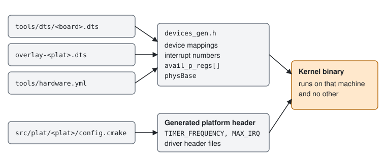

# Platform ports

> A platform is the kernel's build-time description of one board or machine family; porting on Arm and RISC-V means writing that description (device tree, overlay, `config.cmake`, drivers) across several repositories, while on x86 there is one platform, `pc99`, and a "port" means fixing its assumptions about the machine.

[Index](../INDEX.md) › [Part 4: The seL4 kernel](../INDEX.md#part-4-the-sel4-kernel) › [Inside the kernel](../INDEX.md#inside-the-kernel) · ← [Elfloader](elfloader.md) · [Debugging](debugging.md) →

Read first: [Build system and configuration](build-system.md), [Generated code](generated-code.md), [Device trees](../concepts/device-tree.md).

| At a glance | |
|---|---|
| Kind | Process (porting the kernel to a board or machine) |
| Repository | `seL4`, `seL4_tools`, `util_libs`, `seL4_libs`, `sel4test`, `sel4bench`, `microkit`, `sddf` |
| Key source | `src/plat/<plat>/config.cmake`, `tools/dts/<board>.dts`, [`tools/hardware.yml`](https://github.com/seL4/seL4/blob/master/tools/hardware.yml) |
| Config options | `KernelPlatform`; `KernelCustomDTS`, `KernelCustomDTSOverlay` |
| Built on | [Device trees](../concepts/device-tree.md) and [generated code](generated-code.md) (Arm, RISC-V); Multiboot and [ACPI tables](../concepts/acpi-tables.md) (x86, `pc99`) |
| Verified | A new board is unverified until it has a `configs/*_verified.cmake` file and checked proofs |

## What it is

A **platform** in seL4 is a value of the CMake option `KernelPlatform`
(`zynqmp`, `qemu-arm-virt`, `hifive`, `pc99`, ...). Selecting one fixes,
at build time, everything the kernel knows about the machine: which CPU
it is compiled for, where RAM is, which interrupt controller and timer
drivers are linked in, where their registers are, and how many
interrupts exist. The kernel binary that results runs on that machine
and no other. There is no probing and no driver model: the kernel needs
only an interrupt controller, one timer and (in debug builds) a serial
port, and everything else is a user-level driver.

Upstream has 37 directories under `src/plat/`; 36 are Arm or RISC-V
boards and one is `pc99`.

### The Arm and RISC-V recipe

A port to a new board on an architecture seL4 already supports touches
these, roughly in dependency order. The
[porting guide](https://docs.sel4.systems/projects/sel4/porting.html)
is the upstream text for steps 1 to 6.

| Step | Repository | What to add |
|---|---|---|
| 0 | (none) | A boot path: usually U-Boot loading an image over TFTP or from SD ([Arm boot flow](../concepts/arm-boot.md)) |
| 1 | `seL4` | `tools/dts/<board>.dts`: the board's device tree, normally taken from Linux |
| 2 | `seL4` | `src/plat/<plat>/overlay-<plat>.dts`: seL4's corrections to it, and the `chosen` node naming the kernel's and elfloader's devices |
| 3 | `seL4` | `tools/hardware.yml` entries for any device `compatible` string not yet known; a driver in `src/drivers/serial/` or `src/drivers/timer/` if the device is new |
| 4 | `seL4` | `src/plat/<plat>/config.cmake`; `libsel4/sel4_plat_include/<plat>/sel4/plat/api/constants.h` |
| 5 | `seL4_tools` | [Elfloader](elfloader.md): a UART driver in `elfloader-tool/src/drivers/uart/` if needed, a load address, sometimes `src/plat/<plat>/` code |
| 6 | `util_libs`, `seL4_libs` | `libplatsupport` serial and timer (`ltimer`) drivers, so that [sel4test](sel4test.md) can print and time out ([seL4_libs and util_libs](sel4-libs.md)) |
| 7 | `sel4test`, `sel4bench` | Platform quirks in the test settings; the suites must pass |
| 8 | `microkit` | A `BoardInfo` entry in `build_sdk.py` |
| 9 | `sddf` | Serial, timer and network drivers for the board's devices ([sDDF](sddf.md)) |

Steps 1 to 3 feed the generator described in
[Generated code](generated-code.md): the device tree plus overlays plus
`hardware.yml` become `devices_gen.h`, which holds the kernel's device
mappings (`KDEV_BASE`-relative addresses such as `GIC_V2_DISTRIBUTOR_PPTR`),
interrupt numbers, the array of physical memory regions `avail_p_regs[]`
and `physBase`, the physical address the kernel is linked to run at.
The overlay is where a port says "this memory belongs to firmware"
(shrink or replace the `memory` node, add `reserved-memory`) and where
it picks the console (`seL4,kernel-devices = "serial0", ...`). A device
listed in `seL4,kernel-devices` is mapped into the kernel and withheld
from user level; `hardware.yml` says which of its `reg` regions the
kernel maps and under what macro name.

Step 4, the platform file, is short. From `src/plat/zynqmp/config.cmake`:

```cmake
declare_platform(zynqmp KernelPlatformZynqmp PLAT_ZYNQMP KernelArchARM)

if(KernelPlatformZynqmp)
    declare_seL4_arch(aarch64 aarch32 arm_hyp)
    set(KernelArmCortexA53 ON)
    set(KernelArchArmV8a ON)
    list(APPEND KernelDTSList "tools/dts/zynqmp.dts")
    list(APPEND KernelDTSList "src/plat/zynqmp/overlay-zynqmp.dts")
    declare_default_headers(
        TIMER_FREQUENCY 100000000
        MAX_IRQ 187
        NUM_PPI 32
        TIMER drivers/timer/arm_generic.h
        INTERRUPT_CONTROLLER arch/machine/gic_v2.h
        CLK_MAGIC 1374389535llu
        CLK_SHIFT 37u
        KERNEL_WCET 10u
    )
endif()

add_sources(DEP "KernelPlatformZynqmp"
            CFILES src/arch/arm/machine/gic_v2.c src/arch/arm/machine/l2c_nop.c)
```

- `declare_platform(name cmake_var c_define enable_test)` registers the
  name as a choice of `KernelPlatform` and sets `KernelPlatformZynqmp`
  (and `CONFIG_PLAT_ZYNQMP` in C) when it is chosen.
- `declare_seL4_arch()` lists the modes the board can be built for; the
  first is the default.
- The `KernelArmCortex*` and `KernelArchArmV*` variables select the CPU:
  compiler flags and CPU-specific code.
- `KernelDTSList` is the device tree and overlays, concatenated in order.
- `declare_default_headers()` fills the generated platform header:
  `TIMER_FREQUENCY` in Hz (the rate of the kernel timer's counter;
  with the [Arm generic timer](../concepts/arm-generic-timer.md) this
  must equal what firmware programmed into `CNTFRQ_EL0`), `MAX_IRQ` (the
  highest interrupt number, which sizes the kernel's IRQ tables),
  `NUM_PPI` (per-CPU interrupts on a GIC), and the header files of the
  timer and interrupt-controller drivers
  ([GICv2](../concepts/gicv2.md), [GICv3](../concepts/gicv3-its.md)).
  `CLK_MAGIC` and `CLK_SHIFT` are a precomputed reciprocal of the timer
  frequency, produced by `tools/reciprocal.py`, with which the
  [MCS](mcs.md) kernel converts ticks to microseconds without a division;
  `KERNEL_WCET` is the kernel's assumed worst-case execution time in
  microseconds, also for MCS.
- `add_sources()` links the driver C files.



*Steps 1 to 4 of the recipe: four hand-written inputs, two generated
headers, one kernel that knows a single machine.*

RISC-V platforms follow the same shape with a PLIC as interrupt
controller and the SBI timer
([RISC-V interrupts and timers](../concepts/riscv-interrupts.md)); the
elfloader needs no UART driver there because it prints through SBI.

### x86 is different

All x86 machines are the single platform `pc99` (named after the PC 99
design guide), for both `ia32` and `x86_64`. Nothing about the machine
is described at build time: the kernel learns the memory map and its
boot modules from the Multiboot structure the bootloader passes
([x86 boot](../concepts/x86-boot.md)), and the CPUs, interrupt
controllers and IOMMU from [ACPI tables](../concepts/acpi-tables.md).
There is no device tree, no `hardware.yml` entry and no elfloader.

What takes the place of a description is a set of assumptions that the
machine looks like a PC. "Porting" to a new x86 machine means finding
which assumption it breaks:

| Assumption | Where | Breaks when |
|---|---|---|
| The serial console is a 16550 at I/O port `0x3f8` (COM1), or the port in the BIOS data area, or one given on the command line | `src/arch/x86/kernel/cmdline.c` | The machine has no legacy UART, or an MMIO one ([UARTs](../concepts/uart.md)) |
| A [PIT](../concepts/pit.md) exists to calibrate the [TSC](../concepts/tsc.md) and local APIC timer against | `src/plat/pc99/machine/pit.c`, [Timer calibration](../concepts/timer-calibration.md) | A virtual machine has no PIT or an inaccurate one |
| An [8259 PIC](../concepts/pic-8259.md) is present to be remapped and masked | `pic_remap_irqs()` in `boot_sys.c` | Rarely fatal; a hardware-reduced ACPI machine need not have one (Linux bypasses the legacy PIC on such machines) |
| The interrupt controller mode chosen at build time (`KernelIRQController` = `IOAPIC` or `PIC`, `KernelX2APIC`) matches the machine | `src/arch/x86/config.cmake`, [Local APIC and I/O APIC](../concepts/apic.md) | Firmware starts the CPU in x2APIC mode (an xAPIC kernel then stops with "x2APIC enabled in BIOS but kernel does not support that"), or CPUs have APIC IDs of 255 and above, which the MADT lists as x2APIC entries |
| Multiboot 1 or 2 hands over a memory map and an ACPI RSDP can be found | `try_boot_sys()` in `src/arch/x86/kernel/boot_sys.c` | UEFI-only boot without a Multiboot2 loader ([UEFI](../concepts/uefi.md)) |

A cloud virtual machine is exactly this kind of port: the CPU is
ordinary, and the work is in the legacy devices the cloud's hypervisor
leaves out. See [Cloud virtual machines](../concepts/cloud-vms.md).

### What a platform contribution commits you to

The seL4 Foundation's
[platform ports](https://sel4.systems/Contribute/platform-ports.html)
page sets the terms. A port on a supported architecture needs no
[RFC](governance.md); pull requests to the kernel, sel4test, sel4bench
and the documentation site usually suffice. It must follow the kernel's
[contribution rules](contributing-a-patch.md), pass sel4test and sel4bench, and
come with a documentation page and an entry in the list of supported
platforms. Hardware the Foundation can put in its CI rig
([Upstream CI](ci.md)) is "ideally" supplied but not mandatory. Each
platform has a **platform owner**, often the contributor, who keeps the
tests passing on `master` in every supported configuration (MCS,
multicore, hypervisor), answers bug reports, reviews pull requests for
the platform, and helps keep verified configurations verified. The
page's rule for breakage on `master` is "you break it, you fix it".

The
[supported platforms](https://docs.sel4.systems/Hardware/) list has no
support tiers; it groups boards by architecture and gives each a
verification status: Unverified, Ongoing, FC (functional correctness
only) or Verified (all proofs). Verification is per configuration, not
per architecture: the proofs apply to the exact settings in a
`configs/*_verified.cmake` file ([The seL4 proofs](verification.md)).
A new board is unverified until someone adds such a file and the proofs
are checked against it, and a patch to an unverified platform's files
has no [proof impact](proof-impact.md).

## In seL4

- [`configs/seL4Config.cmake`](https://github.com/seL4/seL4/blob/master/configs/seL4Config.cmake):
  `declare_platform()`, `declare_default_headers()` (its full argument
  list also has `SMMU`, `MAX_SID`, `MAX_CB`, `TIMER_PRECISION` and
  `TIMER_OVERHEAD_TICKS`), and the loop that includes every
  `src/plat/*/config.cmake`. Every platform file is evaluated on every
  build; only the selected one's `if()` body runs.
- [`src/plat/`](https://github.com/seL4/seL4/tree/master/src/plat):
  one directory per platform, holding `config.cmake` and overlays. Only
  `pc99` has real code (`machine/acpi.c`, `ioapic.c`, `pic.c`, `pit.c`,
  `intel-vtd.c`, `hardware.c`, `io.c`).
- [`src/drivers/serial/`](https://github.com/seL4/seL4/tree/master/src/drivers/serial)
  and `src/drivers/timer/`: nine serial drivers (PL011, i.MX, Meson,
  Xilinx, ...) and six timers; each has a `config.cmake` that
  `register_driver()`s it against `compatible` strings.
- [`tools/hardware.yml`](https://github.com/seL4/seL4/blob/master/tools/hardware.yml)
  and `tools/hardware_gen.py`: see [Generated code](generated-code.md).
- `KernelCustomDTS` and `KernelCustomDTSOverlay` let a build replace or
  extend the platform's device tree without editing the kernel source,
  which is the quickest way to try a variant of an existing board.
- Microkit:
  [`build_sdk.py`](https://github.com/seL4/microkit/blob/main/build_sdk.py)
  holds a list of `BoardInfo(name, arch, gcc_cpu, loader_link_address,
  smp_cores, kernel_options={"KernelPlatform": ...})`; the SDK is built
  per board from it ([Microkit](microkit.md)).
- `util_libs`: `libplatsupport/src/plat/<plat>/` and
  `libplatsupport/plat_include/<plat>/platsupport/plat/` (`serial.h`,
  `timer.h`, `clock.h`, ...).

## Gotchas

- **Memory is fixed at build time on Arm and RISC-V.** `avail_p_regs[]`
  comes from the `memory` nodes of the build-time device tree. The
  kernel does not read the device tree blob the bootloader passes at
  run time; it only hands it on to the root task
  ([BootInfo](bootinfo-and-root-task.md)). A board sold with 2, 4 or
  8 GB therefore needs one overlay and one kernel build per size (see
  `src/plat/bcm2711/overlay-rpi4-*gb.dts`), and firmware that moves its
  reserved regions between versions silently breaks a port. The
  advice given on the developers' list is to describe only a minimum
  amount of RAM in the memory node: the rest still reaches user level,
  as device untyped memory that can be used for frames but not for
  kernel objects.
- **The verified configurations depend on this.** The proofs take the
  build-time physical base as a constant (l4v's `gen-config-thy.py`
  copies `PHYS_BASE_RAW` from the generated `devices_gen.h` into the
  theory `Kernel_Config`), and `CAVEATS.md` says the proofs "are
  generally sensitive to changes in configuration parameters", so a change that
  makes the Arm layout dynamic is a proof change, not a platform patch.
- **`TIMER_FREQUENCY` is trusted, not measured.** If firmware or a
  hypervisor runs the counter at another rate, time on the board is
  wrong by that ratio. The Arm generic timer driver compares the value
  with `CNTFRQ` and prints a warning (visible only in a printing build)
  but carries on. x86 has the opposite
  problem: it measures, and the measurement can be wrong
  ([Timer calibration](../concepts/timer-calibration.md)).
- **`hardware.yml` matches on `compatible`.** A device tree whose
  console has a compatible string the file lacks produces a kernel
  with no console and no error.
- **A port spans repositories that merge separately.** The kernel
  change must merge before sel4test can test it in CI, and the
  elfloader and libplatsupport changes are in different repositories
  with different maintainers; expect a set of linked pull requests.
- **`pc99` has one configuration for all machines, so a fix for one
  machine must not break another.** A change that helps a cloud VM
  (skipping the PIT, another console) has to be conditional on what is
  detected at run time or on a new option that defaults to the old
  behaviour.
- **x86 verification covers one configuration**, `X64_verified.cmake`,
  and stops at functional correctness; most `pc99` boot code is outside
  the proofs ([Boot code and the proof boundary](boot-code.md)).

## See also

- [Generated code](generated-code.md): the device tree to `devices_gen.h` pipeline
- [Build system and configuration](build-system.md): how `KernelPlatform` selects files
- [Elfloader](elfloader.md): the Arm and RISC-V boot stage a port must also support
- [Kernel boot sequence](kernel-boot.md): where platform code runs
- [Cloud virtual machines](../concepts/cloud-vms.md): what an x86 or Arm cloud port has to change
- [Debugging](debugging.md): first-boot failure signatures
- [Contributing a patch](contributing-a-patch.md) and [Governance and RFCs](governance.md): the process around a port
- [The seL4 proofs](verification.md): what "verified configuration" means
- [Microkit internals](microkit-internals.md): how the `microkit` tool turns a system description into a boot image
- [Source layout](source-layout.md): A tour of the `seL4/seL4` repository

## References

- [seL4 porting guide](https://docs.sel4.systems/projects/sel4/porting.html):
  the Arm/RISC-V steps from bootloader to sel4test, with file paths.
  *Checked 2026-11-14.*
- [Platform ports (seL4 Foundation)](https://sel4.systems/Contribute/platform-ports.html):
  acceptance requirements and the platform owner's duties.
  *Checked 2026-11-14.*
- [Supported platforms](https://docs.sel4.systems/Hardware/): the board
  list and the four verification statuses. *Checked 2026-11-14.*
- [seL4 `configs/seL4Config.cmake`](https://github.com/seL4/seL4/blob/master/configs/seL4Config.cmake):
  `declare_platform`, `declare_default_headers`. *Checked 2026-11-14.*
- [seL4 `src/plat/zynqmp/config.cmake`](https://github.com/seL4/seL4/blob/master/src/plat/zynqmp/config.cmake)
  and its `overlay-zynqmp.dts`: the example above. *Checked 2026-11-14.*
- [seL4 `src/drivers/timer/generic_timer.c`](https://github.com/seL4/seL4/blob/master/src/drivers/timer/generic_timer.c):
  the `CNTFRQ` comparison and warning. *Checked 2026-11-14.*
- [seL4 `src/arch/x86/kernel/boot_sys.c`](https://github.com/seL4/seL4/blob/master/src/arch/x86/kernel/boot_sys.c)
  and [`cmdline.c`](https://github.com/seL4/seL4/blob/master/src/arch/x86/kernel/cmdline.c):
  Multiboot parsing, `acpi_init`, `pic_remap_irqs`, the `0x3f8`
  default. *Checked 2026-11-14.*
- [seL4 `src/arch/x86/kernel/xapic.c`](https://github.com/seL4/seL4/blob/master/src/arch/x86/kernel/xapic.c),
  `apic_enable()`: the refusal when firmware has enabled x2APIC; and
  [`src/plat/pc99/machine/acpi.c`](https://github.com/seL4/seL4/blob/master/src/plat/pc99/machine/acpi.c):
  the MADT parser's comment that APIC IDs of `0xFF` and above belong in
  the x2APIC entries. *Checked 2026-11-14.*
- [Linux `arch/x86/kernel/acpi/boot.c`](https://github.com/torvalds/linux/blob/master/arch/x86/kernel/acpi/boot.c),
  `acpi_generic_reduced_hw_init()`: hardware-reduced ACPI is for
  platforms that do not implement the PC architecture, and Linux
  bypasses the legacy PIC there. *Checked 2026-11-14.*
- [seL4 devel list, "RPi4: DTS memory device and vm_minimal", 18 March 2020](https://lists.sel4.systems/hyperkitty/list/devel@sel4.systems/message/KYXQDYR5PT46MM3MCFYFNYRMB2BUFEGG/):
  the kernel needs the platform layout at build time; the
  minimum-memory-node advice. *Checked 2026-11-14.*
- [l4v `spec/cspec/c/gen-config-thy.py`](https://github.com/seL4/l4v/blob/master/spec/cspec/c/gen-config-thy.py),
  `parse_physBase`, and
  [seL4 `CAVEATS.md`](https://github.com/seL4/seL4/blob/master/CAVEATS.md),
  "Verified Configurations": the proofs' dependence on configuration
  constants. *Checked 2026-11-14.*
- [Microkit `build_sdk.py`](https://github.com/seL4/microkit/blob/main/build_sdk.py):
  the `BoardInfo` list. *Checked 2026-11-14.*
- [util_libs `libplatsupport`](https://github.com/seL4/util_libs/tree/master/libplatsupport):
  per-platform directories. *Checked 2026-11-14.*
