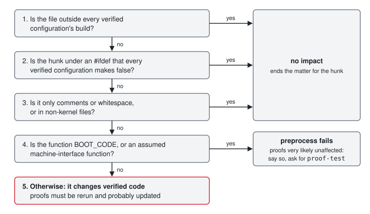

# Judging a patch's proof impact

> A procedure for deciding, before sending a kernel patch, whether it changes code the proofs cover: whether a verified configuration compiles it, whether it is boot or machine-interface code, and what to write in the pull request either way.

[Index](../INDEX.md) › [Part 5: Verification](../INDEX.md#part-5-verification) · ← [The verified C subset](verified-c-subset.md) · [libsel4 and the runtime](libsel4.md) →

Read first: [Verification](verification.md), [l4v](l4v.md), [Verified C subset](verified-c-subset.md).

| At a glance | |
|---|---|
| Kind | Process: deciding whether a kernel patch changes code the proofs cover |
| Repository | `seL4/seL4` pull requests; proof updates go to [l4v](l4v.md) |
| Key source | `kernel_all.c_pp`; `ci-actions/preprocess/test_munge.sh` |
| Built on | The preprocess check in [CI](ci.md) |
| Used by | The pull request description; reviewers' `verification` and `proof-test` labels |
| Verified | Checked for `L4V_ARCH` = ARM, ARM_HYP, AARCH64, RISCV64, X64 and the MCS variants of ARM and RISCV64 |

## What it is

The kernel's `CONTRIBUTING.md` requires that a change to `master` is
either "invisible to the proof" or comes with a proof update. **Proof
impact** is the answer to "which?", and it sets the cost of a patch more
than its size does: a 500-line driver for an unverified platform can
merge in days, while a two-line change to a verified function waits for
a proof engineer.

There is an exact test and a way to predict it.

### The exact test

For each verified configuration, the kernel is preprocessed into one
file, `kernel_all.c_pp`. If a patch leaves that file unchanged for every
verified configuration, no proof can be affected. This is the
**preprocess** check in [CI](ci.md), run for `L4V_ARCH` = ARM, ARM_HYP,
AARCH64, RISCV64, X64 and for the MCS variants of ARM and RISCV64. Its
README is careful about the converse: a failure "does not mean the
proofs are necessarily affected, it only means the full proofs should be
run".

A local approximation, for one architecture, with the cross compiler
installed:

```sh
cmake -G Ninja -B pp-base -C configs/RISCV64_verified.cmake \
      -DCMAKE_TOOLCHAIN_FILE=gcc.cmake -DCROSS_COMPILER_PREFIX=riscv64-linux-gnu-
ninja -C pp-base kernel_all_pp_wrapper      # on the base commit
# repeat into pp-head on the patched commit, then
# (the kernel build calls the file kernel_all_pp.c; l4v's copy is kernel_all.c_pp):
diff <(grep -v '^#' pp-base/kernel_all_pp.c) <(grep -v '^#' pp-head/kernel_all_pp.c)
```

(The `grep` drops the preprocessor's line markers, which shift with any
edit. The official script is `ci-actions/preprocess/test_munge.sh`; the
command above is an approximation of it, not a copy.)

### Predicting it: five questions

Ask them of each hunk, in order. The first "yes" in questions 1 to 3
ends the matter for that hunk.

| # | Question | If yes |
|---|---|---|
| 1 | Is the file outside every verified configuration's build? | no impact |
| 2 | Is the hunk under an `#ifdef` that every verified configuration makes false? | no impact |
| 3 | Is it only comments or whitespace, or in non-kernel files (`libsel4` C, the manual, CMake that does not alter generated headers)? | no impact |
| 4 | Is the function `BOOT_CODE`, or a machine-interface function the proofs treat as assumed? | preprocess fails, proofs very likely unaffected: say so, ask for `proof-test` |
| 5 | Otherwise: it changes verified code | proofs must be rerun and probably updated |



*The questions as a flow: only a hunk that falls through all four
reaches the expensive case.*

**Question 1: which files.** The verified platforms are a fixed list
([Verification](verification.md)). For x86 only `pc99` in 64-bit mode is
verified, so everything under `src/arch/x86/32/` is outside; for Arm,
drivers used only by unverified boards are outside. A driver shared with
a verified platform (the GIC, the generic timer, a common UART) is
inside.

**Question 2: which options.** Verified configurations set, among
others:

| Option | Verified value | So this is outside |
|---|---|---|
| `KernelMaxNumNodes` | 1 | `#ifdef ENABLE_SMP_SUPPORT` code: IPIs, the big kernel lock, per-core state |
| `KernelPrinting`, debug build | off | `printf`, `CONFIG_DEBUG_BUILD` code, the kernel's serial output, debug system calls |
| `KernelBenchmarks` | none | all benchmarking and tracing |
| `KernelIsMCS` | off, except the MCS configurations: RISCV64 (verified), ARM (preprocess-checked only) and AARCH64 (proofs in progress) | on x64 and ARM_HYP all `CONFIG_KERNEL_MCS` code is outside |
| x64: VT-x, VT-d | off | `vcpu`, EPT, the IOMMU driver |
| AArch64: `KernelArmHypervisorSupport` | on | the non-hypervisor AArch64 paths are outside; hypervisor code is inside |
| AArch64: `KernelArmSMMU` | off | SMMU drivers |
| Fast path | on for ARM, AARCH64; off for RISCV64, x64 | `fastpath.c` matters only where on |

The trap is the *other* branch: adding `#ifdef CONFIG_X ... #else ...
#endif` around existing verified code leaves the `#else` text unchanged
after preprocessing, but restructuring that code to make room for the
new branch does not.

**Question 4: assumed code.** Two kinds of function are in
`kernel_all.c_pp` without a refinement proof of their bodies:

- `BOOT_CODE` functions ([Boot code](boot-code.md)): the proofs start
  from the state they leave.
- Machine operations: functions whose body is skipped with
  `/** DONT_TRANSLATE */` or whose effect is hardware access, modelled
  in `l4v/spec/machine/<ARCH>/MachineOps.thy` as constants with assumed
  properties (for RISC-V: `initTimer_impl`, `resetTimer_impl`,
  `configureTimer_impl` and the like). Changing the body of such a
  function changes no proof, provided its signature, its `MODIFIES`
  annotation and the behaviour the model assumes all stay the same.

For both, the preprocess check fails (the text changed) and the proof
run then passes unchanged. That is the cheap kind of failure.

**Question 5: also counts as verified code.**

- `structures.bf` and the other bitfield files: accessors and their
  generated proofs change with any layout change
  ([Generated code](generated-code.md)).
- The API definitions (`libsel4/include/interfaces/*.xml`,
  `syscall.xml`) and `libsel4` headers the kernel includes: invocation
  labels and constants are compiled into the kernel and mirrored in the
  specifications.
- Constants in headers: changing a `#define` used by verified code
  changes every expansion site.
- Configuration values of a verified platform: `CAVEATS.md` says the
  proofs "are generally sensitive to changes in configuration
  parameters".

### Cheap and expensive

| Change | Typical cost |
|---|---|
| New unverified platform; code under SMP, debug, benchmark or x86 virtualisation options; comments; documentation | none: preprocess passes |
| Boot code or a machine operation of a verified platform | a `proof-test` run; usually no proof change |
| Renaming, reordering, changing types in verified code with identical behaviour | proof repair, mostly mechanical, for each affected architecture |
| Changing what a verified function does while the abstract specification stays true | C refinement and possibly design-level repair |
| Changing behaviour visible in the abstract specification, an object layout, or the API | specification changes plus invariants, both refinements and possibly the security proofs; an RFC first ([Governance](governance.md)) |

## In seL4

How upstream handles it, from the pull request guide:

- Reviewers add the label `verification` when a proof change is needed,
  and can add `proof-test` to run the C refinement proofs on the pull
  request (the kernel's `proof.yml`; it needs a maintainer because it
  uses AWS credentials).
- A change may be proposed without proofs "but cannot be merged before
  verification is complete".
- For the proof update there are three routes: send a matching pull
  request to `l4v` yourself; ping the `@verification` team on GitHub for
  help; or, for a larger project, talk to the Foundation about funding or
  volunteers.
- Kernel and proof pull requests are merged together, after which the
  verification manifest advances ([l4v](l4v.md)).

What to write in the pull request description, by case:

- *No impact:* "No proof impact: the change is confined to
  `src/plat/...` for a platform with no verified configuration; the
  preprocess check passes."
- *Assumed code:* "Changes `init_cpu()` (`BOOT_CODE`) for the verified
  `pc99` configuration, so the preprocess check for X64 fails. No
  verified function changes; please run `proof-test`."
- *Verified code:* say which functions, for which architectures, whether
  the abstract specification is affected, and whether a proof update
  exists or help is requested.

## Gotchas

- **One file, several answers.** A generic file such as
  `src/object/tcb.c` is in every verified configuration; an x86 file may
  be in one. Answer per architecture.
- **A fix can be right and still wait.** A real bug in verified code
  means the specification or an assumption was wrong too; the proof
  update is the larger half of the fix.
- **"Unverified" x86 code is often shared.** Much of `src/arch/x86/`
  (APIC, interrupt handling, the 64-bit page tables) is in the X64
  verified configuration; only what is under VT-x, IOMMU, 32-bit, SMP or
  debug options is free.
- **Headers reach further than they look.** A new field in a struct
  used by verified code, or a changed constant, alters the parsed
  program even if no `.c` file changes.
- **Do not hide a change behind a new option to dodge the proofs**
  unless the option is wanted for its own sake; reviewers will ask, and
  an option that every user must turn on leaves the verified
  configuration with the old behaviour.
- **MCS doubles the question.** Since RISC-V MCS is verified and ARM MCS
  is preprocess-checked, `#ifdef CONFIG_KERNEL_MCS` code is not free on
  those architectures.

## See also

- [Verification](verification.md): the verified configurations
- [Verified C subset](verified-c-subset.md): what the parser reads and skips
- [Boot code](boot-code.md): the assumed part a platform change most often touches
- [l4v](l4v.md): where a proof update would go
- [CI](ci.md): the preprocess and proof workflows
- [Contributing a patch](contributing-a-patch.md): the rest of the pull request
- [Kernel design and execution model](kernel-design.md): the rules every line of seL4 follows

## References

- [seL4 `CONTRIBUTING.md`](https://github.com/seL4/seL4/blob/master/CONTRIBUTING.md),
  "Build/Test": invisible to the proof, or with proof updates.
  *Checked 2026-11-14.*
- [Pull requests](https://sel4.systems/Contribute/pull-requests.html),
  "Tests": the definition of no proof impact, the `verification` and
  `proof-test` labels, the three routes to a proof update.
  *Checked 2026-11-14.*
- [`ci-actions/preprocess` README](https://github.com/seL4/ci-actions/tree/master/preprocess):
  what a failing check does and does not mean. *Checked 2026-11-14.*
- [seL4 `.github/workflows/pr.yml`](https://github.com/seL4/seL4/blob/master/.github/workflows/pr.yml)
  and [`proof.yml`](https://github.com/seL4/seL4/blob/master/.github/workflows/proof.yml):
  the architecture and MCS matrices. *Checked 2026-11-14.*
- [seL4 `configs/include/`](https://github.com/seL4/seL4/tree/master/configs/include)
  and [`CAVEATS.md`](https://github.com/seL4/seL4/blob/master/CAVEATS.md):
  option values and the per-architecture feature list of the verified
  configurations. *Checked 2026-11-14.*
- [l4v `spec/machine/RISCV64/MachineOps.thy`](https://github.com/seL4/l4v/blob/master/spec/machine/RISCV64/MachineOps.thy):
  machine operations declared as constants. *Checked 2026-11-14.*
