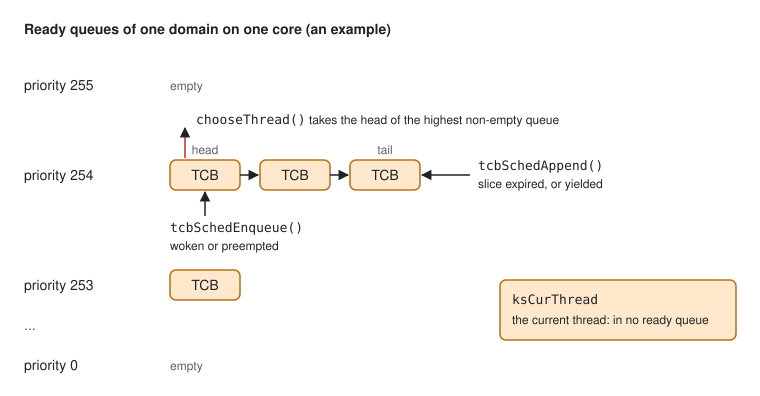

# Scheduling

> seL4's scheduler: 256 fixed priorities with round-robin inside each, found through a two-level bitmap, under an optional fixed-schedule domain scheduler; it decides what runs after every kernel entry, so nearly every kernel patch touches its invariants.

[Index](../INDEX.md) › [Part 4: The seL4 kernel](../INDEX.md#part-4-the-sel4-kernel) › [Model and API](../INDEX.md#model-and-api) · ← [Threads and TCBs](threads.md) · [MCS kernel](mcs.md) →

Read first: [Threads and TCBs](threads.md).

| At a glance | |
|---|---|
| Kind | Kernel mechanism: fixed-priority round-robin scheduler under an optional domain scheduler |
| Key source | [`src/kernel/thread.c`](https://github.com/seL4/seL4/blob/master/src/kernel/thread.c), [`include/kernel/thread.h`](https://github.com/seL4/seL4/blob/master/include/kernel/thread.h), [`include/model/statedata.h`](https://github.com/seL4/seL4/blob/master/include/model/statedata.h) |
| Config options | `KernelNumPriorities` (256), `KernelNumDomains` (1), `KernelNumDomainSchedules` (100), `KernelTimerTickMS` (2), `KernelTimeSlice` (5), `KernelIsMCS` |
| API | `seL4_Yield`, `seL4_TCB_SetPriority`, `seL4_TCB_SetMCPriority`, `seL4_DomainSet_Set` |
| Built on | [Threads and TCBs](threads.md) |
| Used by | Every kernel entry, which ends in `schedule()` |
| Verified | The information-flow proof relies on the domain scheduler |

## What it is

The kernel's scheduling policy is deliberately small:

- **256 priorities** (`CONFIG_NUM_PRIORITIES`, default 256), 0 lowest,
  255 (`seL4_MaxPrio`) highest. Priorities are fixed: the kernel never
  boosts or decays them.
- **Strict priority, preemptive.** The thread that runs is always a
  runnable thread of the highest priority that has one. A thread that
  becomes runnable at a higher priority preempts at once.
- **Round-robin within a priority.** Each priority has a FIFO queue of
  runnable threads. A thread that uses up its **timeslice** goes to the
  back of its queue.
- **No runnable thread**: the per-core [idle thread](threads.md) runs.

There is no fairness between priorities, no load balancing between
cores ([SMP](smp.md): each core has its own queues, and a thread moves
only by `seL4_TCB_SetAffinity`), and no sleeping API: time-based
waiting is built at user level from a timer driver and
[notifications](notifications.md).

### Timeslices on the non-MCS kernel

The classic (non-MCS) kernel takes a periodic timer interrupt every
`CONFIG_TIMER_TICK_MS` milliseconds (default 2). A thread's timeslice
is `CONFIG_TIME_SLICE` ticks (default 5, so 10 ms). Each tick
decrements the current thread's `tcbTimeSlice`; at the end the slice is
refilled and the thread is appended to its queue. Time is charged in
whole ticks to whoever is running when the tick arrives, so accounting
is coarse and a thread can avoid being charged by blocking just before
each tick.

### `seL4_Yield`

A system call with no arguments. On the non-MCS kernel it moves the
caller to the back of its priority's queue; it yields only to threads
of the *same* priority (higher ones would already be running, lower
ones still do not run). On MCS it gives up the rest of the current
budget ([MCS](mcs.md)).

### Maximum controlled priority

Priority is a resource: a thread at 255 that never blocks starves
everything. So setting a priority needs authority. Each thread has a
**maximum controlled priority** (MCP), and
`seL4_TCB_SetPriority(tcb, authority, prio)` succeeds only if `prio` is
at most the MCP of the `authority` TCB; `SetMCPriority` is checked the
same way. See [Threads and TCBs](threads.md).

### Domains

Above priorities sits an optional **domain scheduler**, for strict
time partitioning. With `CONFIG_NUM_DOMAINS` greater than 1 (default
1, maximum 256), every thread belongs to one domain (`tcbDomain`, set
with `seL4_DomainSet_Set` on the `seL4_CapDomain` capability that the
root task receives). The kernel cycles through a **domain schedule**, a
list of (domain, duration) entries, and at any moment only threads of
the current domain are eligible, however high the priority of others.
If the current domain has nothing runnable the core idles until the
domain's time is up.

The point is information flow. Because the schedule is fixed and
does not depend on what threads do, one domain cannot signal another by
how much CPU it uses. seL4's information-flow (non-interference) proof
relies on the domain scheduler for exactly this
([verification](verification.md)); priority scheduling alone leaks.

The schedule was historically a compile-time array. Current upstream
makes it configurable at run time: `ksDomSchedule` has
`CONFIG_NUM_DOMAIN_SCHEDULES` entries (default 100), set with
`seL4_DomainSet_ScheduleConfigure(index, domain, duration)` and
`seL4_DomainSet_ScheduleSetStart(index)`. Duration is in kernel ticks
on non-MCS and timer ticks on MCS. An entry with domain 0 and duration
0 is an end marker that sends the scheduler back to the start index.
After boot, entry 0 is domain 0 with maximum duration.

Domains and SMP exclude each other: `KernelMaxNumNodes` above 1
requires `KernelNumDomains` equal to 1.

### What MCS changes

The [MCS](mcs.md) kernel keeps priorities, queues, bitmap and domains,
and replaces the tick and timeslice. Each thread needs a **scheduling
context** holding a budget and period; time is measured, not counted in
ticks; the timer is programmed one-shot for the next budget expiry or
replenishment; a thread whose budget is spent waits in a **release
queue** until it is replenished; and `timerTick()` gives way to
`checkBudget()`, `chargeBudget()`, `endTimeslice()` and `awaken()`.

## In seL4

Scheduler state (per core through `NODE_STATE()`, declared in
[`include/model/statedata.h`](https://github.com/seL4/seL4/blob/master/include/model/statedata.h)):

| Variable | Meaning |
|---|---|
| `ksCurThread` | The thread that will run on return to user level |
| `ksIdleThread` | This core's idle thread |
| `ksReadyQueues[dom * CONFIG_NUM_PRIORITIES + prio]` | Head and tail of a doubly linked list of TCBs (`tcbSchedNext`/`tcbSchedPrev`) |
| `ksReadyQueuesL1Bitmap[dom]`, `ksReadyQueuesL2Bitmap[dom][i]` | Which queues are non-empty |
| `ksSchedulerAction` | What `schedule()` must do (below) |
| `ksCurDomain`, `ksDomainTime`, `ksDomScheduleIdx`, `ksDomScheduleStart` | Domain scheduler state (global, not per core) |

**The current thread is not in a ready queue.** `switchToThread()`
dequeues the thread it picks; `schedule()` puts the old current thread
back if it is still runnable.

### The bitmap

Finding the highest non-empty queue must be fast and of bounded time,
so the kernel keeps a two-level bitmap. On a 64-bit kernel with 256
priorities:

```
L1 (one word):   bit i set  <=>  some priority in [64i, 64i+63] is non-empty
L2 (four words): bit j of word for group i set  <=>  queue 64i+j is non-empty

highest priority = 64 * (index of top set bit in L1)
                 +      (index of top set bit in that group's L2 word)
```

Two count-leading-zeros instructions (`clzl`) find it:
`getHighestPrio()` in
[`include/kernel/thread.h`](https://github.com/seL4/seL4/blob/master/include/kernel/thread.h).
`addToBitmap()`/`removeFromBitmap()` in `src/object/tcb.c` maintain the
bits when a queue becomes non-empty or empty. The L2 array is indexed
*inverted* (`invert_l1index()`), so that the word for the highest
priorities is next to the L1 word in memory and likely on the same
cache line.

`tcbSchedEnqueue()` puts a thread at the *head* of its queue,
`tcbSchedAppend()` at the *tail*, `tcbSchedDequeue()` removes it. The
`tcbQueued` bit in the thread state makes enqueue and dequeue
idempotent. Code normally uses the `SCHED_ENQUEUE()`/`SCHED_APPEND()`
macros, which on SMP also arrange an inter-processor interrupt if the
thread belongs to another core.



*Which end a thread joins decides the round-robin order: the head for
a woken or preempted thread, the tail for one whose slice expired or
that yielded.*

### `ksSchedulerAction` and `schedule()`

Kernel code never switches threads directly. During a kernel entry it
records an intention in `ksSchedulerAction`, and
[`schedule()`](https://github.com/seL4/seL4/blob/master/src/kernel/thread.c)
acts on it once, at the end, followed by `activateThread()`:

| Value | Meaning | Set by |
|---|---|---|
| `SchedulerAction_ResumeCurrentThread` | Nothing to do | default |
| `SchedulerAction_ChooseNewThread` | Pick from the queues | `rescheduleRequired()`, or `scheduleTCB()` when the current thread stops being runnable |
| a `tcb_t *` | This thread was just woken and may deserve the CPU | `possibleSwitchTo()` |

The third case is an optimisation for IPC: a woken thread is usually
the one to run next, so it is held in `ksSchedulerAction` in place of
being queued and immediately dequeued. `schedule()` then:

1. re-queues the current thread if it is still runnable;
2. for `ChooseNewThread`, calls `scheduleChooseNewThread()`: if
   `ksDomainTime` is 0, `nextDomain()` advances the domain schedule;
   then `chooseThread()` takes the head of the highest non-empty queue
   of `ksCurDomain`, or `switchToIdleThread()`;
3. for a candidate thread, switches to it directly unless a queued
   thread has higher priority (then the candidate is enqueued and the
   normal choice made) or the candidate has the same priority as a
   still-runnable current thread (then the candidate is appended, so
   the current thread keeps the CPU);
4. sets the action back to `ResumeCurrentThread`.

`switchToThread()` calls `Arch_switchToThread()` (which switches the
[address space](vspace.md)), restores FPU ownership lazily, dequeues the
thread and sets `ksCurThread`. Register restore happens later, in the
architecture's exit path.

`possibleSwitchTo(target)` enqueues the target instead if it is in
another domain or on another core, and if a candidate is already
recorded it falls back to `rescheduleRequired()` and queues both.

### Ticks and domain time

On the non-MCS kernel `handleInterrupt()` in
[`src/object/interrupt.c`](https://github.com/seL4/seL4/blob/master/src/object/interrupt.c)
calls `timerTick()` then `resetTimer()` for the kernel timer interrupt.
`timerTick()` handles the timeslice and, when there is more than one
domain, decrements `ksDomainTime` and calls `rescheduleRequired()` at
zero. Each platform's timer driver is programmed for
`CONFIG_TIMER_TICK_MS`: the [local APIC timer](../concepts/lapic-timer.md)
on x86 (`apic_khz * CONFIG_TIMER_TICK_MS`), the
[generic timer](../concepts/arm-generic-timer.md) on most Arm platforms
(`TIMER_RELOAD`).

`seL4_Yield` is `handleYield()` in
[`src/api/syscall.c`](https://github.com/seL4/seL4/blob/master/src/api/syscall.c).

Configuration options (in `config.cmake`): `KernelNumPriorities`,
`KernelNumDomains`, `KernelNumDomainSchedules`, `KernelTimerTickMS` and
`KernelTimeSlice` (both non-MCS only), `KernelIsMCS`.

## Gotchas

- **Enqueue is at the head, append at the tail.** A woken or preempted
  thread goes to the head (it has not had its slice); a thread whose
  slice expired or that yielded goes to the tail. Mixing them up in a
  patch changes round-robin order without breaking any test that only
  checks priorities.
- **A higher-priority thread that never blocks starves all below it**,
  including drivers. Nothing in the kernel ages priorities.
- **`seL4_Yield` does not yield to lower priorities**, and with a
  single thread at its priority it is a no-op costing a kernel entry.
- **The tick is the only clock on non-MCS.** A wrong
  [timer calibration](../concepts/timer-calibration.md) makes ticks the
  wrong length and nothing in the kernel notices.
- **The fastpath duplicates the scheduling decision.** The
  [IPC fastpath](ipc.md) switches threads without calling `schedule()`
  and consults the bitmap itself (`isHighestPrio()`); `schedule()` has
  a comment saying a branch exists "to match fast path". A change to
  the decision in one place must be mirrored in the other.
- **Domain time is global, the queues are per domain.** A thread moved
  to another domain with `seL4_DomainSet_Set` simply stops running
  until that domain's turn; with the boot-time schedule (domain 0
  forever) it never runs again.
- **After configuring the domain schedule, call `ScheduleSetStart`.**
  The manual text says the running entry is not updated otherwise.
- **Older documentation describes a compile-time `ksDomSchedule`**
  (a C file named by `KernelDomainSchedule`). That option is gone from
  upstream's `config.cmake`; releases before the change still use it
  (unchecked: which release first has the run-time schedule).

## See also

- [Threads and TCBs](threads.md): priority, MCP and thread states
- [MCS](mcs.md): scheduling contexts replace timeslices
- [IPC](ipc.md): the fastpath's direct switch
- [SMP](smp.md): per-core queues and reschedule IPIs
- [Verification](verification.md): the information-flow proof that needs domains
- [Kernel design](kernel-design.md): why the kernel is an event handler that schedules once per entry

## References

- [`src/kernel/thread.c`](https://github.com/seL4/seL4/blob/master/src/kernel/thread.c):
  `schedule()`, `chooseThread()`, `switchToThread()`,
  `possibleSwitchTo()`, `rescheduleRequired()`, `timerTick()`,
  `nextDomain()`. *Checked 2026-11-14.*
- [`include/kernel/thread.h`](https://github.com/seL4/seL4/blob/master/include/kernel/thread.h):
  `ready_queues_index()`, `getHighestPrio()`, `isHighestPrio()`.
  *Checked 2026-11-14.*
- [`src/object/tcb.c`](https://github.com/seL4/seL4/blob/master/src/object/tcb.c):
  `tcbSchedEnqueue()`, `addToBitmap()`, `checkPrio()`.
  *Checked 2026-11-14.*
- [`include/object/domain.h`](https://github.com/seL4/seL4/blob/master/include/object/domain.h)
  and the `seL4_DomainSet` interface in
  [`object-api.xml`](https://github.com/seL4/seL4/blob/master/libsel4/include/interfaces/object-api.xml):
  the run-time domain schedule. *Checked 2026-11-14.*
- [`config.cmake`](https://github.com/seL4/seL4/blob/master/config.cmake):
  defaults for `KernelTimerTickMS`, `KernelTimeSlice`,
  `KernelNumDomains`, `KernelNumDomainSchedules`,
  `KernelNumPriorities`. *Checked 2026-11-14.*
- [seL4 Reference Manual](https://sel4.systems/Info/Docs/seL4-manual-latest.pdf),
  sections on scheduling and domains in the threads chapter.
  *Unchecked (not opened today).*
- Murray et al., "seL4: from General Purpose to a Proof of Information
  Flow Enforcement", IEEE S&P 2013: why the domain scheduler exists.
  *Unchecked (from memory).*

## My notes

<!-- Tim writes here. Sessions leave this section as it is. -->
