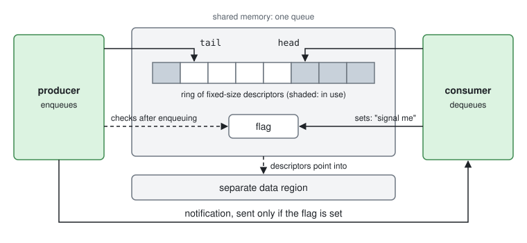

# sDDF (seL4 Device Driver Framework)

> Trustworthy Systems' framework for user-level device drivers on Microkit: small single-purpose protection domains (driver, virtualiser, client) joined by shared-memory queues and notifications, with a common pattern per device class.

[Index](../INDEX.md) › [Part 6: User level](../INDEX.md#part-6-user-level) · ← [Microkit internals](microkit-internals.md) · [sDDF networking](sddf-net.md) →

Read first: [Microkit](microkit.md), [Notifications](notifications.md).

| At a glance | |
|---|---|
| Kind | Framework for user-level device drivers |
| Repository | [au-ts/sddf](https://github.com/au-ts/sddf) |
| Key source | `include/sddf/<class>/queue.h`, `drivers/<class>/<device>/` |
| API | Per-class queue functions; `sddf_notify`, `sddf_deferred_notify`, `sddf_irq_ack`, `sddf_deferred_irq_ack` |
| Built on | [Microkit](microkit.md) (`main` tracks 2.4.0) |
| Used by | [LionsOS and libvmm](lionsos.md) |
| Verified | No; the signalling protocol was model-checked with Spin |

## What it is

In an seL4 system every device driver is an ordinary user program. sDDF
is a set of conventions, queue libraries, ready-made components and
drivers for writing them as [Microkit](microkit.md) protection domains
(PDs), developed by the Trustworthy Systems group at UNSW (GitHub
`au-ts/sddf`). Its README calls it experimental and under active
development; the network class is the mature one.

### Design principles

- **One job per component.** A driver only translates between the
  hardware's interface and the class's queue interface. It contains no
  policy, no multiplexing and no knowledge of its clients.
- **Strict separation of concerns.** Sharing a device among clients is
  done by a separate **virtualiser**; copying, routing and protocol
  work each get their own component where needed.
- **Simple drivers.** Each component is single-threaded and event
  driven (Microkit's `init` and `notified`), which keeps drivers short
  and is meant to make them verifiable.
- **Shared memory, not IPC, carries data.** Neighbours share
  single-producer single-consumer queues of small descriptors, and
  separate data regions that the descriptors point into.
- **Notifications only when needed.** A shared flag says whether the
  other side wants waking.
- **Zero copy where possible.** Buffers are passed by reference; data
  is copied only where isolation demands it.
- **Asynchronous, with priorities doing the scheduling.** Components
  are usually ordered driver highest, then virtualisers, then clients,
  so work drains towards the hardware.

### Roles

```
 client A --+
            +-- virtualiser --- driver --- device
 client B --+
```

| Role | Job |
|---|---|
| **Driver** | the only PD that maps the device's registers and receives its interrupt; speaks the class queue protocol to exactly one neighbour |
| **Virtualiser** | multiplexes one driver among clients, and translates between each client's view (offsets into its own region) and the driver's (addresses the device can use for DMA) |
| **Client** | consumer of the service: an IP stack, a file system, an application, a [guest's virtual device](lionsos.md) |
| **Copier** (network) | copies received packets into a client's private region; see [sDDF networking](sddf-net.md) |

Most classes use two virtualisers, one per direction (`virt_rx`,
`virt_tx`), because receive and transmit share no state.

### Device classes and drivers upstream

Directories under `drivers/` on `main`:

| Class | Drivers (`drivers/<class>/...`) |
|---|---|
| `network` | `virtio` (MMIO and PCI), `imx` (i.MX8 FEC), `meson`, `dwmac-5.10a`, `genet` (Raspberry Pi 4), `zynqmp-gem` |
| `blk` | `virtio`, `mmc` (i.MX uSDHC), `nvme` (x86-64 over PCI) |
| `serial` | `arm` (PL011), `imx`, `meson`, `ns16550a`, `pc99` (x86 COM port through I/O ports), `zynqmp`, `virtio` (console) |
| `timer` | `arm` (generic timer), `imx`, `meson`, `jh7110`, `goldfish`, `cdns`, `bcm2835`, `rk3399`, `rk3568`, `apb_timer`, `tsc_hpet` (x86) |
| `i2c` | `meson`, `imx`, `opentitan` |
| `gpu` | `virtio` (2D only) |

`include/sddf/` also has `sound`, `pci`, `virtio` and `benchmark`
headers. `docs/drivers.md` lists the device-tree compatible strings
each driver is known to work with. There is no driver for
[ENA](../concepts/ena.md) or [gVNIC](../concepts/gvnic.md).

### The queue pattern

Every class defines a queue header (`include/sddf/<class>/queue.h`)
with the same shape: a ring of fixed-size descriptors in a shared
memory region, a `head` index written only by the consumer and a `tail`
index written only by the producer. Because each index has one writer,
no locks are needed, even across cores (the headers add memory barriers
under `CONFIG_ENABLE_SMP_SUPPORT`). Queues come in pairs, one per
direction of ownership: for networking, a **free** queue of empty
buffers and an **active** queue of full ones.

### The signalling protocol

Notifying on every enqueue wastes time: the receiver is often already
running, or will be woken for another reason. So each queue carries a
flag, set by the consumer, saying "signal me when you add something".
The producer checks it after enqueuing and notifies only if it is set.
(How the flag is stored varies by class: the network queues' field is
`consumer_signalled`, where 0 means "signal me"; see
[sDDF networking](sddf-net.md).)



*One queue and its signalling flag. Each index has a single writer, and the data the descriptors point into lives in a separate region.*

The danger is the lost wake-up: the consumer finds the queue empty and
decides to sleep, the producer enqueues and sees the flag still clear,
and then the consumer sets the flag and sleeps for ever. The rule every
consumer loop follows:

```c
bool reprocess = true;
while (reprocess) {
    while (!queue_empty(q)) { /* dequeue and handle */ }
    request_signal(q);              /* "wake me" */
    reprocess = false;
    if (!queue_empty(q)) {          /* re-check: raced with the producer */
        cancel_signal(q);
        reprocess = true;
    }
}
```

and every producer: enqueue, then `if (require_signal(q)) {
cancel_signal(q); notify(ch); }`. The protocol was model-checked for
deadlock freedom with Spin (models in `examples/echo_server/models`).

Components call `sddf_notify`, `sddf_deferred_notify`, `sddf_irq_ack`
and `sddf_deferred_irq_ack`, thin wrappers over the `microkit_*`
functions, with the deferred forms used for the last signal of an
invocation so that it merges with the next wait.

### Assembling a system

Writing the system description file (SDF) for a dozen PDs, queue
regions and channels by hand does not scale, so each example has a
**metaprogram** (`meta.py`). It uses **Acacia** (Python package
`acacia`, repository `au-ts/microkit_acacia`, plus the in-tree
`acacia_sddf/` module with classes such as `sDDFEthernet`, `sDDFSerial`,
`sDDFTimer`, `sDDFLWIP`). Acacia is the successor of the tool earlier
documentation calls `sdfgen` (unchecked: the exact lineage). The
metaprogram:

1. reads the board's [device tree](../concepts/device-tree.md) from
   `dts/` and finds the device node for each driver, matching the
   `compatible` strings in the driver's `config.json`;
2. creates PDs, memory regions (device registers at their physical
   address, queue and data regions), IRQs and channels, and writes the
   SDF;
3. writes one binary **config struct** per component, for example
   `net_driver_config_t` or `device_resources_t`, into a `.data` file,
   which the build copies into a named ELF section of the component
   (`.device_resources`, `.net_virt_rx_config`, ...).

At run time the component just reads the struct, after checking its
magic bytes (`'s','D','D','F'` and a class number):

```c
__attribute__((__section__(".device_resources"))) device_resources_t device_resources;
/* device_resources.regions[i].region.vaddr, .io_addr; device_resources.irqs[i].id */
```

So a driver gets its **device memory** as memory regions with
`phys_addr` mapped uncached into it, **DMA memory** as regions whose
physical address (`io_addr`) it is told, and its **interrupt** as an
`irq` element whose channel number is in `irqs[i].id`.

The build is GNU Make: each driver and component ships a snippet
(`eth_driver.mk`, `network_components.mk`, `serial_components.mk`)
that a project Makefile includes after `tools/make/sddf.mk`
(`docs/makefiles.md`). Clang is the default compiler. There is no Zig
build on `main` any more (older documentation mentions `build.zig`).

### Timer and serial

The **timer** class has no virtualiser: the driver PD is a
server and clients make protected procedure calls,
`sddf_timer_time_now(ch)` (nanoseconds since start) and
`sddf_timer_set_timeout(ch, ns)`, after which the client is notified on
the channel when the time has passed. The driver keeps one timeout per
client and programs the hardware for the earliest (unchecked: one per
client). This is what gives a Microkit system `sleep`.

The **serial** class has `virt_tx` and `virt_rx` between driver and
clients, with byte queues (`include/sddf/serial/queue.h`). `virt_tx`
merges clients' output, optionally tagging or colouring it per client;
`virt_rx` routes input to one client at a time, switched by an escape
sequence typed on the console (unchecked: the exact sequence).
`sddf_printf` in `util/` can print through either the serial subsystem
or the kernel debug console.

### x86-64 status

Present on `main`: the `pc99` serial driver (I/O ports), the `tsc_hpet`
timer ([TSC](../concepts/tsc.md), [HPET](../concepts/hpet.md)), NVMe,
and virtio block and network over [PCI](../concepts/pci.md). The
`echo_server`, `blk`, `serial` and `timer` examples accept
`MICROKIT_BOARD=x86_64_generic`, the first "only QEMU right now". There
is no general PCI bus driver or enumeration component: see Gotchas.

## In seL4

Not kernel code. Layout of [au-ts/sddf](https://github.com/au-ts/sddf):

| Path | Contents |
|---|---|
| `include/sddf/<class>/` | queue and config headers; `resources/device.h` |
| `drivers/<class>/<device>/` | drivers, each with a `.mk` snippet and `config.json` |
| `network/`, `serial/`, `blk/`, `i2c/`, `gpu/`, `sound/` | class components (virtualisers, copier), libraries |
| `util/`, `libco/` | printf, allocators, cache operations; coroutines for blocking-style clients |
| `acacia_sddf/`, `tools/` | system generation and Make support |
| `examples/` | one system per class, plus `echo_server` |
| `docs/` | `developing.md`, `drivers.md`, `makefiles.md`, per-class notes, `design/` (the design document's source) |
| `dts/` | device trees of supported boards |

Kernel features sDDF leans on: [notifications](notifications.md) and
bound notifications, [MCS](mcs.md) budgets and passive servers,
[IRQ handler capabilities](irq-handling.md), and on x86 I/O port
capabilities and I/O APIC or MSI interrupts set up through the SDF.

## Gotchas

- **x86 device details are hard-coded in places.** On `main` the virtio
  network driver, when built for x86-64, assumes the device at PCI
  address 00:02.0, interrupt channel 16 and fixed ring-buffer addresses
  (`0x70000000` virtual, `0x7a000000` physical), under comments asking
  for a fix. A cloud port needs real PCI discovery
  ([ACPI](../concepts/acpi-tables.md), ECAM) and MSI-X; branches such
  as `billn/acpi_pcie` show work in progress, not upstream state.
- **Arm and RISC-V drivers find devices by device tree only.** A board
  needs its `.dts` in `dts/` and an entry in `acacia_sddf/board.py`.
- **The tooling moves.** Hand-written SDFs, then `sdfgen`, now Acacia;
  sDDF `main` tracks a specific Microkit release (2.4.0 now). Match
  them.
- **A driver must not trust queue contents** from a less trusted
  neighbour: descriptors are checked for alignment and range before
  use, and a patch that adds a queue consumer needs the same checks.
- **Forgetting the re-check** after setting the signal flag produces a
  system that hangs only under load.
- **Driver priority matters.** The examples assume the driver outranks
  its virtualisers; changing priorities changes batching behaviour and
  throughput.
- **DMA without an IOMMU is trusted.** A driver that programs arbitrary
  physical addresses into a device can reach any memory unless
  Microkit's `io_address_space` ([IOMMU](../concepts/iommu.md)) confines
  the device.

## See also

- [sDDF networking](sddf-net.md): the network class in full
- [Microkit](microkit.md): the PDs, channels and memory regions underneath
- [LionsOS and libvmm](lionsos.md): the OS built from these components
- [virtio](../concepts/virtio.md): the device family behind the QEMU drivers
- [Device tree](../concepts/device-tree.md): what the metaprogram reads
- [IRQ handling](irq-handling.md): how an interrupt reaches a driver PD
- [Index](../INDEX.md): the reading order
- [NVMe](../concepts/nvme.md): the standard PCI storage controller interface, and the one EC2 uses for every disk and Compute Engine for...
- [Ecosystem and repositories](ecosystem.md): seL4 is some thirty repositories in two GitHub organisations
- [rust-sel4](rust-sel4.md): `seL4/rust-sel4` is the Rust support for seL4 user level
- [seL4_libs and util_libs](sel4-libs.md): the classic C libraries for building dynamic systems on seL4

## References

- [sDDF `README.md`](https://github.com/au-ts/sddf/blob/main/README.md): status, dependencies (Microkit 2.4.0, Acacia). *Checked 2026-11-14.*
- [`docs/developing.md`](https://github.com/au-ts/sddf/blob/main/docs/developing.md): the metaprogram, adding a board, the signalling protocol and its Spin models. *Checked 2026-11-14.*
- [`docs/drivers.md`](https://github.com/au-ts/sddf/blob/main/docs/drivers.md): drivers and compatible strings. *Checked 2026-11-14.*
- [`docs/makefiles.md`](https://github.com/au-ts/sddf/blob/main/docs/makefiles.md): the Make snippets. *Checked 2026-11-14.*
- [`include/sddf/resources/device.h`](https://github.com/au-ts/sddf/blob/main/include/sddf/resources/device.h): `device_resources_t`. *Checked 2026-11-14.*
- [`include/sddf/timer/client.h`](https://github.com/au-ts/sddf/blob/main/include/sddf/timer/client.h): the timer client calls. *Checked 2026-11-14.*
- [`drivers/network/virtio/common/ethernet.c`](https://github.com/au-ts/sddf/blob/main/drivers/network/virtio/common/ethernet.c): the hard-coded x86 values. *Checked 2026-11-14.*
- [sDDF design document](https://trustworthy.systems/projects/drivers/sddf-design.pdf): the principles and measurements, by Heiser and others; source in `docs/design/`. *Unchecked.* PDF not opened today; principles above are from memory of it and from the code.
- [Trustworthy Systems driver project page](https://trustworthy.systems/projects/drivers/): papers and theses. *Unchecked.* Not opened today.
- [Acacia](https://github.com/au-ts/microkit_acacia): the system-generation tooling. *Unchecked.* Named by the README; repository not opened.

## My notes

<!-- Tim writes here. Sessions leave this section as it is. -->
