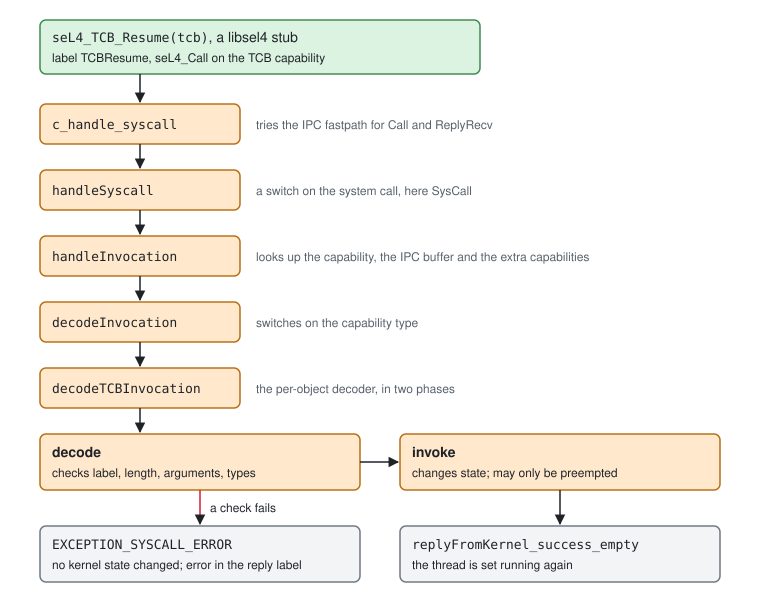

# System calls and invocations

> seL4 has only about a dozen real system calls, all forms of sending to or receiving from a capability; every operation on a kernel object is an invocation, a message sent to the object's capability whose label selects the method, which the kernel decodes and answers itself.

[Index](../INDEX.md) › [Part 4: The seL4 kernel](../INDEX.md#part-4-the-sel4-kernel) › [Model and API](../INDEX.md#model-and-api) · ← [Untyped memory and retyping](untyped-memory.md) · [Threads and TCBs](threads.md) →

Read first: [Capabilities](capabilities.md), [CSpaces](cspace.md).

| At a glance | |
|---|---|
| Kind | Kernel mechanism: the system call interface |
| Key source | [`src/api/syscall.c`](https://github.com/seL4/seL4/blob/master/src/api/syscall.c), [`src/object/objecttype.c`](https://github.com/seL4/seL4/blob/master/src/object/objecttype.c), [`libsel4/include/api/syscall.xml`](https://github.com/seL4/seL4/blob/master/libsel4/include/api/syscall.xml) |
| Config options | `CONFIG_PRINTING`, `CONFIG_DEBUG_BUILD`, `CONFIG_ENABLE_BENCHMARKS`, `CONFIG_VTX`, `CONFIG_SET_TLS_BASE_SELF` add system calls |
| API | `seL4_Send`, `seL4_NBSend`, `seL4_Call`, `seL4_Recv`, `seL4_NBRecv`, `seL4_ReplyRecv`, `seL4_Yield`; more on [MCS](mcs.md) |
| Built on | [Capabilities](capabilities.md), [CSpaces](cspace.md) |
| Used by | The libsel4 stubs ([libsel4](libsel4.md)), which all use Call |
| Verified | The proofs rely on the decode/invoke split; the debug and benchmark calls are in no verified configuration |

## What it is

### The system calls

A seL4 system call names a capability and either sends a message to
it, waits for one from it, or both. There is no `open`, `mmap` or
`fork`: there is "send" and "receive".

| System call | Classic kernel | MCS kernel | Meaning |
|---|---|---|---|
| `seL4_Send` | yes | yes | Send a message; block until delivered |
| `seL4_NBSend` | yes | yes | Send if the receiver is ready now, else drop it silently |
| `seL4_Call` | yes | yes | Send, then block for the reply |
| `seL4_Recv` | yes | yes | Block for a message on an endpoint or notification |
| `seL4_NBRecv` | yes | yes | Poll: receive if something is there |
| `seL4_Reply` | yes | no | Reply to the last caller (through the implicit reply capability) |
| `seL4_ReplyRecv` | yes | yes | Reply, then Recv, in one kernel entry: a server's main loop |
| `seL4_Yield` | yes | yes | Give up the rest of the time slice |
| `seL4_Wait` | no | yes | Recv without supplying a reply object (notifications) |
| `seL4_NBWait` | no | yes | Polling form of Wait |
| `seL4_NBSendRecv` | no | yes | NBSend on one capability, then Recv on another |
| `seL4_NBSendWait` | no | yes | NBSend on one capability, then Wait on another |

"NB" is non-blocking. Under [MCS](mcs.md) replies go through explicit
Reply objects, so `Reply` is gone (a server does an `NBSend` to the
reply capability, or `ReplyRecv`) and receive calls carry a reply
capability argument. On non-MCS kernels libsel4 provides `seL4_Wait`
as a plain function wrapping `seL4_Recv`.

Further system calls exist only in special builds: with
`CONFIG_PRINTING`, `seL4_DebugPutChar` and `seL4_DebugDumpScheduler`;
with `CONFIG_DEBUG_BUILD`, `seL4_DebugHalt`, `seL4_DebugCapIdentify`,
`seL4_DebugSnapshot`, `seL4_DebugNameThread`; with
`CONFIG_ENABLE_BENCHMARKS`, the `seL4_Benchmark*` family; with
`CONFIG_VTX`, `seL4_VMEnter`; with `CONFIG_SET_TLS_BASE_SELF`,
`seL4_SetTLSBase`. None is in a verified configuration
([debugging](debugging.md)).

### Invocations

What happens on a send depends on the capability's type:

- an **endpoint**: the message goes to another thread ([IPC](ipc.md));
- a **notification**: its badge is signalled
  ([notifications](notifications.md));
- **anything else**: the kernel itself is the receiver. It treats the
  message as a method call on the object: an **invocation**.

So `seL4_TCB_Resume(tcb)` is not a system call. It is a libsel4 stub
that builds a message whose label is the number `TCBResume` and does
`seL4_Call` on the TCB capability; the kernel performs the operation
and "replies" with a result. An invocation made with `seL4_Send`
instead of `seL4_Call` still happens, but no error or result comes
back.

### The message

A message is a **message info** word (the "tag"), up to
`seL4_MsgMaxLength` (120) words of data in **message registers**
(MRs), and up to 3 capabilities.

`seL4_MessageInfo_t`, one word, on 64-bit:

| Field | Bits | Meaning |
|---|---|---|
| `label` | 52 | Free for user IPC; the method number for invocations; the error code in an invocation's reply |
| `capsUnwrapped` | 3 | Set by the kernel on receive: which transferred capabilities were turned into badges |
| `extraCaps` | 2 | Number of capabilities sent, 0 to 3 |
| `length` | 7 | Number of message words |

The first few MRs travel in CPU registers (`seL4_FastMessageRegisters`,
4 on the 64-bit architectures); the rest live in the thread's **IPC
buffer**, a `seL4_IPCBuffer` structure in a frame the thread shares
with the kernel (set with `seL4_TCB_SetIPCBuffer`, at most
2^`seL4_IPCBufferSizeBits` = 1024 bytes). It also holds the CPtrs of
capabilities being sent (`caps_or_badges`) and the slot where a
received capability should go (`receiveCNode`, `receiveIndex`,
`receiveDepth`). The register use:

| | Capability | Message info | MR0 to MR3 | System call number |
|---|---|---|---|---|
| x86-64 | `rdi` | `rsi` | `r10`, `r8`, `r9`, `r15` | `rdx` |
| AArch64 | `x0` | `x1` | `x2` to `x5` | `x7` |
| RISC-V | `a0` | `a1` | `a2` to `a5` | `a7` |

For an invocation, the method's non-capability arguments are packed
into MRs in order and its capability arguments are the extra
capabilities. `seL4_Untyped_Retype`, for example, is label
`UntypedRetype`, six MRs and one extra capability (`root`).

### Errors

An invocation's reply has the error in its label. libsel4 returns it
as `seL4_Error`:

| Value | Name | Typical cause |
|---|---|---|
| 0 | `seL4_NoError` | |
| 1 | `seL4_InvalidArgument` | A non-capability argument is bad; MR0 says which |
| 2 | `seL4_InvalidCapability` | A capability argument is the wrong type; MR0 says which |
| 3 | `seL4_IllegalOperation` | This capability type has no such method, or rights are missing |
| 4 | `seL4_RangeError` | Argument out of range; MR0 and MR1 give the allowed range |
| 5 | `seL4_AlignmentError` | An address is not suitably aligned |
| 6 | `seL4_FailedLookup` | A root, index, depth triple did not resolve; MRs describe the lookup failure |
| 7 | `seL4_TruncatedMessage` | Too few MRs or extra capabilities for the method |
| 8 | `seL4_DeleteFirst` | A destination slot is not empty |
| 9 | `seL4_RevokeFirst` | The object has derived children |
| 10 | `seL4_NotEnoughMemory` | An untyped is too small; MR0 gives bytes left |

(Which MR carries which detail is from the manual, section 10.1.) A bad
CPtr for the *invoked* capability is not an error return: it raises a
cap fault to the thread's [fault handler](faults.md).

## In seL4

**Entry.** Architecture trap code saves registers and calls a C entry
point (`c_handle_syscall` in `src/arch/<arch>/c_traps.c`), which tries
the IPC fastpath for `Call` and `ReplyRecv` and otherwise calls
`handleSyscall(syscall)` in
[`src/api/syscall.c`](https://github.com/seL4/seL4/blob/master/src/api/syscall.c)
(names checked in the Arm `c_traps.c` only; see
[kernel design](kernel-design.md)). Numbers outside the main set go to
`handleUnknownSyscall`, which implements the debug and benchmark calls
and otherwise raises an unknown-syscall fault.

**`handleSyscall`** is a switch:

| Case | Does |
|---|---|
| `SysSend` | `handleInvocation(isCall=false, isBlocking=true)` |
| `SysNBSend` | `handleInvocation(false, false)` |
| `SysCall` | `handleInvocation(true, true)` |
| `SysRecv`, `SysNBRecv` | `handleRecv(isBlocking)` |
| `SysReply` (non-MCS) | `handleReply()` |
| `SysReplyRecv` | non-MCS: `handleReply()` then `handleRecv`; MCS: `handleInvocation` on the reply capability then `handleRecv` |
| `SysNBSendRecv`, `SysNBSendWait`, `SysWait`, `SysNBWait` (MCS) | combinations of the above |
| `SysYield` | `handleYield()` |

and it ends, always, with `schedule(); activateThread();`. On MCS the
whole switch is wrapped in `MCS_DO_IF_BUDGET`, which first charges the
time used and checks the thread has budget left.

**`handleInvocation`** does the generic half:

1. read the message info from `msgInfoRegister` and the CPtr from
   `capRegister`;
2. `lookupCapAndSlot`: failure makes a cap fault (`handleFault`, only
   if the call was blocking);
3. `lookupIPCBuffer`, `lookupExtraCaps`: resolve the extra capability
   CPtrs into `current_extra_caps`;
4. `decodeInvocation(label, length, cptr, slot, cap, isBlocking,
   isCall, buffer)`;
5. on `EXCEPTION_SYSCALL_ERROR`: if this was a Call,
   `replyFromKernel_error` writes `current_syscall_error` into the
   caller's registers as the reply; on `EXCEPTION_PREEMPTED`: return
   it, so the caller is left to restart the system call; on success
   with the thread still in `ThreadState_Restart`:
   `replyFromKernel_success_empty` and set it running.

**`decodeInvocation`** in
[`src/object/objecttype.c`](https://github.com/seL4/seL4/blob/master/src/object/objecttype.c)
switches on the capability type: architecture capabilities go to
`Arch_decodeInvocation`; endpoint, notification and reply capabilities
to `performInvocation_Endpoint` and friends (after a rights check such
as `capCanSend`); the rest to a per-object decoder,
`decodeTCBInvocation`, `decodeCNodeInvocation`,
`decodeUntypedInvocation`, `decodeIRQControlInvocation`,
`decodeDomainInvocation`, `decodeSchedContextInvocation` and so on,
each in its object's file.

Every decoder follows the same two-phase shape, which the proofs rely
on and reviewers enforce:

- **decode**: check the label, `length`, argument ranges and
  capability types, reading arguments with `getSyscallArg(i, buffer)`
  (register or IPC buffer as needed). Any failure sets
  `current_syscall_error` and returns `EXCEPTION_SYSCALL_ERROR`
  *before any kernel state has changed*;
- **invoke**: `setThreadState(ksCurThread, ThreadState_Restart)`, then
  call the `invoke*`/`perform*` function, which is not allowed to fail
  (it may only be preempted).

*The only way out with an error is from decode, before any kernel state
has changed; invoke cannot fail.*

**Where the interface is defined.** System calls are listed in
[`libsel4/include/api/syscall.xml`](https://github.com/seL4/seL4/blob/master/libsel4/include/api/syscall.xml)
(separate `api-master` and `api-mcs` lists, then `debug`). Object
methods are in interface XML: generic ones in
[`libsel4/include/interfaces/object-api.xml`](https://github.com/seL4/seL4/blob/master/libsel4/include/interfaces/object-api.xml),
architecture ones in
`libsel4/arch_include/<arch>/interfaces/object-api-arch.xml` and
`libsel4/sel4_arch_include/<sel4arch>/interfaces/object-api-sel4-arch.xml`.
Build-time Python tools turn these into the kernel's invocation label
enumeration, the libsel4 stubs (`seL4_Untyped_Retype` and the rest)
and the API chapter of the manual
([generated code](generated-code.md), [libsel4](libsel4.md)). Adding a
method therefore means: an XML entry with documentation, a decode
case, an invoke function, and for a verified configuration a matching
change to the specifications and proofs
([proof impact](proof-impact.md)).

The types in play (`seL4_MessageInfo`, `seL4_CapRights`,
`seL4_CNode_CapData`) are bitfield definitions in
`libsel4/mode_include/<bits>/sel4/shared_types.bf`, shared by kernel
and user level.

## Gotchas

- **Send-type invocations swallow errors.** Using `seL4_Send` or
  `seL4_NBSend` on a kernel object performs the method but reports
  nothing. The libsel4 stubs all use Call.
- **Label numbers are not stable.** They are generated from the XML
  for each configuration, so they shift between architectures, between
  MCS and non-MCS, and between releases. Nothing should hard-code
  them; tools that emit raw invocations
  ([Microkit](microkit-internals.md)) regenerate them per kernel.
- **System call numbers are negative** and differ between MCS and
  non-MCS: they count down from -1 in the order of `syscall.xml`, so
  `SysCall` is -1 and `SysReplyRecv` -2 in both, and the rest differ.
- **Without an IPC buffer, messages are truncated** to the register
  MRs, silently in release builds; invocations with more arguments
  then fail with `seL4_TruncatedMessage`.
- **`userError` is the fastest diagnosis.** Decode failures print a
  reason in debug builds (`KernelPrinting`); the error code alone is
  often ambiguous.
- **A preempted invocation restarts from the top.** Long operations
  (revoke, untyped reset) return `EXCEPTION_PREEMPTED`; the thread
  re-executes the system call instruction, and decode runs again
  against the partly changed state. Decode checks must therefore be
  written so a half-done operation is a valid starting point.
- **Checks belong in decode.** A patch that can fail after state has
  changed breaks the decode/invoke discipline and will not verify.
- **`seL4_Wait` differs by kernel.** A real system call on MCS, a
  wrapper for `Recv` otherwise; code shared between the two should use
  the libsel4 names and not assume.
- **Cap fault versus error.** A wrong CPtr for the invoked capability
  gives a fault (or nothing at all for a non-blocking send); a wrong
  CPtr in an argument triple gives `seL4_FailedLookup`.

## See also

- [Capabilities](capabilities.md) and [CSpaces](cspace.md): what is being invoked and how its CPtr resolves
- [IPC and endpoints](ipc.md): what the same system calls do on an endpoint
- [Notifications](notifications.md): signals and `Wait`
- [Faults and fault handlers](faults.md): cap faults and unknown-syscall faults
- [MCS kernel](mcs.md): why its system call set differs
- [libsel4 and the runtime](libsel4.md): the stubs and the IPC buffer
- [Generated code](generated-code.md): from XML to labels and stubs
- [Kernel design and execution model](kernel-design.md): kernel entry, the fastpath, preemption and restart
- [x86-64](../concepts/x86-exceptions-syscalls.md), [AArch64](../concepts/aarch64-exceptions.md), [RISC-V](../concepts/riscv-paging-and-traps.md): how a system call instruction enters the kernel
- [Source layout](source-layout.md): A tour of the `seL4/seL4` repository

## References

- [libsel4 `include/api/syscall.xml`](https://github.com/seL4/seL4/blob/master/libsel4/include/api/syscall.xml):
  the system call lists and their configuration conditions.
  *Checked 2026-11-14.*
- [seL4 `src/api/syscall.c`](https://github.com/seL4/seL4/blob/master/src/api/syscall.c):
  `handleSyscall`, `handleInvocation`. *Checked 2026-11-14.*
- [seL4 `src/object/objecttype.c`](https://github.com/seL4/seL4/blob/master/src/object/objecttype.c):
  `decodeInvocation`. *Checked 2026-11-14.*
- [libsel4 `include/sel4/errors.h`](https://github.com/seL4/seL4/blob/master/libsel4/include/sel4/errors.h):
  `seL4_Error` values. *Checked 2026-11-14.*
- [libsel4 `mode_include/64/sel4/shared_types.bf`](https://github.com/seL4/seL4/blob/master/libsel4/mode_include/64/sel4/shared_types.bf):
  `seL4_MessageInfo` field widths. *Checked 2026-11-14.*
- [libsel4 `include/sel4/constants.h`](https://github.com/seL4/seL4/blob/master/libsel4/include/sel4/constants.h):
  `seL4_MsgMaxLength` 120, `seL4_MsgExtraCapBits` 2; and the x86_64
  and aarch64 `constants.h` for `seL4_FastMessageRegisters` 4 and
  `seL4_IPCBufferSizeBits` 10. *Checked 2026-11-14.*
- [libsel4 `include/interfaces/object-api.xml`](https://github.com/seL4/seL4/blob/master/libsel4/include/interfaces/object-api.xml):
  the generic object methods (file list and the Untyped interface
  read). *Checked 2026-11-14.*
- [seL4 Reference Manual](https://sel4.systems/Info/Docs/seL4-manual-latest.pdf),
  version 17.0.0, sections 2.2 "System Calls", 4.1 "Message Registers"
  and 10.1 "Error Codes": the user's view, including which MR carries
  which error detail. *Checked 2026-11-14.*
- [seL4 `src/arch/x86/64/machine/registerset.c`](https://github.com/seL4/seL4/blob/master/src/arch/x86/64/machine/registerset.c)
  with [`include/arch/x86/arch/64/mode/machine/registerset.h`](https://github.com/seL4/seL4/blob/master/include/arch/x86/arch/64/mode/machine/registerset.h)
  and [`src/arch/x86/64/traps.S`](https://github.com/seL4/seL4/blob/master/src/arch/x86/64/traps.S)
  (and the `arm/64` and `riscv` equivalents, with libsel4's
  `syscalls.h` for the system call number register): `capRegister`,
  `msgInfoRegister`, `msgRegisters[]`. *Checked 2026-11-14.*
- [seL4 `tools/syscall_header_gen.py`](https://github.com/seL4/seL4/blob/master/tools/syscall_header_gen.py):
  system call numbers count down from -1. *Checked 2026-11-14.*
